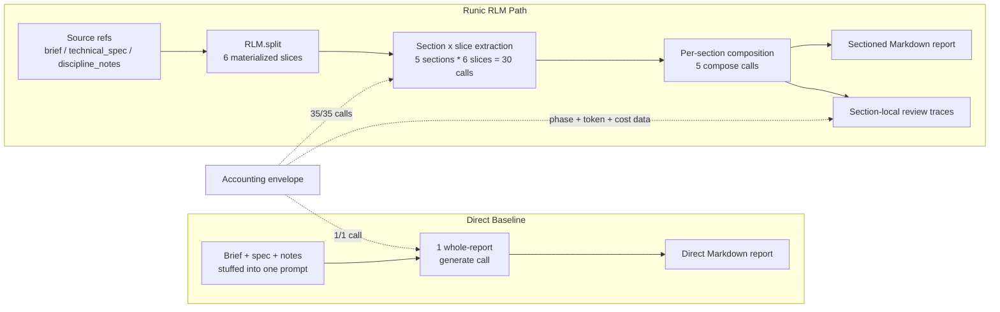
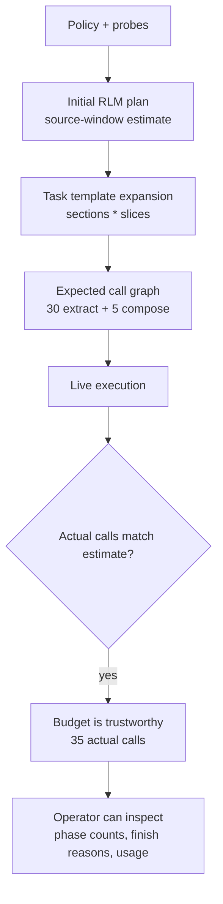

# Phase 9 RLM Medium Report Generation Benchmark Report

Date: April 24, 2026

## Purpose

This report records a provider-backed manual benchmark of the new Phase 9 RLM
execution slice against a direct whole-context report generation baseline.

The exercise was adapted from the report-generation shape discussed in
`https://theharness.blog/blog/recursive-by-design/` and from the lambda-RLM
style of deterministic, typed, bounded decomposition described at
`https://github.com/lambda-calculus-LLM/lambda-RLM`.

The benchmark is not intended to prove that RLM is cheaper for small or medium
inputs. It is intended to test whether RunicAI can execute a report-generation
workflow through externalized source material, bounded leaf calls, deterministic
composition, per-section review, and exact call accounting.

## Script

Manual script:

```bash
scripts/rlm_report_generation_smoke.exs
```

Final live command:

```bash
mix run scripts/rlm_report_generation_smoke.exs \
  --live \
  --mode both \
  --task-size medium \
  --chunk-size 1200 \
  --overlap 120 \
  --max-tokens 900 \
  --output tmp/rlm_report_generation_medium_fair_live.json
```

Static outputs:

- `tmp/rlm_report_generation_medium_fair_live.json`
- `tmp/rlm_report_generation_medium_fair_live_direct.md`
- `tmp/rlm_report_generation_medium_fair_live_runic_rlm.md`

The script defaults to dry-run mode unless `--live` or `RUNIC_AI_RLM_LIVE=1`
is provided. It writes the full generated reports to Markdown files next to the
JSON result.

## Task Shape

Model: `openai:gpt-5.4-mini`

Task: `north_pier_scope_of_works_medium`

Sources:

| Source | Characters |
| --- | ---: |
| `brief` | 1,576 |
| `technical_spec` | 1,457 |
| `discipline_notes` | 1,542 |

Sections:

1. Project Objectives
2. Technical Scope
3. Risks And Interfaces
4. Assumptions And Exclusions
5. Executive Summary

The RLM path split the sources into 6 materialized slices. For each section it
ran one extraction pass per slice, then one composition pass per section:

```text
30 extract calls + 5 compose calls = 35 RLM calls
```

The direct path used one whole-context report call. Its output budget was set
to `max_tokens * section_count` to avoid unfairly clipping the whole-report
baseline while the RLM path received per-section output budgets.

## Visual Model

The benchmark compared a direct whole-context generation path with a bounded
RLM dataflow path over the same source material and output contract.



The RLM path is more expensive on this medium input, but it exposes a reusable
execution mechanism: bounded local reads, typed intermediate artifacts,
deterministic composition, and reviewable accounting.



## Results

| Metric | Direct | Runic RLM |
| --- | ---: | ---: |
| Rubric score | 10/10 | 10/10 |
| Calls | 1 | 35 |
| Call estimate exact | 1/1 | 35/35 |
| Phases | `generate: 1` | `extract: 30`, `compose: 5` |
| Finish reasons | `stop: 1` | `stop: 35` |
| Input tokens | 1,049 | 15,784 |
| Output tokens | 1,641 | 6,737 |
| Total tokens | 2,690 | 22,521 |
| Estimated cost | $0.008171 | $0.042154 |
| Elapsed time | 11.459s | 76.102s |
| Output characters | 8,912 | 12,721 |

Both approaches hit every coarse rubric marker:

- operational continuity
- throughput
- spoilage
- WMS
- security
- cabling conflict
- discipline leads
- exclusions
- definitions
- client idioms

The RLM path also recorded section-local review scores. Every generated section
hit every marker expected for that section.

## Interpretation

For this medium task, the direct call is cheaper and faster. That is expected:
the entire source set is still well within the model's context window, and a
single model call can synthesize the report without needing decomposition.

The RLM path bought different properties:

- exact call predictability before execution
- external source storage instead of stuffing every source into the root prompt
- bounded leaf extraction over materialized slices
- phase-level accounting for extract versus compose work
- section-local review traces
- reusable output artifacts for direct and RLM reports
- a workflow shape that can grow into child workflows, continuations, and
  dynamic plan patches

That is the important computational contract. RLM is not merely a cheaper
summarizer; it is a way to turn report generation into a typed, inspectable,
bounded dataflow computation.

## What Mattered

The most important success is that the RLM call estimate matched exactly. The
script predicted 35 calls, and the live provider-backed run made 35 calls.
This matters because budget, scheduling, continuation, and operator review all
need a reliable execution envelope.

The second important success is that all calls stopped normally. The final run
recorded `stop` for the direct baseline and for all 35 RLM calls. An earlier
medium attempt used too small a direct output cap and produced a report that
appeared to end mid-sentence while still hitting the coarse marker rubric. That
made output-budget fairness visible as a benchmark requirement, so the direct
baseline was rerun with aggregate whole-report output budget.

The third important success is that the generated RLM Markdown report is usable
as a report artifact. It is more verbose than the direct report, but it is
complete, sectioned, and traceably derived from bounded extraction/composition
passes.

## Comparison To Lambda-RLM Style

The relevant lambda-RLM idea is not the exact implementation language. The
useful comparison is the structured execution pattern:

- decompose a larger objective into typed subcalls
- constrain each subcall's visible context
- compose results deterministically
- keep accounting visible
- make the plan inspectable

RunicAI now has a first version of that shape using Runic-native components and
RLM contracts. The current implementation is simpler than a full recursive
fixed-point system, but it exercises the same core idea: the workflow can
generate useful report sections from bounded local contexts and then compose a
global artifact.

## Gaps And Improvements

The coarse marker rubric is useful as a smoke test, but not sufficient as an
evaluator. It can pass a report that mentions every keyword while missing
structure, over-including facts, or ending awkwardly. A stronger evaluator should
check section focus, completeness, hallucination risk, citation/provenance
coverage, and finish status.

The current planner estimate is source-window oriented. In this benchmark the
default plan estimated 4 leaf calls from total source size, while the script's
section-expanded execution made 30 extraction calls. The script correctly
reported the expanded estimate, but this should become first-class in the RLM
planner: template sections, review dimensions, and repeated passes should be
explicit plan nodes or expansion parameters.

The RLM path is sequential today. The 35-call run took 76.102 seconds mostly
because it made many small provider round trips. Leaf extraction is naturally
parallelizable. A next pass should execute independent leaf calls with Runic
async evaluation or a bounded `Task.async_stream/3` policy while preserving
trace and budget accounting.

The section prompts need stricter focus controls. The RLM report is complete,
but some sections include adjacent facts that would be better confined to
another section. This is a useful prompt and contract improvement: composition
should include negative guidance, section schemas, or a cleanup/review pass.

No Benchee benchmark was added. For this exercise, real provider latency and
model behavior were the point, so a manual integration measurement was more
informative than local microbenchmarking. Benchee would be useful later for
local overhead of split/materialize/reduce mechanics without provider calls.

## Follow-Up

Recommended next benchmark:

1. Run `--task-size large` with async leaf extraction.
2. Add a structured evaluator step that scores section focus and provenance, not
   only marker presence.
3. Promote section expansion into `RunicAI.RLM.Planner` so the static plan
   accounts for template-driven repeated leaf calls.
4. Add continuation-style recovery for low-scoring sections: rerun only the
   missing section/slice combinations instead of rerunning the whole report.
