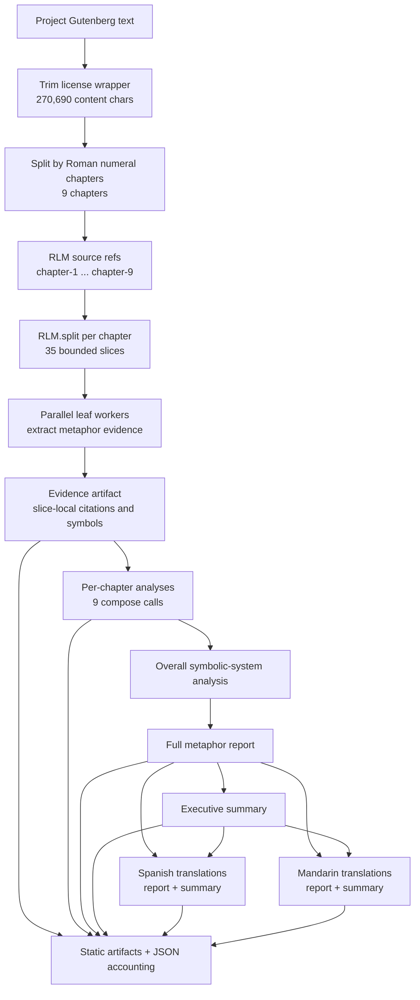
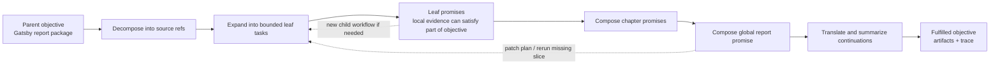
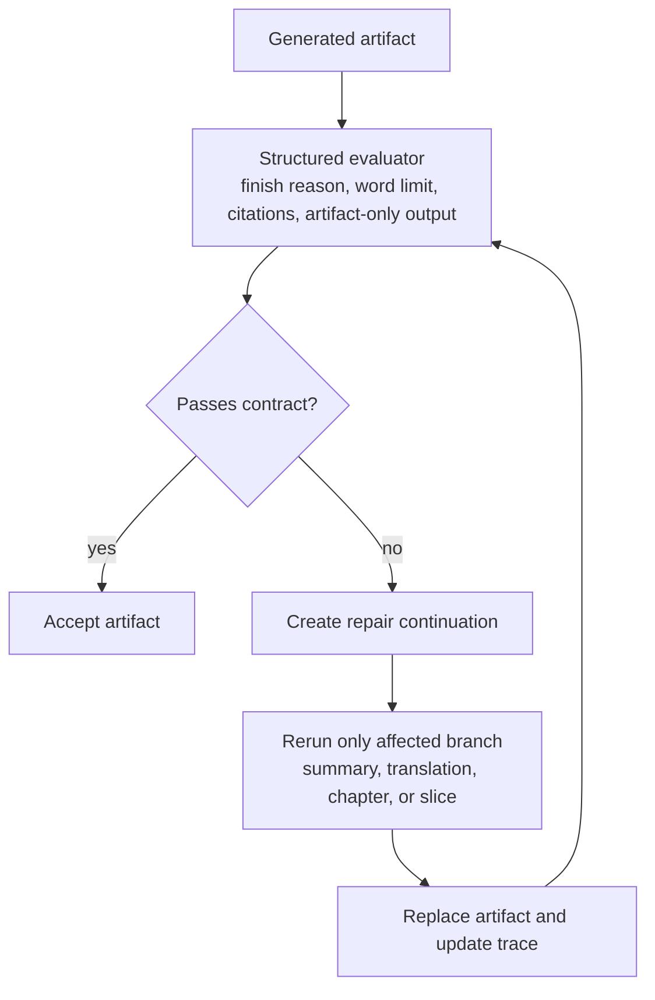

# Phase 9 RLM Gatsby Smoke Report

Date: April 24, 2026

## Purpose

This report records a provider-backed smoke test that adapts the Great Gatsby
workflow from `/home/doops/gatsby-workflow.livemd` to the new RunicAI RLM
execution model.

The original Livebook task was:

1. Write a 10-page metaphor analysis of *The Great Gatsby* with citations.
2. Convert the analysis into a concise 200-word executive summary.
3. Translate both the full essay and summary into Spanish and Mandarin.

The source text was Project Gutenberg's public-domain text:

`https://www.gutenberg.org/cache/epub/64317/pg64317.txt`

The goal of this exercise was not only to reproduce the Livebook's output
shape. It was to test whether RunicAI's RLM layer can handle the same
long-context problem through externalized source references, bounded
materialized slices, parallel leaf delegation, deterministic composition, and
visible execution accounting.

## Script

Manual script:

```bash
scripts/rlm_gatsby_smoke.exs
```

Final live command:

```bash
mix run scripts/rlm_gatsby_smoke.exs \
  --live \
  --chunk-size 9000 \
  --overlap 500 \
  --concurrency 4 \
  --essay-tokens 5000 \
  --translation-tokens 7000 \
  --output tmp/rlm_gatsby_full_live.json
```

The script defaults to dry-run mode unless `--live` or `RUNIC_AI_RLM_LIVE=1`
is provided. It caches the Gutenberg source at `tmp/gatsby_pg64317_raw.txt`
and writes all generated artifacts beside the JSON result.

## Static Outputs

- `tmp/rlm_gatsby_full_live.json`
- `tmp/rlm_gatsby_full_live_evidence.md`
- `tmp/rlm_gatsby_full_live_chapter_analyses.md`
- `tmp/rlm_gatsby_full_live_metaphor_report.md`
- `tmp/rlm_gatsby_full_live_executive_summary.md`
- `tmp/rlm_gatsby_full_live_metaphor_report_es.md`
- `tmp/rlm_gatsby_full_live_metaphor_report_zh.md`
- `tmp/rlm_gatsby_full_live_executive_summary_es.md`
- `tmp/rlm_gatsby_full_live_executive_summary_zh.md`

## Task Shape

Model: `openai:gpt-5.4-mini`

The source was trimmed from 290,115 raw characters to 270,690 content
characters, then split into 9 chapters. Those chapters were stored as RLM
source references and expanded into 35 bounded slices:

| Chapter | Characters |
| --- | ---: |
| 1 | 33,038 |
| 2 | 23,633 |
| 3 | 32,595 |
| 4 | 30,629 |
| 5 | 23,572 |
| 6 | 22,838 |
| 7 | 49,265 |
| 8 | 25,505 |
| 9 | 28,774 |

Execution shape:

```text
35 bounded evidence extractions
 9 chapter analyses
 1 overall symbolic-system analysis
 1 full metaphor report
 1 executive summary
 4 translations
= 51 LLM calls
```

The script predicted 51 calls and the live run made exactly 51 calls.

## Visual Model

The Gatsby smoke test keeps the Livebook's report-generation objective, but
turns the novel into a source-referenced, bounded, continuation-friendly
dataflow.



The key conceptual shift is that recursion does not require a literal
self-call. A Runic/RLM workflow can grow by dynamically adding bounded work,
materializing partial results, and continuing toward the parent objective.



The live smoke test also showed where an evaluator-driven continuation should
fit. Instead of rerunning the whole workflow, a failed artifact should produce a
small repair workflow targeted at the affected output.



## Results

| Metric | Result |
| --- | ---: |
| Chapters | 9 |
| Materialized slices | 35 |
| Calls | 51 |
| Call estimate exact | true |
| Wall time | 200.729s |
| Summed provider call latency | 296.731s |
| Input tokens | 108,571 |
| Output tokens | 31,998 |
| Total tokens | 140,569 |
| Estimated cost | $0.225419 |
| Finish reasons | `stop: 50`, `length: 1` |
| Coarse marker score | 10/10 |

Phase counts:

| Phase | Calls |
| --- | ---: |
| `extract_evidence` | 35 |
| `chapter_analysis` | 9 |
| `overall_analysis` | 1 |
| `metaphor_report` | 1 |
| `executive_summary` | 1 |
| `translate` | 4 |

Artifact sizes:

| Artifact | Characters | Words |
| --- | ---: | ---: |
| Evidence | 50,106 | 7,319 |
| Chapter analyses | 24,778 | 3,832 |
| English metaphor report | 19,792 | 3,197 |
| English executive summary | 1,403 | 211 |
| Spanish metaphor report | 21,393 | 3,556 |
| Spanish executive summary | 1,576 | 266 |
| Mandarin metaphor report | 6,250 | n/a |
| Mandarin executive summary | 484 | n/a |

The coarse marker rubric hit every expected theme:

- citations
- green light
- valley of ashes
- Doctor T. J. Eckleburg
- East Egg and West Egg
- American Dream
- past and time
- cars
- weather
- shirts and wealth

## Comparison To The Livebook

The Livebook is a static human-authored DAG. It splits the book into chapters,
runs an overall metaphor analysis, runs one per-chapter analysis per chapter,
combines those pages, writes an executive summary, and translates the report
and summary to Spanish and Mandarin. That was already a good Runic dataflow
shape: the graph made parallelism and dependency boundaries explicit.

The RLM smoke test keeps the same user-level objective but changes the
execution semantics:

- The source is externalized into RLM source references.
- Chapters are dynamically expanded into bounded slices at runtime.
- Leaf workers extract evidence from local windows instead of receiving whole
  chapters.
- Composition proceeds from evidence to chapter analyses to global synthesis.
- Independent leaf calls run with bounded concurrency.
- The JSON result records call counts, phases, token usage, cost estimate,
  finish reasons, and output paths.

The important improvement is not that this run used fewer calls. It did not.
The Livebook's primary graph is roughly 15 LLM calls, while this RLM smoke test
used 51. The improvement is that the RLM version replaces implicit large-context
assumptions with a stateful, inspectable dataflow. Chapter 7 alone was 49,265
characters; the RLM run did not need to trust that a single provider context
would handle that chapter cleanly. It decomposed the book into 35 local evidence
tasks and then composed those results upward.

This is the practical Runic/RLM advantage for recursive long-context work:
larger objectives become a continuation-friendly computation over source
references and bounded artifacts, not one increasingly fragile prompt.

## Output Quality

The English report is usable. It reads as a coherent literary analysis rather
than a pile of chapter summaries. It develops the green light, valley of ashes,
Eckleburg, geography, cars, parties, shirts, weather, time, character desire,
self-deception, and the American Dream as a connected symbolic system.

The evidence file is also useful as an audit trail. It shows which bounded
slice produced which local observations, so the final essay is not detached
from intermediate work.

The Spanish and Mandarin translations preserve the broad Markdown structure and
the central argument. The Spanish output is especially structurally faithful.
The Mandarin output is much shorter in word-count terms because whitespace word
count is not meaningful for Chinese, but the character count and inspection of
the file show that the full report structure was translated.

Two issues are worth recording:

1. One call reported `length`. The live JSON captured aggregate finish reasons
   but not per-call details, so this run cannot identify the exact clipped call
   after the fact. The script has since been tightened to include per-call
   details and artifact metrics in future JSON outputs.
2. The English report included a trailing assistant-style offer after the
   conclusion, and the executive summary came back at 211 words rather than the
   requested 200. The prompts have since been tightened to request only the
   artifact, with no offers, next steps, or meta commentary.

These are good smoke-test findings because they point to concrete evaluator and
repair contracts rather than architectural failure.

## What Mattered

The most important success is exact execution accounting. The RLM plan expected
51 calls after dynamic slice expansion, and the live run made 51 calls. That is
the foundation for budgeted recursive workflows, resumability, and operator
review.

The second success is source-bounded delegation. The final essay covered the
right global themes without ever requiring a single leaf worker to hold the
whole novel or even a whole long chapter.

The third success is artifact visibility. The run did not only produce a final
essay; it produced evidence, chapter analyses, translations, usage data, and
coarse scoring. That makes the workflow debuggable in a way that a single
whole-context request is not.

The fourth success is that this test exercised the "DAG plus dynamic expansion"
interpretation of Runic recursion. The workflow is still represented as a
Runic/RLM dataflow, but runtime decisions create more bounded work and then
continue toward the parent objective. That is the continuation-friendly model
we want for recursive long-context AI components.

## Gaps And Improvements

The scoring rubric is intentionally coarse. It is useful for smoke testing, but
it cannot detect overlong summaries, trailing assistant offers, weak citations,
or an artifact that mentions every marker while failing the assignment. The next
iteration should add a structured evaluator pass with explicit checks for:

- artifact-only output
- summary word limit
- finish reason
- citation coverage
- chapter coverage
- unsupported claims
- translation completeness

The live JSON should preserve per-call details. The script now does this for
future runs, but this result file predates that improvement.

The output should support targeted repair. If one translation or summary fails
an evaluator, the workflow should rerun only that continuation rather than the
full 51-call exercise.

The RLM planner should eventually model section/review/translation expansion as
first-class plan nodes. In this script the expanded call estimate is explicit,
but the planner's default leaf estimate and the task-template expansion remain
separate concepts.

The final report prompt can be made more citation-disciplined. It includes
quoted snippets and chapter references, but it is not a formal MLA-style essay.
For an academic benchmark, a structured citation schema or evidence-backed
composition contract would be a useful next step.

## Conclusion

The Gatsby smoke test succeeded as a real long-context RLM exercise. It
reproduced the Livebook's report, summary, and translation goals while replacing
manual chapter-level prompting with bounded recursive dataflow over materialized
source artifacts.

The result is not "cheaper than a direct call"; that was not the point. The
result is a more inspectable, resumable, and scalable computation for a document
that is too large to treat casually as prompt text. That is exactly where Runic
and RLM should fit as first-class AI workflow infrastructure.
