# RunicAI RLM Architecture Explainer

Date: April 24, 2026

Audience: engineers familiar with Elixir, AI agents, and the basic idea of
Runic workflows.

## Executive Summary

RunicAI's RLM layer is a workflow-native way to run long-context AI tasks
without stuffing the entire source corpus into a single prompt.

The core idea is:

```text
large source material stays in an external environment
  -> RunicAI creates typed refs, slices, and artifacts
  -> an RLM plan describes bounded work over those artifacts
  -> Runic workflows execute split / materialize / map / reduce / review steps
  -> LLM calls happen at bounded leaves
  -> reducers, episodes, continuations, and traces compose the final artifact
```

This is inspired by Recursive Language Models (RLMs), but it is intentionally
not a raw REPL agent. In the original RLM framing, the model programmatically
inspects an external prompt, decomposes it, and recursively invokes itself over
snippets. lambda-RLM then pushes that idea toward typed functional combinators
and predictable cost. RunicAI takes the same lesson and makes Runic workflows
the execution substrate.

In practice, this means RunicAI gives Elixir developers a way to build
long-context AI components that are:

- bounded: each leaf call sees a small, explicit artifact
- inspectable: refs, slices, plans, costs, and outputs are typed data
- composable: RLM steps are ordinary Runic components
- resumable: child workflows and continuations can advance the parent goal
- auditable: traces, metrics, usage, and provenance stay visible

## Why This Exists

Most agent loops eventually hit the same wall: the task needs more context than
the model can use reliably.

Putting more text into the prompt helps until it does not. As conversations,
documents, tool logs, or codebase context grow, models lose precision and the
system compensates with summarization, retrieval, or subagents. Those help, but
each has tradeoffs:

- compaction is lossy and can drop important state
- retrieval can miss facts if the query is wrong
- subagents often return opaque messages rather than reusable state
- open-ended tool loops can spend many turns rediscovering the same plan

RLM-style execution changes the frame. The long input becomes an external
object. The model no longer has to attend over all of it at once. The workflow
can search, slice, delegate, and compose bounded pieces.

## Background

### Standard RLM

The Recursive Language Models paper describes RLMs as an inference strategy for
processing arbitrarily long prompts by treating the prompt as part of an
external environment. The model can inspect, decompose, and recursively call
itself over snippets of that prompt.

The canonical implementation style is REPL-like:

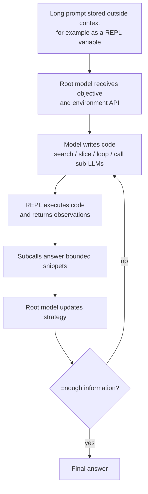

That is powerful because decomposition happens in a symbolic environment
instead of inside one giant attention window. It is also hard to predict because
the model may generate different control code, loop counts, and subcall plans
on each run.

### lambda-RLM

lambda-RLM keeps the external-context insight but replaces open-ended recursive
code generation with a typed functional runtime. Its README describes this as
using pre-verified combinators and reserving neural inference for bounded leaf
subproblems.

Conceptually:

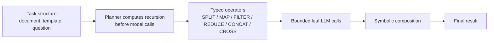

This lowers variance. The model fills bounded leaves; the system owns the
recursive structure.

### RunicAI RLM

RunicAI follows lambda-RLM's bias toward typed structure, but maps the execution
model onto Runic and Elixir.

Runic already gives us named steps, rules, maps, reducers, accumulators,
state machines, lazy execution, parallel execution, and dynamic workflow
construction. RunicAI already adds LLM, tool, control, context, decomposition,
runtime, trace, and evaluation contracts. The RLM layer sits above those pieces
as the long-context execution mode.

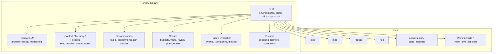

The result is neither "just RAG" nor "just subagents." It is typed dataflow
over external context.

## Core Vocabulary

| Concept | Module | Meaning |
| --- | --- | --- |
| Environment | `RunicAI.RLM.Environment` | External store for long-context source material |
| In-memory environment | `RunicAI.RLM.Environments.InMemory` | Test/example environment implementation |
| Source ref | `RunicAI.RLM.EnvironmentRef` | Stable handle to source material outside the prompt |
| Source | `RunicAI.RLM.Source` | Metadata about registered source material |
| Slice | `RunicAI.RLM.Slice` | Provenance-preserving window over a source |
| Slice set | `RunicAI.RLM.SliceSet` | A collection of slices from split/search |
| Materialized artifact | `RunicAI.RLM.MaterializedArtifact` | Bounded text brought into a workflow step |
| Leaf result | `RunicAI.RLM.LeafResult` | Output of bounded leaf work with provenance |
| Reduction result | `RunicAI.RLM.ReductionResult` | Composed output from leaf results |
| Policy | `RunicAI.RLM.Policy` | Bounds and execution preferences |
| Cost estimate | `RunicAI.RLM.CostEstimate` | Visible estimate of calls, reads, tokens, latency |
| Plan | `RunicAI.RLM.Plan` | Validated recursive execution plan |
| Plan node | `RunicAI.RLM.PlanNode` | One graph-friendly operation in a plan |
| Plan patch | `RunicAI.RLM.PlanPatch` | Validated proposal for runtime plan growth |
| Child workflow spec | `RunicAI.RLM.ChildWorkflowSpec` | Typed description of spawned workflow work |
| Episode | `RunicAI.RLM.Episode` | Synchronization artifact from child/worker execution |
| Continuation | `RunicAI.RLM.Continuation` | Typed description of justified next work |

The facade is `RunicAI.RLM`, which provides the high-level environment and
planning operations:

- `init_environment/1`
- `put_source/3`
- `source/2`
- `split/3`
- `materialize/3`
- `search/4`
- `plan/3`

## The Execution Model

At the simplest level, a RunicAI RLM workflow looks like this:

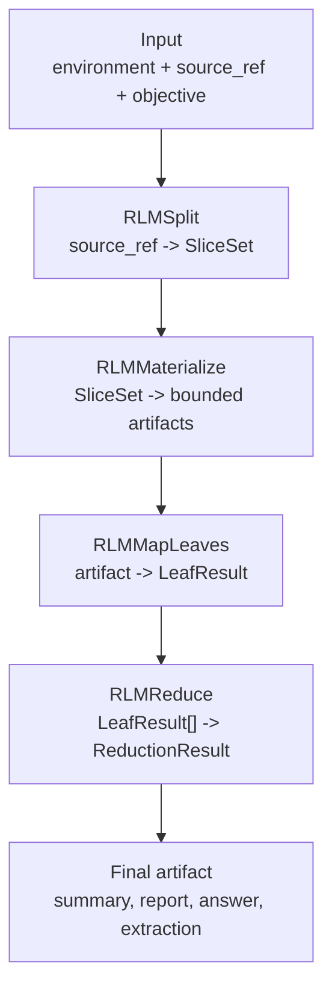

That exact vertical slice exists today as `RunicAI.Recipes.RLMSummarizer`:

```text
source ref -> split -> late materialization -> bounded leaf mapping -> reduce
```

The leaf mapper can be deterministic, an LLM call through `RunicAI.LLM`, a tool
adapter, or a child workflow.

## Late Materialization

Late materialization is one of the key mechanics. A plan can carry references
and slices through most of the workflow without loading the source text into the
model context. Text becomes prompt-visible only at the leaf boundary.

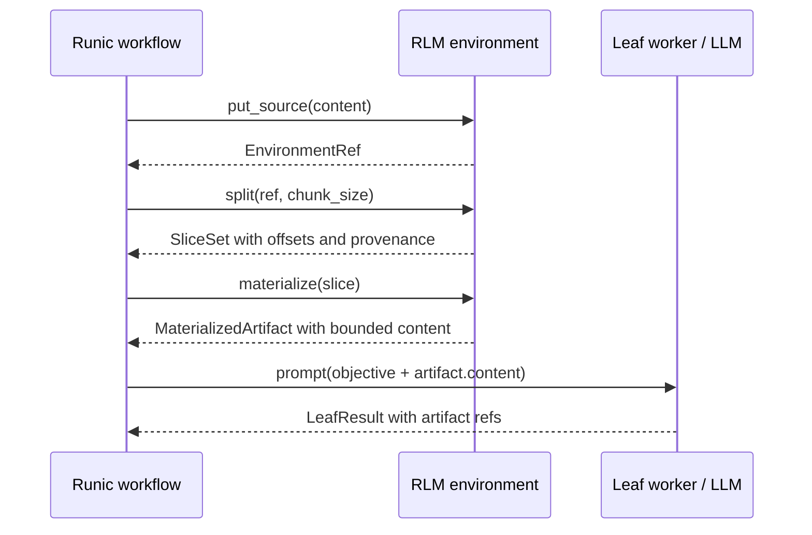

This keeps root prompts lean and makes provenance explicit. A final answer can
point back to which source ref and slice produced each intermediate result.

## Planning And Cost

The current default planner is intentionally small and deterministic. It builds
a basic plan with:

```text
split -> map_leaves -> reduce
```

The planner uses probes and policy values to estimate leaf calls, reducer calls,
environment reads, rough input tokens, and latency class before execution.

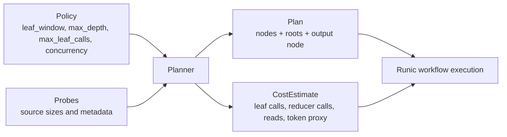

The smoke tests demonstrate why this matters. In the medium report benchmark,
the expanded RLM path predicted 35 calls and made 35 calls. In the Gatsby
smoke test, the expanded RLM path predicted 51 calls and made 51 calls.

Exact call accounting is more than a metric. It is the basis for budgeting,
operator review, retry strategy, and production scheduling.

## Dynamic Recursion Without A Literal Self-Call

Runic workflows are DAG-based when materialized, but that is not an expressivity
limit. Recursion in this system is modeled as explicit workflow data:

- a workflow can add or merge more nodes at runtime
- a leaf can return a `PlanPatch`
- a leaf can spawn a `ChildWorkflowSpec`
- a child workflow can return an `Episode`
- an episode can carry a `Continuation`
- a continuation can justify more bounded work

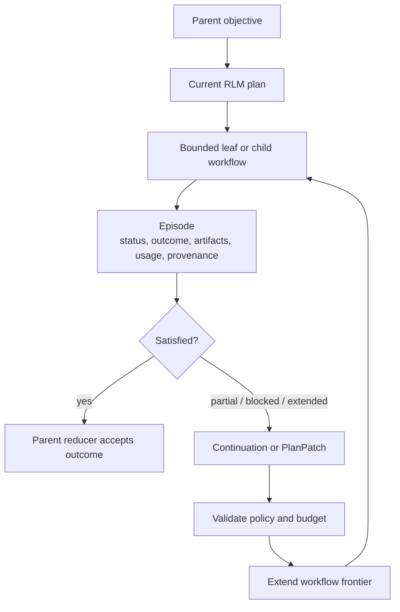

This is the main conceptual difference from "recursion as self-call." RunicAI
does not need hidden recursive control flow. It can represent recursive progress
as stateful dataflow: bounded work produces typed artifacts, and those artifacts
either satisfy the parent objective or produce the next frontier.

## How This Differs From Related Systems

| Dimension | Standard RLM | lambda-RLM | RunicAI RLM |
| --- | --- | --- | --- |
| Execution substrate | Python-like REPL loop | Typed functional runtime | Runic workflows and Elixir data |
| Who chooses decomposition? | Model often writes control code at runtime | Deterministic planner/operators | Planner, workflow, policy, or validated continuations |
| Long context location | External prompt variable/environment | External source processed by combinators | `RLM.Environment` refs, slices, artifacts |
| Neural work | Root model plus recursive subcalls | Bounded leaf subproblems | `RunicAI.LLM`, tools, or child workflows at bounded leaves |
| Composition | Generated code / root synthesis | Symbolic functional operators | Runic reducers, join policies, review steps, episodes |
| Predictability | Powerful but higher variance | More predictable and analyzable | Predictable by default, dynamic by typed patch/continuation |
| Verification | Harder; code is generated | Stronger formal structure | Elixir structs, validations, tests, traces, policies |
| Runtime integration | REPL/session loop | Library runtime | Runic workflows, harnesses, sessions, runners |
| Best fit | Open-ended exploration | Known task structures | Production workflow components with optional dynamic growth |

RunicAI RLM is closest in spirit to lambda-RLM, but with a more general
workflow substrate. It is not trying to prove lambda-calculus properties today.
It is trying to make long-context recursive work first-class inside RunicAI's
existing contracts.

## Relationship To Agent Architecture

Slate-style thread/episode architectures frame long-horizon agent performance
as a context-management problem: bounded work units return episodes, and an
orchestrator composes those episodes rather than compacting one giant trace.
That maps naturally to RunicAI's RLM direction.

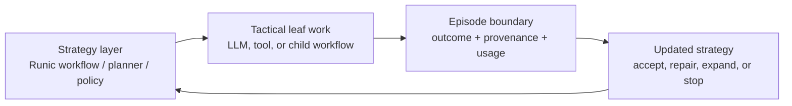

The important engineering lesson is separation of concerns:

- strategy belongs in plans, policies, routing, and reducers
- tactical semantic work belongs in bounded leaf calls
- synchronization belongs in typed episodes and continuations
- memory belongs in environment refs, artifacts, context stores, and traces

## Example: Report Generation

Report generation is a natural RLM task because the output template is already
a dependency tree. The sources may be large, but each section can be built from
bounded extractions and then composed upward.

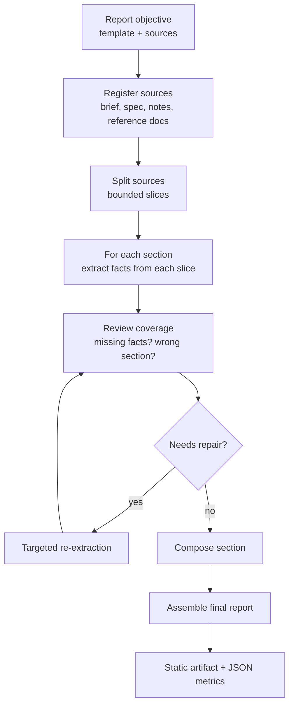

This is the shape exercised in
`.docs/018-phase-9-rlm-medium-report-generation-benchmark-report.md`.

## Example: Gatsby Long-Context Workflow

The Gatsby smoke test demonstrates the same architecture on a literary
long-context task: a whole public-domain novel is too large to treat casually
as one prompt, so the workflow makes chapters and slices explicit.

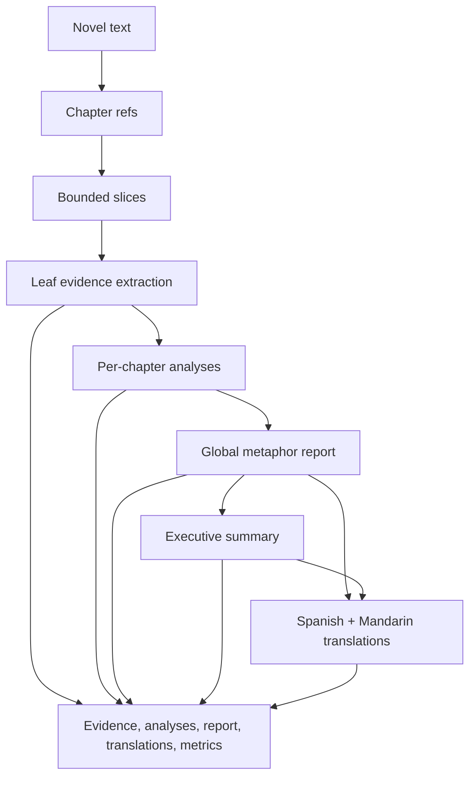

This is the shape exercised in
`.docs/019-phase-9-rlm-gatsby-smoke-report.md`.

## What Developers Should Reach For

Use RunicAI RLM when:

- the source material is too large or too important to dump into one prompt
- you need predictable calls, cost, and phase accounting
- you need provenance from final artifact back to source windows
- the task has natural decomposition, such as sections, chapters, files,
  records, test cases, candidates, or review dimensions
- only small parts of the source should be visible to any one LLM call
- failed outputs should be repaired by targeted continuations

Do not start with RLM when:

- one direct model call is cheap, reliable, and easy to inspect
- there is no meaningful decomposition
- provenance does not matter
- the task is pure short-form chat
- you need unconstrained exploration more than predictable execution

## Design Principles

### Keep Large Context External

The root prompt should carry the objective, policy, and selected summaries. It
should not carry an entire corpus by default. Sources should live in
environments and be pulled into prompts only through bounded artifacts.

### Make Plans Data

Recursive work should be visible as `Plan` and `PlanNode` values, not hidden in
a generated script. When dynamic growth is needed, represent it as a
`PlanPatch`, child workflow, episode, or continuation.

### Let Models Work At The Leaves

LLMs are excellent at local semantic extraction, synthesis, judgment, and
translation. They are much less reliable as the sole owner of budget,
scheduling, termination, retries, and provenance.

### Prefer Targeted Repair

If a summary is too long, a translation is clipped, or a section misses
required facts, rerun the smallest affected branch. The architecture should
make that branch identifiable.

### Treat Episodes As Synchronization Boundaries

An episode should say what happened, what artifacts were produced, how much it
cost, what source material was used, and whether more work is needed. That is
more useful than a free-form subagent message.

## Current State In The Library

Implemented foundation:

- `RunicAI.RLM` facade
- `RunicAI.RLM.Environment` behaviour
- `RunicAI.RLM.Environments.InMemory`
- source refs, sources, slices, slice sets, materialized artifacts
- leaf and reduction result contracts
- policy, plan, plan node, cost estimate
- episode, continuation, child workflow spec, plan patch
- `RLMSplit`, `RLMMaterialize`, `RLMMapLeaves`, `RLMReduce` Runic steps
- `RunicAI.Recipes.RLMSummarizer`
- manual smoke scripts for report generation and Gatsby long-context work

Still emerging:

- first-class compiler from richer `Plan` graphs to workflows
- planner support for template expansion, review dimensions, and translations
- structured evaluator and repair continuations
- persistent/non-memory RLM environments
- tighter integration with runtime sessions and `Runic.Runner`
- cost estimates with tokenizer-aware accounting
- richer provenance and citation contracts

## Reference Architecture

The intended production shape is:

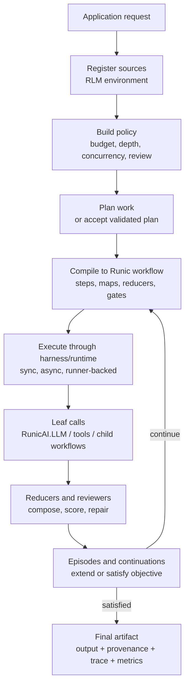

## Practical Mental Model

For an Elixir developer, the mental model can be compact:

1. Put large text somewhere outside the prompt.
2. Pass around refs, not giant strings.
3. Split refs into bounded slices.
4. Materialize a slice only when a leaf step needs it.
5. Map each leaf through an LLM/tool/function.
6. Reduce typed leaf results into the artifact.
7. Review the artifact.
8. Patch only the part that failed.

That is the whole trick. The sophistication comes from making each of those
steps typed, composable, observable, and compatible with the rest of RunicAI.

## Source Notes

- Recursive Language Models paper:
  `https://arxiv.org/abs/2512.24601`
- lambda-RLM:
  `https://github.com/lambda-calculus-LLM/lambda-RLM`
- Recursive report-generation discussion:
  `https://theharness.blog/blog/recursive-by-design/`
- Slate/thread-weaving architecture discussion:
  `https://techstrong.ai/features/random-labs-says-the-bottleneck-in-ai-agents-isnt-intelligence-its-memory-management/`
- RunicAI implementation plan:
  `.docs/017-phase-9-rlm-execution-mode-and-recursive-long-context-workflows-implementation-plan.md`
- Medium report smoke:
  `.docs/018-phase-9-rlm-medium-report-generation-benchmark-report.md`
- Gatsby smoke:
  `.docs/019-phase-9-rlm-gatsby-smoke-report.md`
