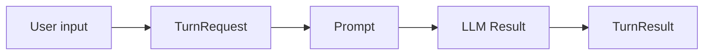

# Finalization, Polish, And Release Preparation Implementation Plan

Status: draft implementation plan

Date: 2026-04-25

Depends on:
- `.docs/002-workflow-native-agent-roadmap.md`
- `.docs/003-phase-0-contracts-and-core-substrate-implementation-plan.md`
- `.docs/004-phase-1-conversational-loop-kernel-implementation-plan.md`
- `.docs/005-phase-2-tool-calling-and-capability-execution-implementation-plan.md`
- `.docs/006-phase-3-controls-guards-and-operator-interaction-implementation-plan.md`
- `.docs/007-phase-4-context-engineering-memory-and-retrieval-boundaries-implementation-plan.md`
- `.docs/009-phase-5-multi-agent-and-decomposition-workflows-implementation-plan.md`
- `.docs/012-phase-6-stateful-integrated-agent-recipes-implementation-plan.md`
- `.docs/014-phase-7-observability-testing-and-evaluation-implementation-plan.md`
- `.docs/015-phase-8-advanced-runtime-adapters-and-optimization-hooks-implementation-plan.md`
- `.docs/017-phase-9-rlm-execution-mode-and-recursive-long-context-workflows-implementation-plan.md`

Primary repo references:
- [mix.exs](/home/doops/wrk/runic_ai/mix.exs:1)
- [README.md](/home/doops/wrk/runic_ai/README.md:1)
- [lib/runic_ai.ex](/home/doops/wrk/runic_ai/lib/runic_ai.ex:1)
- [lib/runic_ai/recipes](/home/doops/wrk/runic_ai/lib/runic_ai/recipes)
- [lib/runic_ai/steps](/home/doops/wrk/runic_ai/lib/runic_ai/steps)
- [test/runic_ai](/home/doops/wrk/runic_ai/test/runic_ai)

## Goal

Prepare RunicAI for a coherent public release by turning the completed feature
surface into approachable documentation, validated examples, a clean HexDocs
information architecture, and a small set of realistic dogfooding projects that
exercise the library before publishing.

This work is successful when a new user can answer these questions from the
README, guides, module docs, and examples:

- What problem does RunicAI solve?
- Why is Runic a useful foundation for AI and agent systems?
- What contracts move through a RunicAI workflow?
- Which component or recipe should I start with?
- How do I build a plain LLM workflow, a tool agent, a controlled agent, a
  context-aware agent, a delegated workflow, an integrated stateful agent, and a
  long-context RLM-style workflow?
- How do I test, trace, replay, evaluate, persist, schedule, and extend those
  workflows?
- Which public options are available, what types do they accept, what defaults
  apply, and when should I use them?
- How do I adapt the library to my own model client, tools, authorization,
  persistence, telemetry, causal logging, and runtime topology?

## Release Readiness Definition

RunicAI is ready to publish when the following are true.

- ExDoc is configured in `mix.exs` with grouped modules, grouped guides,
  Livebook extras, source links, package metadata, and a public documentation
  landing page.
- The README is the single source of truth for the top-level introduction, and
  `RunicAI` injects it as its moduledoc.
- Public documentation describes user value and concepts, not internal project
  management history.
- Public modules have clear moduledocs that explain what the component is for,
  what contract it consumes and emits, and how it composes with nearby
  components.
- Public user-facing options are documented with name, example value, type,
  required/optional status, default, and purpose.
- Guide and moduledoc examples are executable and are either covered by doctests
  or verified through Tidewave eval, IEx, or a dedicated doc-example test.
- At least three practical dogfooding projects have been run far enough to
  produce rough-edge fixes or explicit release notes.
- `mix test`, `mix format --check-formatted`, `mix compile`, `mix docs`, and the
  doc-example verification path pass locally.
- Hex package metadata, changelog, license, semantic version, links, and
  security notes are ready for a public Hex release.

## Current Starting Point

The library now has a broad working surface:

- normalized core contracts for messages, prompts, conversations, LLM requests,
  LLM results, errors, waits, and review decisions
- agent turn contracts and conversational recipes
- tool definition, selection, planning, execution, observation, and adapter
  contracts
- control contracts for budgets, guards, retry, fallback, wait, and review
- context, memory, retrieval, compaction, handoff, and horizon contracts
- decomposition, role registry, assignment, join, judge, and candidate contracts
- integrated workflow-owned state for one or many agent lanes
- harness, trace, testing, replay, and evaluation support
- runtime session, scheduler, backend, runner, and adapter support
- RLM-style environment, plan, slice, map/reduce, continuation, and artifact
  contracts
- reference recipes and tests across the above areas

The main public gap is not more primitives. It is coherence:

- `mix.exs` does not yet include ExDoc configuration.
- The README and `RunicAI` moduledoc are separate and repeat internal phase
  language.
- Public documentation is arranged chronologically by implementation history
  more than by user goals.
- Many modules have moduledocs, but the level of usage guidance, option
  inventory, and example verification is uneven.
- Existing `.docs` files are useful internal history, but they should not leak
  into the public HexDocs story as the primary user path.

## Documentation Information Architecture

### ExDoc Setup

Add ExDoc and documentation metadata to `mix.exs`.

Implementation tasks:

- Add `{:ex_doc, "~> 0.34", only: :dev, runtime: false}` or the current
  supported ExDoc version at implementation time.
- Add `description: description()`, `package: package()`, and `docs: docs()` to
  the project configuration.
- Configure `docs/0` with:
  - `main: "RunicAI"` so the injected README/module docs are the landing page
  - `source_url` pointing at the public repository URL
  - `source_ref` matching the release tag when building release docs
  - `homepage_url` pointing at the package or repository
  - the ExDoc Mermaid rendering hook so fenced `mermaid` blocks render as
    diagrams in generated HTML docs
  - `extras` for README, guides, recipes, reference pages, and Livebooks
  - `groups_for_extras` for conceptual guides, recipes, Livebooks, reference,
    and release notes
  - `groups_for_modules` that match the functional areas below
  - `nest_modules_by_prefix` for large namespaces such as `RunicAI.Steps`,
    `RunicAI.Tool`, `RunicAI.Context`, `RunicAI.Recipes`, `RunicAI.Runtime`,
    and `RunicAI.RLM`

Recommended module groups:

- `Overview`
  - `RunicAI`
- `Core Contracts`
  - `RunicAI.Message`
  - `RunicAI.Prompt`
  - `RunicAI.Conversation`
  - `RunicAI.Conversation.State`
  - `RunicAI.Error`
  - `RunicAI.Wait`
  - `RunicAI.ResumeSignal`
  - `RunicAI.ReviewRequest`
  - `RunicAI.ReviewDecision`
- `LLM Access`
  - `RunicAI.LLM`
  - `RunicAI.LLM.Request`
  - `RunicAI.LLM.Result`
  - `RunicAI.LLM.ReqLLMClient`
- `Agent Turns`
  - modules under `RunicAI.Agent`
- `Workflow Steps`
  - modules under `RunicAI.Steps`
- `Workflow Rules`
  - modules under `RunicAI.Rules`
- `Tools`
  - modules under `RunicAI.Tool`
- `Control`
  - modules under `RunicAI.Control`
- `Context, Memory, And Retrieval`
  - modules under `RunicAI.Context`
  - modules under `RunicAI.Memory`
  - modules under `RunicAI.Retrieval`
- `Decomposition And Subagents`
  - modules under `RunicAI.Decomposition`
  - modules under `RunicAI.Candidate`
- `Integrated Stateful Agents`
  - modules under `RunicAI.Integrated`
- `Recipes`
  - modules under `RunicAI.Recipes`
- `Runtime`
  - modules under `RunicAI.Runtime`
- `Tracing, Harnesses, Testing, And Evaluation`
  - modules under `RunicAI.Trace`
  - modules under `RunicAI.Harness`
  - modules under `RunicAI.Testing`
  - modules under `RunicAI.Evaluation`
- `RLM And Long-Context Workflows`
  - `RunicAI.RLM`
  - modules under `RunicAI.RLM`
- `Optimization`
  - modules under `RunicAI.Optimization`

Recommended guide and extra groups:

- `Start Here`
  - `README.md`
  - `guides/getting-started.md`
  - `guides/mental-model.md`
- `Core Concepts`
  - `guides/workflows-as-composition.md`
  - `guides/contracts.md`
  - `guides/context-engineering.md`
  - `guides/controls-and-limits.md`
  - `guides/stateless-vs-stateful-agents.md`
- `Recipes`
  - `guides/recipes/chat-agent.md`
  - `guides/recipes/tool-agent.md`
  - `guides/recipes/controlled-tool-agent.md`
  - `guides/recipes/context-aware-agent.md`
  - `guides/recipes/subagent-decomposition.md`
  - `guides/recipes/integrated-stateful-agent.md`
  - `guides/recipes/evaluation-harness.md`
  - `guides/recipes/rlm-summarizer.md`
- `Extending RunicAI`
  - `guides/extending/components.md`
  - `guides/extending/tools.md`
  - `guides/extending/telemetry-and-tracing.md`
  - `guides/extending/authorization-and-guards.md`
  - `guides/extending/persistence-and-runtime.md`
  - `guides/extending/causal-logging.md`
- `Livebooks`
  - `livebooks/getting-started.livemd`
  - `livebooks/tool-agent.livemd`
  - `livebooks/context-engineering.livemd`
  - `livebooks/evaluation-harness.livemd`
  - `livebooks/rlm-summarizer.livemd`
- `Reference`
  - `guides/reference/component-catalog.md`
  - `guides/reference/testing-strategy.md`
  - `guides/reference/release-checklist.md`

Keep internal planning docs under `.docs`. Do not include the existing phase
plans as public HexDocs extras unless there is a deliberate "Architecture
History" section outside the primary learning path.

### Example `mix.exs` Shape

The implementation should end near this shape, adjusted to the final repository
URL and current dependency versions:

```elixir
@version "0.1.0"

def project do
  [
    app: :runic_ai,
    version: @version,
    elixir: "~> 1.18",
    elixirc_paths: elixirc_paths(Mix.env()),
    start_permanent: Mix.env() == :prod,
    description: description(),
    package: package(),
    docs: docs(),
    deps: deps(),
    aliases: aliases()
  ]
end

defp docs do
  [
    main: "RunicAI",
    source_url: "https://github.com/OWNER/runic_ai",
    source_ref: "v#{@version}",
    before_closing_body_tag: &before_closing_body_tag/1,
    extras: [
      "README.md",
      "guides/getting-started.md",
      "guides/mental-model.md",
      "guides/workflows-as-composition.md",
      "guides/contracts.md",
      "guides/context-engineering.md",
      "guides/controls-and-limits.md",
      "guides/stateless-vs-stateful-agents.md",
      "guides/recipes/chat-agent.md",
      "guides/recipes/tool-agent.md",
      "guides/recipes/controlled-tool-agent.md",
      "guides/recipes/context-aware-agent.md",
      "guides/recipes/subagent-decomposition.md",
      "guides/recipes/integrated-stateful-agent.md",
      "guides/recipes/evaluation-harness.md",
      "guides/recipes/rlm-summarizer.md",
      "guides/extending/components.md",
      "guides/extending/tools.md",
      "guides/extending/telemetry-and-tracing.md",
      "guides/extending/authorization-and-guards.md",
      "guides/extending/persistence-and-runtime.md",
      "guides/extending/causal-logging.md",
      "guides/reference/component-catalog.md",
      "guides/reference/release-checklist.md",
      "livebooks/getting-started.livemd",
      "livebooks/tool-agent.livemd",
      "livebooks/context-engineering.livemd",
      "livebooks/evaluation-harness.livemd",
      "livebooks/rlm-summarizer.livemd"
    ],
    groups_for_extras: groups_for_extras(),
    groups_for_modules: groups_for_modules(),
    nest_modules_by_prefix: [
      RunicAI.Agent,
      RunicAI.Candidate,
      RunicAI.Context,
      RunicAI.Control,
      RunicAI.Decomposition,
      RunicAI.Evaluation,
      RunicAI.Harness,
      RunicAI.Integrated,
      RunicAI.Memory,
      RunicAI.Optimization,
      RunicAI.Recipes,
      RunicAI.Retrieval,
      RunicAI.RLM,
      RunicAI.Runtime,
      RunicAI.Steps,
      RunicAI.Testing,
      RunicAI.Tool,
      RunicAI.Trace
    ]
  ]
end
```

The Mermaid hook should follow ExDoc's documented extension pattern: load the
Mermaid runtime for HTML output, listen for ExDoc page-load events, find
`mermaid` code blocks, render them into SVG, and leave EPUB/Markdown output
plain. Keep the helper small and isolated so it can be removed if ExDoc later
ships built-in Mermaid handling.

## README And Top-Level Moduledoc

The README should become the single public introduction to RunicAI.

Implementation tasks:

- Rewrite `README.md` around user goals instead of implementation phases.
- Explain RunicAI in simple language:
  - RunicAI gives AI workflows typed, inspectable values.
  - Runic provides named workflow components, DAG composition, lazy evaluation,
    explicit routing, reducers, accumulators, and runtime integration.
  - ReqLLM provides provider-neutral model access.
  - RunicAI connects those pieces into reusable contracts, steps, rules,
    recipes, harnesses, and runtime adapters.
- Explain what is unique:
  - agents are composed from workflow dataflow, not hidden loops
  - state can be external and caller-owned or internal and workflow-owned
  - context, tools, controls, delegation, tracing, and evaluation are typed
    workflow values
  - tests can inject fake model clients and scripted tools without Mox or
    global application config
- Keep the quick start runnable with a fake client by default, so the first
  example does not require API keys.
- Add a second short real-provider example that clearly states which dependency
  and environment variables are expected.
- Replace the giant chronological contract list with an organized "What to use
  first" section and links into guides.
- Move long lists into `guides/reference/component-catalog.md`.
- Move recipe-specific depth into recipe guides.
- Remove public wording like "Phase 1", "Phase 7", "current roadmap", and
  "this phase" from README, moduledocs, and guide pages.
- Keep `.docs` as internal project planning history where phase language is
  acceptable.

Inject the README into the top-level module:

```elixir
defmodule RunicAI do
  @external_resource Path.expand("../README.md", __DIR__)
  @moduledoc File.read!(Path.expand("../README.md", __DIR__))
end
```

If ExDoc renders the README both as an extra and as the `RunicAI` module, prefer
`RunicAI` as the `main` page and keep the README extra only if it improves Hex
package navigation. The canonical source should still be `README.md`.

## Public Documentation Style

Use a consistent public-doc shape for every user-facing module.

Recommended moduledoc sections:

- `What It Is`
  - One plain-language paragraph.
- `Use It When`
  - A short list of situations where the component is the right tool.
- `Contract Shape`
  - The input struct or map shape it expects.
  - The output struct or map shape it emits.
  - Any error tuple, pause, review, wait, or retry behavior.
- `How It Composes`
  - Nearby components, recipes, or Runic primitives that commonly wrap it.
- `Options`
  - A table of public options.
- `Example`
  - A runnable example backed by doctest, Tidewave eval, IEx, or a doc example
    test.
- `Related Guides`
  - Links to relevant guide pages.

Recommended option table columns:

| Option | Example | Type | Required | Default | Description |
| --- | --- | --- | --- | --- | --- |
| `:name` | `:generate_turn` | `atom()` | no | module-specific | Runic component name used in workflow results and debugging. |

Document only user-facing options. Internal implementation knobs can remain out
of public docs, but if a public function accepts an option that users are
expected to pass, it must be documented somewhere discoverable.

## Mermaid Diagram Guidance

Use Mermaid diagrams when a visual explanation makes the workflow, contract
flow, state transition, or runtime boundary easier to understand than prose
alone. Prefer diagrams for graph shape and control flow; prefer code examples
for exact API usage.

Author Mermaid diagrams as fenced blocks:

````markdown

````

Recommended diagram types:

- `flowchart` for recipe graphs, step pipelines, context assembly, tool
  execution, RLM split/map/reduce, and runtime adapter boundaries.
- `stateDiagram-v2` for waits, reviews, guarded execution, integrated agent
  sessions, scheduler wakeups, and pause/resume flows.
- `sequenceDiagram` for interactions among caller, harness, runtime session,
  workflow, model client, tools, stores, and trace sinks.
- `classDiagram` only when contract families and ownership relationships are
  clearer as types than as dataflow.

Use diagrams in:

- README mental model section, for the shortest "values through a workflow"
  picture.
- `guides/workflows-as-composition.md`, for the progressive graph from a single
  LLM step to branches, tools, and reducers.
- `guides/contracts.md`, for contract families and how data moves between them.
- `guides/context-engineering.md`, for transcript truth, derived context graph,
  memory, retrieval, compaction, bundle assembly, and handoff artifacts.
- `guides/controls-and-limits.md`, for budget gates, guard decisions, review
  pauses, waits, retries, and fallbacks.
- `guides/stateless-vs-stateful-agents.md`, for side-by-side external-state
  and workflow-owned state paths.
- `guides/recipes/*.md`, for each recipe's canonical workflow path.
- `guides/extending/persistence-and-runtime.md`, for harness, session server,
  scheduler, runner, store, and resume interactions.
- `guides/extending/causal-logging.md`, for the causal chain from input to
  trace event to application log entry.
- `guides/recipes/rlm-summarizer.md`, for split -> materialize -> map leaves ->
  reduce and for continuation boundaries.

Diagram quality rules:

- Keep each diagram focused on one concept; split large graphs rather than
  making one unreadable omnibus diagram.
- Use the same public contract names as the code and docs.
- Label edges with meaning when the transition is not obvious.
- Avoid visualizing every private helper.
- Keep diagrams source-controlled in Markdown or Livebook files rather than
  generated images.
- Verify diagrams by building local ExDoc HTML and opening the rendered pages.

## Component Documentation Audit

Each component should answer what it is useful for and which contract family it
belongs to.

### Steps

For every module under `RunicAI.Steps`, document:

- the Runic primitive it returns, usually `Runic.step/2`
- the input contract, such as `TurnRequest`, `Prompt`, `Tool.Selection`,
  `Context.State`, `TaskPlan`, `Integrated.Signal`, or `RLM.Plan`
- the output contract
- whether the step is pure normalization, model I/O, tool I/O, context
  mutation, planning, reduction, or runtime routing
- the default `:name`
- all public options
- one example that calls the pure helper function when available, or runs the
  step inside a tiny workflow when the Runic shape is the point

Priority step clusters:

- LLM and turn assembly:
  - `RunicAI.Steps.PromptBuilder`
  - `RunicAI.Steps.TextToConversation`
  - `RunicAI.Steps.AssembleTurnRequest`
  - `RunicAI.Steps.AssembleTurnPrompt`
  - `RunicAI.Steps.LLMGenerate`
  - `RunicAI.Steps.GenerateTurn`
  - `RunicAI.Steps.InterpretTurn`
- Tools:
  - `RunicAI.Steps.SelectTools`
  - `RunicAI.Steps.AttachVisibleTools`
  - `RunicAI.Steps.InterpretToolRequests`
  - `RunicAI.Steps.PlanToolExecution`
  - `RunicAI.Steps.ExecuteToolCalls`
  - `RunicAI.Steps.AppendToolObservations`
  - `RunicAI.Steps.ReduceToolResults`
- Controls:
  - `RunicAI.Steps.EvaluateBudget`
  - `RunicAI.Steps.EvaluateGuard`
  - `RunicAI.Steps.GenerateTurnControlled`
  - `RunicAI.Steps.ExecuteToolCallsControlled`
  - `RunicAI.Steps.ApplyReviewDecision`
  - `RunicAI.Steps.NormalizeResumeSignal`
  - `RunicAI.Steps.RepairHistory`
- Context:
  - `RunicAI.Steps.IngestContextTurn`
  - `RunicAI.Steps.InferFocus`
  - `RunicAI.Steps.RecallMemory`
  - `RunicAI.Steps.RetrieveContext`
  - `RunicAI.Steps.EvaluateContextPressure`
  - `RunicAI.Steps.CompactContext`
  - `RunicAI.Steps.AssembleContextBundle`
  - `RunicAI.Steps.BuildHandoff`
  - `RunicAI.Steps.WriteMemory`
- Decomposition and candidates:
  - `RunicAI.Steps.PlanChildTasks`
  - `RunicAI.Steps.BuildChildAssignments`
  - `RunicAI.Steps.ExecuteChildAssignments`
  - `RunicAI.Steps.ReduceChildResults`
  - `RunicAI.Steps.JudgeCandidates`
- Integrated state:
  - `RunicAI.Steps.NormalizeIntegratedSignal`
  - `RunicAI.Steps.SelectReadyAgent`
  - `RunicAI.Steps.MaterializeIntegratedTurn`
  - `RunicAI.Steps.ApplyIntegratedTurnResult`
  - `RunicAI.Steps.RegisterIntegratedPause`
  - `RunicAI.Steps.ResolveIntegratedResume`
  - `RunicAI.Steps.EmitIntegratedValue`
- RLM:
  - `RunicAI.Steps.RLMSplit`
  - `RunicAI.Steps.RLMMaterialize`
  - `RunicAI.Steps.RLMMapLeaves`
  - `RunicAI.Steps.RLMReduce`

### Rules

For every module under `RunicAI.Rules`, document:

- why the behavior is a `Runic.rule/2` rather than a step
- which decisions route the workflow
- how the rule handles unknown, denied, waiting, exhausted, or terminal states
- the options and default `:name`
- a minimal workflow example that demonstrates branching

Priority modules:

- `RunicAI.Rules.ContinueChat`
- `RunicAI.Rules.BudgetGate`
- `RunicAI.Rules.ResolveGuardedAction`

### Accumulators, Reducers, And Stateful Components

Document accumulator-backed or reducer-like modules as state transition
components.

Priority modules and recipes:

- `RunicAI.Conversation`
- `RunicAI.Integrated.RuntimeState`
- `RunicAI.Recipes.IntegratedAgentKernel`
- `RunicAI.Recipes.IntegratedChatAgent`
- `RunicAI.Recipes.IntegratedToolAgent`
- `RunicAI.Recipes.EvaluationHarness`
- `RunicAI.Steps.RLMReduce`
- `RunicAI.Steps.ReduceChildResults`
- `RunicAI.Steps.ReduceToolResults`

Each doc should say:

- what state is owned by the workflow
- what state is owned by the caller
- what events or values advance the state
- how to inspect the latest state from workflow results
- how to persist or replay the state when applicable

### Contracts

For every public struct contract, document:

- required fields
- optional fields and defaults
- accepted input forms for `new/1`, `new/2`, `from_input/1`, or similar helpers
- validation behavior
- serialization expectations
- whether the contract is intended for user construction, internal recipe
  output, adapter integration, or all three

## Guide Plan

### 1. Getting Started

Goal: get a user from zero to one working workflow.

Cover:

- installation
- `require Runic`
- creating a tiny named step
- calling `RunicAI.LLM.generate_text/2` with a fake client
- composing a tiny workflow
- extracting results with `Workflow.results/1` or
  `Workflow.raw_productions/1`
- using `RunicAI.Recipes.ChatAgentKernel` as the first practical recipe
- where to go next

The first runnable example should avoid live provider credentials:

```elixir
client = fn _model, _prompt, _opts ->
  {:ok, RunicAI.LLM.TestClient.result("hello from a fake model")}
end

{:ok, result} =
  RunicAI.LLM.generate_text(
    "test:model",
    "Say hello",
    client: client
  )

RunicAI.LLM.Result.text(result)
```

### 2. Mental Model

Goal: explain RunicAI without overwhelming users with every module.

Cover:

- Runic workflows are the composition layer
- RunicAI contracts are the values flowing through the graph
- steps transform values
- rules route values
- accumulators and reducers make state and aggregation explicit
- recipes are canonical compositions, not a separate agent runtime
- harnesses and runtime modules operate recipes without changing their meaning

Suggested diagram:

- one flowchart showing user input becoming typed contracts, moving through
  named workflow components, and producing inspectable outputs.

### 3. Workflows As The Compositional Foundation

Goal: show how complex AI behavior grows naturally from workflow composition.

Cover:

- plain transformation step
- model call step
- interpretation step
- branch rule
- tool execution branch
- context assembly branch
- fan-out/fan-in for subagents
- accumulator for integrated state
- why named components and explicit results make debugging easier

Use one progressively expanded example rather than disconnected snippets.

Suggested diagrams:

- a flowchart for the basic LLM workflow
- a second flowchart adding rules, tools, and fan-in
- a small accumulator diagram for workflow-owned state

### 4. Contracts

Goal: explain RunicAI's contract approach and extension model.

Cover:

- core contracts:
  - `RunicAI.Message`
  - `RunicAI.Prompt`
  - `RunicAI.Conversation.State`
  - `RunicAI.LLM.Request`
  - `RunicAI.LLM.Result`
- agent contracts:
  - `RunicAI.Agent.State`
  - `RunicAI.Agent.TurnRequest`
  - `RunicAI.Agent.TurnResult`
  - `RunicAI.Agent.ContinueDecision`
- tool contracts:
  - `RunicAI.Tool.Definition`
  - `RunicAI.Tool.Selection`
  - `RunicAI.Tool.ExecutionPlan`
  - `RunicAI.Tool.BatchResult`
  - `RunicAI.Tool.Observation`
- control contracts:
  - budget, guard, wait, review, retry, fallback
- context contracts:
  - focus, graph, bundle, memory, retrieval, handoff, horizon
- decomposition contracts:
  - roles, tasks, assignments, results, join policies
- runtime, trace, evaluation, and RLM contracts
- how users extend the system by implementing adapters or constructing
  compatible structs instead of patching hidden runtime state

Suggested diagram:

- a contract-family map showing core, agent, tool, control, context,
  decomposition, runtime, trace, evaluation, and RLM contracts.

### 5. Context Engineering

Goal: make context engineering concrete and useful.

Cover:

- transcript truth versus derived context
- context graph refs and provenance
- focus inference
- memory recall
- retrieval adapters
- window pressure
- compaction
- bundle assembly
- handoff artifacts
- horizon and selective restore
- testing context behavior with fake memory and retrieval providers

Canonical guide example:

- a support assistant that keeps a long issue history, recalls relevant user
  preferences, retrieves current troubleshooting docs, compacts stale turns,
  and builds a handoff for a human operator.

Suggested diagrams:

- a flowchart for transcript -> context graph -> focus -> memory/retrieval ->
  pressure -> compaction -> bundle -> prompt
- a graph-style diagram showing refs from derived nodes back to source messages
  and tool observations

### 6. Tools And Subagents

Goal: show tools and subagents as related forms of controlled capability
execution.

Cover:

- defining tools with `RunicAI.Tool.Definition`
- selecting visible tools
- tool requirement policies
- execution plans and batch results
- command, external worker, and runner workflow adapters
- role registries and task plans
- child assignment inheritance
- deterministic joins
- judge and jury patterns
- when to use a tool versus a subagent versus an RLM leaf

Canonical guide example:

- an incident assistant that can call a status API tool, spawn parallel
  investigation subtasks, and join findings into a final operator brief.

Suggested diagrams:

- a flowchart for model result -> tool requests -> execution plan -> batch
  result -> observations -> next prompt
- a fan-out/fan-in diagram for child assignments and join policies

### 7. Controls, Limits, And Designing Constraints

Goal: teach users to make agents bounded and reviewable.

Cover:

- budget policies for turns, model calls, tool calls, time, cost, and recursion
- guard points before tool execution and answer emission
- review requests and decisions
- waits and resume signals
- retry and fallback policies
- explicit denial and review outcomes
- authorization hooks
- how constraints appear in traces and evaluation results

Canonical guide example:

- a finance-like tool agent that can draft a transfer but requires approval
  before executing it.

Suggested diagrams:

- a state diagram for allow, deny, review, wait, retry, fallback, and resume
- a sequence diagram for caller approval around a guarded tool call

### 8. Stateless Turn Processing Versus Stateful Integrated Agents

Goal: help users choose the right operating model.

Cover:

- external-state recipes:
  - caller persists `RunicAI.Agent.State`
  - good for HTTP request/response, jobs, tests, and simple storage
- integrated workflow-owned recipes:
  - workflow owns `RunicAI.Integrated.RuntimeState`
  - good for long-lived sessions, multiple lanes, queued signals, and internal
    routing
- runtime sessions:
  - supervised process wrappers and runner-backed execution
- tradeoffs:
  - persistence
  - observability
  - replay
  - operational complexity
  - multi-agent coordination

Include a side-by-side code example that sends two turns through each model.

Suggested diagram:

- a side-by-side flowchart comparing caller-owned `Agent.State` persistence
  with workflow-owned `Integrated.RuntimeState`.

### 9. Extending And Integrating

Goal: show how RunicAI fits real applications.

Cover:

- writing a custom step, rule, reducer, or accumulator
- writing model client adapters through `RunicAI.LLM`
- writing tool adapters through `RunicAI.Tool.ExecutionAdapter`
- integrating telemetry sinks
- logging and tracing through `RunicAI.Trace.Sink`
- using logger, telemetry, and in-memory sinks
- authorization and policy guards around capability execution
- persistence of agent state, context state, and runtime sessions
- using `Runic.Runner` stores for durable workflow execution
- causal logging with Runic store or adjacent application event logs
- replaying traces through `RunicAI.Testing.Replay`
- evaluating recipes with `RunicAI.Recipes.EvaluationHarness`

The causal logging guide should reference Runic store and runner docs without
copying them. The RunicAI-specific point is how `Trace.Event`,
`Trace.Trajectory`, `Harness.Session`, `Runtime.Handle`, and recipe outputs map
to a causal application log.

Suggested diagrams:

- a sequence diagram for caller -> runtime session -> workflow -> model/tool ->
  trace sink -> store
- a flowchart for custom adapter boundaries

### 10. Recipes

Goal: introduce recipes through canonical use cases that have practical utility.

Each recipe guide should include:

- problem statement
- when to use it
- when not to use it
- option table
- runnable fake-client example
- real-provider variant when useful
- how to inspect results
- how to test it
- how to trace it
- links to involved contracts and components

Each recipe guide should include a Mermaid flowchart for the happy path. Recipes
with pauses, retries, waits, or review should also include a state diagram for
the non-happy paths.

Recommended canonical use cases:

- `ChatAgentKernel`
  - "A support reply assistant that keeps conversation state."
- `ConversationalToolAgent`
  - "A weather or inventory assistant that must call tools before answering."
- `GuardedOperatorToolAgent`
  - "An operations assistant that needs approval before risky actions."
- `SummaryBackedChatAgent`
  - "A long-running support case assistant that summarizes old history."
- `MemoryAwareToolAgent`
  - "A customer assistant that remembers stable user preferences and still
    uses tools for live data."
- `HandoffContextBuilder`
  - "A handoff brief for moving a complex thread to a human or another agent."
- `PlannerExecutorWorkflow`
  - "A work planner that assigns typed subtasks to deterministic or workflow
    roles."
- `ParallelResearchSynthesizer`
  - "A research assistant that divides topics, gathers findings, and produces a
    synthesis."
- `ReviewerEditorJury`
  - "A content improvement loop that compares candidate edits and judges the
    result."
- `IntegratedChatAgent`
  - "A stateful assistant session embedded in a workflow."
- `IntegratedToolAgent`
  - "A long-lived tool agent with waits and approvals scoped by agent id."
- `EvaluationHarness`
  - "A regression suite for agent behavior."
- `RLMSummarizer`
  - "A long-document summarizer that splits, maps, and reduces bounded model
    calls over externalized source material."

## Working Example Verification

Examples must be treated as code, not prose.

Implementation tasks:

- Prefer doctests for short pure function examples.
- Use `tidewave` project eval for examples that need project modules loaded and
  can run without external network calls.
- Use IEx or `mix run -e` for examples that are easier to validate as scripts.
- Create `test/runic_ai/doc_examples_test.exs` for guide examples that are too
  large for doctests.
- Put larger runnable examples under `examples/` or `scripts/` and have guide
  snippets reference the same code path.
- For Livebooks, keep examples deterministic by default and use fake clients or
  scripted providers unless the Livebook is explicitly marked as a live-provider
  smoke.
- Every guide should have a short "Verified by" note in source comments or the
  release checklist, naming the test, doctest, Tidewave eval, or script that
  exercises it.
- Mermaid diagrams should be verified through generated ExDoc HTML. They do not
  need code execution, but they must render correctly and remain readable in
  light and dark themes.
- Do not merge guide examples that require private API keys as the only path.
  Live-provider examples can exist, but they must have fake-client counterparts.

Suggested verification commands:

```bash
mix test
mix test test/runic_ai/doc_examples_test.exs
mix format --check-formatted
mix compile
mix docs
```

Suggested Tidewave eval pattern while writing guide examples:

```elixir
Code.require_file("test/support/llm_test_client.ex")

client = fn _model, _prompt, _opts ->
  {:ok, RunicAI.LLM.TestClient.result("verified example response")}
end

{:ok, result} = RunicAI.LLM.generate_text("test:model", "hello", client: client)
RunicAI.LLM.Result.text(result)
```

## Module-Local Options Documentation

The release prep work should document options at the function, module, or
recipe guide that accepts them. Avoid a standalone options catalog that
duplicates defaults and drifts away from the owning API.

Implementation tasks:

- Audit public functions with `opts`, `options`, `Keyword.get`,
  `Keyword.pop`, and `Keyword.merge`.
- Decide which options are public and which are internal recipe wiring.
- For public options, add a table in the owning module docs, function docs, or
  recipe guide.
- Use `guides/reference/component-catalog.md` only as a navigation map to the
  owning docs.
- Use consistent type language:
  - `atom()`
  - `module()`
  - `function()`
  - `keyword()`
  - `map()`
  - `non_neg_integer()`
  - `pos_integer()`
  - `timeout()`
  - struct types such as `RunicAI.Tool.Registry.t()`
- Document accepted shorthands. For example, if an API accepts either a struct,
  a keyword list, or a plain map, say so explicitly.
- Document default values exactly as code implements them.
- Document option interactions and conflicts, such as mutually exclusive tool
  requirement and tool choice options.

Priority option surfaces:

- `RunicAI.LLM.generate_text/3`, `stream_text/3`, and `generate_object/4`
- `RunicAI.LLM.Request`
- every `RunicAI.Recipes.*.new/1` and `react_until_resolution/3`
- every public `RunicAI.Steps.*.new/1`
- pure helper functions on step modules that accept options
- `RunicAI.Tool.Definition`, `Tool.ExecutionPolicy`, `Tool.Registry`,
  `Tool.Selection`, and tool adapters
- `RunicAI.Control.*` policies
- `RunicAI.Context.*` policies and state builders
- `RunicAI.Decomposition.*` contracts and role/task registries
- `RunicAI.Harness.Policy`, `Harness.TurnProcessor`, and `Harness.Integrated`
- `RunicAI.Runtime.SessionSpec`, backends, schedulers, and session server APIs
- `RunicAI.Trace.CapturePolicy`, `Trace.Sink`, and sinks
- `RunicAI.Evaluation.*`
- `RunicAI.RLM.*` contracts, steps, and recipes

## Public Docs Cleanup

Remove arbitrary project-specific language from public docs.

Implementation tasks:

- Run:

```bash
rg -n "Phase [0-9]|phase [0-9]|roadmap|current version|dogfood|TODO|FIXME" README.md lib guides livebooks
```

- Rewrite public occurrences into user-facing conceptual language.
- Keep implementation history in `.docs`, tests, and internal fixture names if
  renaming would create needless churn.
- Avoid local absolute paths in public docs except generated source links.
- Avoid unpublished project names, private repo references, and transient dates
  in HexDocs pages.
- Replace "later phase" with "advanced guide", "extension point", or a concrete
  module link.
- Replace "Phase 7 operability" with "Tracing, testing, replay, and evaluation".
- Replace "Phase 8 runtime" with "Runtime sessions and adapters".
- Replace "Phase 9 RLM" with "RLM-style long-context workflows".

## Dogfooding Project Ideas

Before public release, use RunicAI to build projects that produce real
feedback. Each project should record:

- goal
- modules and recipes exercised
- what worked
- rough edges found
- docs missing
- API changes proposed
- tests or examples added because of the project

Recommended dogfooding projects:

1. Documentation QA Assistant
   - Use `SummaryBackedChatAgent` or `MemoryAwareToolAgent`.
   - Ingest the README, guides, and module docs as retrieval documents.
   - Ask "how do I..." questions and verify the assistant points to the right
     guide or module.
   - Exercises context engineering, retrieval adapters, guide organization, and
     public naming.

2. Release Checklist Agent
   - Use `GuardedOperatorToolAgent`.
   - Tools check `mix test`, `mix format --check-formatted`, `mix docs`,
     package metadata, changelog, and public-doc scrub results.
   - Risky actions require review.
   - Exercises controls, tool execution, review pauses, waits, traces, and
     runtime resumability.

3. Long Document Summarizer
   - Use `RunicAI.Recipes.RLMSummarizer`.
   - Summarize the existing `.docs` planning history into a concise public
     architecture narrative.
   - Compare direct prompting against RLM split/map/reduce.
   - Exercises RLM environments, slices, materialization, map/reduce, cost
     accounting, and trace clarity.

4. Recipe Recommendation Assistant
   - Use `ChatAgentKernel` plus a small deterministic selector step.
   - Given a user goal, recommend the simplest RunicAI recipe and explain why.
   - Exercises contract docs, recipe docs, and beginner mental model.

5. Support Ticket Triage Agent
   - Use `MemoryAwareToolAgent`.
   - Tools fetch ticket metadata, current status, and known issue records.
   - Memory records stable customer context.
   - Exercises tools, retrieval, memory writes, context pressure, and testing
     doubles.

6. Incident Investigation Workflow
   - Use `ParallelResearchSynthesizer`.
   - Spawn subtasks for logs, metrics, deploy history, and user impact.
   - Join findings into an operator brief with trace-backed evidence.
   - Exercises subagents, deterministic joins, context inheritance, and trace
     payload capture.

7. Reviewer/Editor/Jury For Documentation
   - Use `ReviewerEditorJury`.
   - Generate two rewrite candidates for a guide, judge them against
     readability and correctness criteria, and select a winner.
   - Exercises decomposition, evaluation extraction, join policies, and docs
     examples.

8. Stateful Interactive Assistant
   - Use `IntegratedToolAgent` through `RunicAI.Runtime.SessionServer`.
   - Send multiple user turns, wait signals, approval resumes, and tool calls
     through one long-lived session.
   - Exercises integrated runtime state, scheduler adapters, runtime handles,
     persistence boundaries, and multi-turn docs.

9. Agent Regression Suite
   - Use `RunicAI.Recipes.EvaluationHarness`.
   - Convert dogfood scenarios into fixtures with scripted LLM and tool
     responses.
   - Track metrics before release.
   - Exercises evaluation contracts, scripted doubles, replay, and CI.

10. Causal Trace Viewer Prototype
    - Use `RunicAI.Trace.Sinks.InMemory`, `Trace.Trajectory`, and a small
      application-specific event log.
    - Render the causal path from input to prompt to model result to tool call
      to final output.
    - Exercises trace schema, redaction policy, payload capture, and causal
      logging guidance.

## Recommended Implementation Order

### Slice 1: Documentation Infrastructure

- Add ExDoc dependency and `docs/0` configuration.
- Add package metadata.
- Create guide and Livebook directory skeletons.
- Add initial module and extra group configuration.
- Add the ExDoc Mermaid rendering hook and a tiny smoke page with one Mermaid
  diagram.
- Run `mix docs` and fix immediate warnings.

Exit when HexDocs has a navigable skeleton with sensible groups and a rendered
Mermaid smoke diagram.

### Slice 2: README And Main Narrative

- Rewrite README as the public introduction.
- Inject README into `RunicAI` moduledoc.
- Replace public phase language.
- Add fake-client quick start.
- Link to the guide skeleton.
- Verify README examples.

Exit when the project has one coherent landing page.

### Slice 3: Core Guides

- Write getting started.
- Write mental model.
- Write workflows as composition.
- Write contracts.
- Write stateless versus stateful agents.
- Verify all code examples.

Exit when a new user can understand the library without reading module source.

### Slice 4: Recipe Guides

- Write recipe guides in order of increasing complexity:
  - chat
  - tools
  - controls
  - context
  - decomposition
  - integrated state
  - evaluation
  - RLM
- Add runnable fake-client examples.
- Add real-provider notes only where useful.
- Link each recipe guide back to contracts and component docs.

Exit when each public recipe has a canonical use case and runnable example.

### Slice 5: Component And Options Audit

- Audit public options.
- Update moduledocs for steps, rules, accumulators, reducers, contracts, and
  adapters.
- Add option tables.
- Add examples or doctests.
- Add `guides/reference/component-catalog.md`.

Exit when user-facing options are documented and examples are verified.

### Slice 6: Extension Guides

- Write component extension guide.
- Write custom tools and adapters guide.
- Write telemetry and tracing guide.
- Write authorization and guard guide.
- Write persistence and runtime guide.
- Write causal logging guide.

Exit when application developers can see where their own infrastructure plugs
in.

### Slice 7: Dogfooding

- Select at least three dogfood projects from the list above.
- Run them with scripted doubles first.
- Run at least one provider-backed smoke if credentials are available.
- Capture rough edges as issues, TODOs, or follow-up docs.
- Convert stable dogfood examples into tests, scripts, Livebooks, or guides.

Exit when dogfooding has produced concrete fixes or explicit known limitations.

### Slice 8: Release Polish

- Add or update `CHANGELOG.md`.
- Confirm license.
- Confirm package metadata and links.
- Decide public version and release tag strategy.
- Add security notes for tool execution, command adapters, external workers,
  API keys, and trace payload redaction.
- Confirm CI commands.
- Run release checklist.
- Build docs and package locally.

Exit when the project can be published without surprising users or maintainers.

## Validation Checklist

Required local checks:

```bash
mix deps.get
mix compile
mix format --check-formatted
mix test
mix docs
```

Recommended release checks:

```bash
mix hex.build
mix hex.publish --dry-run
rg -n "Phase [0-9]|phase [0-9]|roadmap|TODO|FIXME" README.md lib guides livebooks
rg -n "/home/|/Users/|sk-|anthropic_api_key|openai_api_key" README.md lib guides livebooks
```

Recommended manual checks:

- Open generated docs locally and click through every guide group.
- Confirm every Mermaid diagram renders, is readable in light and dark themes,
  and fits reasonably on mobile-width documentation pages.
- Confirm source links point at the expected release tag.
- Confirm README on Hex, GitHub, and `RunicAI` module page render acceptably.
- Run every Livebook with fake clients.
- Run one complete recipe with a real provider, if credentials are available.
- Confirm examples do not mutate external systems by default.
- Confirm command and external-worker adapter docs include safety warnings.
- Confirm trace examples show redaction or capture policy choices.

## Other Release Recommendations

- Add a short `SECURITY.md` that explains tool execution risks, command adapter
  precautions, secret handling, and trace payload redaction.
- Add a `CHANGELOG.md` before the first public release, even if it starts with a
  single `0.1.0` entry.
- Add "stability labels" in docs:
  - stable public contract
  - experimental recipe
  - advanced runtime adapter
  - internal helper
- Consider `@moduledoc false` for modules that are implementation details and
  should not become a public support burden.
- Keep fake-client examples first and live-provider examples second.
- Add CI jobs for docs, tests, formatting, and package build.
- Consider Dialyzer or type-checking later, but do not block the first release
  on it unless current specs are already strong enough to make it useful.
- Add a compatibility section for Elixir, OTP, Runic, and ReqLLM versions.
- Add a migration policy for pre-1.0 releases.
- Add a deprecation policy for public modules and options.
- Add a public issue template asking for recipe, input shape, trace excerpt,
  expected behavior, actual behavior, and versions.
- Keep `.docs` as internal planning history and HexDocs as the user journey.

## Open Decisions

- Public repository URL and Hex package ownership.
- Whether README should appear as an ExDoc extra in addition to being injected
  into `RunicAI`.
- Which modules should be hidden with `@moduledoc false` before public release.
- Whether to ship Livebooks in the Hex package or keep them repository-only.
- How much of the runtime and RLM surface should be labeled experimental in
  `0.1.0`.
- Which three dogfood projects are mandatory release gates.
- Whether to add a docs-snippet extraction tool or keep examples mirrored in
  `test/runic_ai/doc_examples_test.exs`.

## Final Exit Criteria

RunicAI is ready for public release when:

- a beginner can succeed with the README quick start in under ten minutes
- an experienced Elixir developer can find the right recipe from HexDocs
- every public recipe has a real use case, option table, and runnable example
- public docs speak in durable product concepts rather than implementation
  phases
- doc examples are verified
- dogfooding has exercised at least chat, tools, controls, context, runtime, and
  evaluation
- release commands pass
- known limitations are explicit rather than hidden in source code
