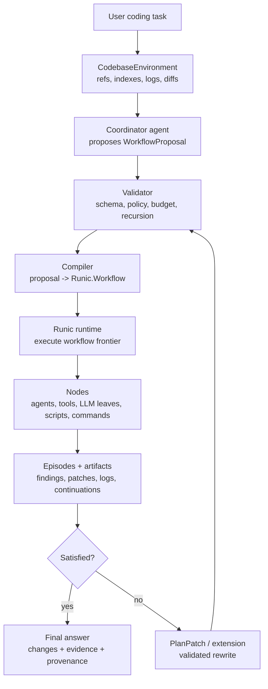

# RLM Coding Agent Investigation

Date: April 25, 2026

Related notes:

- `.docs/020-runic-rlm-architecture-explainer.md`
- `.docs/022-coding-agent-capabilities-investigation.md`
- `/home/doops/wrk/runic/.docs/workflow-rewriting-rlm-exploration.md`

## Goal

This note investigates how RunicAI could implement a coding agent specifically
through its RLM components.

The prior coding-agent investigation describes the broad local agent surface:
workspace tools, command execution, patch editing, Codex integration, safety
policy, and persistence. This note asks a narrower question:

How would a coding agent look if the outer coordination layer were an RLM plan
over a codebase environment, rather than a single ReAct-style tool loop?

## Short Thesis

Codebases are a very strong fit for RunicAI RLMs.

A non-trivial coding task usually has more relevant context than a model should
hold in one prompt: source files, tests, docs, dependency manifests, git history,
logs, generated artifacts, review comments, and prior failed attempts. RLMs are
designed for this shape. The codebase can live in an external environment. The
workflow can pass refs, slices, search results, and derived artifacts around as
typed data. Bounded leaves can inspect small pieces. Reducers can compose an
evidence-backed plan or patch. Episodes and continuations can handle the places
where the investigation discovers new work.

The strongest architecture is not a fixed set of expert-system planner
profiles. Those profiles can be useful seeds, but the deeper Runic-native idea
is that the coordinator should be able to synthesize a purpose-built workflow at
runtime. That workflow can contain agents, tools, command steps, code/script
steps, reducers, reviewers, child workflows, and continuations. Delegated
workers can also return typed proposals for more workflow structure when their
subtask reveals new work.

The strongest architecture is a workflow-rewriting RLM:

```text
RLM coordinator
  -> codebase environment refs
  -> purpose-built workflow proposal
  -> policy validation and budget checks
  -> compile proposal into Runic workflow
  -> execute agents/tools/scripts/commands as bounded nodes
  -> collect episodes, artifacts, continuations, and plan patches
  -> rewrite or extend the workflow until satisfied or bounded
```

The RLM layer should own planning, partitioning, budgeting, provenance, and
coordination. Inner leaves can still use ordinary RunicAI tool-agent recipes for
tactical work.

## Why Coding Is An RLM-Shaped Problem

Many coding tasks are not blocked by the absence of a shell command. They are
blocked by coordination:

- Which parts of the repo matter?
- Which facts must be gathered before editing?
- Which files can be inspected independently?
- Which proposed change affects shared contracts?
- Which tests verify the actual behavior?
- Which failure logs justify another branch of work?
- Which partial findings should become a patch, and which should become a
  continuation?

That is exactly the territory described in the RLM architecture explainer:
large source material stays external, refs and slices move through the workflow,
bounded leaves do local semantic work, reducers compose artifacts, and episodes
or continuations extend the frontier when more work is justified.

## Correction: RLM As Workflow Rewriting

The first version of this note leaned toward a menu of planner profiles:
repo-orientation planner, bug-investigation planner, patch-planning planner,
review planner, and so on. Those are useful examples, but they are not the full
Runic perspective.

Runic's distinctive point is that workflows are not merely static pipelines
chosen ahead of time. A workflow can be composed dynamically at runtime. The
Runic workflow-rewriting exploration frames this as a typed graph rewriting
substrate for RLMs: a coordinator can produce new workflow structure, execute
that structure, receive episodes or continuations, and then grow or rewrite the
graph again under policy constraints.

For coding agents, that means the top-level RLM coordinator should be able to:

- Inspect the objective, codebase refs, policy, and prior artifacts.
- Design a purpose-built Runic workflow for this task.
- Choose whether nodes are LLM leaves, tool-agent children, shell/command
  tools, deterministic Elixir steps, generated scripts, reducers, reviewers, or
  human approval gates.
- Execute the workflow through normal Runic mechanics.
- Accept typed plan patches or workflow proposals from delegated workers.
- Validate those proposals against recursion, cost, safety, and workspace
  policies.
- Extend or rewrite the workflow frontier until the objective is satisfied,
  blocked, or budget-limited.

This is not "let the model run arbitrary code forever." It is "let the model
propose workflow structure as data, then let RunicAI validate, compile, trace,
execute, and bound it."

The expert-system planner profiles in this note should therefore be read as
seed patterns and evaluation fixtures, not as the intended ceiling of the
architecture.

## Role Of Recipes And Commands

Pre-planned workflows are still valuable.

The point is not to reject recipes. It is to avoid making recipes the only way
the RLM can plan. Common coding tasks often do have reliable shapes, and those
shapes should be captured as named recipes or commands that the coordinator can
invoke directly when they fit.

Useful roles for recipes:

- **Slash-command style entrypoints**: `/review`, `/fix-ci`, `/explain-repo`,
  `/plan-migration`, `/write-tests`, or `/triage-bug` can map to known workflow
  templates.
- **Coordinator seed patterns**: the coordinator can inspect examples of proven
  workflows and adapt them to the current objective.
- **High-confidence fast paths**: if the task clearly matches a known pattern,
  skip open-ended workflow synthesis and instantiate the recipe.
- **Fallbacks**: if a generated workflow proposal fails validation, fall back
  to the nearest safe recipe.
- **Evaluation fixtures**: recipes give stable baselines for comparing dynamic
  planning against known-good workflows.
- **Policy presets**: recipes can carry conservative defaults for allowed tools,
  command access, recursion depth, review gates, and verification commands.

So the architecture should support both:

```text
known task + high confidence
  -> instantiate named recipe / command workflow

ambiguous task or novel context
  -> coordinator proposes purpose-built workflow
  -> validator may accept, rewrite, or fall back to a recipe
```

This gives RunicAI a practical path: start with recipes that solve common
coding problems, then let the coordinator compose or modify them when the task
does not fit a template cleanly.

## Runic Mechanics To Preserve

The key implementation requirement is to keep the RLM architecture aligned with
Runic's own runtime model:

- A coordinator proposal should compile to ordinary Runic components and
  `Workflow.add/3` or `Workflow.merge/2` operations.
- Execution should still use the normal prepare / execute / apply shape:
  `Workflow.prepare_for_dispatch/1`, external execution or scheduler dispatch,
  and `Workflow.apply_runnable/2`.
- Workflow growth should happen as a typed graph rewrite, not as hidden mutable
  state inside a chat loop.
- Every proposed node should have a name, expected inputs, output contract,
  policy metadata, and causal relationship to the objective or parent episode.
- Subtasks can be workflows themselves. Their outputs should return as
  `Episode`, `Continuation`, `PlanPatch`, or typed artifacts rather than loose
  prose.
- Recursion is allowed, but it must be bounded by depth, plan patch count, child
  workflow count, cost, command policy, and explicit stop conditions.

This keeps the RLM agent from becoming a parallel framework beside Runic. It is
Runic: dynamic workflow composition used as the recursive planning substrate.

## RLM Versus A Normal Coding Tool Agent

A normal coding tool agent is best when the task is small and sequential:

```text
read a few files -> edit -> run tests -> final answer
```

An RLM coding agent is better when the task is broad, ambiguous, or evidence
heavy:

```text
index codebase -> split by files/symbols/domains
  -> inspect relevant slices in parallel
  -> reduce findings into a dependency-aware plan
  -> execute bounded edits
  -> verify and repair targeted failures
```

The distinction is not "RLM instead of tools." It is "RLM above tools."

The broad tool surface from `.docs/022-coding-agent-capabilities-investigation.md`
still matters: file reads, `rg`-like search, patch application, commands,
background processes, git, SQLite, and Codex delegation. RLM gives those tools
a typed, inspectable coordination layer.

## Codebase As RLM Environment

The first required addition is a codebase-backed implementation of
`RunicAI.RLM.Environment`.

The existing `RunicAI.RLM.Environments.InMemory` stores text blobs and supports
character splitting, searching, and materialization. A coding environment would
store or reference richer sources:

| Source kind | Example | Notes |
| --- | --- | --- |
| Repo manifest | file tree, language detectors, package manifests | Small enough to materialize early. |
| Instructions | `AGENTS.md`, README, contributing docs | High priority context. |
| Source file | `lib/runic_ai/rlm/plan.ex` | Split by file, module, function, or range. |
| Test file | `test/runic_ai/rlm/planning_test.exs` | Useful as behavior evidence. |
| Git diff | current working tree diff | Essential for review and repair. |
| Test log | failed command output | Often a source that should be sliced and searched. |
| Symbol index | module/function definitions, call references | Derived source, not raw file text only. |
| Dependency graph | modules, packages, imports, aliases | Helps route investigation. |
| Prior session trace | tool summaries, findings, failed patches | Enables resume and session search. |

This suggests a new adapter:

```text
RunicAI.Coding.RLM.CodebaseEnvironment
```

It should expose source refs for files and generated indexes without forcing the
root prompt to carry file contents.

Materialization should support multiple granularities:

- whole file for small files
- line range
- symbol range
- search hit with surrounding context
- dependency neighborhood
- current diff hunk
- command log section

## Coding-Specific Slices

Character windows are useful for documents, but code wants structural slicing.

Potential slice strategies:

- `:file`: one slice per file, with size caps.
- `:line_window`: fixed line windows with overlap.
- `:symbol`: module, function, class, or method body.
- `:test_case`: test block and setup around it.
- `:diff_hunk`: changed file hunk plus nearby context.
- `:search_hit`: regex/search match plus context.
- `:dependency_neighborhood`: file plus imports, callers, or callees.
- `:owned_area`: directory or package boundary.

The RLM `Slice` contract can already represent offsets, lengths, provenance, and
metadata. The missing piece is a code-aware environment that can translate
"symbol X in file Y" or "hunk 3 of diff Z" into a materialized artifact.

## Coordinator-Compiled Workflow Shape

The current default RLM planner intentionally builds a simple plan:

```text
split -> map_leaf -> reduce
```

That is the right minimum vertical slice, but a serious coding RLM needs a
coordinator that can compile a task-specific workflow. The coordinator's output
should be structured data, not free-form instructions:

```text
RunicAI.Coding.RLM.WorkflowProposal
  objective
  assumptions
  sources
  nodes
  edges
  policies
  expected_artifacts
  stop_conditions
  verification_strategy
```

The proposal is then validated and compiled:

```text
objective + codebase refs
  -> coordinator LLM proposes WorkflowProposal
  -> validator checks schema, safety, recursion, budget, and allowed node kinds
  -> compiler turns proposal into Runic.Workflow
  -> runtime executes workflow
  -> episodes / artifacts / continuations return to coordinator
  -> coordinator proposes PlanPatch or WorkflowProposal extension
```

In this model, "planner profiles" become examples the coordinator can imitate
or compose, not hard-coded outer strategies.

### Example Seed Patterns

Seed patterns are still useful as few-shot references, tests, and fallback
plans.

Repo orientation:

```text
register repo manifest
  -> split by top-level domains
  -> map leaves to summarize responsibility and risks
  -> reduce into architecture map
```

Bug investigation:

```text
register issue, logs, tests, and repo index
  -> search likely symbols and error messages
  -> materialize candidate slices
  -> map leaves to extract hypotheses and evidence
  -> reduce into ranked root-cause findings
  -> continue with targeted reads if confidence is low
```

Patch planning:

```text
register objective, repo map, relevant docs, candidate files
  -> inspect contracts and call sites in parallel
  -> reduce into dependency-aware patch plan
  -> review plan against safety and blast radius
```

Edit and verify:

```text
patch plan
  -> child editor workflow emits structured patch
  -> apply patch through guarded tool
  -> run targeted verification
  -> reduce verification observations
  -> continue to repair only failed branches
```

Review:

```text
register diff and touched files
  -> split by file/hunk
  -> map leaves to find risks, missing tests, behavior changes
  -> reduce duplicate findings
  -> emit severity-ordered review
```

The coordinator should be allowed to combine these. For example, a single
purpose-built workflow might run a bug-investigation branch, a contract-mining
branch, and a verification-planning branch in parallel, then reduce those into
one guarded editor workflow.

## Plan Nodes For Coding

`RunicAI.RLM.PlanNode` currently supports these ops:

```text
:split, :filter, :map_leaf, :reduce, :materialize, :review, :child_workflow
```

Those are enough for an initial coding RLM. Coding-specific meaning can live in
`params` and `metadata` before adding new core ops.

Example plan node roles:

| Node op | Coding use |
| --- | --- |
| `:split` | Split repo refs by file, symbol, hunk, or search result. |
| `:filter` | Keep slices relevant to the task, language, error, or symbol. |
| `:materialize` | Load bounded code or log excerpts just before leaf work. |
| `:map_leaf` | Extract local facts, hypotheses, risks, or edit suggestions. |
| `:reduce` | Merge findings into plan, diagnosis, patch set, or review. |
| `:review` | Gate patch plans, destructive commands, or low-confidence results. |
| `:child_workflow` | Invoke an editor, verifier, Codex bridge, or tool agent. |

For workflow proposal nodes, it may be useful to define a coding-level node
vocabulary that compiles down to these RLM ops and ordinary Runic components:

| Proposal node kind | Compiles to |
| --- | --- |
| `:agent` | Child workflow or integrated tool-agent lane. |
| `:tool` | `RunicAI.Tool.Definition` call through execution planning. |
| `:command` | Guarded command runner or verifier node. |
| `:script` | Sandboxed generated script, checked and executed as a tool node. |
| `:llm_leaf` | Bounded `RunicAI.LLM` call over materialized artifacts. |
| `:deterministic_step` | Static Elixir function from an allowlisted module. |
| `:reducer` | Deterministic or LLM-assisted reducer. |
| `:review_gate` | Guard/review/wait node. |
| `:workflow_patch` | A proposal to add or rewrite part of the frontier. |

This keeps the coordinator expressive while preserving a typed compilation
boundary. Arbitrary code, shell commands, and generated scripts are possible,
but only as explicit node kinds with policy, sandbox, timeout, and trace
semantics.

## Leaf Work

Coding RLM leaves should be deliberately small. Examples:

- "Given this function and the failing assertion, extract likely invariant
  violations."
- "Given this module and task, list externally visible contracts."
- "Given this diff hunk, identify behavioral regressions and missing tests."
- "Given this file slice, say whether it is relevant to the target symbol."
- "Given this test log section, extract the failing test names and error causes."
- "Given this candidate patch plan and code slice, check if the edit is safe."

Leaf outputs should not be free-form prose only. Useful leaf artifacts:

```text
RunicAI.Coding.RLM.Finding
RunicAI.Coding.RLM.ContractFact
RunicAI.Coding.RLM.Risk
RunicAI.Coding.RLM.EditCandidate
RunicAI.Coding.RLM.VerificationObservation
RunicAI.Coding.RLM.RepairNeed
```

Each artifact should carry:

- source refs and slice provenance
- confidence
- rationale
- affected paths or symbols
- suggested follow-up, if any

## Reducers

Reducers are where an RLM coding agent becomes more than parallel grep with an
LLM at each hit.

Important reducers:

- **Finding reducer**: deduplicates hypotheses and ranks them by evidence.
- **Contract reducer**: merges API, type, behavior, and test constraints.
- **Patch-plan reducer**: converts findings into ordered edit steps.
- **Risk reducer**: identifies shared behavior, public API changes, migrations,
  or missing tests.
- **Verification reducer**: classifies command outputs into pass, fail,
  blocked, flaky, or needs broader verification.
- **Review reducer**: turns per-hunk review observations into a concise final
  review.

Reducers can be deterministic where possible and LLM-assisted where semantic
synthesis is needed. The key is that reducer inputs are typed leaf results with
provenance, not one giant transcript.

## Episodes And Continuations

Coding is full of "not enough information yet" moments. The RLM episode and
continuation contracts are a natural fit.

An investigation leaf might return:

```text
Episode status: :partial
Outcome: likely failure is in RunicAI.Steps.ExecuteToolCallsControlled
Artifacts: finding + supporting slices
Continuation: search call sites for retryable_batch?
```

An editor child workflow might return:

```text
Episode status: :blocked
Outcome: patch applies, but targeted test fails
Artifacts: patch, test log, verification observation
Continuation: inspect reducer behavior around retry status
```

A verifier might return:

```text
Episode status: :satisfied
Outcome: targeted and full tests pass
Artifacts: command observations, changed file hashes
Continuation: nil
```

This is cleaner than asking a subagent to summarize "what happened" in a loose
message. The parent RLM reducer can decide whether to accept, repair, expand, or
ask for review.

## Recursive Delegation And Plan Patches

Delegated workers should not be limited to returning final answers. If a worker
discovers that its subtask requires a different decomposition, it should be able
to return a typed continuation or plan patch.

Examples:

```text
Worker objective: inspect the retry control code.
Observation: failure path depends on BatchResult status normalization.
Return: 
  Episode status: :extended
  Artifacts: local findings
  PlanPatch:
    add search node for BatchResult status constructors
    add materialize nodes for matching files
    add reducer node to compare status semantics
```

```text
Worker objective: propose focused tests.
Observation: existing tests cover retries but not fallback after mixed batch results.
Return:
  Episode status: :partial
  Artifacts: test-plan candidate
  Continuation:
    run child workflow to inspect existing fallback tests
```

The parent coordinator should not blindly accept these. It should validate:

- Does the patch preserve the parent objective?
- Does it fit recursion, token, cost, command, and child-workflow budgets?
- Does it request only allowed tools and workspace paths?
- Does it introduce a cycle without a decreasing measure?
- Does it have a clear stop condition and expected artifact?

This lets recursive decomposition be dynamic without becoming an unbounded REPL.

## Hybrid Workflow-Rewriting Architecture

The most practical implementation is a two-level system, but the top level is
not a fixed planner. It is a coordinator that proposes and rewrites Runic
workflow structure.



In this shape, the RLM coordinator owns workflow composition. The editor and
verifier can still be child workflows that use the normal coding tool surface
described in `.docs/022-coding-agent-capabilities-investigation.md`, but they
are only two node kinds among many.

## Codex In An RLM Coding Agent

The main Codex motivation here is practical access to a user's existing Codex /
ChatGPT subscription tokens during local testing, not necessarily treating Codex
as an autonomous subagent.

The preferred framing is therefore an authentication/model-access adapter:

- The RunicAI coordinator still produces workflow proposals and owns policy.
- Model turns can optionally be routed through Codex CLI/SDK auth when that is
  the only practical way to use subscription-backed local access.
- The adapter should not scrape or manage Codex credentials. Let Codex own its
  local login, refresh, and auth storage.
- The adapter should normalize whatever events it can observe into RunicAI
  traces and LLM/tool result contracts.

There are still cases where Codex-as-subagent is useful, but that should be
optional. It should not be the conceptual center of the RLM design.

Open question: Codex CLI is itself an agent harness, not a raw model endpoint.
So a `RunicAI.LLM` client backed by Codex may be awkward unless Codex exposes a
stable SDK surface for "run this turn under local auth and stream events." For
testing, a `codex exec --json` bridge could be good enough, but the RLM
coordinator should treat it as a model/worker access path rather than as the
owner of recursive decomposition.

## Persistence

The persistence ideas from the prior note become more important with RLMs.

An RLM coding session should persist:

- environment refs and source metadata
- repo index snapshots
- workflow proposals, compiled plan nodes, plan patches, and cost estimates
- leaf artifacts and reducer outputs
- episodes and continuations
- command observations and patch hashes
- search/session FTS entries

SQLite is a good default candidate for this internal state because it can store
session metadata, JSON artifacts, FTS search, command logs, and a per-agent
scratch database in one local file. The package can still hide this behind a
behaviour so downstream apps can use another store.

## Safety Model

RLMs create a useful safety split:

- Coordinator workflow proposals should be inert data until validated.
- Investigation leaves should usually be read-only.
- Reducers should produce plans and review requests, not mutate the workspace.
- Editor child workflows should be the only phase allowed to emit patches.
- Command execution should be isolated to verifier phases or explicit tool
  leaves.
- Generated scripts should run only in sandboxed backends or return artifacts
  for review.
- Destructive or broad operations should pass through `GuardDecision`,
  `ReviewRequest`, and budget policies.

The coordinator should be allowed to branch broadly over reads, but mutation
should be narrow, late, and evidence-backed.

This policy pairs naturally with late materialization:

- Root context sees the objective and summaries.
- Leaves see bounded files or logs.
- Editor sees only the files and plan needed for the patch.
- Verifier sees command output and changed-file metadata.

## Proposed Modules

Suggested namespace:

```text
lib/runic_ai/coding/rlm/
  agent.ex
  codebase_environment.ex
  source_index.ex
  structural_splitter.ex
  coordinator.ex
  planner.ex
  workflow_proposal.ex
  workflow_compiler.ex
  workflow_validator.ex
  plan_patch_validator.ex
  task_profile.ex
  artifact.ex
  finding.ex
  patch_plan.ex
  reducers.ex
  verifier.ex
  continuation_policy.ex
```

Potential public entrypoint:

```elixir
RunicAI.Coding.RLM.Agent.new(
  cwd: ".",
  coordinator: RunicAI.Coding.RLM.Coordinator,
  seed_patterns: [:bug_investigation, :patch_planning, :verify_and_repair],
  policy: [
    leaf_window: 400,
    max_leaf_calls: 40,
    max_child_workflows: 4,
    max_plan_patches: 6,
    max_depth: 3,
    concurrency: 8
  ],
  editor: RunicAI.Coding.Agent,
  verifier: RunicAI.Coding.RLM.Verifier
)
```

Potential workflow input:

```elixir
%{
  objective: "Fix the failing retry behavior in controlled tool execution.",
  cwd: ".",
  sources: [:repo_index, :instructions, :git_diff, {:test_log, log_id}],
  constraints: ["preserve public contracts", "add focused tests"],
  allowed_node_kinds: [:llm_leaf, :tool, :command, :agent, :reducer, :review_gate]
}
```

## Implementation Sequence

### Phase 1: Read-Only Dynamic Workflow Proposal

- Add `CodebaseEnvironment` with file refs, repo manifest, and text search.
- Add structural split modes for file, line window, and search hit.
- Add `WorkflowProposal` and a schema validator.
- Let a coordinator propose read-only workflows using allowed node kinds.
- Compile the proposal to `RLMSplit`, `RLMMaterialize`, `RLMMapLeaves`,
  `RLMReduce`, filters, and deterministic steps where possible.
- Output findings with source provenance.

This proves the RLM value and workflow-rewriting shape without editing files.

### Phase 2: Plan Patches And Recursive Subtasks

- Add `PatchPlan`, `ContractFact`, and `Risk` artifacts.
- Add reducers for findings, contracts, and risk.
- Add `PlanPatch` validation for coordinator and worker-proposed extensions.
- Allow child workflows to return continuations that request new bounded
  workflow structure.
- Enforce `max_depth`, `max_plan_patches`, `max_child_workflows`, and cost
  estimates.

### Phase 3: Patch Planning

- Add review gates for low-confidence or high-blast-radius plans.
- Keep output as a proposed plan, not a patch.
- Teach the coordinator to choose between more investigation, patch planning,
  review, or stop.

### Phase 4: Editor Child Workflow

- Connect patch plans to a guarded coding tool agent.
- Keep the child write scope explicit.
- Return `Episode` values containing patch summary, changed files, hashes, and
  provenance.

### Phase 5: Verification And Repair Continuations

- Add verifier child workflows for test/format/compile commands.
- Parse command output into `VerificationObservation` artifacts.
- Generate continuations for targeted repair.
- Rerun only affected branches when possible.

### Phase 6: Durable Runtime

- Persist plans, episodes, command observations, patches, and source indexes.
- Add FTS session search over prior RLM coding sessions.
- Add replay/eval fixtures for bug investigation, review, migration planning,
  and multi-file patching.

## What Existing RLM Pieces Can Be Used Immediately

Already useful:

- `RunicAI.RLM.Environment` as the environment behaviour.
- `RunicAI.RLM.EnvironmentRef`, `Slice`, `SliceSet`, and
  `MaterializedArtifact` for code/source refs.
- `RunicAI.RLM.Policy` for leaf windows, branch limits, child workflow limits,
  and concurrency.
- `RunicAI.RLM.Plan` and `PlanNode` for visible recursive work.
- `RunicAI.RLM.CostEstimate` for preflight budget review.
- `RunicAI.RLM.PlanPatch`, `Episode`, and `Continuation` for workflow growth
  and repair loops.
- `RLMSplit`, `RLMMaterialize`, `RLMMapLeaves`, and `RLMReduce`.
- `RunicAI.Recipes.RLMSummarizer` as the minimal vertical slice.
- Runic's dynamic workflow construction concepts from the workflow-rewriting
  exploration: workflow proposals, graph expansion, and bounded continuations.

Likely gaps:

- Persistent codebase environment.
- Structural code splitting.
- Search-backed slice generation with file/range provenance.
- Workflow proposal contract and compiler for richer generated graphs.
- Validator for coordinator-proposed workflows and worker-proposed plan patches.
- Coding artifact contracts.
- Reducers tuned for findings, risks, patch plans, and verification.
- Integration with `IntegratedToolAgent` as an editor/verifier child workflow.
- Durable RLM runtime store.

## Open Questions

- Should coding RLM live in core RunicAI or a companion package?
- Should `CodebaseEnvironment` read directly from the working tree, or should it
  snapshot files into a durable store first?
- How much structural parsing should be language-specific versus based on
  generic text, regex, and tree-sitter-style adapters?
- What is the smallest safe `WorkflowProposal` schema that is expressive enough
  for real coding tasks?
- Should editing be represented as proposal nodes, `PlanNode` work, a child
  workflow, or a combination?
- Can `PlanPatch` become the standard representation for dynamically discovered
  coding work?
- How should the validator prove or approximate that recursion is decreasing?
- Which generated scripts are safe enough to execute, and which should only
  produce reviewable artifacts?
- What is the right boundary between a patch-plan reducer and an editor child
  agent?
- Can Codex subscription-backed access be exposed as a model/client adapter
  without treating Codex as the recursive planner?

## Practical Recommendation

Start with a read-only dynamic workflow proposal recipe.

That gives RunicAI a distinctive capability without immediately taking on the
risk of autonomous editing. The first valuable demo could be:

```text
Given a failing test log and a repo, have the coordinator propose a bounded
Runic workflow that investigates the failure, execute that workflow, and produce
a ranked diagnosis with cited file ranges, likely root cause, and a patch plan.
```

Once that works, allow worker episodes to propose validated plan patches. After
that, attach the guarded editing and verification harness from the broader
coding-agent investigation.

This sequence uses RLMs where they are strongest: large-context planning,
purpose-built workflow construction, parallel investigation, provenance, and
targeted continuation. It lets the ordinary tool-agent loop do what it is
strongest at: local editing and command execution once the relevant context has
been narrowed.
