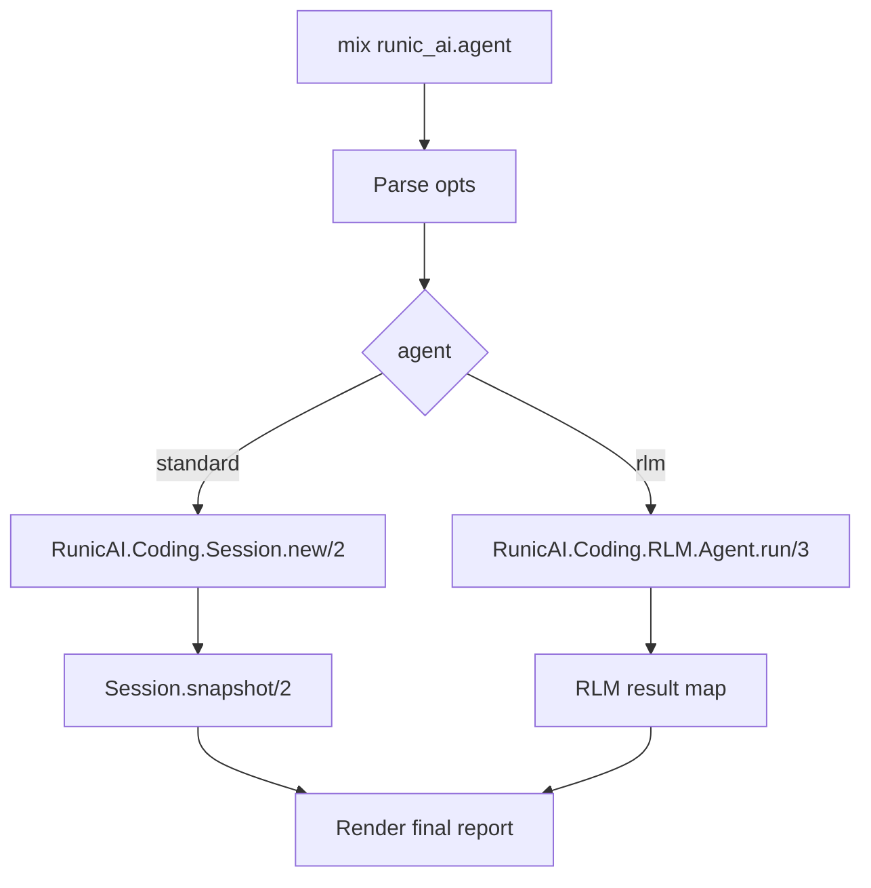
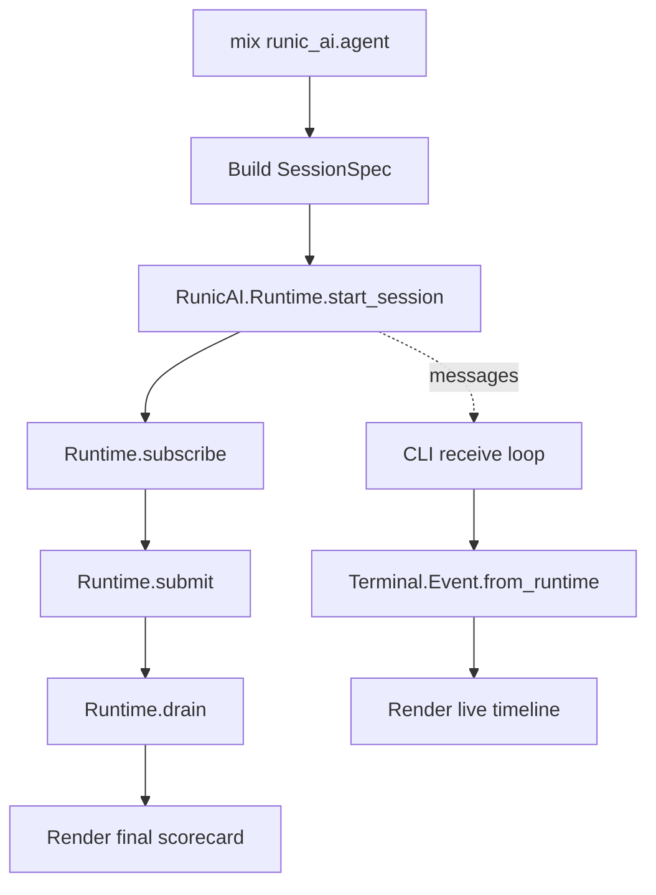
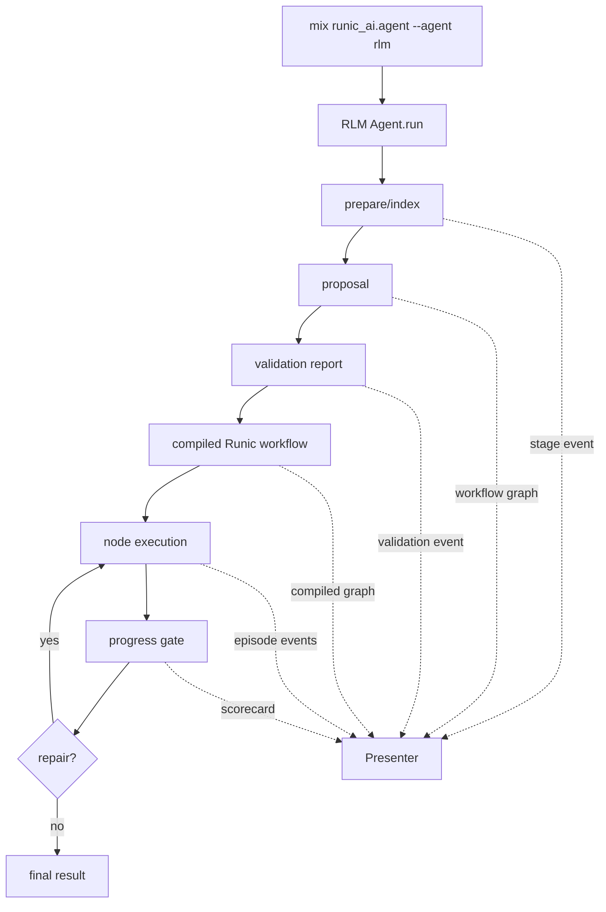
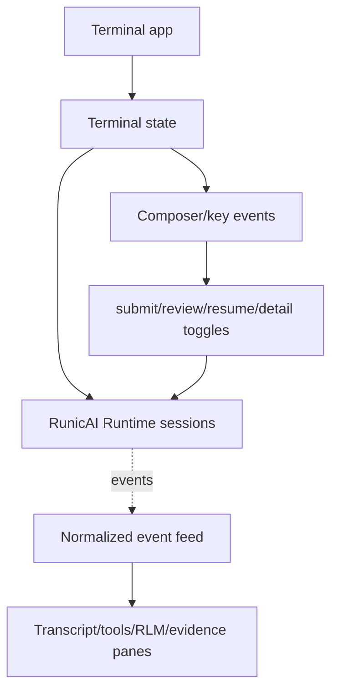
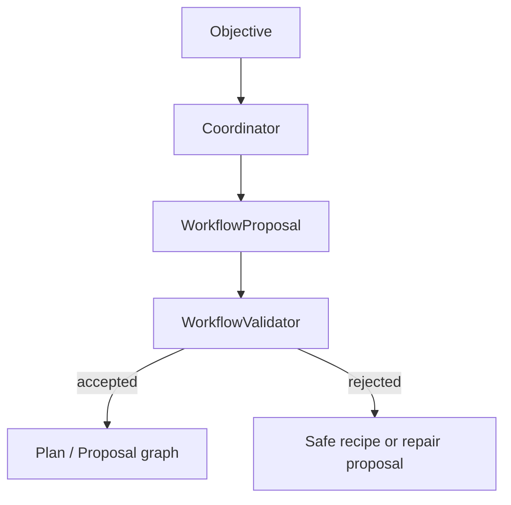
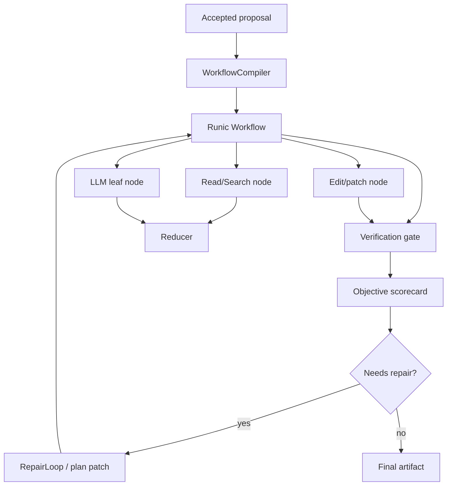

# Minimum Compelling CLI/Terminal Interface Exploration

Status: scoping and recommendation

Date: 2026-04-30

MCP in this document means "minimum compelling product", not Model Context
Protocol.

Motivated by:

- Stable standard coding-agent OODA loop work in
  `.docs/028-standard-coding-agent-ooda-reliability-implementation-plan.md`.
- Stable RLM coding-agent reliability work in
  `.docs/027-rlm-coding-agent-reliability-implementation-plan.md`.
- Existing supervised session runtime in `RunicAI.Runtime`.
- Hermes Agent CLI and TUI docs as a reference point for a productive terminal
  agent harness.

## Goal

Build a terminal harness that makes RunicAI agents feel real enough for
day-to-day iteration.

The first version should prove RunicAI functionality, not prove that we can
build an elaborate terminal application. A developer should be able to run a
local objective, watch the agent loop, see tool/HITL/subagent activity in a
legible timeline, inspect final evidence, and understand whether the standard
agent or RLM agent is the right fit for their problem.

The harness should cover both major coding-agent modes:

- Standard agent: direct, tactical, tool-driven ReAct/OODA worker.
- RLM agent: strategic workflow coordinator that proposes, validates, compiles,
  and executes a generated Runic workflow.

## What "Compelling" Means

The minimum compelling interface is not just a wrapper around `Agent.run/3`.
It needs to expose the parts of RunicAI that are distinctive:

- Agent loop progress: observe, orient, decide, act, verify, repair, finish.
- Tool activity: selected tool, arguments preview, status, result summary, and
  changed files or command output preview where relevant.
- HITL gates: review request, why review is required, selected action, and
  concise approve/deny/rewrite/final-stop controls.
- RLM workflow shape: the proposed workflow graph before execution, validation
  status, compiled execution graph, node progress, episodes, repairs, and final
  scorecard.
- Session identity: session id, workspace root, agent mode, model/client,
  policy, and a resume/export path.
- Evidence discipline: objective scorecard, verification results, residual
  risks, and any gap between agent-declared completion and independent proof.

The first version can be text-first. It becomes compelling if the timeline is
honest, stable, and easy to scan.

## Current RunicAI Surface Area

### Standard Agent

`RunicAI.Coding.Session` is already close to the right terminal entry point.
It can create a `RunicAI.Runtime.SessionSpec` for the standard coding agent:

```elixir
spec = RunicAI.Coding.Session.spec(".", id: "coding:cli:...")
{:ok, handle} = RunicAI.Runtime.start_session(spec)
:ok = RunicAI.Runtime.subscribe(handle)
{:ok, session} = RunicAI.Runtime.submit(handle, %{user: %{content: objective}})
{:ok, session} = RunicAI.Runtime.drain(handle)
```

The runtime sends subscriber messages as the session transitions:

```elixir
{:runic_ai_runtime, session_id, :trace_event, event}
{:runic_ai_runtime, session_id, :output, output}
{:runic_ai_runtime, session_id, :snapshot, session}
```

This gives a CLI or TUI a clean event feed without needing to inspect workflow
internals directly.

The standard coding-agent snapshot already includes a high-signal summary:

- visible tools,
- tool calls and observations,
- changed files,
- verification summaries,
- objective scorecard,
- repair attempts,
- residual risks.

`RunicAI.Coding.Review` also provides terminal-friendly decision constructors:
`allow/2`, `deny/2`, `rewrite/3`, and `final_stop/2`.

### RLM Agent

`RunicAI.Coding.RLM.Agent.run/3` currently returns a rich result after the run:

- `proposal`
- `validation_report`
- `compiled`
- `workflow`
- `context`
- `output`
- `episodes`
- `trace`
- `codebase_environment`
- `objective_scorecard` and repair metadata when reliability gates run

The RLM path has the right artifacts for a compelling terminal display, but it
does not yet expose the same supervised, live event interface as the standard
agent. The initial terminal harness can summarize RLM stages after completion,
but true "stream as it materializes" behavior needs one of these changes:

- Add an RLM event sink/callback option that emits stage events during
  `prepare -> propose -> validate -> compile -> execute -> progress_gate ->
  repair -> persist`.
- Wrap RLM execution in a `RunicAI.Runtime.SessionSpec` backend so it can use
  `RunicAI.Runtime.subscribe/1` like the standard agent.
- Emit RLM trace events from `Checkpoint`, `Coordinator`, `WorkflowCompiler`,
  `ProgressGate`, and `RepairLoop`, then bridge those events to the runtime.

The event-sink option is the smallest incremental change. A runtime backend is
the cleaner long-term shape if RLM runs need resume, wait scheduling, and
interactive control.

### Streaming Reality

RunicAI has `RunicAI.LLM.stream_text/3`, and the ReqLLM adapter delegates to
`ReqLLM.stream_text/3`. The current integrated agent turn-generation path is
still primarily `generate_text` oriented, and the local Codex bridge explicitly
does not support `stream_text`.

That means the first terminal harness can stream RunicAI runtime events as they
appear, but not necessarily token-by-token LLM content. Token streaming should
be treated as a second layer:

1. Present trace events, outputs, snapshots, tool observations, and HITL gates
   live.
2. Extend turn generation to optionally call `stream_text` and emit normalized
   chunk events.
3. Classify chunks by content type when the provider exposes enough structure:
   assistant text, reasoning/thinking, tool call delta, tool result, comments,
   subagent progress, and final response.

## External Options

### Option A: No New Dependency Mix Task

Build a minimal Mix task and plain ANSI/text presenter.

Possible command shape:

```sh
mix runic_ai.agent "add a health check endpoint" --agent standard --cwd .
mix runic_ai.agent "investigate failing checkout tests" --agent rlm --cwd .
mix runic_ai.agent --interactive --agent standard --cwd .
mix runic_ai.agent --jsonl trace.jsonl --agent standard --cwd .
```

Core modules:

```text
lib/mix/tasks/runic_ai.agent.ex
lib/runic_ai/terminal/agent_runner.ex
lib/runic_ai/terminal/event_presenter.ex
lib/runic_ai/terminal/standard_runner.ex
lib/runic_ai/terminal/rlm_runner.ex
```

Strengths:

- Zero dependency risk.
- Works on the current Elixir 1.18 / OTP 27 project setup.
- Can reuse `RunicAI.Runtime.subscribe/1` immediately for the standard agent.
- Easy to test with `ExUnit.CaptureIO` and scripted LLM clients.
- Best path for proving agent semantics before investing in terminal layout.

Weaknesses:

- Multiline editing, scrollback control, keybindings, modals, and split panes
  will be basic unless we build them.
- Less visually compelling than a true TUI.
- Interactive input while a turn is running will be awkward unless we add raw
  terminal input or a separate input process.

Best use:

- First MCP spike.
- CI-friendly single-query mode.
- Trace/export-focused developer harness.

### Option B: Owl-Enhanced CLI

[`owl`](https://hex.pm/packages/owl) is a command-line UI toolkit for Elixir.
Hex currently lists v0.13.0, and its docs cover colorized text, input controls,
tables, boxes, progress bars, spinners, live-updating multiline blocks, and
virtual devices that cooperate with live blocks.

Strengths:

- Much more polish than hand-written ANSI without becoming a full alternate
  screen TUI.
- Good fit for a timeline, tables, scorecards, progress blocks, and prompts.
- More mature package footprint than the niche TUI options.
- Can keep the architecture as a Mix task plus event presenter.

Weaknesses:

- Still not a full TUI framework with panes, modal overlays, mouse support, or
  a terminal application architecture.
- Adds a dependency before we know if presentation is the bottleneck.

Best use:

- If the no-dependency task proves useful but too visually plain.
- A very good "phase 1.5" dependency.

### Option C: Termite Low-Level TUI Primitives

[`termite`](https://hex.pm/packages/termite) is a dependency-free, NIF-free
terminal library. Hex currently lists v0.4.2, OTP 26+ support, no dependencies,
and a small surface for terminal start/poll/write, screen escape sequences,
styles, alt screen, and keyboard events.

Strengths:

- Works with the current OTP 27 environment.
- Very small dependency and simple mental model.
- Good if RunicAI wants to own its rendering/event-loop architecture.
- Useful for a custom event timeline without pulling in a heavy TUI framework.

Weaknesses:

- It is deliberately low-level.
- We would need to build layout, panes, scrollback, composer, focus, resize,
  modals, and accessibility behavior ourselves.
- The product risk shifts from agent harness design to terminal UI mechanics.

Best use:

- A focused TUI spike after the CLI event model is stable.
- A custom alt-screen dashboard for event timeline plus input composer.

### Option D: TermUI Direct-Mode TUI

[`term_ui`](https://hex.pm/packages/term_ui) is a direct-mode terminal UI
framework for Elixir/BEAM. Hex currently lists v0.2.0, and the docs describe an
Elm-style `init/update/view` model, differential rendering, theming, OTP
integration, and widgets such as text inputs, dialogs, tabs, split panes,
viewports, tables, log viewers, command palettes, and stream widgets.

Strengths:

- Best match for a Hermes-inspired visual interface.
- Built-in widgets map well to RunicAI needs:
  - log viewer for trace events,
  - split panes for transcript/tool details,
  - dialogs for HITL approval,
  - tabs for standard/RLM/session/evidence views,
  - stream widgets for live event feeds.
- Its architecture fits a supervised BEAM application better than an ad hoc
  terminal loop.

Weaknesses:

- Current docs list OTP 28+ for native raw terminal mode; this repo currently
  runs on OTP 27.
- Bigger dependency and architecture commitment.
- A TUI could obscure agent API gaps unless we first stabilize the event model.

Best use:

- Second-stage TUI once the RunicAI terminal event model is proven.
- Best candidate if the project moves to OTP 28 or if TermUI's compatibility
  story changes.

### Option E: Ratatouille Or Other TUI Libraries

Ratatouille is established in the Elixir TUI space, but it is older and less
aligned with the current dependency direction suggested by `termite` and
`term_ui`. It is worth keeping in mind only if TermUI is blocked and Termite is
too low-level.

## Hermes Features To Translate

Hermes is useful as a feature reference, not as a spec to clone.

The Hermes CLI docs emphasize terminal-first interaction: interactive and
single-query modes, model/provider/tool flags, session resume, a status bar,
slash commands, multiline input, interruption, tool progress display, session
storage, context compression, background sessions, and quiet/verbose display
modes.

The Hermes TUI docs add the important terminal-app behaviors: same runtime as
the CLI, non-blocking input, rich overlays for model/session/approval prompts,
live session panels, alternate-screen rendering, floating slash completion,
real-time status line, per-section detail controls for thinking/tools/subagents,
and shared sessions between CLI and TUI.

RunicAI should translate only the parts that help developers iterate on agents:

- Single-query mode first.
- Interactive loop second.
- Live status line or status prefix.
- Tool progress display.
- Review/HITL prompts.
- RLM plan/proposal display.
- Session resume/export.
- Verbose/detail toggles.
- JSONL trace export.
- Later: queued/interrupting/steering input.
- Later: subagent/background run panels.

Do not start with skins, voice, custom personalities, marketplace skills,
mouse selection, image paste, or a full command palette. Those are product
surface area multipliers and are not needed to prove RunicAI.

## Proposed Terminal Event Model

The terminal harness should not render raw structs directly. Add a presentation
event layer that normalizes standard-agent runtime events, RLM artifacts, and
future token chunks into a small vocabulary.

```elixir
%RunicAI.Terminal.Event{
  id: "...",
  at: DateTime.utc_now(),
  session_id: "...",
  agent: :standard | :rlm,
  kind: :status | :message | :tool | :hitl | :rlm_plan | :rlm_node |
        :verification | :repair | :subagent | :chunk | :error | :summary,
  phase: atom(),
  status: :pending | :running | :ok | :review | :waiting | :blocked | :error,
  title: String.t(),
  detail: String.t() | nil,
  data: map(),
  raw: term()
}
```

Initial mappings:

| Source | Terminal event |
| --- | --- |
| `:turn_started` | `:status`, phase `:turn` |
| `:llm_request` | `:status`, phase `:thinking` |
| `:coding_tool_visibility` | `:tool`, phase `:visible_tools` |
| `:coding_tool_call` | `:tool`, phase `:call` |
| `:coding_tool_observation` | `:tool`, phase `:observation` |
| `:coding_verification_observation` | `:verification` |
| `:coding_repair_attempt` | `:repair` |
| `:review_requested` | `:hitl`, status `:review` |
| `:wait_registered` | `:hitl`, status `:waiting` |
| RLM `WorkflowProposal` | `:rlm_plan`, phase `:proposed` |
| RLM `WorkflowValidationReport` | `:rlm_plan`, phase `:validated` |
| RLM compiled workflow | `:rlm_plan`, phase `:compiled` |
| RLM `Episode` | `:rlm_node`, phase `:episode` |
| RLM `WorkflowScorecard` | `:summary`, phase `:scorecard` |
| future LLM token | `:chunk`, phase `:assistant` or `:thinking` |

The presenter can then support multiple renderers:

- plain text,
- ANSI text,
- Owl blocks,
- Termite alt-screen UI,
- TermUI app,
- JSONL trace.

## Architecture Options

### Architecture 1: Synchronous Mix Task



This is the smallest possible implementation. It is useful for deterministic
reports and CI, but it is not live enough to feel like an agent harness.

### Architecture 2: Event-Subscribed CLI



This is the recommended first MCP path for the standard agent. It uses the
runtime exactly as intended and gives us live progress without a TUI dependency.

### Architecture 3: Event-Subscribed CLI Plus RLM Stage Sink



This requires a new `:event_sink` or `:trace_sink` option in the RLM stack, but
it keeps the first change small and avoids prematurely designing a new runtime
backend.

### Architecture 4: Full TUI Shell



This should reuse the same terminal event model and runners from the CLI. If we
go here too early, UI mechanics will slow down the agent harness work.

## Recommended Path

Start with Architecture 2 for the standard agent and a partial Architecture 3
for the RLM agent.

Do not add `term_ui` yet. The current project is on OTP 27, while TermUI's docs
list OTP 28+ for native raw terminal mode. It is the best full-TUI candidate,
but adopting it now would either force an OTP upgrade decision or create a
compatibility distraction.

Do not start with `termite` unless we explicitly want to spend the spike on
terminal mechanics. Termite is attractive because it works on OTP 27 and is
small, but the first product question is whether the event timeline and agent
control loop are compelling. A low-level TUI will not answer that faster than a
good CLI.

Recommended sequence:

1. Add a no-dependency `mix runic_ai.agent` task.
2. Implement a `RunicAI.Terminal.Event` normalizer and plain text presenter.
3. Use `RunicAI.Runtime.subscribe/1` for live standard-agent events.
4. Add HITL prompt handling for review requests with allow/deny first, rewrite
   second.
5. Add RLM final-result presentation that shows proposal, validation,
   compiled-plan summary, episodes, repairs, and scorecard.
6. Add RLM stage-event sink so proposal/validation/compile/execute progress
   appears live.
7. Add `--jsonl` export and `--detail collapsed|expanded|hidden`.
8. If the CLI is useful but visually flat, consider `owl`.
9. If users need panes, non-blocking input, modals, and scrollable history,
   revisit a TermUI TUI after OTP 28 is acceptable.

## Minimal Feature Set For The First Spike

Command modes:

- `--agent standard|rlm`
- `--cwd PATH`
- `--model MODEL` or `--client CLIENT_ALIAS`
- `--interactive`
- `--jsonl PATH`
- `--detail hidden|collapsed|expanded`
- `--approve never|safe|ask`
- `--max-turns N`
- `--max-runtime-ms N`

Standard-agent display:

- Header: session id, workspace, profile, model/client, mode.
- Live timeline:
  - user objective,
  - turn start,
  - LLM request,
  - visible tools,
  - tool calls,
  - tool observations,
  - verification results,
  - repair attempts,
  - review/wait prompts,
  - final assistant response.
- Final report:
  - status,
  - changed files,
  - tools used,
  - objective status,
  - latest compile/test results,
  - residual risks.

RLM display:

- Header: run id, workspace, objective, file/source count.
- Proposed workflow graph:
  - node id,
  - node kind,
  - dependencies,
  - policy,
  - expected outputs.
- Validation:
  - accepted/rejected,
  - errors/warnings,
  - rejected node ids,
  - estimated cost/budget summary.
- Execution:
  - compiled node progress,
  - child-agent nodes,
  - tool/command nodes,
  - reducer outputs,
  - episodes and artifacts.
- Final report:
  - objective scorecard,
  - changed files,
  - verification observations,
  - repair count,
  - residual risks,
  - persistence ref when available.

HITL controls:

- Initial: approve, deny, final stop.
- Next: rewrite/edit selected value.
- Later: explain diff, open detail, approve once vs approve matching action.

## RLM Workflow Visualization

The RLM agent needs to show two related but different graphs.

First, show the planned workflow proposal. This is the coordinator's inert data:



Second, show the materialized execution workflow:



For terminal output, render these as compact text first:

```text
RLM proposal accepted: workflow:abc

  [inspect] tool:list_dir          -> [facts]
  [facts]   reducer:contract       -> [patch_plan]
  [edit]    edit:patch_set         -> [verification]
  [verify]  verification_gate      -> [scorecard]

Validation: accepted, 0 errors, 1 warning
```

A later TUI can use the same normalized graph data to render a split view:
proposal on the left, live execution status on the right.

## What We Need To Change

### New Terminal Namespace

Add a small terminal namespace without committing to a UI framework:

```text
lib/runic_ai/terminal/
  event.ex
  event_presenter.ex
  standard_runner.ex
  rlm_runner.ex
  jsonl_sink.ex
```

`event.ex` should be framework-neutral. `event_presenter.ex` should be pure
formatting logic, testable without a TTY.

### Standard Agent Runner

Use the supervised runtime path:

- `RunicAI.Coding.Session.spec/2`
- `RunicAI.Runtime.start_session/1`
- `RunicAI.Runtime.subscribe/1`
- `RunicAI.Runtime.submit/2`
- `RunicAI.Runtime.drain/2`
- `RunicAI.Coding.Session.snapshot/2`

The receive loop should render subscriber events while `submit`/`drain` runs in
a task. This keeps output live even while the GenServer call is blocked.

### RLM Runner

Start with `RunicAI.Coding.RLM.Agent.run/3` and synthesize terminal events from
the final result. Then add an `:event_sink` option:

```elixir
event_sink = fn event -> send(parent, {:runic_ai_terminal, event}) end
RunicAI.Coding.RLM.Agent.run(workspace, objective, event_sink: event_sink)
```

The sink should be called at these boundaries:

- environment prepared,
- proposal received,
- validation completed,
- compile completed,
- node/episode completed,
- progress gate completed,
- repair attempt started/completed,
- persistence completed.

### Token Streaming

Token streaming should not block the first terminal release. To add it well:

- Add an opt-in streaming mode to the turn generation steps.
- Normalize provider chunks into `RunicAI.Terminal.Event` or lower-level
  `RunicAI.Trace.Event` values.
- Preserve the non-streaming path for tests and providers that do not support
  streaming.
- Make the local Codex bridge report "streaming unsupported" cleanly.

### HITL

HITL should be a first-class terminal loop, not an afterthought.

The CLI can detect `ReviewRequest` in either runtime outputs or session
snapshot and prompt:

```text
Review required: destructive_patch
Tool: apply_patch
Path: lib/old.ex
Action: delete

[a] approve  [d] deny  [s] stop
```

Then resume with:

```elixir
RunicAI.Runtime.submit(handle, %{
  review_decision: RunicAI.Coding.Review.allow(review_request)
})
```

Rewrite/edit can follow once approve/deny/final-stop is reliable.

## Testing Plan

Unit tests:

- Terminal event normalization for known `RunicAI.Trace.Event` kinds.
- Presentation of tool calls, observations, review requests, scorecards, and
  RLM proposals.
- JSONL sink output.
- Option parsing for the Mix task.

Integration tests:

- Standard agent with scripted LLM:
  - emits visible tools,
  - emits one tool call,
  - emits final summary.
- Review-gated standard session:
  - blocks on review,
  - renders prompt,
  - resumes after allow/deny.
- RLM scripted proposal:
  - renders proposed graph,
  - renders validation report,
  - renders final scorecard.

Manual smoke:

- `mix runic_ai.agent "summarize this repo's coding harness" --agent standard --cwd .`
- `mix runic_ai.agent "plan how to fix a failing test log" --agent rlm --cwd .`
- One mutating standard-agent smoke in an isolated `tmp` workspace.
- One RLM repair-loop smoke in an isolated `tmp` workspace.

## Decision Matrix

| Route | Compelling fastest? | Dependency risk | Current OTP 27 fit | Long-term TUI fit | Recommendation |
| --- | --- | --- | --- | --- | --- |
| Plain Mix task | High | None | Yes | Medium | Start here |
| Owl CLI | High | Low/medium | Likely yes | Medium | Consider after first spike |
| Termite TUI | Medium | Low | Yes | Medium | Use only for focused TUI spike |
| TermUI TUI | Medium later | Medium/high | Blocked by docs-reported OTP 28 requirement | High | Revisit after event model/OTP decision |
| Ratatouille | Low/medium | Medium | Unknown without deeper spike | Medium | Not preferred |

## Recommendation

Build the first RunicAI terminal harness as a no-dependency Mix task over a
normalized terminal event model.

This gives us the smallest path to a high-quality product surface:

- It showcases the existing standard-agent session runtime immediately.
- It exposes the gaps in RLM live instrumentation directly.
- It keeps presentation testable and framework-neutral.
- It gives future Owl, Termite, or TermUI work a stable event model instead of
  making the TUI framework define the agent harness.

The first implementation should be good enough that a developer can use it for
real local agent runs. If it is not compelling in a simple CLI, a TUI will hide
the problem rather than fix it.

## Source Notes

- Hermes CLI docs: <https://hermes-agent.nousresearch.com/docs/user-guide/cli>
  describe interactive and single-query modes, status bar, slash commands,
  interruption, tool progress, session resume/storage, and background sessions.
- Hermes TUI docs: <https://hermes-agent.nousresearch.com/docs/user-guide/tui>
  describe shared CLI/TUI runtime, non-blocking input, modal overlays, live
  session panels, alternate-screen rendering, real-time status line, and
  section detail controls for thinking/tools/subagents.
- Termite Hex package: <https://hex.pm/packages/termite> currently lists v0.4.2,
  no dependencies, MIT license, and an Apr 17, 2026 update.
- Termite docs/GitHub: <https://github.com/Gazler/termite> and
  <https://hexdocs.pm/termite/Termite.Terminal.html> describe terminal
  start/poll/write, alt screen, styles, keyboard events, and OTP-dependent
  adapters.
- TermUI Hex package: <https://hex.pm/packages/term_ui> currently lists v0.2.0,
  MIT license, and a Dec 3, 2025 update.
- TermUI docs/GitHub: <https://hexdocs.pm/term_ui/readme.html> and
  <https://github.com/pcharbon70/term_ui> describe Elm-style
  `init/update/view`, differential rendering, widgets, stream/log views, and
  an OTP 28+ requirement for native raw terminal mode.
- Owl Hex/docs: <https://hex.pm/packages/owl> and
  <https://hexdocs.pm/owl/readme.html> currently list v0.13.0 and describe a
  command-line UI toolkit with tables, prompts, spinners, progress bars, boxes,
  and live-updating blocks.
