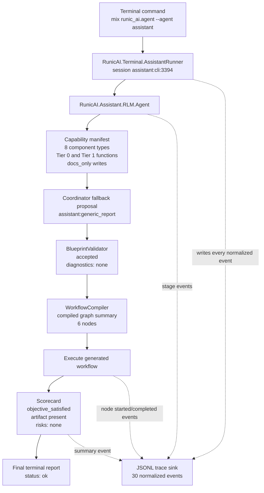
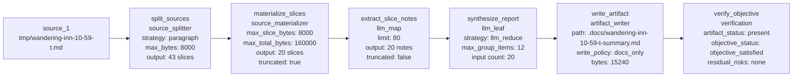
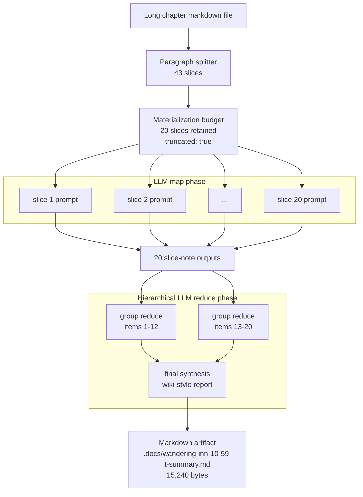
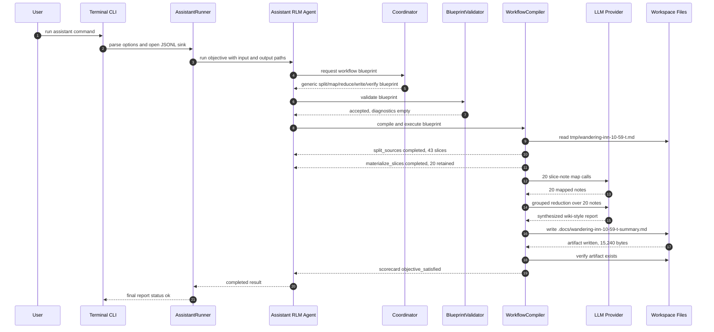
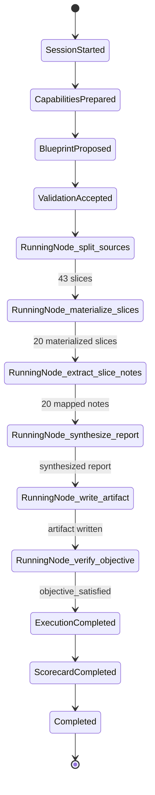
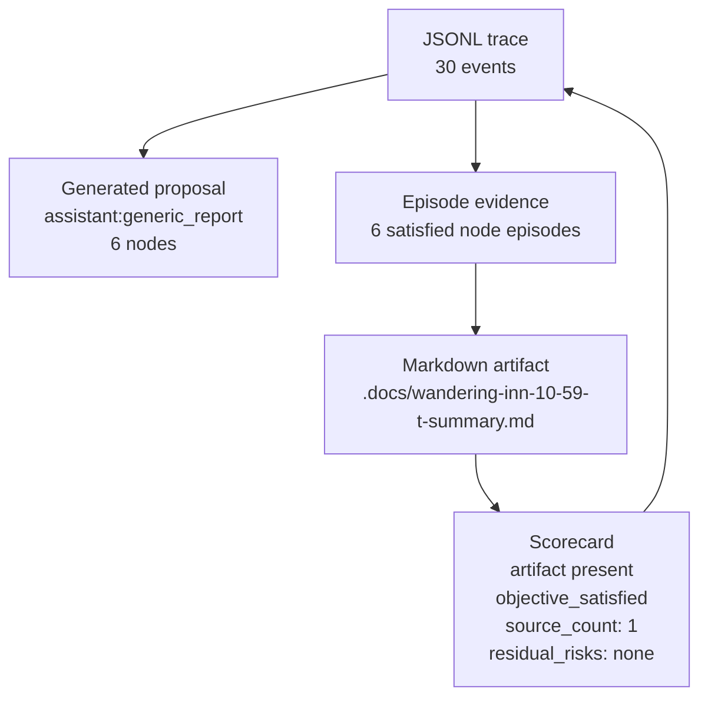

# Wandering Inn Assistant RLM Workflow Diagrams

Status: observed run diagrams

Date: 2026-04-30

Source trace:

- `tmp/wandering-inn-10-59-t.assistant-rlm.jsonl`

Run artifact:

- `.docs/wandering-inn-10-59-t-summary.md`

## Observed Run Summary

- Session: `assistant:cli:3394`
- Blueprint: `assistant:generic_report`
- Input: `tmp/wandering-inn-10-59-t.md`
- Output: `.docs/wandering-inn-10-59-t-summary.md`
- Default model capability: `openai:gpt-5.4-mini`
- Source split: 43 paragraph slices
- Materialized slice set: 20 slices, truncated by materialization budget
- LLM map: 20 per-slice note outputs
- LLM reduce/synthesis: 20 mapped items reduced into final report text
- Artifact write: 15,240 bytes
- Verification: `objective_satisfied`, artifact present, no residual risks
- Runtime window: approximately 5 minutes 25 seconds from terminal start to completion

## Control Workflow

## Generated Blueprint Graph

## Long-Document Map And Reduce Workflow

The trace reports 20 mapped items entering `synthesize_report`. Because the
generated reducer uses `max_group_items: 12`, the group reduction shape below is
the effective shape implied by the component settings: two group synthesis calls
followed by one final synthesis call.

## Runtime Sequence

## Execution Timing View

```mermaid
gantt
  title Assistant RLM Run Timing From JSONL Trace
  dateFormat HH:mm:ss
  axisFormat %H:%M:%S

  section Setup
  Terminal start and capability manifest :done, setup, 17:12:06, 1s
  Blueprint proposal and validation      :done, plan, 17:12:06, 1s

  section Workflow Nodes
  split_sources                          :done, split, 17:12:06, 1s
  materialize_slices                     :done, materialize, 17:12:06, 1s
  extract_slice_notes                    :done, map, 17:12:06, 17:16:09
  synthesize_report                      :done, reduce, 17:16:09, 17:17:31
  write_artifact                         :done, write, 17:17:31, 1s
  verify_objective                       :done, verify, 17:17:31, 1s

  section Completion
  execution_completed and scorecard      :done, complete, 17:17:31, 1s
```

## State Machine View

## Artifact And Evidence Flow

