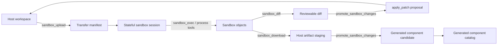

# Standard Agent Sandbox Tooling Plan

Status: active

Date: 2026-06-13

Last aligned: 2026-06-13

## Purpose

RunicAI already has most of the raw sandbox execution primitives needed by a
standard coding agent: bounded code execution, stateful sandbox sessions, file
read/write inside a sandbox, checkpoints, services, proxies, and process
lifecycle scaffolding. The missing product layer is a coherent capability model
that lets an agent intentionally move work between the host workspace and a
sandbox, keep provenance for objects produced there, and promote the useful
pieces back into the host project or the generated-component library under
review.

This plan turns the sandbox tooling suggestions into an implementation sequence
for standard coding agents, subagents, and dynamic workflow agents.

## Product Goal

Agents should be able to:

- choose an appropriate sandbox profile and language runtime per operation;
- execute shell and language-specific code in a one-shot or stateful sandbox;
- create, inspect, copy, move, diff, checkpoint, and restore sandbox objects;
- bring host workspace files into a sandbox without granting broad host write
  access;
- bring sandbox-produced files back to the host only through a reviewable
  promotion path;
- hand a sandbox session or object references to subagents and workflow steps;
- elevate proven artifacts into reusable RunicAI or Runic components.

## Current Baseline

Implemented or already scaffolded:

- `RunicAI.Coding.Tools.default_registry/2` builds code execution tools for
  `execute_code`, `sandbox_status`, stateful sessions, sandbox exec, sandbox
  file read/write/list, checkpoint/restore, services, proxies, and sandbox
  process lifecycle tools when a `SandboxSessionRegistry` is present.
- `RunicAI.Coding.Recipe` exposes `execute_code` and `sandbox_status` to
  sandbox-oriented recipes, while normal verification recipes remain mostly
  host-workspace focused.
- `RunicAI.Agent.CapabilityResolver` has a `:code_execution` toolset and
  profile presets such as `:coding_verify`, `:local_workbench`, and
  `:full_local`.
- `apply_patch` can already create, update, delete, and move host workspace
  files after review.
- The workbench now treats sandbox choice and runtime choice as card-level
  capability inputs instead of assuming only active backends are usable.

Known gaps:

- There is no first-class host-to-sandbox upload, sandbox-to-host download, or
  recursive directory sync tool.
- Sandbox files are not represented as durable object references with hashes,
  origin, session id, and promotion state.
- Sandbox process lifecycle tools exist in the registry but the static
  `CapabilityResolver` `:code_execution` list is missing several process tools,
  so visibility can drift by launch path.
- Promotion from sandbox output to host workspace or component catalog is an
  agent composition today, not a named workflow with review gates.
- Subagent delegation exists through `delegate_task`, but it needs richer
  sandbox handoff semantics: session leases, object references, budgets, and
  expected output schemas.

## Design Principles

- Keep host workspace mutation reviewable. A sandbox can produce changes, but
  promotion to host should flow through patches, staged artifacts, or explicit
  user approval.
- Treat files, directories, checkpoints, running processes, services, and
  generated components as objects with provenance rather than transient strings.
- Prefer backend capability checks over backend-name branching. A Docker,
  Vmsan, Sprites, or remote backend should advertise whether it supports
  upload, download, checkpoint, process streams, service proxies, or snapshots.
- Keep one shared capability surface. Standard agents, subagents, workflows,
  and Workbench should all see the same sandbox operations filtered by policy.
- Preserve low-level primitives. The product should expose ergonomic copy/sync
  tools without removing direct `sandbox_exec`, `sandbox_read_file`, and
  `sandbox_write_file` operations needed by advanced workflows.

## Target Tool Surface

### Existing Tools To Keep

| Tool | Role |
| --- | --- |
| `execute_code` | Bounded one-shot execution in the configured sandbox backend. |
| `sandbox_status` | Capability, isolation, runtime, and readiness metadata. |
| `open_sandbox_session` | Allocate a managed stateful sandbox session. |
| `sandbox_exec` | Execute code inside an existing stateful sandbox. |
| `sandbox_write_file` | Write one file into a sandbox session. |
| `sandbox_read_file` | Read a bounded preview of one sandbox file. |
| `sandbox_list_files` | List sandbox files. |
| `checkpoint_sandbox` / `restore_sandbox` | Save and recover stateful sandbox state. |
| `start_sandbox_process` and related process tools | Manage long-running commands where supported. |
| `start_sandbox_service` / `open_sandbox_proxy` | Host service and preview workflows where supported. |

### New Tools

| Tool | Purpose | Review posture |
| --- | --- | --- |
| `sandbox_upload` | Copy host files or directories into a sandbox session. Supports explicit source paths, ignore rules, max byte limits, and manifest output. | Requires review when source path is broad or ignore rules are absent. |
| `sandbox_download` | Copy sandbox files or directories into a host staging area or artifact bundle without changing project files directly. | Does not mutate project files unless promotion is requested. |
| `sandbox_diff` | Compare sandbox paths against host paths or a previous manifest. | Read-only. |
| `sandbox_sync` | Reconcile a declared host/sandbox mapping using hashes and policy. | Requires review; defaults to host-to-sandbox or sandbox-to-staging, not direct host overwrite. |
| `sandbox_move` | Move or rename files inside the sandbox session. | Sandbox mutation only. |
| `sandbox_copy` | Copy files inside the sandbox session. | Sandbox mutation only. |
| `promote_sandbox_changes` | Convert staged sandbox outputs into an `apply_patch` payload or generated-component promotion request. | Requires review and should provide a diff summary. |
| `sandbox_object_manifest` | Return durable object refs, hashes, sizes, kind, and promotion state for a session. | Read-only. |

## Sandbox Object Model

Introduce a small durable object shape that can be returned by tools, stored in
run artifacts, and passed between agents:

```elixir
%RunicAI.Coding.SandboxObject{
  id: "sobj_...",
  session_id: "sandbox_...",
  path: "/workspace/generated/chart.ex",
  kind: :file | :directory | :checkpoint | :process_log | :service_preview,
  byte_size: 12841,
  sha256: "...",
  origin: :host_upload | :sandbox_generated | :checkpoint_restore,
  runtime: :elixir,
  backend: :docker,
  created_by: %{run_id: "...", agent_label: "builder:chart"},
  promotion_state: :sandbox_only | :staged | :patch_ready | :promoted,
  metadata: %{}
}
```

The exact struct can evolve, but every object should carry enough identity to
support review, replay, and promotion.

## Host/Sandbox File Flow



## Workbench UX

Workbench should surface sandbox tooling as a capability stack instead of a raw
backend picker:

- Sandbox card: readiness, warm/cold state, isolation level, state model, and
  supported operations.
- Runtime chips: all allowed runtimes, not a single default runtime. The agent
  can choose runtime per execution.
- Session panel: open sessions, checkpoints, process handles, services, and
  proxy URLs.
- Object browser: sandbox file tree with size/hash, origin, and promotion state.
- Transfer actions: upload selected host paths, download selected sandbox paths
  to staging, diff against host, promote as patch or component.
- Review lane: pending promotions, patch previews, component metadata, and proof
  runs.

## Subagents And Workflows

The standard coding agent should be able to delegate bounded tasks with explicit
sandbox handles:

- `reviewer`: read-only host workspace plus selected sandbox object refs.
- `builder`: session lease plus upload/download permissions scoped to a working
  directory.
- `runtime-specialist`: one or more language runtimes and package-manager
  permissions inside the sandbox.
- `verifier`: sandbox object refs, test commands, and acceptance schema.
- `promoter`: staged artifacts plus host patch permission and component catalog
  permission.

Delegation should pass:

- visible toolsets and denied toolsets;
- session lease or no-session policy;
- object refs and path scopes;
- runtime policy;
- token/time/tool budgets;
- expected output schema;
- whether host mutation is allowed or patch-only.

## Implementation Plan

### Slice 1: Capability Truth Alignment

- Add all registry-backed sandbox process tools to the static
  `CapabilityResolver` `:code_execution` toolset.
- Add a narrow `:sandbox_transfer` toolset name even if it initially maps only
  to `sandbox_write_file`, `sandbox_read_file`, and `sandbox_list_files`.
- Update recipe presets so sandboxed workflows can request the full stateful
  surface when configured, while default verification remains conservative.
- Add tests proving launch paths resolve the same sandbox tool visibility from
  CLI, Workbench, and workflow-created agents.

### Slice 2: Object Manifest And Staging

- Add `RunicAI.Coding.SandboxObject` and `SandboxObjectManifest`.
- Store manifests in run artifacts or session metadata.
- Return object refs from `sandbox_write_file`, `sandbox_download`,
  `sandbox_diff`, checkpoint tools, process log tools, and generated-component
  workflows.
- Add hash and byte-size metadata for every file object.

### Slice 3: Transfer Tools

- Implement `sandbox_upload` using host read APIs plus backend file write APIs.
- Implement `sandbox_download` to a controlled staging location under
  `.runic_ai/artifacts/` or the run artifact store.
- Implement `sandbox_diff` using manifests first and content reads only where
  hashes differ.
- Implement `sandbox_move` and `sandbox_copy` as sandbox-native operations when
  the backend supports them, falling back to read/write/delete only for files
  under configured limits.
- Add max byte and path allowlist protections.

### Slice 4: Promotion Flow

- Implement `promote_sandbox_changes` with two output modes:
  `:host_patch` and `:generated_component_candidate`.
- For `:host_patch`, build an `apply_patch` proposal and require review before
  mutation.
- For `:generated_component_candidate`, emit metadata compatible with the
  generated-component catalog and require proof commands or workflow evidence.
- Add Workbench review UI for staged artifacts, diffs, promotion target, and
  proof status.

### Slice 5: Subagent Handoff

- Extend `delegate_task` args to accept sandbox session ids, object refs, path
  scopes, runtime policy, and output schemas.
- Enforce child agent budgets and tool visibility from one shared resolver.
- Add workflow events for child agent start, object produced, checkpoint
  created, promotion proposed, and promotion accepted.

### Slice 6: Live Validation

- Package-local unit tests for manifests, transfer paths, and promotion payloads.
- Workbench LiveView tests for cards, session panel, object browser, and review
  lane.
- Docker-backed smoke:
  - upload host fixture;
  - run code in two runtimes inside one session;
  - produce output file;
  - download to staging;
  - promote to host patch;
  - checkpoint and restore.
- Vmsan/Sprites smokes where credentials and local services are present.

## Acceptance Criteria

- Standard coding agents can discover all configured sandbox runtimes and choose
  runtime per tool call.
- Agents can upload and download both files and directories with manifest output.
- Sandbox outputs can be diffed and promoted without direct unreviewed host
  writes.
- Subagents can receive sandbox session leases and object refs without exposing
  backend secrets.
- Workbench shows readiness, runtime composition, sessions, sandbox objects,
  transfer actions, and promotion state.
- Tests cover capability resolution, transfer policies, object manifests, and
  review-gated promotion.

