# Dynamic Workflows Research And Workbench Plan

Status: research

Date: 2026-06-13

Last aligned: 2026-06-13

## Purpose

This document studies Anthropic's dynamic workflow surface in Claude Code and
maps the useful ideas onto RunicAI. Claude's design moves orchestration into a
JavaScript script that coordinates many larger agent calls. RunicAI can cover
the same orchestration patterns, but should expose them as typed Runic-native
workflow blueprints that can compose both high-level agents and lower-level
Runic components, tools, sandbox operations, validators, and promotion gates.

## Sources

- Claude Code docs: [Orchestrate subagents at scale with dynamic workflows](https://code.claude.com/docs/en/workflows)
- Anthropic blog: [A harness for every task: dynamic workflows in Claude Code](https://claude.com/blog/a-harness-for-every-task-dynamic-workflows-in-claude-code)
- User-provided screenshot of a Claude workflow prompt excerpt, transcribed
  below.

## Claude Dynamic Workflow Surface

The public Claude Code documentation describes dynamic workflows as JavaScript
scripts that orchestrate subagents at scale. Claude writes the script for a
task, a runtime executes it in the background, and the user's session remains
responsive. The feature is positioned for codebase audits, large migrations,
cross-checked research, and other tasks where dozens or hundreds of agents are
more useful than one conversational loop.

The docs distinguish workflows from other agent mechanisms by where the plan
lives:

- Subagents: Claude decides turn by turn, and results return to Claude's
  context.
- Skills: Claude follows reusable instructions.
- Agent teams: a lead agent supervises peer sessions.
- Workflows: a script holds loops, branching, and intermediate results, and the
  runtime executes the orchestration.

The documented workflow features include:

- bundled `/deep-research`, which fans out search angles, fetches and
  cross-checks sources, votes on claims, and returns a cited report;
- `ultracode` as a prompt keyword or effort mode that lets Claude decide when a
  task warrants a workflow;
- an approval prompt that shows the workflow name, planned phases, raw script,
  and launch actions;
- saved workflows in `.claude/workflows/` or `~/.claude/workflows/`, exposed as
  slash commands;
- structured `args` passed into saved workflow scripts;
- a `/workflows` progress view with phases, agents, token totals, elapsed time,
  pause/resume, stop, restart, save, and drilldown into prompts/tool calls;
- isolated script execution where agents do filesystem, shell, web, and MCP
  work while the script coordinates;
- constraints: no mid-run user input except permission pauses, no direct
  filesystem or shell access from the workflow script itself, up to 16
  concurrent agents depending on local CPU, and 1,000 total agents per run;
- resume in the same Claude Code session, where completed agent results can be
  reused and incomplete work continues live;
- cost visibility and advice to run large workflows on a small slice first.

The blog broadens the pattern catalog. It names classify-and-act,
fan-out-and-synthesize, adversarial verification, generate-and-filter,
tournament, and loop-until-done as common dynamic workflow shapes. It also
describes use cases such as migrations/refactors, deep research, deep
verification, qualitative sorting, memory/rule adherence, root-cause
investigation, triage with quarantine, exploration/taste review, lightweight
evals, classifier-based model routing, goal/loop control, explicit token
budgets, and reusable workflow templates.

## Workflow Prompt Screenshot Transcription

The user-provided image appears to show an internal or generated workflow
prompt. The transcription below preserves the visible escaped Unicode sequences
and normalizes only line wrapping.

```text
Workflow agents can reach all session-connected MCP tools via ToolSearch \u2014 schemas load on demand per agent. Caveat: interactively-authenticated MCP servers (e.g. claude.ai) may be absent in headless/cron runs.

Scripts are plain JavaScript, NOT TypeScript \u2014 type annotations (`: string[]`), interfaces, and generics fail to parse. The script body runs in an async context \u2014 use await directly. Standard JS built-ins (JSON, Math, Array, etc.) are available \u2014 EXCEPT `Date.now()` / `Math.random()` / argless `new Date()`, which throw (they would break resume); pass timestamps in via `args`, stamp results after the workflow returns, and for randomness vary the agent prompt/label by index. No filesystem or Node.js API access.

DEFAULT TO pipeline(). Only reach for a barrier (parallel between stages) when you genuinely need ALL prior-stage results together.

A barrier is correct ONLY when stage N needs cross-item context from all of stage N-1:
- Dedup/merge across the full result set before expensive downstream work
- Early-exit if the total count is zero ("0 bugs found \u2192 skip verification entirely")
- Stage N's prompt references "the other findings" for comparison

A barrier is NOT justified by:
- "I need to flatten/map/filter first" \u2014 do it inside a pipeline stage: pipeline(items, stageA, r => transform([r]).flat(), stageB)
- "The stages are conceptually separate" \u2014 that's what pipeline() models. Separate stages \u2260 synchronized stages.
- "It's cleaner code" \u2014 barrier latency is real. If 5 finders run and the slowest takes 3x the fastest, a barrier wastes 2/3 of the fast finders' idle time.

Smell test: if you wrote
  const a = await parallel(...)
  const b = transform(a)       // flatten, map, filter \u2014 no cross-item dependency
  const c = await parallel(b.map(...))
that middle transform doesn't need the barrier. Rewrite as a pipeline with the transform inside a stage. When in doubt: pipeline.

Concurrent agent() calls are capped at min(16, cpu cores - 2) per workflow \u2014 excess calls queue and run as slots free up. You can still pass 100 items to parallel()/pipeline() and they all complete; only ~10 run at any moment. Total agent count across a workflow's lifetime is capped at 1000 \u2014 a runaway-loop backstop set far above any real workflow.

The canonical multi-stage pattern \u2014 pipeline by default, each dimension verifies as soon as its review completes:
  export const meta = {
    name: 'review-changes',
    description: 'Review changed files across dimensions, verify each finding',
    phases: [{ title: 'Review' }, { title: 'Verify' }],
  }
  const DIMENSIONS = [{key: 'bugs', prompt: '...'}, {key: 'perf', prompt: '...'}]
  const results = await pipeline(
    DIMENSIONS,
    d => agent(d.prompt, {label: `review:${d.key}`, phase: 'Review', schema: FINDINGS_SCHEMA}),
    review => parallel(review.findings.map(f => () =>
      agent(`Adversarially verify: ${f.title}`, {label: `verify:${f.file}`, phase: 'Verify', schema: VERDICT_SCHEMA})
        .then(v => ({...f, verdict: v}))
    ))
  )
  const confirmed = results.flat().filter(Boolean).filter(f => f.verdict?.isReal)
  return { confirmed }
  // Dimension 'bugs' findings verify while dimension 'perf' is still reviewing. No wasted wall-clock.

When a barrier IS correct \u2014 dedup across all findings before expensive verification:
```

The screenshot cuts off after the final line.

## Prompting Takeaways

The most useful prompting ideas for RunicAI are:

- Default to streaming pipeline semantics. Ask the planner to justify any
  barrier with a concrete cross-item dependency.
- Require output schemas per agent or step. This makes downstream graph
  compilation and validation easier than free-form text handoffs.
- Ask for high-level orchestration first, then compile it into lower-level
  Runic components. A "review every callsite" node in the proposal might compile
  into a `Runic.map`, subagent launch component, schema validator, sandbox proof
  step, and promotion gate.
- Keep workflow scripts deterministic and resumable. Avoid ambient time,
  randomness, filesystem access, and untracked side effects in the orchestrator.
- Separate orchestration from execution. The workflow planner should coordinate;
  agents and sandbox tools should perform filesystem, shell, network, and code
  execution work under policy.
- Never hide a collection operation inside an opaque `Runic.step` when Runic has
  a native component for the shape. A high-level map must compile to
  `Runic.map`, and a high-level aggregation must compile to `Runic.reduce` or an
  explicit aggregate/join, so the scheduler can decide where and how individual
  runnables execute.
- Label phases and agent calls. Labels are not just observability; they make
  Workbench progress, restart, artifact provenance, and cost accounting usable.
- Treat concurrency as a policy, not a prompt wish. The runtime should enforce
  per-workflow and total agent caps.
- Make headless mode explicit. Interactive MCP/auth/tool prompts may be missing
  when a workflow runs in cron or CI.

## RunicAI Translation Principles

RunicAI should not copy Claude's JavaScript runtime model directly. The product
can expose a high-level workflow authoring surface, but the internal contract
should be a validated blueprint compiled into ordinary Runic workflows.

The important distinction is that a high-level orchestration node is not
necessarily one Runic component:

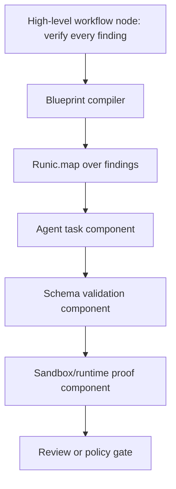

Rules for the compiler:

- `agent_map`, `pairwise_compare`, `bucket_rank`, `verify_each`, and similar
  high-level nodes compile to native Runic collection components, not a single
  `Runic.step` that runs `Enum.map`, `Task.async_stream`, or ad hoc concurrency.
- `synthesize`, `dedupe`, and global ranking compile to `Runic.reduce`,
  aggregates, or explicit joins only when the node needs the whole upstream
  result set.
- `loop_until_done` compiles to a supervised workflow loop, state machine,
  process manager, or resumable workflow runner construct rather than an
  unbounded recursive agent prompt.
- `workflow_task` invokes another saved workflow definition and records a child
  workflow run, so top-level orchestration can coordinate workflows, not only
  individual agents.
- Agent, tool, sandbox, and model choices remain metadata on components and
  runnables so the scheduler/workflow runner can place work on host processes,
  warmed sandboxes, remote providers, or future Runic execution strategies.

## Agent Orchestration Patterns

### Streaming Pipeline

Use when each item can move to the next stage as soon as that item finishes the
previous stage.

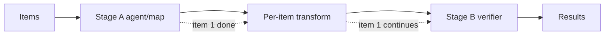

RunicAI mapping:

- compile the high-level item stage into `Runic.map/2` or an equivalent Runic
  fanout component;
- per-item continuation edges instead of global joins;
- scheduler-managed bounded concurrency, placement, and sandbox affinity;
- per-node schemas and validators.

### Fanout With Barrier

Use only when a downstream step needs the complete upstream set.

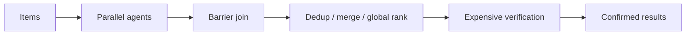

RunicAI mapping:

- fanout via `Runic.map` or parallel Runic branches;
- barrier via `Runic.reduce/3`, aggregate, or an explicit join node;
- global transforms expressed as deterministic component steps;
- early exit when the reduced set is empty.

### Classify And Act

Use when the workflow first needs a route decision.

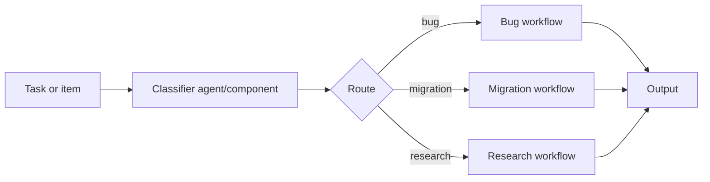

RunicAI mapping:

- classifier output is a typed route decision;
- each branch can target an agent, component, sandbox operation, or nested
  workflow definition;
- Workbench should show the chosen route and allow rerouting before launch when
  the workflow is still in proposal state.

### Fanout And Synthesize

Use when many independent workers need clean context windows and one final
synthesis step really needs all outputs.

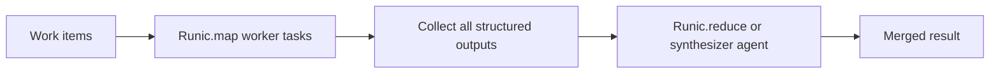

RunicAI mapping:

- workers compile to `Runic.map`;
- the synthesize barrier must declare why it needs all outputs;
- deterministic reducers should be preferred over synthesis agents when the
  merge is mechanical.

### Adversarial Review

Use when the cost of false positives is high.

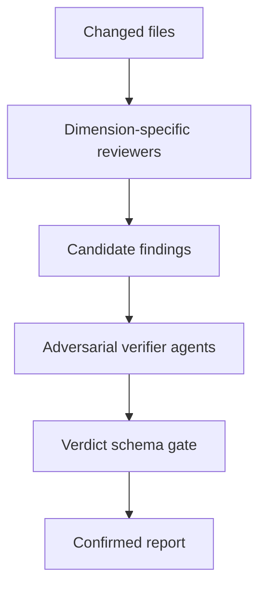

RunicAI mapping:

- finder agents produce `Finding` structs;
- verifier agents produce `Verdict` structs;
- a schema gate filters unconfirmed findings;
- Workbench displays phases, agent labels, and rejected evidence.

### Tournament / Rubric Selection

Use for design, naming, architecture, or taste-heavy exploration.

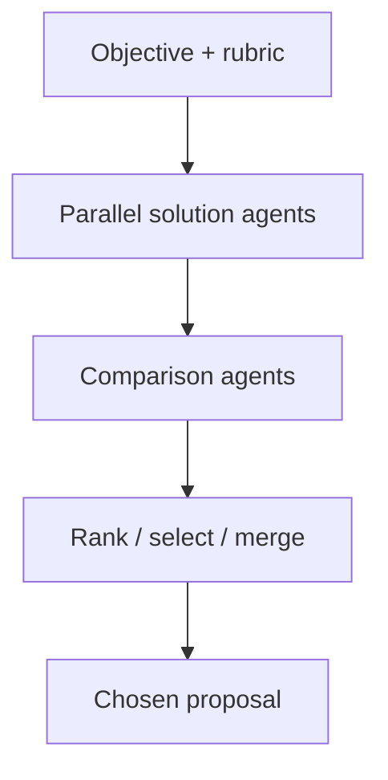

RunicAI mapping:

- solution agents can run in separate worktrees or sandboxes;
- comparison agents receive structured rubric inputs;
- the ranker is a deterministic Runic component where possible;
- final selection can become a proposal or component candidate.

### Generate And Filter

Use when the goal is a high-quality candidate set rather than one deterministic
answer.

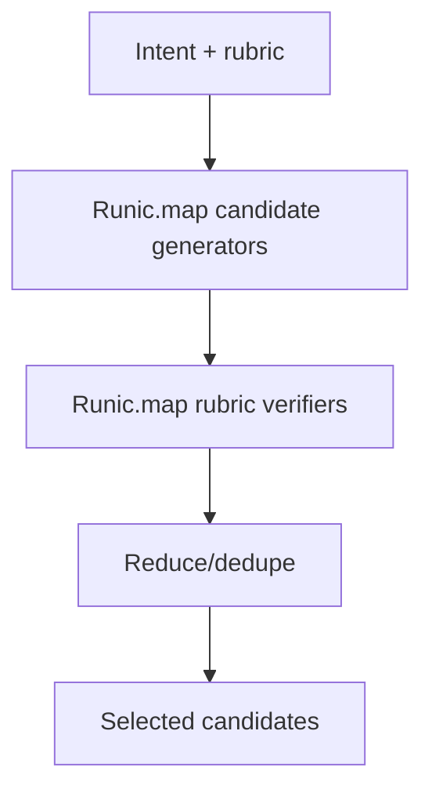

RunicAI mapping:

- candidate generators can vary model, prompt, sandbox runtime, or retrieved
  context;
- filter and dedupe stages should be typed and repeatable;
- selected candidates can flow into promotion, eval, or human review.

### Loop Until Done

Use when the amount of work is unknown and the stop condition is observable.

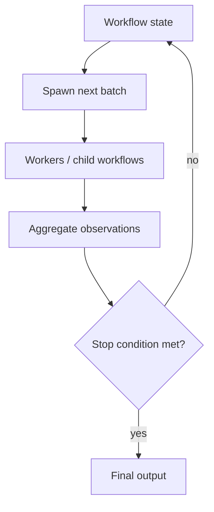

RunicAI mapping:

- represent the loop as a state machine, process manager, or resumable workflow
  run, not a single agent prompt that keeps asking itself what to do;
- stop conditions should be schema-backed, such as no new findings, zero
  failing tests, all tickets classified, or budget exhausted;
- `/goal`-style objectives can own the hard completion condition.

### Migration And Refactor Workflow

Use when a large code change can be decomposed by callsite, module, failing
test, or capability slice.

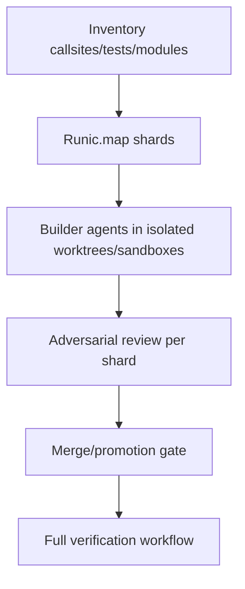

RunicAI mapping:

- inventory is a normal Runic component or agent task that emits typed work
  items;
- each shard can run as a child workflow with its own sandbox/worktree and
  budget;
- merge remains review-gated and should not happen inside the shard worker.

### Deep Research

Use for source gathering, cross-checking, and cited synthesis.

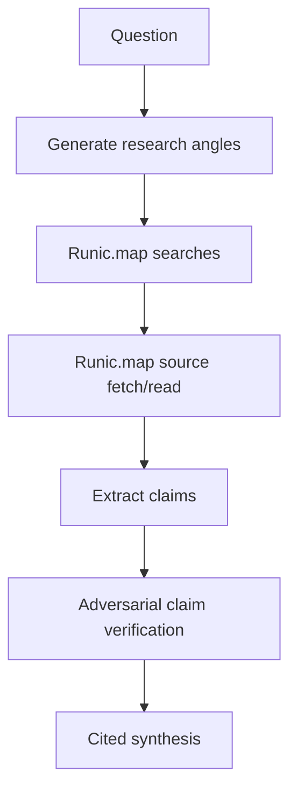

RunicAI mapping:

- source objects should carry provenance and citation metadata;
- claim extraction and verification should use schemas;
- synthesis can be a barrier because citations and contradictions are
  cross-source concerns.

### Deep Verification

Use when a report, code change, or generated artifact needs every claim or
finding checked independently.

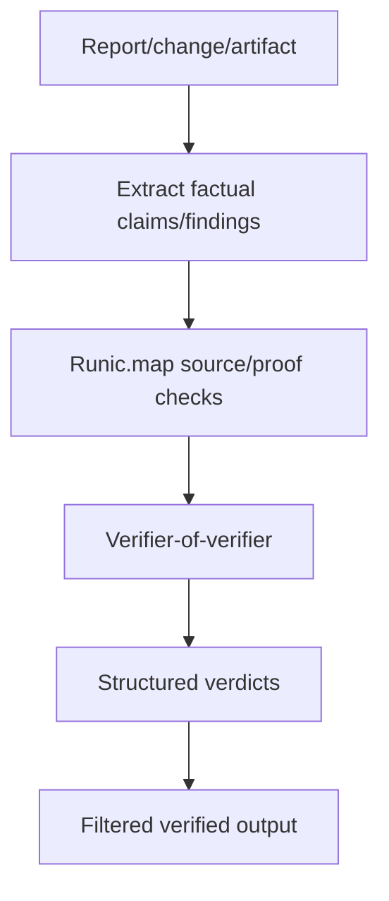

RunicAI mapping:

- claim extraction emits structured `Claim` records;
- proof checks can be agents, tool calls, tests, or sandbox executions;
- meta-verification is useful when source quality or test relevance matters.

### Qualitative Sorting

Use when many items need ranking by a subjective or hard-to-score property.

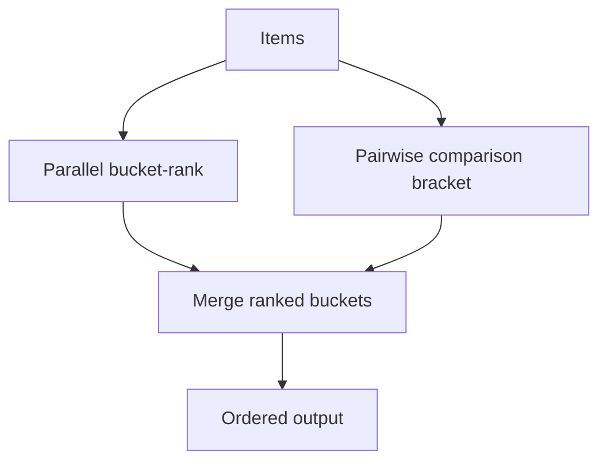

RunicAI mapping:

- pairwise comparisons are agent tasks over item pairs;
- bracket state is deterministic workflow state;
- bucket-rank can reduce token use before final pairwise comparisons.

### Memory And Rule Adherence

Use when a project repeatedly violates local rules or when recent review
corrections should become durable guidance.

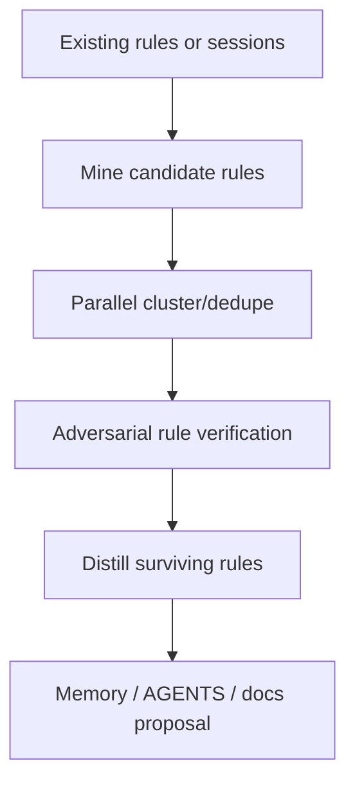

RunicAI mapping:

- mining can read SQLite terminal events, review requests, tool calls, and
  persisted facts;
- candidate rules should be verified against real mistakes before promotion;
- Workbench should show rule evidence and false-positive risk.

### Root-Cause Investigation

Use when independent hypotheses should be protected from one another.

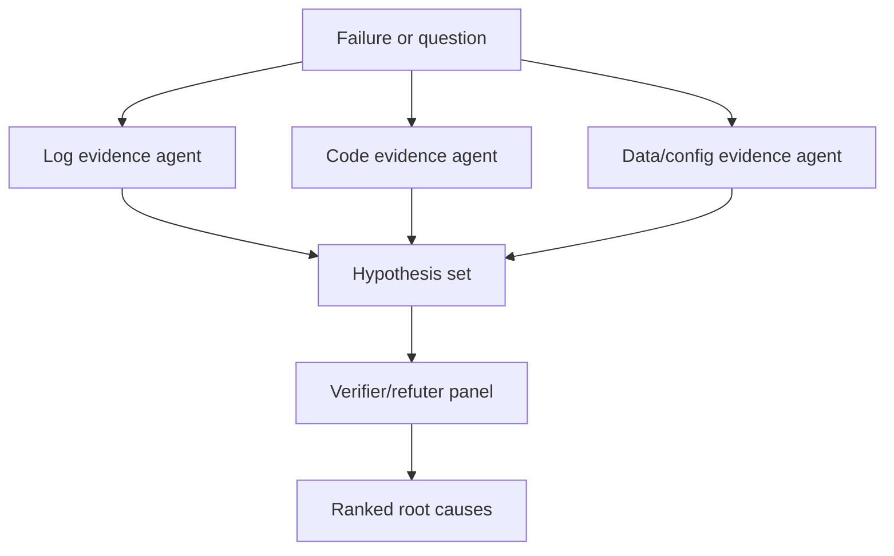

RunicAI mapping:

- evidence lanes should receive disjoint context when independence matters;
- verifier/refuter panels can be `Runic.map` over hypotheses;
- final root-cause ranking is a barrier because it compares hypotheses.

### Triage With Quarantine

Use when untrusted content needs classification before any privileged action.

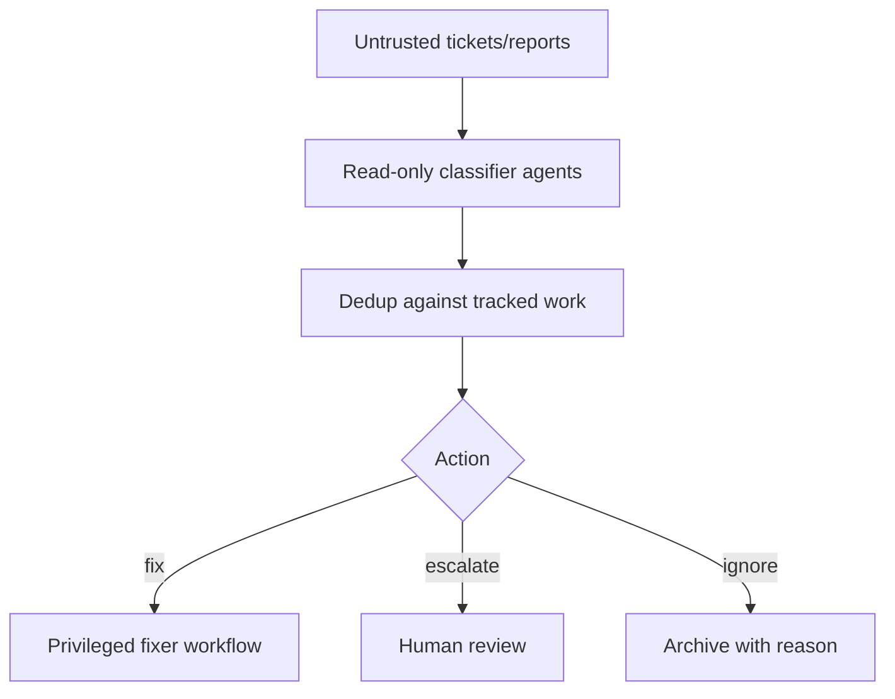

RunicAI mapping:

- quarantine is a capability boundary: intake agents do not get patch,
  filesystem mutation, shell, or high-privilege sandbox tools;
- privileged workflows receive only sanitized structured outputs;
- `/loop`-style recurrence can poll queues while preserving the same boundary.

### Workflow Invokes Workflow

Use when top-level orchestration should coordinate reusable subplans rather than
individual agents.

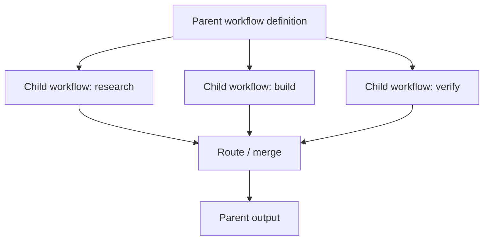

RunicAI mapping:

- a `workflow_task` node resolves a stored workflow definition, creates a child
  workflow run, and waits for the declared output schema;
- child workflow runs inherit scoped input, budgets, tool policies, and sandbox
  leases;
- Workbench should show parent/child run trees and let a user restart one child
  without losing completed siblings.

### Model And Runtime Routing

Use when the workflow needs to decide cost, model, backend, or runtime before
doing expensive work.

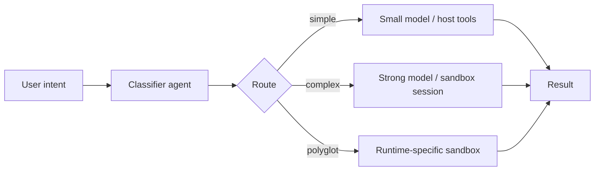

RunicAI mapping:

- classifier output is a typed route decision;
- route controls model, toolsets, sandbox profile, runtime policy, and budgets;
- Workbench can show the selected route before execution.

### Generated Component Promotion

Use when workflow output should become reusable RunicAI or Runic building
blocks.

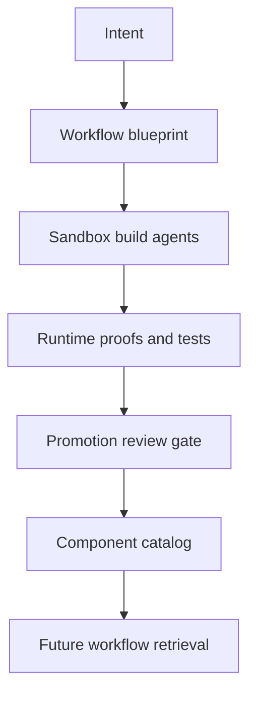

RunicAI mapping:

- generated code remains in sandbox or staging until proof passes;
- promotion captures runtime, dependencies, schema, tests, and evidence;
- future planning checks the catalog before generating a new component.

## RunicAI Dynamic Workflow Model

Claude workflows use JavaScript as the orchestration language. RunicAI should
support a friendlier authoring surface, but the durable internal form should be
a typed blueprint that compiles to a Runic workflow graph.

Proposed blueprint shape:

```elixir
%RunicAI.WorkflowBlueprint{
  version: 1,
  name: "review-changes",
  objective: "Review changed files across dimensions and verify each finding",
  phases: [
    %{id: "review", title: "Review"},
    %{id: "verify", title: "Verify"}
  ],
  inputs: [
    %{name: "paths", type: {:list, :string}, required?: true}
  ],
  policies: %{
    default_mode: :pipeline,
    max_concurrent_agents: 12,
    max_total_agents: 1000,
    token_budget: 50_000,
    sandbox: %{profile: :docker, runtimes: [:bash, :elixir, :python]},
    headless?: false
  },
  schemas: %{
    finding: RunicAI.Schemas.Finding,
    verdict: RunicAI.Schemas.Verdict
  },
  nodes: [
    %{
      id: "review_dimensions",
      type: :agent_map,
      phase: "review",
      input: "$inputs.dimensions",
      prompt: "$item.prompt",
      label: "review:$item.key",
      output_schema: :finding
    },
    %{
      id: "verify_findings",
      type: :agent_map,
      phase: "verify",
      input: "$review_dimensions.findings",
      prompt: "Adversarially verify: $item.title",
      label: "verify:$item.file",
      output_schema: :verdict
    }
  ],
  edges: [
    %{from: "review_dimensions", to: "verify_findings", mode: :pipeline}
  ],
  outputs: [
    %{name: "confirmed", from: "verify_findings", filter: "$item.verdict.is_real"}
  ],
  acceptance: [
    %{type: :schema_valid, output: "confirmed"},
    %{type: :no_unverified_findings}
  ]
}
```

Key point: the planner can write JSON/YAML/Elixir-ish blueprint data, but the
runtime should validate and compile it rather than executing arbitrary host code.
If a script surface is added later, it should compile into this same blueprint
and run in a deterministic sandbox with no direct host filesystem or shell
access.

High-level node types such as `:agent_map` are proposal language, not runtime
instructions to call `Enum.map` or `Task.async_stream` inside a step. The
compiler must lower them into Runic graph structure so Runic and the selected
runner keep control over scheduling, placement, retries, checkpoints, and
sandbox affinity.

## Workflow Definition Storage

Claude saves workflow scripts into files for command reuse. RunicAI should use
SQLite as the canonical workflow library because the Workbench, terminal
session history, workflow runs, review requests, runnable events, artifacts, and
managed workflow state already live there.

There is already a `managed_workflows` table and
`RunicAI.Persistence.ManagedWorkflows` API for stable workflow definitions that
produce many concrete `workflow_runs`. The next iteration should either evolve
that table or add an explicit `workflow_definitions` table that makes the
blueprint model first-class.

Recommended `workflow_definitions` fields:

| Field | Purpose |
| --- | --- |
| `id` | Stable definition id. |
| `workflow_key` | User-invokable key, unique per scope. |
| `name` / `description` | Workbench display and search. |
| `scope_type` / `scope_id` | Project, user, organization, or generated-component scope. |
| `status` | Active, disabled, archived, draft, failed validation. |
| `blueprint_json` | Validated high-level blueprint. |
| `compiled_graph_blob` | Optional cached compiled Runic graph or compilation artifact. |
| `compiled_hash` | Invalidates cached compiled output when the blueprint changes. |
| `version` / `parent_definition_id` | Version history and template lineage. |
| `input_schema_json` / `output_schema_json` | Typed invocation and output contract. |
| `policy_json` | Toolsets, sandbox profile, runtime policy, budgets, and headless mode. |
| `source` | Generated, user-authored, imported, component-promoted, or system built-in. |
| `metadata_json` | Tags, examples, citations, last proof, and Workbench UI hints. |

Files still have a role, but only as import/export or shareable template
artifacts. The canonical object the Workbench launches should be a SQLite-backed
definition that can be queried, versioned, linked to runs, and inspected with
the rest of the durable state.

## Built-In Node Types

RunicAI should ship a standard catalog of high-level blueprint node types. Each
node type compiles into one or more Runic components.

| Node type | Purpose | Lowering expectation |
| --- | --- |
| `agent_task` | Single agent call with toolsets, model, prompt, and schema. | One invokable component plus schema validation. |
| `agent_map` | Fanout over items with bounded concurrency. | `Runic.map` over agent task subgraph. |
| `workflow_task` | Invoke another saved workflow definition. | Child `workflow_run` plus output schema gate. |
| `workflow_map` | Run a saved workflow for each item. | `Runic.map` over `workflow_task`. |
| `component` | Run a reusable RunicAI or Runic component. | Native component insertion. |
| `tool_call` | Call a registered tool under policy. | Tool invokable plus review/policy metadata. |
| `sandbox_exec` | Execute code in a selected sandbox session/runtime. | Sandbox tool component with runtime policy. |
| `sandbox_transfer` | Upload, download, diff, or promote sandbox objects. | Transfer components plus object manifest outputs. |
| `transform` | Deterministic map/filter/project over structured data. | Pure component; collection transforms lower to native map where item-wise. |
| `reduce` | Aggregate a set of results. | `Runic.reduce` or aggregate component. |
| `join` | Explicit barrier with a required justification field. | Join node; rejected when no cross-item dependency exists. |
| `condition` | Branch on structured values. | Rule/FSM/conditional graph branch. |
| `loop_until_done` | Repeat batches until a stop condition is met. | State machine/process manager/resumable runner loop. |
| `review_gate` | Human or policy gate before mutation or promotion. | Durable review request and wait component. |
| `checkpoint` | Create or restore workflow/sandbox state. | Persistence/sandbox checkpoint component. |
| `model_route` | Choose model/tool/sandbox policy from structured criteria. | Classifier component plus policy rewrite. |
| `component_promotion` | Package proven output as a reusable component candidate. | Promotion workflow subgraph. |

## Planning And Validation Pipeline

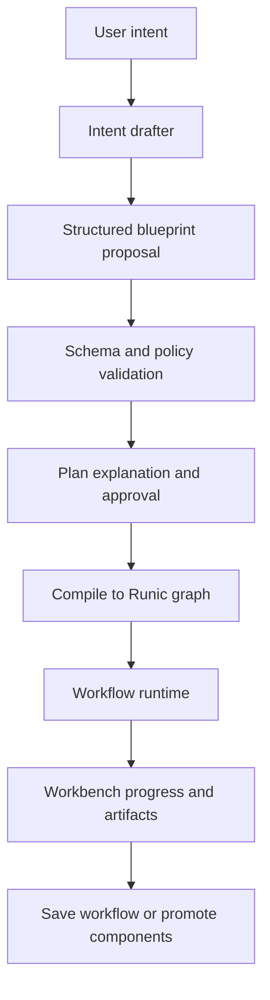

Recommended planner stages:

- Intent drafting: restate objective, success criteria, risks, data sources, and
  whether a workflow is warranted.
- Blueprint proposal: emit structured nodes, edges, schemas, budgets, and
  sandbox policy.
- Validation: reject unjustified barriers, missing schemas, unsafe tools,
  unknown runtimes, opaque map/reduce-in-step plans, and host mutation without
  review gates.
- Approval: show phases, estimated agents, token budget, sandbox profile,
  runtime composition, and mutation points.
- Execution: run compiled graph with resumable state, progress events, and
  artifact manifests.
- Save/promote: persist useful workflow definitions in SQLite and component
  candidates in the component catalog.

## Workbench UX

Workbench should make workflows inspectable before and during execution:

- Workflow draft panel: objective, phases, agent count estimate, concurrency,
  budget, selected model route, sandbox profile, runtimes, and mutation gates.
- Graph preview: render the compiled Runic graph with `pipeline`, `parallel`,
  and `barrier` edges visually distinct.
- Barrier warnings: require a short justification when a barrier is present and
  show the latency cost.
- Phase view: active, queued, completed, failed, and paused agents by phase.
- Agent detail: prompt, tool calls, sandbox session, object refs, token use,
  elapsed time, and structured result.
- Artifact lane: sandbox manifests, diffs, reports, checkpoints, services, and
  generated-component candidates.
- Definition library: SQLite-backed workflow definitions with versions, scopes,
  tags, schemas, last proof status, and recent runs.
- Parent/child run tree: show nested workflow runs alongside agent phases.
- Controls: pause/resume workflow, stop agent, restart agent, save workflow,
  clone workflow as template, promote component, and rerun on smaller slice.

## Implementation Plan

### Slice 1: Workflow Blueprint Schema

- Add `RunicAI.WorkflowBlueprint` and validation helpers.
- Represent phases, policies, schemas, nodes, edges, outputs, and acceptance
  criteria.
- Require every agent node to declare an output schema.
- Require every barrier/join node to declare a `justification`.
- Add fixtures for common patterns: review/verify, deep research, migration,
  tournament, model routing, and component promotion.

### Slice 2: Blueprint Compiler

- Compile blueprint nodes into Runic workflow graphs, with high-level nodes
  lowered into native Runic components rather than opaque steps.
- Implement `:pipeline`, `:parallel`, and `:barrier` edge semantics.
- Compile maps to `Runic.map`, reductions to `Runic.reduce` or aggregates, and
  route decisions to rules/FSM branches.
- Support nested `workflow_task` and `workflow_map` nodes backed by stored
  workflow definitions.
- Carry labels, phases, budgets, toolsets, sandbox policy, and schemas into
  runtime metadata.
- Start with deterministic local execution and then connect to the existing
  coding agent runner.

### Slice 3: Agent And Sandbox Runtime

- Add workflow-aware subagent launch using the shared
  `CapabilityResolver`.
- Pass sandbox session leases, object refs, runtime policy, and output schemas
  into child agents.
- Enforce concurrency and total-agent caps in the workflow runtime.
- Emit progress events suitable for Workbench and persisted run inspection.

### Slice 4: Planner Prompting

- Add planner prompts that default to pipelines, require barrier justification,
  prefer schemas, and keep orchestration deterministic.
- Add a structured object schema for planner output instead of accepting
  free-form workflow scripts.
- Add validation repair: if a draft has an unjustified barrier or missing
  schema, ask the planner to repair only the invalid section.

### Slice 5: Workbench Workflow UX

- Build graph preview and phase panels.
- Add workflow approval cards with raw blueprint, graph, and budget details.
- Add progress drilldown for agent labels, prompts, tool calls, tokens,
  sandbox objects, and structured outputs.
- Add save-as-template and promote-component flows.

### Slice 6: Reusable Workflow Library

- Use SQLite workflow definitions as the canonical workflow library.
- Evolve `managed_workflows` or add a `workflow_definitions` table with
  blueprint JSON, compiled graph cache metadata, schema contracts, policy,
  scope, version lineage, and source metadata.
- Keep file import/export as a sharing path, not the source of truth for
  Workbench launches.
- Support structured args and typed input forms in Workbench.
- Add search/reuse before generating a new workflow.

## Acceptance Criteria

- RunicAI can express the Claude workflow patterns above as validated
  blueprints and compiled Runic graphs.
- High-level map/reduce/fanout nodes compile to native Runic map, reduce,
  aggregate, rule, FSM, or child workflow constructs rather than embedding
  scheduling inside `Runic.step`.
- The planner defaults to pipeline semantics and rejects barriers without
  cross-item dependency justification.
- Workflow execution can launch subagents with scoped tools, models, sandbox
  sessions, runtimes, budgets, and output schemas.
- Workflow definitions are persisted in SQLite and linked to concrete
  `workflow_runs`; files are used only for import/export or template sharing.
- Workbench can preview, approve, observe, pause, resume, stop, restart, save,
  and promote workflow runs.
- Generated outputs can become reusable RunicAI/Runic components through the
  same proof and promotion gates used by sandbox tooling.
