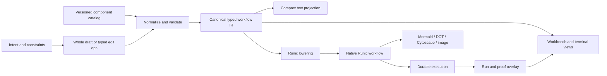
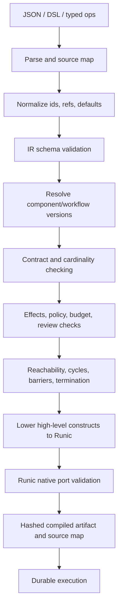

# Agent-Drafted Workflow Substrate Research And Evaluation Plan

Status: proposed research direction

Date: 2026-07-20

Related: `.docs/058-dynamic-workflows-research-and-workbench-plan.md`,
`.docs/061-sandbox-backed-dynamic-workflow-ooda-goal.md`, and
`.docs/062-general-purpose-agent-next-steps-plan.md`

## Executive Recommendation

RunicAI should not choose JSON, YAML, a text DSL, DOT, or an image as one
representation that must satisfy every workflow concern. Those concerns have
different requirements.

Use a multi-view architecture with one semantic source of truth:

1. A versioned, normalized, typed workflow IR is the canonical definition
   stored in SQLite. It is JSON-safe data, but its runtime API does not need to
   expose one large Elixir struct to authors.
2. Agents draft and revise the IR through small, typed graph operations such as
   `add_node`, `connect`, `set_argument`, and `set_acceptance`, each applied
   transactionally against a base revision and followed by incremental
   validation.
3. A compact, WDL-inspired Runic workflow DSL is an optional text projection
   for whole-workflow generation, import/export, prompt context, and expert
   editing. It parses into the same IR; it is never evaluated as Elixir.
4. Humans receive generated Mermaid or Cytoscape views plus structured detail
   panels. Agents receive the smallest useful projection: a summary, a local
   graph slice, the DSL, or typed diagnostics.
5. DOT, SVG, PNG, and JPEG are derived views only. A multimodal agent may use a
   rendered graph as supplementary context, but an image must never be the only
   executable or editable representation.
6. Keep schemas, catalog resolution, policy checks, and Runic lowering
   deterministic. Use model generation for intent and design choices, not for
   facts the catalog or compiler can determine.

The most valuable near-term experiment is therefore not "JSON versus DSL" in
isolation. It is a substrate bake-off with three serious candidates:

- normalized JSON IR generated in one response;
- compact DSL generated in one response and parsed to the IR;
- incremental typed graph operations over the IR.

YAML, DOT/Mermaid source, and rendered images should remain comparison arms.
The winner should be selected by execution success, repair locality, semantic
validity, human collaboration quality, and total model I/O cost, not merely by
parse rate or serialized byte count.

## Problem Statement

The target capability is:

> An agent designs a workflow at runtime, reasons about and revises it over
> time, collaborates with a human operator, proves that available components
> and their contracts fit, compiles the result into native Runic structure,
> executes it under policy, and preserves a durable, understandable history.

This is more demanding than serializing a DAG. The substrate must represent:

- incomplete drafts and explicit unknowns;
- stable node identity across revisions;
- available component references and versioned contracts;
- node arguments, data bindings, ports, schemas, cardinality, and effects;
- map, reduce, branch, join, loop, nested workflow, review, and acceptance
  semantics;
- model, tool, sandbox, concurrency, budget, retry, and mutation policy;
- human labels, rationale, warnings, and layout hints without confusing them
  with runtime semantics;
- deterministic lowering to native Runic components;
- precise patches and revision conflicts;
- projections suitable for text-only agents, multimodal agents, terminal users,
  Workbench users, storage, audit, and execution.

No single surface is naturally best at all of these.

## Current RunicAI Baseline

The current path is already more capable than a plain vibe-coded struct, but its
boundaries are uneven.

### What Exists

- `RunicAI.Assistant.RLM.WorkflowBlueprint` is JSON encodable and contains an
  id, objective, sources, component list, edge list, stop conditions, policies,
  and metadata.
- `ComponentBlueprint` resolves a closed component type through
  `RunicAI.RLM.ComponentCatalog`.
- `ComponentCatalog` supplies normalized `ComponentSpec` records with Runic
  input/output port contracts and an execution shape.
- `BlueprintGraph` checks duplicate ids, unknown endpoints, self-edges, cycles,
  isolation, and a small number of component-specific graph rules.
- `BlueprintValidator` adds catalog, tool, sandbox, budget, generated-function,
  and artifact checks with structured diagnostics.
- `WorkflowCompiler` already lowers map and reduce shapes into native Runic
  graph components and catches `Runic.IncompatiblePortError`.
- Runic itself validates component port compatibility and serializes compiled
  graphs to Mermaid, DOT, Cytoscape JSON, and edge lists.
- Workbench and terminal code already render Mermaid and can consume compiled
  graph summaries.

These are valuable assets. The proposed work should evolve them rather than
replace the compiler with a new workflow engine.

### Material Limitations

1. The blueprint has no explicit format version even though durable definitions
   and future migrations require one.
2. Components and edges are arrays. Array-index patches are fragile when nodes
   are inserted, removed, or reordered; stable ids exist but are not the storage
   keys.
3. `WorkflowBlueprint.normalize_edge/1` retains only `from` and `to`. Although
   `BlueprintGraph` is prepared to attach `input` and `output` properties, those
   fields have already been discarded. Edge-level port binding is therefore not
   part of the accepted contract.
4. Blueprint-declared named ports are normalized to `:any`. This can override
   the stronger catalog defaults and make a proposal appear compatible without
   proving a meaningful contract.
5. Value contracts are useful semantic atoms such as `:records`, `:report`, and
   `:artifact`, but they do not yet express field schemas, effect requirements,
   provenance guarantees, stream/batch mode, or rich cardinality.
6. Runic's gradual `:any` behavior is appropriate for prototyping, but an agent
   proposal should not silently use it to cross a safety- or correctness-critical
   boundary.
7. Compatibility of union-like `{:one_of, ...}` contracts currently means that
   at least one alternative overlaps. For a producer that may emit several
   alternatives, that is weaker than proving every possible output is accepted
   by the consumer.
8. The generation schema constrains only top-level fields; components, edges,
   policies, and metadata are maps with much of their semantic validity deferred
   to handwritten validation.
9. Generation and repair commonly regenerate the complete JSON object. That
   increases output tokens, can damage unrelated valid regions, and makes
   multi-turn collaboration harder to audit.
10. The current manifest sends broad component information in prompt context,
    while the planner often needs only a shortlist followed by exact contracts
    for selected candidates.
11. The source blueprint, normalized graph, compiled graph, visualization, and
    run overlay are adjacent concepts but are not yet modeled as explicit
    projections of one revisioned definition.

These limitations do not prove that structs or JSON are wrong. They show that
the semantic IR, authoring protocol, and presentation format need to be treated
as separate design decisions.

## Design Principles

### One Semantic Truth, Multiple Lossless Or Lossy Views

The canonical IR owns execution meaning. Every editable text representation
must parse to it, and every graph or image is generated from it.



This avoids two dangerous round trips:

- do not render an IR to an image and then parse the image to execute it;
- do not render a compiled Runic graph and try to reconstruct author intent from
  compiler-generated implementation nodes.

### Separate Intent, Semantic IR, Lowered Graph, And Runtime State

These layers answer different questions:

| Layer | Primary question | Mutable by planner? |
| --- | --- | --- |
| Objective contract | What outcome and proof does the user want? | Yes, with user visibility. |
| Semantic workflow IR | Which capabilities and dataflow should achieve it? | Yes, before or between runs. |
| Lowered Runic graph | How does Runic execute those high-level constructs? | Compiler only. |
| Run state/overlay | What happened in this particular execution? | Runtime only. |
| Presentation/layout | How should this revision or run be shown? | User/UI; no execution meaning. |

For example, one semantic `map` node may lower to an item preparation step, a
native `Runic.map`, scheduler policies, schema gates, and event instrumentation.
The planner should reason about the map, while diagnostics can link it to its
lowered nodes.

### Progressive Validity

Drafting over time requires two validation modes:

- `draft`: syntax, identity, known references, and all currently checkable
  contracts must be sound; explicit holes are allowed.
- `runnable`: no unresolved holes, all required inputs bound, all output and
  acceptance contracts closed, all effects authorized, and lowering succeeds.

An incomplete workflow should contain explicit holes such as
`{"unresolved": "choose a verifier producing Verdict"}` rather than fabricating
a component or weakening a contract to `any`.

### Catalog Contracts Are Authoritative

The agent selects a catalog component and binds its inputs. It does not redefine
that component's ports. A proposal may narrow an output with a schema assertion,
but it may not widen or replace the catalog contract without inserting an
explicit, cataloged adapter or generated component.

A component reference should include a stable key and contract version or
catalog revision:

```json
{
  "component": {
    "key": "llm_map",
    "contract": "runic-ai/llm-map@2"
  }
}
```

Definitions can then be revalidated when the catalog changes instead of silently
compiling against new semantics.

### Prefer Deterministic Inference Over Generated Redundancy

Do not ask the model to repeat facts available from the catalog. If `llm_map@2`
has one input named `items` and one output named `results`, a concise authoring
surface may infer those names. The normalized IR records the resolved bindings
explicitly after validation.

This reduces output tokens without weakening the executable artifact.

## Research Findings From Other Substrates

### JSON Plus JSON Schema

JSON is the strongest interchange and persistence baseline:

- every current provider and ReqLLM path understands it;
- constrained generation commonly targets JSON Schema;
- it maps directly to SQLite JSON fields and Elixir maps;
- canonical ordering and hashing can be defined;
- schema, generated forms, and machine diagnostics share an ecosystem.

[JSON Schema 2020-12](https://json-schema.org/draft/2020-12/json-schema-core)
supports structural validation and annotations. Its `title`, `description`,
`examples`, `readOnly`, and `writeOnly` annotations can also drive agent context
and Workbench forms, although annotations themselves do not validate semantics.

Structured decoding can materially improve syntactic/schema adherence. OpenAI's
[Structured Outputs description](https://openai.com/index/introducing-structured-outputs-in-the-api/)
explains a JSON-Schema-to-context-free-grammar approach. Independent
[JSONSchemaBench research](https://arxiv.org/abs/2501.10868) evaluates syntax
coverage, efficiency, and output quality across constrained decoders. This is a
reason to use strict object generation where available, not a reason to remove
the semantic compiler. A schema-valid graph can still refer to incompatible
ports, violate policy, deadlock, or solve the wrong objective.

Weaknesses are verbosity, punctuation-heavy editing, duplicate information, and
poor whole-document diffs when graph entities live in arrays.

Conclusion: use JSON-safe data as the canonical IR and interchange form, but
normalize collections by stable id and avoid making full JSON regeneration the
only authoring experience.

### YAML

YAML is more pleasant for many human authors and permits comments. The
[Arazzo Specification](https://spec.openapis.org/arazzo/latest.html) is a useful
precedent: it defines API workflows as a JSON object representable in JSON or
YAML, recommends YAML 1.2 constraints that preserve round trips, uses JSON
Schema for workflow inputs, and models step dependencies and nested workflows.

YAML does not inherently improve the semantic model. Unrestricted YAML adds
implicit scalar typing, anchors, aliases, tags, and parser differences that are
unhelpful for agent-generated executable plans. RunicAI also has JSON support
already but no direct YAML dependency in the current application.

Conclusion: support a restricted YAML import/export projection only if human
testing shows value. It should be the JSON data model rendered as YAML 1.2 with
JSON-compatible scalars, no custom tags, and no execution-specific semantics.

### Purpose-Built Text DSL

The strongest argument for a DSL is not aesthetics. It can make common workflow
semantics syntactically first-class:

- typed workflow inputs and outputs;
- calls to cataloged tasks or child workflows;
- data dependencies rather than accidental source order;
- map/scatter, reduce/gather, branch, loop, and review constructs;
- compact local references and defaults;
- comments and human-oriented phase grouping.

[WDL](https://docs.openwdl.org/language-guide/workflows.html) is instructive:
calls bring task or subworkflow inputs and outputs into scope, and declaration
order does not force sequential execution when dependencies are absent. Its
[scatter-gather pattern](https://docs.openwdl.org/design-patterns/scatter-gather/)
also closely matches the desired Runic-native map/reduce lowering.
[CWL](https://www.commonwl.org/user_guide/topics/workflows.html) similarly
combines typed workflow I/O with scatter over tools or workflows. Both are
scientific/batch workflow languages, so adopting either runtime wholesale would
misfit agent prompts, tools, HITL, sandbox leases, dynamic routing, and Runic
semantics. Their separation of task contracts from workflow bindings is worth
borrowing.

The CNCF [Open Workflow Specification](https://serverlessworkflow.io/) is
another useful catalog of language constructs: `for`, `fork`, `switch`,
`try/catch`, event waits, calls, scripts, and subflows in a JSON/YAML-compatible
DSL. It is much broader and more imperative than the minimal Runic authoring
surface should initially be.

Conclusion: prototype a small Runic-specific DSL as a projection into the IR.
Do not build a second runtime, allow arbitrary code, or expose every possible
Runic construct in version 1.

### CUE Or Another Constraint Language

[CUE](https://cuelang.org/docs/reference/spec/) combines data and constraints
through unification and is designed for validation, templating, and code
generation. It could express reusable workflow policies and component contract
constraints more compactly than a large JSON Schema.

Its drawbacks here are ecosystem and integration cost: RunicAI is Elixir-based,
the current runtime has no CUE integration, and making CUE the authoring language
would add another compiler/toolchain before the core IR has been proven.

Conclusion: use CUE as an optional experimental validator in the bake-off, or
borrow its constraint-composition ideas. Do not make it the first canonical
format.

### DOT And Mermaid

[DOT](https://graphviz.org/doc/info/lang.html) has a small graph grammar,
directed edges, subgraphs, port syntax, and arbitrary node/edge attributes.
Graphviz can render it into SVG or raster formats, and clusters can present
phases. It is compact for topology and mature for layout.

[Mermaid flowcharts](https://mermaid.js.org/syntax/flowchart.html) are familiar
in Markdown and already supported by RunicAI. They express nodes, edges, labels,
subgraphs, and direction with low ceremony.

Neither language naturally validates nested JSON Schema contracts, effect
policies, typed parameter values, reusable workflow versions, or acceptance
criteria. Packing these into string attributes produces a second escaping and
typing problem. Mermaid also has presentation-oriented parse edge cases; for
example, its documentation warns that some ordinary node text can alter or
break flowchart parsing.

Most importantly, Runic already emits Mermaid, DOT, Cytoscape, and edge lists
from a compiled workflow. Making one of those formats canonical would reverse a
working dependency direction.

Conclusion: retain Mermaid for Workbench/Markdown and DOT where its layout or
export ecosystem helps. Both should be generated projections, with edits mapped
back to semantic graph operations rather than reparsing decorated display text.

### Raster Or Multimodal Graphs

A rendered graph can compress spatial relationships for a person and may help a
multimodal model answer high-level questions such as "where is the bottleneck?"
or "which phase has too much fanout?" It is also useful for review snapshots and
large-graph overview.

It is a poor executable substrate:

- exact node ids, port names, schema fields, and policy values become pixels;
- layout changes can change model behavior while semantics stay constant;
- OCR and visual edge-following add another failure layer;
- a raster has no safe local patch model;
- image input accounting is provider/model specific, so fewer text characters
  do not imply lower cost;
- a compiled image cannot preserve comments, provenance, revision preconditions,
  or lossless round trips.

Graph reasoning is itself an eval target, not a safe assumption. The
[NLGraph benchmark](https://arxiv.org/abs/2305.10037)
found that language models are brittle on more complex textual graph problems,
and recent multimodal work continues to benchmark whether visual graph
representations actually help. This supports testing image-plus-IR against
text-only projections rather than declaring images token-efficient in advance.

Conclusion: use SVG/PNG as a derived overview paired with stable semantic ids
and a machine-readable local slice. Never use image-only generation, patching,
validation, or execution.

### Incremental Edit Protocols

[JSON Patch (RFC 6902)](https://www.rfc-editor.org/info/rfc6902/) defines
`add`, `remove`, `replace`, `move`, `copy`, and `test`, with failure terminating
the patch and HTTP PATCH applications being atomic. It is useful for interchange
and audit, especially when a `test` operation protects the expected revision.

Raw JSON Patch is not the ideal agent tool surface:

- array positions shift;
- a generic `remove` cannot state whether incident edges should cascade;
- generic paths do not express graph invariants or component intent;
- related edits are easy to omit.

Normalize nodes and edges as id-keyed maps, then expose domain operations whose
implementation may emit or store JSON Patch. Domain operations can validate
preconditions and return graph-aware diagnostics.

Conclusion: typed graph edit operations are the strongest substrate for
multi-turn drafting and repair. Pair them with a whole-document JSON or DSL
bootstrap for the first draft.

## Candidate Comparison

Ratings are hypotheses to test, not final benchmark results.

| Candidate | Machine validation | Agent drafting | Local patching | Human reading | Graph overview | Expected I/O | Main risk |
| --- | --- | --- | --- | --- | --- | --- | --- |
| Current array-based JSON blueprint | Medium | Medium | Low | Medium-low | Low | High on rewrites | Weak edge/contract semantics and collateral repair. |
| Normalized typed JSON IR | High | Medium-high with strict output | High when id-keyed | Medium | Low | Medium | Verbose if the model must repeat inferred catalog facts. |
| Restricted YAML projection | High after parse | Medium-high | Medium | High for YAML users | Low | Potentially medium | Parser ambiguity and no semantic advantage over the IR. |
| Compact Runic workflow DSL | High after parse/typecheck | Potentially high | High by text or AST edit | High | Medium | Potentially low | New grammar, parser, migrations, and model/provider variance. |
| Typed graph-operation tool calls | Highest per operation | High for iterative work | Highest | Medium through change summaries | Medium | Low after initial draft | More round trips and poor standalone readability without projection. |
| DOT with typed attributes | Medium | Medium | Medium | Medium | High | Low-medium | Contracts and policies become stringly attributes. |
| Mermaid source | Low-medium | High for simple graphs | Medium | High | High | Low | Presentation syntax cannot carry full executable meaning safely. |
| Image-only graph | Very low | Low for exact generation | Very low | High at overview scale | High | Unknown until measured | Lossy, non-deterministic, unpatchable, inaccessible to text-only lanes. |
| Image plus canonical IR/local slice | High through IR | Medium | High through IR | High | High | Potentially high | Duplicate context unless projection selection is disciplined. |

## Proposed Canonical Workflow IR

The canonical representation should be JSON-safe and normalized by stable id.
Elixir structs may remain internal convenience wrappers, but persisted and
public semantics should be specified independently of struct layout.

Illustrative, abbreviated IR:

```json
{
  "format": "runic.workflow-ir",
  "format_version": 1,
  "definition_id": "review_changes",
  "revision": 7,
  "status": "draft",
  "objective": {
    "statement": "Review changed files and verify every proposed finding",
    "acceptance": [
      {"check": "schema_valid", "output": "confirmed_findings"},
      {"check": "all_items_verified", "source": "review_findings"}
    ]
  },
  "inputs": {
    "paths": {"schema": {"type": "array", "items": {"type": "string"}}}
  },
  "contracts": {
    "Finding": {"schema_ref": "runic-ai://schemas/finding@1"},
    "Verdict": {"schema_ref": "runic-ai://schemas/verdict@1"}
  },
  "nodes": {
    "discover": {
      "component": {"key": "source_discovery", "contract": "runic-ai/source-discovery@1"},
      "phase": "review",
      "arguments": {"paths": {"ref": "workflow.inputs.paths"}}
    },
    "review_findings": {
      "construct": "map",
      "phase": "review",
      "over": {"ref": "discover.outputs.sources"},
      "as": "source",
      "body": {
        "component": {"key": "llm_leaf", "contract": "runic-ai/llm-leaf@2"},
        "arguments": {"prompt": "Review {{source}} for objective-relevant findings."},
        "assert_output": {"schema_ref": "runic-ai://schemas/finding@1"}
      },
      "policy": {"max_concurrency": 8}
    },
    "verify_findings": {
      "construct": "map",
      "phase": "verify",
      "over": {"ref": "review_findings.outputs.items"},
      "as": "finding",
      "body": {
        "component": {"key": "llm_leaf", "contract": "runic-ai/llm-leaf@2"},
        "arguments": {"prompt": "Adversarially verify {{finding}}."},
        "assert_output": {"schema_ref": "runic-ai://schemas/verdict@1"}
      }
    },
    "confirmed_findings": {
      "component": {"key": "blueprint_transform", "contract": "runic-ai/transform@2"},
      "arguments": {"operation": "filter", "where": {"path": ["is_real"], "equals": true}}
    }
  },
  "edges": {
    "verified_to_confirmed": {
      "from": {"node": "verify_findings", "port": "items"},
      "to": {"node": "confirmed_findings", "port": "input"},
      "mode": "pipeline"
    }
  },
  "outputs": {
    "confirmed_findings": {
      "from": {"node": "confirmed_findings", "port": "output"},
      "schema": {"type": "array", "items": {"$ref": "runic-ai://schemas/verdict@1"}}
    }
  },
  "policy": {
    "budgets": {"max_llm_calls": 96, "max_runtime_ms": 900000},
    "effects": {"host_write": "review_required"}
  },
  "presentation": {
    "phase_order": ["review", "verify"],
    "node_order": ["discover", "review_findings", "verify_findings", "confirmed_findings"]
  }
}
```

The exact fields need prototyping. The important properties are:

- stable id-keyed entities;
- explicit format and component contract versions;
- graph endpoints include ports;
- values use typed references rather than interpolation everywhere;
- high-level constructs remain visible before lowering;
- acceptance is executable data rather than prose-only stop conditions;
- runtime policy and presentation metadata are separate;
- catalog contracts remain authoritative;
- canonical JSON can be deterministically ordered and hashed.

### Contract Model

Contract checking should consider at least four axes:

| Axis | Examples | Compile-time behavior |
| --- | --- | --- |
| Shape | JSON Schema, named semantic type, required fields | Producer output must be a subtype of consumer input or use an explicit adapter. |
| Cardinality | one, optional, list, stream | Map/gather/coercion must be explicit. |
| Effects | pure, LLM, tool, sandbox, network, host mutation, human wait | Policy must authorize every effect and required review. |
| Operational traits | bounded/unbounded, resumable, idempotent, retry-safe | Compiler/scheduler checks policy compatibility and warns about unsafe retry or barriers. |

Runic's native port contracts remain the final lowering gate. The workflow IR
checker should be stricter for generated plans and produce errors before graph
construction.

### Component Context Should Be Retrieved In Tiers

Do not place the full catalog in every planner prompt.

1. Catalog index: component key, one-line purpose, input/output semantic types,
   effects, and cost class.
2. Shortlist: exact port schemas, parameters, examples, policy, version, and
   compatibility candidates for selected components.
3. Local closure: for a node under edit, include its parents, children,
   contracts, unresolved diagnostics, and suggested adapters.
4. Full manifest: only for broad redesign, offline optimization, or explicit
   inspection.

The deterministic system can answer queries such as:

- `find_components(produces: Finding, effects_at_most: llm)`;
- `compatible_consumers(node: "review_findings", port: "items")`;
- `explain_incompatibility(edge: "e7")`;
- `suggest_adapters(from: Records, to: Report)`;
- `estimate_lowering(node: "verify_findings")`.

This makes component discovery a capability query, not a memory test for the
planner.

## Proposed Compact Authoring DSL

The DSL should be intentionally small and declarative. A possible projection of
the preceding IR is:

```text
workflow review_changes v1
  objective "Review changed files and verify every proposed finding"
  input paths: List<String>
  output confirmed_findings: List<Verdict>

  policy max_llm_calls=96 max_runtime="15m" host_write=review

  phase review
    discover = source_discovery(paths: $paths)

    review_findings = map discover.sources as source max_concurrency=8
      llm_leaf(
        prompt: "Review {{source}} for objective-relevant findings."
      ) -> Finding

  phase verify
    verify_findings = map review_findings.items as finding
      llm_leaf(prompt: "Adversarially verify {{finding}}.") -> Verdict

    confirmed_findings = transform(
      input: verify_findings.items,
      operation: filter,
      where: .is_real == true
    )

  emit confirmed_findings = confirmed_findings.output
  accept schema_valid(confirmed_findings)
  accept all_items_verified(review_findings)
end
```

Design rules:

- catalog calls resemble function calls, but they resolve only to known
  components or saved workflows;
- data references are explicit and statically resolvable;
- source order is for reading, not implicit execution order;
- dependencies are inferred from references and stored explicitly in normalized
  IR;
- `map`, `reduce`, `when`, `loop`, `review`, and `call workflow` are language
  constructs lowered by the compiler, not user-supplied code;
- embedded expressions use a tiny typed expression AST, not Elixir, JavaScript,
  shell, or arbitrary evaluation;
- prompts remain strings and can refer only to declared bindings/context;
- comments and phase order are retained as presentation/source-map metadata;
- parsing produces source spans so diagnostics and patches point to exact text;
- a canonical formatter makes equivalent programs stable for hashing and diffs.

The first prototype should cover only:

- workflow inputs/outputs;
- component calls;
- data references;
- map and reduce;
- explicit branch;
- child workflow call;
- review gate;
- policy and acceptance declarations.

Loops, state machines, process managers, event waits, and generated components
should be added only after the basic substrate wins evals.

## Proposed Transactional Graph Edit API

Whole-document generation is useful for bootstrap. It should not be the default
repair or collaborative edit mechanism.

Illustrative edit transaction:

```json
{
  "definition_id": "review_changes",
  "base_revision": 7,
  "intent": "Add adversarial verification before accepting findings",
  "operations": [
    {
      "op": "add_node",
      "node_id": "verify_findings",
      "node": {
        "construct": "map",
        "over": {"ref": "review_findings.outputs.items"},
        "as": "finding",
        "body": {"component": {"key": "llm_leaf", "contract": "runic-ai/llm-leaf@2"}}
      }
    },
    {
      "op": "connect",
      "edge_id": "verified_to_confirmed",
      "from": {"node": "verify_findings", "port": "items"},
      "to": {"node": "confirmed_findings", "port": "input"}
    },
    {
      "op": "set_acceptance",
      "acceptance_id": "all_verified",
      "check": {"type": "all_items_verified", "source": "review_findings"}
    }
  ]
}
```

Each transaction should:

1. reject a stale `base_revision` or allow an explicit rebase path;
2. apply to a copy;
3. resolve catalog references;
4. run incremental structural, contract, policy, and lowering checks;
5. commit all operations or none;
6. return the new revision, a semantic diff, diagnostics, affected nodes, cost
   delta, and refreshed compact projection;
7. retain the user's request, agent rationale, and human approval provenance.

Useful operations include:

- `add_node`, `replace_node`, `remove_node` with explicit cascade behavior;
- `connect`, `disconnect`, and `rebind_port`;
- `set_argument` and `set_policy`;
- `add_input`, `add_output`, and `set_acceptance`;
- `wrap_map`, `wrap_condition`, and `extract_child_workflow`;
- `resolve_hole`;
- `rename_display_label` separately from stable id;
- `apply_layout_hint` with no semantic impact.

This protocol can be exposed as one tool with a discriminated operation schema
or several narrow tools. The eval should compare both because very large union
schemas may increase prompt and constrained-decoding cost.

## Compilation And Validation Pipeline



Validation should return diagnostic objects rather than prose-only errors:

```json
{
  "code": "contract.type_mismatch",
  "severity": "error",
  "subject": {"edge": "verified_to_confirmed"},
  "producer": {"node": "verify_findings", "port": "items", "type": "List<Verdict>"},
  "consumer": {"node": "confirmed_findings", "port": "input", "type": "List<Finding>"},
  "explanation": "Every producer value must be accepted by the consumer.",
  "suggestions": [
    {"action": "change_binding", "target": "confirmed_findings.input"},
    {"action": "insert_adapter", "component": "verdict_to_finding"}
  ],
  "source_span": {"line": 17, "column": 5}
}
```

The repair agent receives the affected subgraph and diagnostics, not necessarily
the entire definition.

### Compatibility Rules

At minimum, reject before execution when:

- a component or contract version is unavailable;
- an edge endpoint or port is missing;
- producer output is not a subtype of consumer input;
- list/single/stream cardinality differs without an explicit construct;
- a required input has zero or multiple ambiguous producers;
- a branch does not close the required output contract;
- a map body or reducer has the wrong item/accumulator contract;
- a join has no declared cross-item dependency or justification;
- a loop lacks a bounded or policy-approved termination condition;
- a retry policy is applied to a non-idempotent effect without compensation;
- an effect exceeds the workflow policy or lacks a required human gate;
- an acceptance check cannot observe the output or proof it claims to verify;
- a child workflow version or boundary schema does not fit;
- lowering would hide map/reduce concurrency inside an opaque step.

Warnings can cover high estimated fanout, unnecessary barriers, `any` at a
non-critical boundary, duplicate expensive reads, or a visual graph too dense
for one panel.

## Human And Agent Collaboration Model

The human should not have to review raw canonical JSON unless requested.

Workbench should show the same revision through synchronized views:

- Intent: objective, assumptions, acceptance checks, risks, and unresolved
  questions.
- Graph: semantic nodes grouped by phase, with distinct pipeline, map, barrier,
  conditional, review, and child-workflow edges.
- Contracts: selected node input/output schemas and why each incoming edge is
  compatible.
- Policy/cost: models, tools, sandboxes, effects, reviews, concurrency, estimated
  calls, and budget.
- Source: formatted DSL or JSON for users who prefer text.
- Changes: semantic operations since the last approved revision.
- Lowering: optional expansion from one semantic node to native Runic nodes.
- Run overlay: queued/running/blocked/failed/completed state, artifacts, proof,
  and cost without changing definition semantics.

Human natural-language edits should compile to the same typed operations:

> "Verify each finding before synthesis and cap verification at four agents."

The UI can preview:

```text
+ verify_findings: map llm_leaf over review_findings.items -> Verdict
~ synthesize.input: review_findings.items -> verify_findings.items
~ verify_findings.max_concurrency: default -> 4
+ acceptance: all_items_verified(review_findings)
```

Approval applies that transaction. A later user or agent can see exactly what
changed and why.

## Evaluation Strategy

### Questions The Eval Must Answer

1. Can the model produce a parseable representation?
2. Is it schema-valid and semantically valid?
3. Does it use available components rather than inventing names or contracts?
4. Does the graph compile into the intended native Runic structure?
5. Does execution achieve the objective and acceptance contract?
6. Can the model diagnose and patch a deliberately broken workflow locally?
7. Can it extend a valid workflow without damaging unrelated behavior?
8. Can a human understand, question, and safely modify it?
9. What are total input tokens, output tokens, tool round trips, latency, and
   provider cost through successful execution, including repair?
10. Does performance hold across models, workflow sizes, catalog changes, and
    held-out task shapes?

### Substrate Arms

Run at least these arms through the same semantic compiler:

| Arm | Initial draft | Repair/edit | Context view |
| --- | --- | --- | --- |
| A: current baseline | Current JSON arrays | Full JSON regeneration | Full manifest/current prompt. |
| B: normalized JSON | Strict typed IR object | Full object, then RFC 6902 comparison | Tiered catalog. |
| C: compact DSL | Grammar-constrained text where supported | Text span/AST patch | Tiered catalog plus grammar. |
| D: typed operations | Skeleton plus operation sequence | Domain operation transaction | Local graph slice and diagnostics. |
| E: restricted YAML | YAML whole document | YAML rewrite | Tiered catalog. |
| F: DOT/Mermaid | Annotated graph text plus sidecar contracts | Graph text rewrite | Graph source. |
| G: multimodal | Canonical IR generated elsewhere | Typed operations | Rendered SVG/PNG plus compact local IR. |

Arm F should not be allowed to bypass missing semantic data; a sidecar makes its
true I/O cost visible. Arm G tests images as context, not as executable truth.

### Task Corpus

Build parameterized families rather than a handful of fixed prompts:

| Family | Required semantics | Representative traps |
| --- | --- | --- |
| Simple answer | One LLM leaf and scorecard | Over-planning, missing acceptance. |
| Source synthesis | Discover, split, materialize, map, reduce, report | Raw source wired to incompatible consumer. |
| Typed record cleanup | Parse, map, group, artifact | Lost identifiers, wrong record cardinality. |
| Adversarial review | Parallel finders, verifier map, confirmed synthesis | Unverified findings accepted. |
| Conditional tool route | Classifier and tool/model branches | Branch output schemas disagree. |
| Sandbox mutation | Session, exec/write, proof, review | Missing effect gate or unsafe retry. |
| Nested workflow | Parent task/map calling saved definitions | Version drift and bad child boundary. |
| Loop until done | State, bounded termination, scorecard | Unbounded loop or model-only completion. |
| Wide graph | 20-50 nodes and several phases | Context pressure, edge omission, visual clutter. |
| Longitudinal drafting | 5-15 sequential user changes | Id drift, collateral changes, stale revision. |
| Catalog evolution | Component removed or contract narrowed | Hallucinated old component, invalid cached plan. |
| Deliberately broken | One or more seeded semantic faults | Repair replaces correct regions or weakens types. |

Use generated graph variants to cover topology, not merely domain wording:
chains, diamonds, independent branches, fanout/gather, nested maps, conditional
joins, and unreachable nodes.

### Deterministic Metrics

Capture metrics per attempt and end-to-end:

| Dimension | Metrics |
| --- | --- |
| Syntax | Parse rate, strict schema rate, source-span quality. |
| Semantics | Unknown references, contract errors, policy errors, unresolved holes, diagnostic precision/recall. |
| Compilation | Compile rate, expected native node kinds, lowering equivalence, deterministic hash. |
| Execution | Objective scorecard, fixture outputs, artifacts, proof, blocked-state correctness. |
| Repair | Attempts to valid, edit distance, affected-node precision, collateral-change rate, convergence rate. |
| Longitudinal | Stable-id survival, conflict handling, revision replay, cumulative drift. |
| I/O | Provider-reported input/output tokens, serialized bytes, prompt-cache behavior, tool calls, round trips, wall time, dollars. |
| Runtime cost | LLM calls, duplicate work, maximum fanout, barrier wait, sandbox starts, retries. |
| Safety | Unauthorized effects proposed, review gates missing/bypassed, unsafe retry/loop policies. |
| Robustness | Performance by model/provider, task family, graph size, and catalog version. |

Do not use characters divided by four as the primary token metric. Store raw
bytes for reproducibility, but use provider-reported token counts for each model
and count all repair/context traffic. For image arms, record image dimensions,
provider image-token accounting, upload latency, and the accompanying text.

### Metamorphic And Round-Trip Tests

For each valid workflow:

- encode, parse, normalize, format, parse again, and compare semantic hashes;
- reorder source declarations and verify execution semantics are unchanged;
- rename display labels without changing stable ids;
- rename a stable id through an explicit operation and update all references;
- insert an independent node and verify no accidental barrier appears;
- replace one component with a contract-compatible alternative;
- narrow a contract and require either a diagnostic or explicit adapter;
- render to Mermaid/DOT/image and verify the original IR is unchanged;
- compile twice and compare lowered graph summaries;
- replay edit history from revision zero and reproduce the final hash;
- update the catalog and revalidate without silently changing the pinned
  definition.

### Human Evaluation

Use paired, counterbalanced sessions with developers and less-technical
operators. Give each participant the same tasks in different projections:

- explain what runs in parallel and where a barrier exists;
- identify which component can mutate the host;
- identify an incompatible connection;
- predict final outputs and acceptance conditions;
- request or make one change;
- approve or reject the plan with a reason.

Measure answer correctness, time, confidence calibration, edit success, number
of view switches, and perceived trust. Keep graph layout constant when comparing
semantic details, and vary layout separately to avoid confounding image quality
with substrate quality.

### Statistical And Release Discipline

- Pre-register primary metrics and the workflow families used for selection.
- Split by task template/topology, not only by prompt instances, so held-out
  tests detect recipe memorization.
- Run multiple samples per model/arm and report confidence intervals.
- Use the same component catalog snapshot and runtime fixtures across arms.
- Keep deterministic validation and execution results blind to the substrate
  label.
- Preserve every draft, repair, diagnostic, compiled hash, execution trace,
  token count, and scorecard in SQLite.
- A substrate cannot win on parse rate alone; require non-inferior task success
  and safety, then compare repair and I/O cost.

## GEPA-Style Optimization

GEPA is relevant because the candidate substrate and its prompts are textual
system parameters with rich compiler/runtime feedback. The
[GEPA paper](https://arxiv.org/abs/2507.19457) describes sampling trajectories,
reflecting on natural-language diagnostics, mutating prompts, and retaining a
Pareto frontier of candidates. The current
[GEPA implementation](https://github.com/gepa-ai/gepa) calls rich diagnostics
"Actionable Side Information" and supports adapters for evaluating arbitrary
text candidates, not only conventional prompts.

### What To Optimize

Keep runtime semantics fixed initially. Evolve bounded textual modules:

- planner instruction;
- compact component-index projection;
- component shortlist format;
- JSON schema or DSL grammar summary shown to the model;
- whole-draft examples;
- diagnostic rendering;
- repair instruction;
- operation-tool descriptions;
- local graph-slice format;
- human explanation template.

Do not let the optimizer mutate the safety policy, compiler checks, hidden test
expectations, or acceptance oracle. Evolving the grammar itself should be a
later, explicitly versioned experiment because it changes the search space and
parser implementation.

### Candidate Evaluation Adapter

For each candidate prompt/projection bundle:

1. generate or edit a workflow on a minibatch;
2. capture the full trajectory;
3. parse, validate, compile, and run it when safe;
4. return scalar subscores plus concise stage-specific feedback;
5. reflect on the failure and mutate only one selected textual module;
6. evaluate improvements on a validation slice;
7. retain Pareto candidates covering different task families and cost profiles;
8. periodically merge complementary modules, then rerun regression gates.

Example actionable feedback:

```text
Task family: typed record cleanup
Result: failed before execution
Parse: pass
Catalog resolution: pass
Contract check: fail
Diagnostic: normalize_records.outputs.out is List<Record>, but group.inputs.in
accepts RecordGroups. A record_group component accepts List<Record> and was in
the supplied shortlist. The candidate regenerated 11 unrelated nodes during
repair and used 3,842 output tokens.
Suggested optimization target: repair instruction and local graph-slice format.
```

That is much more useful than a reward of `0`.

### Multi-Objective Fitness

Maintain a Pareto frontier rather than collapsing everything immediately to one
score. Objectives should include:

- executed task success;
- semantic validity before repair;
- successful local repair;
- safety/policy compliance;
- total model tokens and monetary cost;
- wall time and round trips;
- collateral edit rate;
- human comprehension score.

Hard constraints remove a candidate regardless of reward: unauthorized effects,
compiler bypass, hidden arbitrary code, or acceptance-check removal to make a
failure appear successful.

For product selection, define explicit profiles rather than one universal
winner:

- `fast_small`: low context and few round trips for simple workflows;
- `robust`: best first-pass semantic validity for unattended drafting;
- `collaborative`: best human comprehension and edit locality;
- `large_graph`: best behavior under context pressure.

The runtime may then select a proven profile by task shape while retaining one
canonical IR.

### Avoiding Eval Overfitting

- Hold out complete topology families and component combinations.
- Randomize stable ids, labels, domain nouns, and catalog ordering.
- Include decoy components with similar descriptions but incompatible effects
  or contracts.
- Evaluate against newer catalog snapshots after optimization.
- Inspect whether mutations contain task-specific constants.
- Require a final untouched browser-backed matrix analogous to 061.
- Keep a simple hand-written baseline prompt throughout the study.

### Practical Integration Choice

RunicAI does not need to adopt the Python GEPA package in production to learn
from the method. A first implementation can be a Runic-native offline optimizer
that stores candidate text modules, sampled eval rows, rich feedback, ancestry,
and Pareto membership in SQLite. If the research harness benefits from the
existing GEPA package, invoke it as an external offline experiment and import
the winning artifacts with hashes and provenance.

The optimized artifact should be a versioned planner/projection bundle, not an
opaque model checkpoint.

## Recommended Prototype Sequence

### Phase 0: Freeze The Baseline

- Snapshot the current blueprint schema, proposal/repair prompts, component
  manifest, and 061/062 workflow fixtures.
- Record current first-pass validity, repair attempts, compile rate, execution
  success, token usage, and full-object edit distance.
- Add regression fixtures for the edge-port information currently discarded and
  blueprint-declared `:any` overrides.

Gate: baseline results and artifacts are reproducible from one command.

### Phase 1: Define Workflow IR V1 Without Migrating Production Storage

- Specify the normalized JSON IR and canonical hash rules.
- Build adapters from the current `WorkflowBlueprint` into IR V1 and, where
  lossless, back again.
- Add format version, id-keyed nodes/edges, port endpoints, catalog contract
  versions, typed references, objective acceptance, and separate presentation
  data.
- Implement draft and runnable validation modes.
- Reuse `ComponentCatalog`, `ValueContract`, `BlueprintGraph`, and Runic port
  checks while tightening generated-plan semantics.

Gate: current valid fixtures compile equivalently or have documented migration
diagnostics; no production table change yet.

### Phase 2: Add Typed Edit Transactions

- Implement a pure transaction engine over IR V1.
- Add base-revision checks, semantic diffs, incremental diagnostics, and replay.
- Expose a minimal operation tool to the repair path.
- Compare local repair with full JSON regeneration on seeded failures.

Gate: operation-based repair reduces collateral changes and output tokens
without lowering execution success.

### Phase 3: Prototype The Compact DSL

- Write a small grammar and canonical formatter.
- Parse to IR with source spans; render IR back to canonical DSL.
- Cover component calls, references, map/reduce, branch, child workflow, review,
  policy, and acceptance only.
- Run the same corpus against JSON, DSL, and operation arms.

Gate: DSL round trips are lossless and its end-to-end quality/cost justifies the
parser and migration burden.

### Phase 4: Multi-View Workbench Trial

- Render semantic graph, contracts, policy/cost, source, semantic diff, and
  lowering views from one IR revision.
- Use current Mermaid support first and Cytoscape for richer interaction.
- Add optional SVG/PNG snapshots and multimodal evals.
- Run the counterbalanced human study.

Gate: users correctly identify flow, effects, errors, and changes faster than
with raw JSON alone.

### Phase 5: GEPA-Style Offline Optimization

- Treat planner instructions, catalog projections, diagnostics, and repair
  prompts as separately mutable candidates.
- Feed parse/compiler/runtime/human feedback as actionable side information.
- Maintain Pareto candidates by task family and cost profile.
- Validate winners on held-out shapes and the browser-backed general dynamic
  workflow matrix.

Gate: a selected bundle improves held-out execution success or repair cost with
no safety regression.

### Phase 6: Durable Definition Migration

- Persist canonical IR V1 and revision/operation history in the SQLite-managed
  workflow definition path proposed by 062.
- Store authoring source as a projection, compiled artifact/hash as a cache, and
  graph/image outputs as regenerable artifacts.
- Pin component catalog contracts and revalidate on activation or catalog
  upgrade.
- Add import/export for canonical JSON, formatted DSL, and optionally restricted
  YAML.

Gate: a saved workflow can be revised, audited, compiled, executed, replayed,
and rendered from SQLite without relying on an image or stale compiled blob.

## Suggested SQLite Shape

This is conceptual and should evolve the existing managed workflow persistence
rather than creating an unrelated store.

| Record | Important fields |
| --- | --- |
| Workflow definition | id, key, scope, status, active revision, source, lineage. |
| Workflow revision | definition id, revision, format version, canonical IR JSON, semantic hash, catalog snapshot/hash, author, rationale, validation state. |
| Workflow operation batch | base/result revision, operations JSON, request/rationale, actor, approval, diagnostics, timestamps. |
| Compiled artifact | revision hash, Runic/library version, compiler version, compiled hash/blob or rebuild recipe, lowering/source map. |
| Projection artifact | revision hash, kind (`dsl`, `mermaid`, `dot`, `cytoscape`, `svg`, `png`), renderer version, content/hash. |
| Eval result | candidate bundle, corpus row, model/provider, metrics, feedback, traces, cost. |

Canonical IR and operation history are durable truth. Compiled and rendered
artifacts are caches that can be invalidated by their input/version hashes.

## Decision Gates

Adopt normalized IR V1 if it improves correctness and revision semantics even if
no alternate authoring syntax wins.

Adopt typed operation editing if it produces:

- materially fewer repair tokens or lower total cost;
- lower collateral-change rate;
- equal or better compile/execution success;
- useful conflict and audit behavior.

Adopt the DSL only if it produces a meaningful gain in at least two of:

- first-pass semantic validity;
- total successful-run token/cost efficiency;
- repair convergence;
- human comprehension/edit speed;
- large-graph reasoning.

Do not adopt image-first authoring unless image-plus-machine-sidecar beats text
on held-out reasoning and total cost. Even then, retain canonical IR and typed
edits.

Do not adopt CUE, WDL, CWL, Open Workflow Specification, Arazzo, DOT, or Mermaid
wholesale. Borrow their strongest ideas and keep Runic as the execution target.

## Open Questions To Resolve Empirically

- Should nodes and edges both be id-keyed maps, or should edges use a canonical
  tuple identity derived from endpoints and mode?
- How much JSON Schema should be embedded versus referenced by immutable schema
  ids?
- Is a small nominal type lattice sufficient on top of JSON Schema, or does
  agent workflow composition need a richer algebra for unions, streams, and
  effects?
- Which defaults can safely be inferred from a component contract without
  obscuring runtime behavior?
- Does one discriminated graph-operation tool outperform several narrow tools
  across model providers?
- Does a DSL improve smaller models more than larger models, and does constrained
  grammar generation offset any familiarity disadvantage?
- At what graph size do adjacency text, DSL, Mermaid source, Cytoscape JSON, and
  rendered images cross over in comprehension and cost?
- Should a human-approved revision be immutable with all subsequent agent work
  occurring on a branch/fork?
- How should a long-running draft rebase when the component catalog changes?
- Can contract adapters always be explicit catalog components, or are some safe
  coercions better represented as compiler rules?
- Which acceptance checks are deterministic, which require a verifier workflow,
  and how are those distinctions shown to the user?

## Final Position

The current blueprint struct is a useful prototype and compatibility boundary,
not a sufficiently expressive final substrate. Replacing it with YAML or DOT
would mostly move the same problems into different punctuation. Replacing it
with an image would discard the properties needed for safe compilation and
patching.

The durable advance is to make the semantic layer explicit:

- normalized, versioned, typed IR;
- authoritative component contracts and exact port bindings;
- deterministic validation and Runic lowering;
- transactional graph operations for drafting and repair;
- a compact DSL for optional whole-workflow authoring;
- generated visual projections for collaboration;
- eval-driven, GEPA-style optimization of the prompts and projections around the
  fixed semantic core.

This gives both agent and human collaborators the view best suited to the
moment without allowing presentation choices to weaken execution truth.

## Sources

- [GEPA paper](https://arxiv.org/abs/2507.19457)
- [GEPA implementation and Actionable Side Information](https://github.com/gepa-ai/gepa)
- [JSON Schema 2020-12 core](https://json-schema.org/draft/2020-12/json-schema-core)
- [JSON Schema annotations](https://json-schema.org/understanding-json-schema/reference/annotations)
- [JSONSchemaBench](https://arxiv.org/abs/2501.10868)
- [OpenAI Structured Outputs and constrained decoding](https://openai.com/index/introducing-structured-outputs-in-the-api/)
- [RFC 6902: JSON Patch](https://www.rfc-editor.org/info/rfc6902/)
- [CUE language specification](https://cuelang.org/docs/reference/spec/)
- [Graphviz DOT language](https://graphviz.org/doc/info/lang.html)
- [Mermaid flowchart syntax](https://mermaid.js.org/syntax/flowchart.html)
- [Workflow Description Language workflows](https://docs.openwdl.org/language-guide/workflows.html)
- [WDL scatter-gather](https://docs.openwdl.org/design-patterns/scatter-gather/)
- [Common Workflow Language workflows and scatter](https://www.commonwl.org/user_guide/topics/workflows.html)
- [CNCF Open Workflow Specification](https://serverlessworkflow.io/)
- [OpenAPI Arazzo Specification](https://spec.openapis.org/arazzo/latest.html)
- [NLGraph benchmark](https://arxiv.org/abs/2305.10037)
