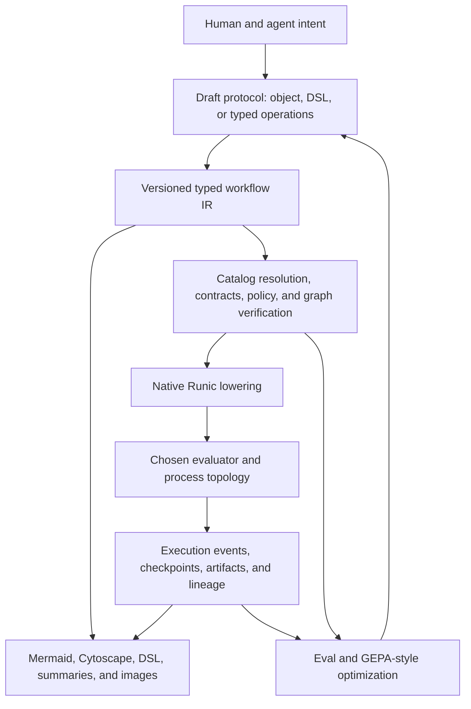

# Adjacent Agent Workflow Orchestration Research And Reference Survey

Status: research reference

Date: 2026-07-20

Related: `.docs/058-dynamic-workflows-research-and-workbench-plan.md`,
`.docs/062-general-purpose-agent-next-steps-plan.md`, and
`.docs/063-agent-drafted-workflow-substrate-research.md`

## Purpose

This document is a follow-up reference survey for the agent-drafted workflow
substrate proposed in `.docs/063`. It maps adjacent frameworks, runtimes,
languages, papers, protocols, and evaluation suites onto RunicAI's specific
problem:

> An agent and a human collaboratively design a workflow at runtime, verify
> component and policy compatibility, patch it over time, compile it into
> native Runic structure, execute it safely, and learn from the resulting
> traces.

This is not a package-selection exercise. Most of the systems below solve only
one or two layers of that problem. The useful question is which design ideas to
borrow while keeping Runic as the workflow graph and execution semantics,
RunicAI as the planning/policy/product layer, LitterBox as the sandbox boundary,
and SQLite-backed managed workflows as the durable definition path.

The research was checked against public sources on 2026-07-20. Agent framework
APIs are changing quickly, so links should be treated as version-sensitive
references rather than frozen implementation contracts.

## Executive Findings

The adjacent work supports the multi-view recommendation in `.docs/063` and
sharpens it in several ways.

1. **Separate the definition, runtime, and optimizer.** Agent frameworks often
   combine them for convenience. Compiler IRs and durable runtimes demonstrate
   why RunicAI should keep a canonical workflow definition, a compiled Runic
   artifact, and execution history as distinct versioned objects.
2. **Prefer explicit dataflow over conversation-as-control-flow.** Conversation
   frameworks are useful for delegation, debate, and specialist handoff, but
   their message histories are weak substitutes for named ports, cardinality,
   effects, and output contracts.
3. **Validate at connection time.** Haystack's pipeline connection checks,
   Pydantic Graph's type-derived edges, WIT interfaces, and MLIR verifiers all
   point toward rejecting an invalid connection when it is proposed rather than
   waiting for an execution failure.
4. **Treat agent planning as a compilation problem.** ReWOO and LLMCompiler
   separate planning from execution; LLM+P delegates formal search to a
   deterministic planner. RunicAI can let the model express intent and
   decomposition while deterministic code resolves components, proves
   contracts, schedules independent work, and lowers native `Runic.map` and
   `Runic.reduce` structures.
5. **Use typed domain edits as the workflow search space.** AFlow, GPTSwarm,
   ADAS, and AgentSquare show the value of optimizing topology and modules, but
   unconstrained code mutation is too large and unsafe a production search
   space. RunicAI should search over typed graph operations and catalog-backed
   component choices.
6. **Durability is more than saving the current graph.** Temporal, Restate,
   DBOS, LangGraph, and Burr preserve execution history, resumable state, or
   forks. Definition revision history and execution checkpoint history are
   different concerns and should be stored separately.
7. **Human intervention is a runtime event, not a blocking process.** Durable
   interrupts, messages, and checkpoints provide the right model for approvals
   that may take minutes or days.
8. **Optimization needs rich diagnostics and several objectives.** GEPA and
   TextGrad are relevant because compiler errors, policy diagnostics, cost, and
   human feedback contain more information than a pass/fail reward. The
   optimizer should retain a Pareto set rather than collapsing quality, cost,
   safety, and readability into one score too early.
9. **Images are views, not semantic truth.** Research on textual graph encoding
   shows that representation strongly affects LLM graph reasoning. That argues
   for evaluating adjacency text, a compact DSL, and rendered diagrams rather
   than assuming a PNG is inherently cheaper or easier for a model.
10. **No public benchmark measures this full problem.** Existing suites test
    function calls, planning, browser work, policy following, or end-task
    success. RunicAI needs a layered internal eval covering drafting, contracts,
    patching, compilation, execution, human comprehension, and total I/O cost.

## A Layered Reference Model

The surveyed systems become easier to compare when assigned to layers rather
than placed in one framework leaderboard.



| Layer | Primary question | Best adjacent references |
| --- | --- | --- |
| Authoring | How does an agent or human state and patch a design? | MLIR text/in-memory forms, CUE, WDL/CWL, JSON Patch, Automerge/Yjs. |
| Semantic IR | What is the durable meaning of the workflow? | MLIR, ONNX IR, WIT, JSON Schema, workflow patterns. |
| Validation | Are graph shape, ports, effects, and policies compatible? | Haystack, Pydantic Graph, WIT, MLIR verifiers, OPA. |
| Agent orchestration | Which deterministic and model-directed coordination patterns exist? | LangGraph, AutoGen GraphFlow, Google ADK, OpenAI Agents SDK, Semantic Kernel. |
| Compilation | How does a plan become efficient executable structure? | ReWOO, LLMCompiler, Beam, MLIR lowering. |
| Durable execution | How are waits, failures, restarts, and forks handled? | Temporal, Restate, DBOS, Burr, LangGraph. |
| Optimization | How are prompts, modules, and topology improved? | GEPA, AFlow, GPTSwarm, ADAS, AgentSquare, TextGrad. |
| Interoperability | How are tools and remote agents discovered and called? | MCP, A2A, WIT. |
| Observation | How are runs, lineage, and responsibility represented? | OpenTelemetry, OpenInference, OpenLineage, W3C PROV. |
| Evaluation | What succeeded, why, and at what cost? | BFCL, tau-bench, WorkArena, PlanBench, AgentBench, GAIA. |

The key architectural conclusion is that no item in the final column should
become the canonical RunicAI substrate merely because it is strong at its own
layer.

## Priority Reading And Prototype Map

| Priority | Reference | Why it matters to RunicAI | Recommended action |
| --- | --- | --- | --- |
| Study now | MLIR | One semantic graph represented as human text, in-memory objects, and compact serialization; extensible dialects and verifiers. | Borrow the multi-form IR, dialect, verifier, and lowering concepts. |
| Study now | Haystack pipelines | Concrete pre-run validation of component existence, named sockets, types, and connection occupancy. | Prototype equivalent `connect` diagnostics over `ComponentCatalog`. |
| Study now | WIT/component model | Versioned packages, imports/exports, interfaces, worlds, and explicit typed boundaries. | Use as a model for component identity and workflow boundary contracts. |
| Study now | LangGraph and Burr | Checkpoints, interrupts, forks, and graph-state inspection. | Model draft and execution time travel separately. |
| Study now | ReWOO and LLMCompiler | Plan first, bind dependencies, then execute independent work concurrently. | Add a dependency-aware plan projection and scheduling eval. |
| Study now | GEPA | Rich trace reflection and Pareto-aware textual optimization. | Use compiler/runtime diagnostics as actionable side information. |
| Prototype | CUE | Constraints and values share one declarative representation. | Compare CUE-like unification with a hand-built type lattice plus JSON Schema. |
| Prototype | AFlow | Execution-feedback search over workflow structure. | Recreate the search over safe typed operations, not arbitrary code. |
| Prototype | Agent Workflow Memory | Induction and reuse of common procedures from successful trajectories. | Mine proven subgraphs into candidate templates with provenance. |
| Prototype | Temporal/Restate/DBOS concepts | Replay, durable waits, idempotency, and recovery. | Define a Runic evaluator wrapper contract before selecting runtime infrastructure. |
| Watch | A2A | Remote opaque agents expose capabilities and task/artifact lifecycles. | Treat a remote agent as a catalog component with explicit boundary contracts. |
| Watch | CRDT editors | Concurrent human and agent mutation without a central edit lock. | Defer until transactional revision conflicts are proven insufficient. |
| Context only | Crew/group-chat frameworks | Useful coordination patterns but often message-centric and weakly typed. | Borrow patterns, not the conversation transcript as the workflow definition. |
| Avoid as canonical | BPMN, DOT, Mermaid, PNG | Strong communication formats; incomplete or overly broad execution semantics for this product. | Keep as derived or import/export views. |

## Agent Graph And Orchestration Frameworks

### LangGraph

[LangGraph](https://langchain-ai.github.io/langgraph/index.html) is a low-level
runtime for long-running, stateful agent graphs. Its core model is shared state,
nodes that update state, and fixed or conditional edges. It combines
deterministic graph structure with model-directed nodes and adds persistence,
streaming, human interrupts, and deployment support. Its
[persistence model](https://langchain-ai.github.io/langgraph/concepts/time-travel/)
distinguishes thread-scoped checkpoints from cross-thread stores.

Useful ideas:

- deterministic and agentic regions can coexist in one graph;
- checkpointed state supports resume, failure recovery, inspection, and forks;
- an interrupt is serialized state plus a resumable continuation, not a live
  process waiting on a person;
- orchestrator-worker patterns can create workers dynamically while writing
  their outputs into a defined aggregate state.

RunicAI application:

- expose a similar distinction between workflow revision state, run state, and
  long-lived knowledge;
- add fork-from-revision and fork-from-run-event as different operations;
- retain Runic's explicit productions and ports instead of adopting one shared
  mutable state object as the only data model;
- test whether conditional Runic rules plus a small state contract cover the
  useful dynamic routing behavior without importing a second graph runtime.

### Microsoft AutoGen And GraphFlow

[AutoGen](https://microsoft.github.io/autogen/stable/index.html) is an
event-driven multi-agent framework, while
[GraphFlow](https://microsoft.github.io/autogen/dev/user-guide/agentchat-user-guide/graph-flow.html)
adds directed workflow control for sequential, parallel, conditional, and
looping multi-agent teams. The earlier
[AutoGen paper](https://arxiv.org/abs/2308.08155) treats multi-agent
conversation as a programmable coordination mechanism.

Useful ideas:

- make the distinction between free-form group conversation and strict graph
  control explicit to the author;
- treat handoff, parallel fanout, conditional transition, and bounded loop as
  named patterns rather than accidental emergent chat behavior;
- use an event-driven core so agent messages and tool events can be observed
  independently of the UI.

RunicAI application:

- represent conversation-based collaboration as one catalog component or
  nested workflow, not as the universal workflow substrate;
- add first-class branch, handoff, and bounded-loop semantics to the proposed
  IR instead of encoding them in opaque prompts;
- compare GraphFlow's authoring ergonomics with native Runic rules, FSMs, and
  process managers.

Caution: message compatibility is not the same as data contract compatibility.
Two agents that can exchange strings may still disagree about required
artifacts, effects, completion evidence, or cardinality.

### Google Agent Development Kit

Google's [Agent Development Kit](https://developers.googleblog.com/agent-development-kit-easy-to-build-multi-agent-applications/)
provides deterministic sequential, parallel, and loop workflow agents alongside
LLM-directed agents that transfer control dynamically. Its evaluation tooling
compares both final responses and step-by-step execution trajectories.

Useful ideas:

- deterministic workflow agents and adaptive LLM agents are different
  primitives that can be nested;
- the development UI, trace, and eval representation should share identifiers;
- final-answer evaluation does not replace trajectory evaluation when policy or
  required ordering matters.

RunicAI application:

- label IR regions as deterministic, model-routed, or mixed;
- evaluate both accepted outputs and invariants such as "approval precedes
  mutation" or "verification follows every mapped edit";
- keep workflow pattern constructors small and native rather than introducing a
  generic `agent` node that hides every topology.

### Pydantic Graph

[Pydantic Graph](https://pydantic.dev/docs/ai/graph/graph/) models a workflow as
typed nodes in an asynchronous state machine. Node return type hints determine
possible outgoing edges, and graph state and dependencies are typed. It can
render Mermaid diagrams from the same graph definition.

Useful ideas:

- derive possible transitions from types rather than separately maintained edge
  prose;
- make state, runtime dependencies, node input, and node output distinct types;
- generate visualizations from the executable definition.

RunicAI application:

- make component port signatures authoritative and edges refer to exact output
  and input ports;
- reject an edge when the producer contract is not a subtype of the consumer
  contract;
- generate the compact agent view and human diagram from the same normalized
  revision.

### Haystack Pipelines

[Haystack pipelines](https://docs.haystack.deepset.ai/docs/pipelines) are the
closest practical reference for the proposed `connect` operation. When two
components are connected, Haystack checks that both exist, the requested output
and input sockets exist, their types match, and the target socket is available.
Pipelines support branches, bounded loops, async parallelism,
[serialization](https://docs.haystack.deepset.ai/docs/serialization), and
Mermaid rendering.

Useful ideas:

- connection validation is an authoring-time operation with a precise local
  error;
- named sockets are part of the durable component contract;
- serializable configuration and runtime component instances are separate;
- loops have an explicit run-count bound.

RunicAI application:

```text
connect source_split.slices -> materialize.in

check:
  producer exists                         pass
  output port `slices` exists             pass
  consumer exists                         pass
  input port `in` exists                  pass
  SourceSlices <: SourceSlices            pass
  input occupancy permits another edge    pass
  effects/policy permit the connection    pass
```

This should be a pure deterministic operation over IR V1 and the pinned catalog
snapshot. The current blueprint path cannot provide this guarantee until it
preserves port endpoints instead of reducing every edge to `from` and `to`.

### Burr

[Burr](https://burr.apache.org/docs/concepts/overview/) models applications as
actions and transitions over state. Its
[state persistence](https://burr.apache.org/docs/concepts/state-persistence/)
uses application, partition, and sequence identifiers to resume or fork an
application from a particular step.

Useful ideas:

- every state transition has a sequence identity;
- forks are normal debugging and experimentation operations;
- blocking for a user can be represented inside the state machine;
- persisted state and telemetry are part of the application abstraction.

RunicAI application:

- assign stable sequence numbers to accepted workflow operation batches and run
  events;
- allow a human to fork a draft at revision 12 and a run after node event 47
  without conflating the two histories;
- compare candidate workflow revisions from a common execution prefix during
  evals.

### OpenAI Agents SDK

The [OpenAI Agents SDK](https://openai.github.io/openai-agents-python/) is a
code-first runtime with a deliberately small set of primitives: agents, tools,
handoffs, guardrails, sessions, human intervention, and tracing. Its
[orchestration guide](https://openai.github.io/openai-agents-python/multi_agent/)
distinguishes manager-owned "agents as tools" from handoffs where a specialist
takes control. Its [tracing model](https://openai.github.io/openai-agents-python/tracing/)
records agent, model, tool, handoff, and guardrail spans.

Useful ideas:

- delegation has at least two different ownership semantics;
- handoff inputs can have a structured schema and filtered context;
- guardrails and tool approvals are explicit runtime boundaries;
- trace categories should reflect semantic actions, not only generic node
  start/stop events.

RunicAI application:

- distinguish `call_workflow`, `delegate_subtask`, and `transfer_ownership` in
  the IR;
- make context passed across a handoff an explicit bounded projection;
- record model, tool, sandbox, handoff, review, and acceptance spans using
  stable workflow revision and component ids.

The SDK is a useful runtime and tracing reference, but Python code should not be
the persisted RunicAI workflow definition.

### Pattern Catalogs Rather Than Framework Lock-In

Microsoft's
[agent orchestration pattern catalog](https://learn.microsoft.com/en-us/azure/architecture/ai-ml/guide/ai-agent-design-patterns)
and [Semantic Kernel orchestration](https://learn.microsoft.com/en-us/semantic-kernel/frameworks/agent/agent-orchestration/)
name concurrent, sequential, handoff, group-chat, and Magentic-style patterns.
Anthropic's
[Building Effective AI Agents](https://resources.anthropic.com/building-effective-ai-agents)
separates workflows from autonomous agents and discusses chaining, routing,
parallelization, orchestrator-worker, and evaluator-optimizer structures.

RunicAI should retain a framework-neutral pattern catalog. A pattern expands to
typed IR and then lowers to Runic. It should not become a permanently opaque
"multi-agent" node.

## Durable Execution References

### Temporal

[Temporal workflows](https://docs.temporal.io/workflows) are durable code whose
event history is replayed to reconstruct state after failure. Workflow code
must make the same decisions for the same recorded history; external I/O and
LLM calls belong in activities whose results are recorded.

Useful ideas:

- event history, not an in-memory process, is the source of execution truth;
- nondeterministic operations must cross an explicit recorded boundary;
- code and workflow definitions require versioning because old executions may
  replay after deployment;
- signals, queries, child workflows, and patches are separate concepts.

RunicAI application:

- define which Runic evaluator events must be durable before promising
  crash-safe resume;
- treat LLM, tool, filesystem, sandbox, time, and random operations as recorded
  invocations with idempotency metadata;
- pin the workflow revision and component implementation versions for every run;
- do not put replay restrictions inside pure Runic components. A durable
  evaluator or host process should own that policy so Runic remains
  process-agnostic.

### Restate

[Restate](https://docs.restate.dev/foundations/key-concepts#durable-execution)
journals operations and results, replays completed steps without repeating
them, provides resilient service calls, flow control, consistent per-entity
state, and suspension while waiting for external events. Its
[AI guidance](https://docs.restate.dev/ai) applies the model to agent sessions,
approvals, and multi-agent routing.

Useful ideas:

- durable functions can remain visually close to ordinary application code;
- single-writer entity state prevents races in session and agent memory;
- concurrency limits are cost and downstream-protection controls, not merely
  performance tuning;
- a human wait can release compute while retaining durable continuation state.

RunicAI application:

- add run-scoped concurrency, rate, token, and sandbox allocation ceilings to
  compiled policies;
- use durable messages for approvals and external results;
- test a Restate-backed evaluator only after defining a backend-neutral RunicAI
  durability contract.

### DBOS

[DBOS workflows](https://docs.dbos.dev/python/tutorials/workflow-tutorial)
checkpoint workflow inputs and step outputs in Postgres and recover from the
last completed step. Its
[architecture](https://docs.dbos.dev/architecture) requires deterministic
workflow functions and retry-safe steps, and its
[human-in-the-loop pattern](https://docs.dbos.dev/ai/hitl) durably waits for a
message.

Why it is especially relevant:

- it demonstrates a database-backed library approach without requiring a large
  separate orchestration service;
- workflow and queue state, step outputs, and operational controls share one
  durable data plane;
- fork/restart tooling is explicitly useful for agent evals;
- it is close to RunicAI's preference for durable relational storage.

RunicAI application:

- prototype the minimum evaluator state needed in SQLite before adopting new
  infrastructure;
- benchmark whether SQLite remains appropriate at the intended concurrency and
  history volume;
- preserve idempotency keys and completed invocation results so repair or resume
  does not repeat an irreversible tool action.

### Prefect And Airflow

[Prefect flows](https://docs.prefect.io/v3/concepts/flows) are dynamic
Python-authored workflows with explicit states, task runners, retries, caching,
artifacts, and concurrency controls. Apache Airflow's
[dynamic task mapping](https://airflow.apache.org/docs/apache-airflow/stable/authoring-and-scheduling/dynamic-task-mapping.html)
expands task instances from upstream data at runtime and supports collection as
a reduce-like operation.

Useful ideas:

- distinguish graph construction time from run-time expansion;
- lazy mapped results avoid materializing all values in the authoring layer;
- cap map width and active task instances independently;
- treat caching and retry as declared execution policy.

RunicAI application:

- keep native `Runic.map` and `Runic.reduce` as compiler targets rather than
  hiding fanout inside one step;
- make maximum expansion, concurrency, retry, timeout, and cache identity part
  of the compiled policy;
- show dynamic instances as a run overlay on the stable semantic node, not as a
  permanent mutation of the workflow definition.

## Compiler IR, Contract, And Workflow Language References

### MLIR: The Strongest IR Analogy

The [MLIR language reference](https://mlir.llvm.org/docs/LangRef/) explicitly
supports human-readable text, an in-memory programmatic form, and compact
serialization describing the same semantics. Its graph consists of operations
and typed values, supports nested regions, uses dialect namespaces for
extension, and attaches verifier traits and interfaces to operations. Different
passes progressively lower high-level concepts to target-specific forms.

This maps unusually well to RunicAI:

| MLIR concept | RunicAI analogue |
| --- | --- |
| Operation | Catalog-backed workflow component invocation. |
| Value | Typed production flowing from an output port to one or more inputs. |
| Dialect namespace | Component provider or capability namespace. |
| Trait/interface | Map-like, effectful, review-gated, serializable, compensatable, or stream-capable behavior. |
| Region | Nested workflow, branch, loop body, map body, or review scope. |
| Verifier | Structural, contract, policy, and effect validation. |
| Pass | Normalize, resolve catalog refs, infer contracts, insert adapters, lower native Runic graph. |
| Textual form | Optional compact Runic workflow DSL. |
| Serialized form | Canonical versioned JSON-safe IR. |

Recommended borrowing:

- generic lossless representation first, pretty syntax second;
- namespaced component and type dialects;
- one verifier per invariant with source-local diagnostics;
- explicit high-level-to-native lowering stages and source maps;
- nested regions for control structures instead of flattening every semantic
  distinction into arbitrary edges.

Do not copy SSA or compiler syntax literally. The value is the architecture, not
percent-prefixed identifiers.

### WebAssembly Component Model And WIT

The [WIT specification](https://github.com/WebAssembly/component-model/blob/main/design/mvp/WIT.md)
defines packages, versioned identifiers, interfaces, imports, exports, and
"worlds" that describe a component boundary. WIT describes contracts rather
than implementation behavior, and the component model validates that imports
and exports can be linked.

RunicAI application:

```text
component runic_ai/source-splitter@1.2
  import source: SourceSet
  export slices: List<SourceSlice>
  effects: [workspace_read]

component runic_ai/materialize@2.0
  import slices: List<SourceSlice>
  export documents: List<Document>
  effects: [workspace_read]
```

Borrow versioned package identity, named interfaces, and explicit imports and
exports. Extend the contract with workflow concerns WIT does not cover:
cardinality, stream/batch mode, effects, retry safety, cost class, approval
requirements, and provenance.

### ONNX IR

The [ONNX IR](https://onnx.ai/onnx/repo-docs/IR.html) separates the IR version
from imported operator-set versions and permits reusable functions to expand
into subgraphs. Its
[versioning rules](https://onnx.ai/onnx/repo-docs/Versioning.html) distinguish
changes to the container format from changes to operator semantics.

RunicAI application:

- store `ir_version`, `catalog_snapshot`, and each referenced component contract
  version separately;
- allow a reusable workflow/component macro to expand into a native subgraph
  while preserving a source map;
- define compatibility rules for upgrading an operator contract independently
  of migrating the overall IR format.

### Apache Beam

The [Apache Beam programming model](https://beam.apache.org/documentation/programming-guide/)
represents pipelines as transforms over typed collections and delegates physical
execution to runners. This cleanly separates logical pipeline definition from
the process topology chosen to execute it.

RunicAI application:

- preserve Runic's process-agnostic workflow definitions;
- let the compiler express collection-level map/reduce semantics while the
  evaluator chooses synchronous, asynchronous, distributed, or sandbox-affine
  execution;
- avoid encoding worker allocation or Task internals into the canonical IR.

### CWL, WDL, Argo, And General Workflow DSLs

The [Common Workflow Language](https://www.commonwl.org/v1.2/Workflow.html)
describes tools and directed workflows with typed inputs/outputs, nested
workflows, scatter, and conditional execution. WDL similarly separates tasks
from workflows. [Argo Workflows](https://github.com/argoproj/argo-workflows)
uses YAML templates, DAGs or steps, parameters, artifacts, fanout, and
Kubernetes execution.

Ideas worth borrowing:

- task/component definition is separate from invocation;
- workflow inputs and outputs are first-class;
- scatter/map and gather are explicit language constructs;
- artifacts and small parameters may need different transport treatment;
- nested workflows have a typed public boundary.

Ideas not to import wholesale:

- file staging and container execution are not the universal RunicAI component
  model;
- YAML verbosity and templating do not solve agent patch locality;
- DAG-only languages cannot directly express every Runic control component;
- a Kubernetes controller would duplicate rather than complement Runic's role.

### Workflow Patterns, BPMN, And Petri-Net Semantics

The [Workflow Patterns Initiative](https://www.workflowpatterns.com/patterns/control/)
catalogs recurring control-flow structures and gives formal Colored Petri Net
models for them. The broader catalog includes data, resource, and exception
perspectives. [BPMN 2.0](https://www.omg.org/spec/BPMN/2.0/About-BPMN/) is a
large standardized notation and execution model for business processes.

RunicAI should use the pattern catalog as a coverage checklist:

- sequence, parallel split, synchronization, exclusive and multi-choice route;
- structured and arbitrary loops;
- discriminator and partial join;
- cancellation, timeout, exception, compensation, and retry;
- multiple instances with known or runtime cardinality;
- human resource allocation and escalation.

This can reveal missing semantics in the proposed IR and compiler tests. BPMN
itself is too large and business-process-oriented to become the canonical
substrate, but selected BPMN import/export could be considered later.

### JSON Schema And CUE

[JSON Schema 2020-12](https://json-schema.org/specification) supplies a standard
vocabulary for structural validation and machine-readable diagnostics. It is a
good interchange boundary but does not by itself define workflow subtyping,
effects, or graph semantics.

[CUE](https://cuelang.org/docs/introduction/) combines values and constraints
through unification and supports validation, templating, querying, and code
generation. It is an interesting alternative to accumulating ad hoc schema
merge rules.

Recommended experiment:

- arm A: the proposed nominal `ValueContract` lattice plus referenced JSON
  Schemas and explicit effect/cardinality fields;
- arm B: CUE-like unification of component requirements, workflow bindings, and
  environment policy;
- compare diagnostic clarity, implementation size, agent context cost, and
  contract expressiveness.

Do not expose raw schema machinery to the planner when the compiler can return a
short deterministic answer such as `List<Record> is not assignable to
RecordGroup`.

### JSON Patch, Domain Operations, And CRDTs

[RFC 6902 JSON Patch](https://datatracker.ietf.org/doc/html/rfc6902) defines
`add`, `remove`, `replace`, `move`, `copy`, and `test` over JSON Pointer paths.
It is useful as a baseline and interchange format, but array indexes make graph
edits fragile and the operations do not express domain intent.

[Yjs](https://docs.yjs.dev/) and
[Automerge](https://automerge.org/docs/reference/under-the-hood/merge-rules/)
use conflict-free replicated data types to merge concurrent changes to maps,
lists, and text. They are strong references for a future multiplayer Workbench.

Recommended order:

1. implement id-based typed operation batches with a base revision;
2. return semantic conflicts and support rebase/fork;
3. measure actual concurrent human/agent conflict frequency;
4. add a CRDT only if offline or simultaneous editing justifies its operational
   complexity.

A graph-specific operation such as `connect(from: node.port, to: node.port)` is
better for validation, audit, and optimization than `add /edges/17` even if the
server can export the accepted transaction as JSON Patch.

## Planning, Synthesis, And Workflow Search Research

### ReWOO

[ReWOO](https://arxiv.org/abs/2305.18323) separates planning from tool
observations using a planner, workers, and a solver. The paper reports lower
token use and better robustness on its evaluated tasks because the model does
not repeatedly re-read the entire accumulated trajectory between every tool
call.

RunicAI application:

- draft a dependency-bearing plan once, then resolve and execute it through
  Runic;
- bind worker outputs to stable references rather than copying their text into
  every later prompt;
- replan only at explicit diagnostic or uncertainty boundaries;
- measure end-to-end token savings including repair, not only planner tokens.

### LLMCompiler

[LLMCompiler](https://arxiv.org/abs/2312.04511) uses a function-calling planner,
a task-fetching unit, and parallel executors. Dependencies between tool calls
form a plan that can schedule independent functions concurrently.

RunicAI application:

- let the LLM propose dependency references, not a serial action transcript;
- compile the dependency graph into native parallel Runic structure;
- use exact catalog functions and contracts to validate the plan;
- compare critical-path latency and model calls with a ReAct-style sequential
  loop.

### AutoFlow Versus AFlow

[AutoFlow](https://arxiv.org/abs/2407.12821) represents workflows as natural
language programs and iteratively improves them. It is useful as evidence that
natural language can act as a flexible procedural memory, but its semantics are
hard to verify or compile safely.

[AFlow](https://arxiv.org/abs/2410.10762) instead treats workflow generation as
search over code-represented graphs and uses Monte Carlo Tree Search plus
execution feedback to revise nodes and edges.

RunicAI application:

- include concise natural-language rationale and procedure summaries as
  annotations, not executable truth;
- recreate AFlow's feedback-driven search over typed operations such as
  `replace_component`, `parallelize_region`, `insert_verifier`, and
  `change_model_policy`;
- reject candidates before execution when contracts, effects, policy, or graph
  invariants fail;
- evaluate Pareto quality rather than selecting only the highest task score.

### GPTSwarm

[GPTSwarm](https://arxiv.org/abs/2402.16823) represents language agents as
composable computational graphs and optimizes node prompts and graph
connectivity separately.

RunicAI application:

- maintain separate mutation operators for node parameters and topology;
- permit recursive/nested graph composition through saved workflow references;
- score the effect of an edge mutation using compiler validity, execution
  outcome, critical path, and cost;
- preserve a semantic diff so a human can understand why the optimizer changed
  the graph.

### Automated Design Of Agentic Systems

[ADAS](https://arxiv.org/abs/2408.08435) frames automatic agent design as a
research field and demonstrates a meta-agent that writes new agent systems in
code while retaining an archive of discoveries.

RunicAI application:

- maintain an archive of valid, evaluated workflow revisions and reusable
  subgraphs;
- use novelty and behavioral diversity alongside score so search does not
  converge immediately on one template;
- keep production discovery inside a capability-safe IR. Arbitrary generated
  code belongs in the existing generated-component proof and promotion flow,
  not directly in a managed workflow definition.

### AgentSquare

[AgentSquare](https://arxiv.org/abs/2410.06153) defines a modular agent search
space around planning, reasoning, tool use, and memory, then evolves and
recombines modules while using a predictor to skip unpromising designs.

RunicAI application:

- define explicit replaceable roles or slots in workflow templates;
- require uniform typed boundaries for alternative components;
- learn a cheap validity/performance predictor only after enough real eval data
  exists;
- never let the predictor bypass deterministic validation or hidden safety
  gates.

### Agent Workflow Memory

[Agent Workflow Memory](https://arxiv.org/abs/2409.07429) induces reusable
procedures from prior trajectories and retrieves them to guide future tasks. It
abstracts example-specific details from common action routines.

RunicAI application:

- mine frequently successful subgraphs and edit sequences from managed workflow
  history;
- retain provenance to the source revisions, catalog versions, task families,
  and scores;
- retrieve a workflow sketch or typed template, then re-resolve all components
  and contracts against the current catalog;
- distinguish `copied`, `adapted`, and `newly synthesized` regions in the UI.

This is a promising later stage for the saved workflow library proposed in
`.docs/062`, after definitions and eval evidence are durable.

### Classical Planning And LLM+P

[LLM+P](https://arxiv.org/abs/2304.11477) translates a natural-language problem
into PDDL, delegates search to a classical planner, and translates the valid
plan back to language. [PlanBench](https://arxiv.org/abs/2206.10498) exists in
part because fluent model output is not reliable evidence of feasible
long-horizon planning.

RunicAI application:

- borrow the division of labor: model for interpretation, deterministic engine
  for feasibility;
- encode component preconditions, effects, and goal predicates for a constrained
  subset of workflow problems;
- compare graph drafting against planner-assisted synthesis for tasks with clear
  symbolic state and objectives;
- do not force open-ended research or writing workflows into PDDL where quality
  remains semantic and non-symbolic.

## Optimization References

### GEPA And DSPy

[GEPA](https://arxiv.org/abs/2507.19457) evolves textual system components using
reflection over full trajectories and Pareto-aware selection. The
[implementation](https://github.com/gepa-ai/gepa) accepts arbitrary textual
candidates and actionable side information. [DSPy](https://dspy.ai/) provides
the broader model of compiling modular LM programs against examples and a
metric.

The important transfer is not "optimize one giant planner prompt." It is to
make separately versioned optimization surfaces:

- task-shape classifier instruction;
- catalog shortlist projection;
- component contract rendering;
- workflow drafting instruction;
- diagnostic rendering;
- typed-operation repair instruction;
- human explanation template;
- model/runtime selection policy within allowed bounds.

Each candidate should receive structured scalar metrics plus text explaining
parse, contract, compile, run, safety, cost, and human-review failures. Preserve
the ancestry and Pareto frontier in SQLite.

### TextGrad

[TextGrad](https://arxiv.org/abs/2406.07496) models compound AI systems as
computation graphs and propagates textual feedback backward to improve textual
variables.

RunicAI application:

- attribute downstream failure to the relevant upstream prompt, component
  choice, or projection rather than mutating everything;
- use the compiler source map to connect a failed native Runic node back to its
  semantic IR node and optimization surface;
- compare localized textual feedback with GEPA-style population search;
- keep deterministic graph and policy rules non-trainable.

## Interoperability, Observation, Provenance, And Policy

### Model Context Protocol

The [MCP tool specification](https://modelcontextprotocol.io/specification/2025-06-18/server/tools)
uses JSON Schema for tool inputs and supports structured outputs and multiple
content types. MCP is an important capability discovery and invocation boundary,
not a workflow language.

RunicAI application:

- import MCP tools into `ComponentCatalog` through a normalized adapter;
- attach server identity, tool schema hash, capability/effect classification,
  transport, and authorization requirements;
- avoid placing the entire connected tool catalog in every planning prompt;
- revalidate a saved workflow when an MCP server's tool schema changes.

### Agent2Agent Protocol

The [A2A specification](https://github.com/a2aproject/A2A/blob/main/docs/specification.md)
defines discovery through Agent Cards and a task lifecycle using messages,
parts, and artifacts for communication with potentially opaque remote agents.

RunicAI application:

- model an A2A agent as a remote, versioned component provider;
- convert advertised skills and modalities into catalog candidates;
- keep task status and artifact delivery as runtime events;
- require local RunicAI policy for delegated authority even when the remote
  agent advertises broader capability.

MCP primarily exposes context and callable tools to a model-facing host; A2A
primarily coordinates work with another agent system. Neither replaces the
internal workflow IR.

### OpenTelemetry And OpenInference

[OpenTelemetry semantic conventions](https://opentelemetry.io/docs/specs/semconv/)
standardize names and attributes across traces, metrics, logs, and events.
[OpenInference](https://arize-ai.github.io/openinference/spec/semantic_conventions.html)
adds AI-oriented span kinds for model, retriever, tool, agent, and related
operations.

RunicAI application:

- define trace/span ids separately from workflow definition, revision, semantic
  node, compiled component, and dynamic instance ids;
- record token, model, tool, sandbox, retry, review, and artifact attributes;
- default sensitive prompt/tool payload capture off or redacted;
- export standard spans while retaining richer RunicAI events in SQLite.

### OpenLineage And W3C PROV

[OpenLineage](https://github.com/OpenLineage/OpenLineage/blob/main/spec/OpenLineage.md)
distinguishes a job definition, a particular run, and input/output datasets,
with extensible facets for schema, source code, errors, versions, and statistics.
[W3C PROV](https://www.w3.org/TR/prov-overview/) models entities, activities,
agents, derivation, and responsibility.

RunicAI application:

- keep definition, revision, run, node invocation, artifact, and actor as
  distinct durable identities;
- record which workflow revision and component produced or revised an artifact;
- represent human approval, agent authorship, optimizer mutation, and imported
  template lineage;
- expose provenance in Workbench without forcing the canonical IR to adopt RDF.

### Policy As Code And Agentic Risk

[Open Policy Agent](https://openpolicyagent.org/docs) evaluates declarative Rego
policies over structured input. The
[OWASP Top 10 for Agentic Applications](https://genai.owasp.org/resource/owasp-top-10-for-agentic-applications-for-2026/)
is a useful threat checklist for agents that plan, delegate, retain memory, and
invoke tools across multi-step workflows.

RunicAI application:

- feed normalized workflow IR, actor, workspace, component effects, budgets,
  and target environment into a deterministic policy decision;
- return structured allow, deny, approval-required, and remediation results;
- evaluate composite risk, such as untrusted source input flowing into a
  privileged mutating tool, not only node-local permissions;
- keep policy outside model-editable workflow content.

Adopting OPA itself is optional. The architectural requirement is a declarative,
testable, versioned policy boundary whose results can be explained and audited.

## Human Collaboration And Visual Reasoning

### AutoGen Studio As A UI Reference

[AutoGen Studio](https://arxiv.org/abs/2408.15247) explores a no-code interface
for prototyping, debugging, and evaluating multi-agent workflows. The project
supports visual construction, testing, profiling, and JSON export.

RunicAI application:

- support visual composition and natural-language edits as clients of the same
  typed operation API;
- show component configuration, flow, events, and evaluation results together;
- make export/import a projection of a durable revision;
- clearly distinguish a prototype configuration from a validated runnable
  workflow.

### Text, DSL, And Image Views Need An Eval

[Encoding Graphs for Large Language Models](https://arxiv.org/abs/2310.04560)
finds that LLM graph reasoning varies with graph encoding, task, and graph
structure. [CodeGraph](https://arxiv.org/abs/2408.13863) further shows that
having the model generate executable graph-analysis code can reduce arithmetic
and control errors on graph tasks.

Implications:

- do not assume DOT, adjacency lists, DSL, Mermaid, Cytoscape JSON, or images are
  interchangeable model inputs;
- use deterministic graph algorithms for reachability, cycles, critical paths,
  and contract propagation instead of asking the LLM to count or simulate;
- test local graph slices against whole-graph views;
- for multimodal arms, count both image tokens and the machine-readable sidecar
  required for precise edits.

The image should help a model or human see topology. Typed local text should
remain available for exact reasoning and patching.

### Event History Before CRDT Complexity

Event sourcing captures changes as an append-only sequence that can reconstruct
past state. [Yjs](https://docs.yjs.dev/) and Automerge go further by merging
concurrent replicas.

For RunicAI, an accepted typed operation history provides immediate benefits:

- audit and replay;
- semantic diffs;
- agent/human attribution;
- undo through compensating operations or revision forks;
- optimizer training data;
- reconstruction of any approved revision.

CRDT collaboration becomes valuable only when multiple editors must work
simultaneously or offline. Server-serialized SQLite transactions and optimistic
base revisions are simpler for the initial agent-plus-human workflow.

## Evaluation Landscape

### What Existing Benchmarks Cover

| Benchmark | What it measures | Useful RunicAI slice | Important gap |
| --- | --- | --- | --- |
| [BFCL](https://gorilla.cs.berkeley.edu/leaderboard) | Function selection and arguments, parallel calls, multi-turn tool use, hallucination, latency, and cost. | Catalog selection, schema adherence, and tool-call formatting. | Does not evaluate durable workflow authoring or graph patching. |
| [tau-bench](https://arxiv.org/abs/2406.12045) | Tool-agent-user interaction under domain policies and dynamic conversation. | Policy following, user clarification, and stateful execution. | Workflow definition quality is not the tested artifact. |
| [AgentBench](https://arxiv.org/abs/2308.03688) | Agent behavior across several interactive environments. | General execution robustness. | Limited contract and revision analysis. |
| [GAIA](https://arxiv.org/abs/2311.12983) | General assistant tasks requiring tools, files, browsing, and multi-step reasoning. | End-task utility for general-purpose workflows. | A correct answer may hide a poor or unsafe workflow. |
| [WorkArena](https://arxiv.org/abs/2403.07718) | Browser-based enterprise knowledge-work tasks. | Realistic long-horizon actions and compositional workflows. | UI/environment success dominates substrate quality. |
| [PlanBench](https://arxiv.org/abs/2206.10498) | Feasible symbolic planning and reasoning about change. | Preconditions, effects, goal satisfaction, replanning. | Many RunicAI tasks have semantic outputs that are not PDDL goals. |
| Google ADK trajectory eval | Expected action/tool sequence plus response quality. | Ordering and policy invariants. | Exact trajectory matching can reject valid alternative workflows. |

These benchmarks should be used as task sources or external validity checks, not
as the only selection score for the substrate.

### Required Internal Evaluation Stack

The `.docs/063` substrate bake-off should be extended into six nested levels.

#### Level 1: Representation

- parse and strict schema success;
- semantic round trip and stable hash;
- output tokens, bytes, image tokens, and latency;
- source spans and diagnostic locality;
- id stability under formatting and insertion.

#### Level 2: Catalog And Contract Resolution

- correct shortlist recall and decoy rejection;
- exact component and version resolution;
- named port correctness;
- subtype, cardinality, stream/batch, and effect compatibility;
- behavior when a component disappears or narrows its contract.

#### Level 3: Graph And Policy Verification

- reachability, cycles, roots/leaves, join and branch completeness;
- bounded loops and maximum dynamic expansion;
- mutation/review ordering;
- retry safety and idempotency requirements;
- budget, sandbox, network, and credential boundaries.

#### Level 4: Compilation And Execution

- deterministic native lowering and source maps;
- expected `Runic.map`, `Runic.reduce`, rule, FSM, or nested workflow shape;
- objective scorecard, artifacts, and proof;
- correct blocked state when execution is unsafe or impossible;
- recovery without duplicate irreversible effects.

#### Level 5: Longitudinal Collaboration

- local edit success over 5-15 turns;
- collateral-change rate;
- base-revision conflicts and rebase/fork success;
- human ability to identify flow, effects, errors, and diffs;
- time and confidence for approval decisions.

#### Level 6: Search And Learning

- improvement on held-out task and topology families;
- Pareto quality/cost/safety/readability frontier;
- transfer across model provider and catalog version;
- novelty versus template memorization;
- regression on the general dynamic workflow browser matrix.

### Reference Experiment Matrix

| Experiment | Question | Arms | Primary result |
| --- | --- | --- | --- |
| E1: authoring substrate | Which whole-draft format gives the best semantic plan per total cost? | Current JSON, normalized JSON, compact DSL, restricted YAML. | Valid compiled workflows per dollar and repair attempt. |
| E2: repair protocol | Does domain editing outperform regeneration? | Whole object, RFC 6902, typed operations. | Convergence, collateral edits, tokens, conflict behavior. |
| E3: graph view | Which projection supports topology reasoning? | Edge list, DSL, Mermaid source, local slice, PNG/SVG plus sidecar. | Correctness by topology and graph size at full I/O cost. |
| E4: planner/executor split | Is a compiled plan better than stepwise ReAct? | ReAct, ReWOO-like, LLMCompiler-like Runic plan. | Task success, calls, tokens, critical-path latency, replans. |
| E5: contract engine | What type machinery is sufficient? | Current nominal types, nominal plus JSON Schema/effects, CUE-like constraints. | Fault detection, false rejection, diagnostic quality, complexity. |
| E6: durability | What history is required for reliable resume? | Restart, node checkpoint, journal/replay. | Correct recovery and duplicate-effect rate under fault injection. |
| E7: optimizer | Which feedback loop improves held-out workflows safely? | Hand prompt, GEPA-style, TextGrad-style local feedback, typed MCTS. | Pareto gain with no policy regression. |
| E8: human collaboration | Which Workbench combination earns accurate approval? | Raw source, diagram, diagram plus contracts/diff. | Decision accuracy, time, confidence calibration. |

### Fault Injection Corpus

Add failures inspired by the surveyed runtimes and protocols:

- model times out after a tool side effect but before its result is recorded;
- worker crashes after some mapped items finish;
- workflow definition changes while an old run is suspended for approval;
- MCP tool schema changes between draft and activation;
- remote A2A agent returns an artifact with the wrong declared media/schema;
- human and agent edit the same node from the same base revision;
- optimizer proposes an incompatible but higher-scoring component;
- a branch omits one output needed by a downstream join;
- retry repeats a non-idempotent sandbox or external action;
- map expansion exceeds policy after an upstream result is observed;
- imported template resolves to a newer component with broader effects;
- a visually plausible graph contains an unreachable acceptance check.

Each case should have a deterministic oracle for the acceptable result:
successful recovery, a local diagnostic, a required review, or a terminal
blocked state.

## Concrete RunicAI Design Transfers

### Component Identity And Boundary

Use a versioned identity inspired by WIT and ONNX:

```text
runic_ai/source_materializer@2.1
```

Pin the resolved component contract in each workflow revision. A catalog alias
may make drafting concise, but activation and replay should know the exact
version and schema hash.

### Rich Port Contract

A useful boundary needs more than `:records` or `:any`:

```elixir
%{
  name: :documents,
  value: {:list, {:schema_ref, "runic_ai/document@1"}},
  cardinality: :many,
  mode: :batch,
  required?: true,
  effects: [],
  provenance: [:source_ref, :content_hash]
}
```

Effects belong primarily to the component invocation, but ports may also carry
trust, sensitivity, provenance, or artifact-lifetime labels used by dataflow
policy.

### Staged Compiler

```text
authoring source
  -> parse with source spans
  -> normalize stable ids and references
  -> resolve pinned catalog components
  -> infer and check exact ports
  -> verify topology, effects, policy, and acceptance
  -> expand patterns and nested workflow boundaries
  -> lower map/reduce/rule/FSM/native Runic components
  -> produce source map and deterministic compiled hash
```

Each stage returns structured diagnostics against semantic ids and source spans.
No model call is needed to decide facts already known at a stage.

### Definition History Versus Run History

```text
workflow definition
  revision 7 -- operation batch --> revision 8
       |                              |
       | run A                        | run B
       v                              v
  execution events               execution events
  checkpoint/fork A.23           checkpoint/fork B.11
```

A run remains pinned to its revision. Editing a suspended run creates a new
revision and an explicit migration/restart decision; it must not silently change
the meaning of history being replayed.

### Safe Workflow Search Space

Start with mutations whose preconditions and effects are statically checkable:

- add, remove, replace, or configure a catalog component;
- connect or disconnect exact ports;
- wrap a region in bounded map, reduce, branch, review, or retry;
- parallelize independent nodes;
- insert a verifier, adapter, materializer, or approval gate;
- replace a model/runtime policy within an allowed set;
- extract or inline a nested saved workflow;
- change acceptance logic without weakening mandatory policy checks.

Arbitrary component code generation remains a separate sandboxed proof and
promotion workflow.

## Recommended Investigation Sequence

### Investigation 1: Contract-First Connect Prototype

Implement a pure experimental connector over a normalized IR sketch and the
current `ComponentCatalog`:

- exact output and input port references;
- local Haystack-style diagnostics;
- contract version/hash;
- nominal type plus JSON Schema reference;
- cardinality, mode, effects, and target occupancy.

Use current blueprint fixtures plus seeded faults. This provides value even if
the eventual authoring syntax remains JSON.

### Investigation 2: Multi-Form IR Spike

Following MLIR, prove that one semantic graph can round-trip through:

- normalized JSON-safe data;
- a compact textual form;
- typed operation batches;
- Mermaid/Cytoscape projections.

The round trip should preserve semantics, comments/annotations where promised,
stable ids, and source locations. Rendered diagrams remain intentionally lossy.

### Investigation 3: Plan-Then-Run Comparison

Build a small ReWOO/LLMCompiler-style planner that emits dependency references
against a tiered catalog. Compile independent operations into native Runic
parallelism and compare it with the current turn-by-turn path on research,
repo-analysis, and tool-routing fixtures.

### Investigation 4: Durable Interrupt And Fault Model

Specify a backend-neutral evaluator contract for:

- recorded invocation start/result;
- checkpoint and continuation;
- external message/approval;
- cancellation and timeout;
- idempotency and retry;
- fork/replay;
- pinned revision and implementation versions.

Implement the minimal SQLite-backed experiment before deciding whether DBOS,
Restate, Temporal, or another host runtime is warranted.

### Investigation 5: Typed Workflow Search

Recreate a narrow AFlow-like search:

- mutation space is typed operations;
- deterministic validators prune candidates;
- execution fixtures return rich diagnostics;
- GEPA-style reflection proposes targeted changes;
- Pareto selection retains task quality, cost, latency, and safety diversity.

Start with 3-5 small workflow families and keep an untouched held-out topology
family.

### Investigation 6: Procedure Mining

After workflow revisions and eval traces are durable, test Agent Workflow
Memory-style induction:

- identify repeated successful subgraphs;
- abstract task-specific constants into typed inputs;
- validate the extracted public boundary;
- store source lineage and score distributions;
- retrieve and adapt rather than blindly copy.

## Decisions This Survey Supports

The research supports these current decisions:

- keep one canonical, versioned, typed IR in SQLite;
- make JSON a serialization, not the entire authoring protocol;
- use typed domain operations for incremental edits and optimizer mutations;
- make exact component ports and versioned contracts authoritative;
- derive DSL, Mermaid, Cytoscape, DOT, SVG, and image views;
- lower high-level patterns to native Runic components;
- keep durability in the evaluator/process layer so Runic components retain no
  process assumptions;
- store definition history, compiled artifacts, execution history, and
  provenance as related but distinct records;
- use rich compiler/runtime feedback for GEPA-style optimization;
- evaluate task success, safety, repair, human comprehension, and total I/O
  cost together.

The research argues against these shortcuts:

- using a chat transcript as the workflow definition;
- persisting Python, Elixir, or JavaScript generated by the planner as the normal
  managed workflow format;
- accepting `:any` across critical boundaries to make plans compile;
- embedding dynamic fanout in one opaque step;
- choosing a durable runtime before defining RunicAI's durability contract;
- treating an image or Mermaid source as the sole editable executable truth;
- optimizing topology with arbitrary code mutation in the production path;
- scoring only the final answer while ignoring forbidden or wasteful
  trajectories.

## Curated Reference Index

### Highest-Value Architecture References

- [MLIR Language Reference](https://mlir.llvm.org/docs/LangRef/)
- [MLIR Transform Dialect](https://mlir.llvm.org/docs/Dialects/Transform/)
- [WebAssembly Interface Types](https://github.com/WebAssembly/component-model/blob/main/design/mvp/WIT.md)
- [Haystack Pipelines](https://docs.haystack.deepset.ai/docs/pipelines)
- [Pydantic Graph](https://pydantic.dev/docs/ai/graph/graph/)
- [Workflow Control-Flow Patterns](https://www.workflowpatterns.com/patterns/control/)
- [CUE Introduction](https://cuelang.org/docs/introduction/)

### Agent Frameworks And UI

- [LangGraph](https://langchain-ai.github.io/langgraph/index.html)
- [AutoGen](https://microsoft.github.io/autogen/stable/index.html)
- [AutoGen GraphFlow](https://microsoft.github.io/autogen/dev/user-guide/agentchat-user-guide/graph-flow.html)
- [AutoGen Studio paper](https://arxiv.org/abs/2408.15247)
- [Google ADK](https://developers.googleblog.com/agent-development-kit-easy-to-build-multi-agent-applications/)
- [OpenAI Agents SDK](https://openai.github.io/openai-agents-python/)
- [Semantic Kernel Agent Orchestration](https://learn.microsoft.com/en-us/semantic-kernel/frameworks/agent/agent-orchestration/)
- [Burr](https://burr.apache.org/docs/concepts/overview/)

### Durable Runtime References

- [Temporal Workflows](https://docs.temporal.io/workflows)
- [Restate Durable Execution](https://docs.restate.dev/foundations/key-concepts#durable-execution)
- [DBOS Architecture](https://docs.dbos.dev/architecture)
- [Prefect Flows](https://docs.prefect.io/v3/concepts/flows)
- [Airflow Dynamic Task Mapping](https://airflow.apache.org/docs/apache-airflow/stable/authoring-and-scheduling/dynamic-task-mapping.html)

### Planning And Workflow Synthesis Papers

- [ReWOO](https://arxiv.org/abs/2305.18323)
- [LLMCompiler](https://arxiv.org/abs/2312.04511)
- [AutoFlow](https://arxiv.org/abs/2407.12821)
- [AFlow](https://arxiv.org/abs/2410.10762)
- [Language Agents as Optimizable Graphs / GPTSwarm](https://arxiv.org/abs/2402.16823)
- [Automated Design of Agentic Systems](https://arxiv.org/abs/2408.08435)
- [AgentSquare](https://arxiv.org/abs/2410.06153)
- [Agent Workflow Memory](https://arxiv.org/abs/2409.07429)
- [LLM+P](https://arxiv.org/abs/2304.11477)

### Optimization

- [GEPA paper](https://arxiv.org/abs/2507.19457)
- [GEPA code](https://github.com/gepa-ai/gepa)
- [DSPy](https://dspy.ai/)
- [TextGrad](https://arxiv.org/abs/2406.07496)

### Protocol, Trace, Lineage, And Policy

- [MCP Tools](https://modelcontextprotocol.io/specification/2025-06-18/server/tools)
- [A2A Specification](https://github.com/a2aproject/A2A/blob/main/docs/specification.md)
- [OpenTelemetry Semantic Conventions](https://opentelemetry.io/docs/specs/semconv/)
- [OpenInference Semantic Conventions](https://arize-ai.github.io/openinference/spec/semantic_conventions.html)
- [OpenLineage Specification](https://github.com/OpenLineage/OpenLineage/blob/main/spec/OpenLineage.md)
- [W3C PROV Overview](https://www.w3.org/TR/prov-overview/)
- [Open Policy Agent](https://openpolicyagent.org/docs)
- [OWASP Top 10 for Agentic Applications](https://genai.owasp.org/resource/owasp-top-10-for-agentic-applications-for-2026/)

### Evaluation And Representation

- [Berkeley Function Calling Leaderboard](https://gorilla.cs.berkeley.edu/leaderboard)
- [tau-bench](https://arxiv.org/abs/2406.12045)
- [AgentBench](https://arxiv.org/abs/2308.03688)
- [GAIA](https://arxiv.org/abs/2311.12983)
- [WorkArena](https://arxiv.org/abs/2403.07718)
- [PlanBench](https://arxiv.org/abs/2206.10498)
- [Encoding Graphs for Large Language Models](https://arxiv.org/abs/2310.04560)
- [CodeGraph](https://arxiv.org/abs/2408.13863)

## Final Position

Adjacent systems do not reveal a single superior workflow substrate. They reveal
a mature division of responsibilities that RunicAI can adopt:

- compiler IRs show how one semantic definition can have several authoring,
  storage, and debugging forms;
- typed pipeline systems show that invalid connections should fail locally;
- agent frameworks contribute coordination patterns, interrupts, and trace UX;
- durable runtimes contribute replay, messages, checkpoints, and idempotency;
- planning research contributes dependency-aware plan-then-execute designs;
- workflow-search research contributes topology and module optimization;
- GEPA and TextGrad contribute rich-feedback optimization;
- protocols contribute discovery and remote invocation boundaries;
- provenance and telemetry standards contribute stable run identity and audit;
- planning, tool-use, and browser benchmarks contribute external task families.

The distinctive RunicAI opportunity is to combine those ideas around native
Runic semantics rather than becoming another message-centric agent framework:
a typed, revisioned intermediate workflow definition; deterministic catalog,
contract, and policy verification; native graph lowering; durable but
process-agnostic execution integration; precise human/agent patching; and an
eval loop that treats correctness, safety, readability, and cost as first-class
outcomes.
