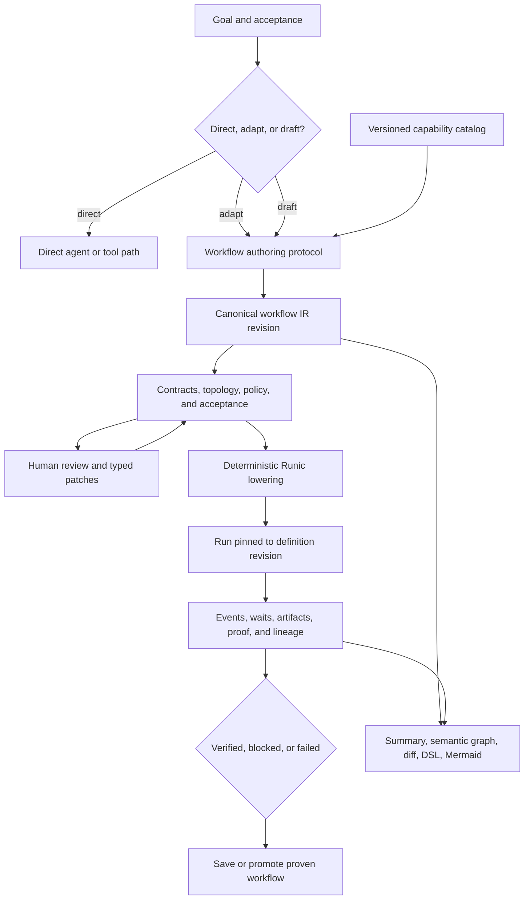
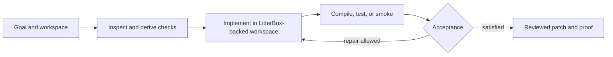
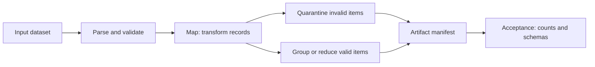

# General Dynamic Workflow Product Reassessment

Status: adopted V1 product direction; automated and real-browser gates are
implemented across the three golden families, with the actual human review
study still open. Supersedes the implementation sequencing in
`.docs/062-general-purpose-agent-next-steps-plan.md`. See
`.docs/066-general-dynamic-workflow-implementation-ledger.md` for current
evidence and the ship/defer/remove boundary.

Date: 2026-07-26

Related: `.docs/058-dynamic-workflows-research-and-workbench-plan.md`,
`.docs/061-sandbox-backed-dynamic-workflow-ooda-goal.md`,
`.docs/062-general-purpose-agent-next-steps-plan.md`,
`.docs/063-agent-drafted-workflow-substrate-research.md`, and
`.docs/064-adjacent-agent-workflow-orchestration-research-survey.md`

## Executive Decision

The strategic loop in `.docs/062` is still right:

```text
intent
  -> proposed workflow
  -> validation and repair
  -> native Runic execution
  -> observable proof
  -> durable reuse
```

The implementation sequence should change.

`.docs/062` organizes the work as a progression of platform capabilities:
durable definitions, compiler breadth, child workflows, sandbox objects,
templates, generalized proof, and reuse. That is a sensible architecture
inventory, but it risks producing several individually capable subsystems before
there is one coherent product that a user can trust.

The next goal should be a thin but complete product loop:

> A user gives RunicAI a goal that benefits from orchestration. RunicAI either
> chooses a direct agent, adapts a proven workflow, or drafts a new typed
> workflow. The user can understand and patch the proposal, deterministic
> checks explain whether it is runnable, Runic executes it with visible state
> and review boundaries, and the run ends with verified output or a precise
> blocked reason. A successful workflow can then be saved and reused.

Build that loop for three representative workflow families before broadening the
catalog or adopting a new authoring syntax:

1. research and cited synthesis;
2. repository analysis, change, and verification;
3. bounded batch transformation with fan-out and aggregation.

The central product investment is a shared semantic workflow layer between the
existing assistant and coding paths. It should use a versioned typed IR, exact
catalog contracts, typed edit operations, deterministic validation, native
Runic lowering, durable revision history, and generated human views. JSON is a
serialization. Mermaid is a view. A future DSL is an optional authoring
projection. None of those surfaces should independently define execution
meaning.

Do not begin by building a universal orchestration platform. First prove that a
user can get a better, more controllable result from a dynamic workflow than
from a direct agent, and that the improvement justifies planning latency,
model I/O, and operational complexity.

## What "Useful General Dynamic Workflow" Means

The product is not useful merely because an LLM can emit a valid DAG. It is
useful when orchestration improves an outcome the user cares about.

The initial product promise should be:

- decompose larger goals into inspectable work;
- use only available, policy-compatible capabilities;
- expose what will run, mutate, cost, and require review;
- exploit safe parallelism without hiding it inside opaque steps;
- preserve enough state to recover from failures and human delays;
- prove the requested result instead of treating fluent output as completion;
- turn successful procedures into reusable assets.

"General" should mean that the semantic core composes across task domains. It
should not mean that RunicAI invents a graph for every request or supports every
workflow pattern in its first release.

### The Product Must Be Allowed To Choose No Workflow

A graph has a cost: proposal tokens, validation, user review, runtime state,
more failure surfaces, and more UI. The router should choose among three paths:

| Path | Use when | Product behavior |
| --- | --- | --- |
| Direct agent or tool | The goal is short, sequential, and has little reuse or recovery value. | Execute directly with normal policy and proof. Do not manufacture a one-node workflow for display. |
| Adapt proven workflow | A saved or built-in workflow closely matches the goal. | Bind inputs and policies, show the adaptation, validate, and run. |
| Draft dynamic workflow | The goal needs decomposition, heterogeneous capabilities, parallel work, review, durable waiting, or reusable structure. | Draft against the catalog, validate incrementally, invite review when material, then compile and run. |

This decision itself should be evaluated. A system that always drafts a workflow
can score well on graph-generation tests while being a worse product.

### Initial User And Job

The first user should be a local developer, researcher, or technical operator
who can understand a graph but should not need to edit raw Elixir or decipher
event payloads. The initial job is:

> Turn a multi-step goal into a trustworthy plan, let me correct it before or
> during execution, and give me evidence that the result is complete.

This is narrower and more testable than "general-purpose autonomous agent." It
still exercises the architecture required for broader users later.

## Grounded Current State

The current checkout is beyond the starting assumptions of `.docs/062`, but its
capabilities are split across product paths.

### Existing Assets Worth Keeping

The generic assistant path already has:

- `RunicAI.Assistant.RLM.WorkflowBlueprint` and `ComponentBlueprint` as inert,
  JSON-encodable proposal data;
- a closed `RunicAI.RLM.ComponentCatalog` and normalized component specs;
- graph checks for identities, endpoints, cycles, isolation, and selected
  execution-shape rules;
- structured blueprint diagnostics covering catalog, policy, tools, sandbox
  capabilities, budgets, generated functions, and artifacts;
- `RunicAI.Assistant.RLM.WorkflowCompiler`, including native `Runic.map` and
  `Runic.reduce` lowering and Runic port compatibility errors;
- compiled graph summaries and Mermaid rendering in terminal and Workbench
  surfaces;
- objective scorecards, artifacts, execution metrics, and generated-component
  proof paths.

The coding RLM path already has:

- a separate `RunicAI.Coding.RLM.WorkflowProposal`, `ProposalNode`, validator,
  coordinator, compiler, and repair loop;
- objective and acceptance contracts, verification gates, review gates,
  child-agent execution, checkpoints, repair evidence, and browser-backed
  robustness scenarios;
- proposal-generation and proposal-repair code beyond the last recorded 061
  4/5 browser result, although the full matrix still needs to be rerun to prove
  closure.

The persistence and product surfaces already have:

- SQLite-backed `managed_workflows` linked to concrete `workflow_runs`;
- durable events, snapshots, reviews, artifacts, facts, scorecards, child runs,
  and terminal state;
- managed-workflow query and launch surfaces in the terminal;
- graph and proof projections in Workbench;
- an in-progress package boundary where LitterBox owns sandbox execution and
  RunicAI retains planning, policy, persistence, proof, and UI.

These are significant advantages. RunicAI does not need a replacement workflow
engine or a greenfield orchestration framework.

### The Current Product Fractures

The most important gap is not the absence of more node types. It is the absence
of one product-level workflow truth.

| Area | Current state | Product consequence |
| --- | --- | --- |
| Proposal model | Generic assistant blueprints and coding workflow proposals have separate structs, node vocabularies, validators, compilers, and repair paths. | Features and fixes can land in one path without improving the other; users cannot rely on one workflow contract. |
| Ports and contracts | Catalog specs have useful nominal contracts, but accepted blueprint edges retain only node-to-node `from` and `to`; blueprint-declared ports can degrade to `:any`. | A graph can look connected without proving the intended output-to-input binding. |
| Authoring | Proposals and repairs commonly regenerate whole JSON values. | Repairs spend more tokens, can damage unrelated regions, and are hard to audit or merge with human changes. |
| Definition persistence | `managed_workflows` stores a definition kind and opaque definition blob and links runs, but it has no canonical workflow revision or edit-operation history. | Saving exists at an infrastructure level, not yet as a safe collaborative workflow library. |
| Execution history | Runs, events, checkpoints, artifacts, and reviews are durable. | This is a strong base, but a run is not yet visibly pinned to an immutable semantic definition revision. |
| Human view | Runtime graphs and Mermaid are renderable. | Users can observe graphs, but cannot yet review contracts, semantic diffs, holes, or patches as one definition workflow. |
| Reuse | Managed workflows and generated component catalog entries exist. | Planning does not yet have one reliable retrieval, adaptation, validation, and provenance loop. |
| Product proof | The 061 general matrix tests real tasks and browser behavior. | It is the right discipline, but it primarily proves coding RLM reliability rather than the shared workflow product. |

### What Has Changed Since 062

Three 062 assumptions now need updating:

1. **The high-level compiler is not wholly future work.** The assistant compiler
   and component factory already lower catalog-backed components, including
   native map and reduce shapes. The next task is contract fidelity and product
   convergence, not introducing a second broad compiler project.
2. **Proposal repair is implemented but not fully closed.** The coding
   coordinator now includes generated-proposal repair attempts and focused
   tests. The remaining obligation is a current full browser matrix and durable
   product telemetry, not merely writing a repair function.
3. **Durable definitions exist but are semantically shallow.** The persistence
   layer is ready to evolve, but storing more opaque blueprint blobs before the
   IR and revision semantics are proven would fossilize the prototype model.

The LitterBox extraction is also visibly in progress in the working tree. It
remains a necessary boundary validation, but it should be managed as a runtime
dependency gate rather than the organizing principle for the workflow product.

## Product Architecture: One Thin Waist

The useful architecture is a thin semantic waist with multiple producers,
views, and execution targets around it.



The thin waist consists of:

- a versioned semantic IR;
- a versioned component and workflow catalog;
- deterministic draft and runnable validation;
- typed edit operations;
- a staged compiler with source mappings;
- an immutable link from a run to a definition revision;
- a shared acceptance and proof contract.

The existing `WorkflowBlueprint` and `WorkflowProposal` should initially adapt
into this layer. Do not perform a flag-day rewrite. Once the shared path proves
it can express both families without semantic loss, generation and execution
can migrate one path at a time.

### Definition, Compilation, And Run Are Different Objects

The product should name and show these distinctions:

| Object | Mutable? | Meaning |
| --- | --- | --- |
| Goal and acceptance contract | Revisioned | What outcome, constraints, and proof the user requested. |
| Workflow draft revision | Yes, through new revisions | The high-level component graph, bindings, policies, holes, rationale, and presentation hints. |
| Runnable revision | Immutable once approved or launched | A draft that passes all required checks against a pinned catalog. |
| Compiled artifact | Regenerable cache | Native Runic graph, compiler versions, hashes, and source mapping. |
| Workflow run | Append-only history plus explicit state transitions | One execution pinned to one runnable revision. |
| Projection | Regenerable view | Summary, DSL, Mermaid, Cytoscape, DOT, SVG, or image. |

Editing a suspended run must not silently rewrite history. A material edit
creates a new definition revision and an explicit restart, migrate, or fork
decision.

### V1 Semantic Vocabulary

Keep the initial language small. It should cover the shapes required by the
three product families and lower cleanly into Runic:

| Semantic construct | Intended lowering |
| --- | --- |
| Catalog component invocation | Named Runic component with pinned contract and runtime context. |
| Sequential dataflow | Normal Runic edges. |
| Parallel independent branches | Independent Runic components and scheduler-owned execution. |
| Map | Native `Runic.map`; concurrency is policy, not hidden `Enum.map`. |
| Reduce or gather | Native `Runic.reduce` and explicit fan-in/finalization. |
| Conditional branch | Rule or finite-state-machine shape with typed branch outputs. |
| Review or approval | Durable review request and external resume event. |
| Acceptance gate | Shared proof evaluation that can complete, block, or request repair. |
| Saved workflow invocation | Child workflow run with a versioned public input/output contract. |

For V1, model retries and bounded repair as evaluator or acceptance-loop policy
unless a user-visible loop is semantically part of the workflow. Do not permit
arbitrary graph cycles merely to express retry. Defer general saga,
process-manager, arbitrary recursion, CRDT editing, and runtime topology
mutation until a demonstrated product case needs them.

### Contracts Must Be Visible Product Information

Exact contracts are not only compiler machinery. They answer questions users
ask before approval:

- What does this step need and produce?
- Which data crosses into an LLM, tool, child workflow, or sandbox?
- Which steps can write, call the network, or expose an artifact?
- Why are these two components incompatible?
- What evidence will count as completion?

A V1 connection should identify source node and output port, target node and
input port, value/schema contract, cardinality, batch or stream mode where
relevant, and policy labels such as effects or sensitivity. The catalog owns
the component contract. The planner binds it; it does not redefine it to make a
connection pass.

## The First Complete Product Journey

The initial Workbench experience should make the following flow unsurprising.

### 1. Capture Goal And Proof

The user supplies a goal. RunicAI derives a small acceptance contract and shows
assumptions that materially affect execution. For mutation, external effects,
or expensive fan-out, the assumptions require confirmation.

### 2. Choose Direct, Adapt, Or Draft

RunicAI explains its choice briefly:

- "This is a single bounded inspection; run directly."
- "A proven research-and-synthesis workflow matches; adapt three inputs."
- "This task has independent source analysis, a verifier, and an approval
  boundary; draft a workflow."

### 3. Draft Against A Retrieved Catalog Slice

The planner receives summaries for likely components, then exact contracts only
for selected candidates. It should not receive the entire manifest on every
repair turn. A draft may contain explicit holes, but it may not invent a
component or silently weaken a contract.

### 4. Review One Understandable Proposal

The default view shows:

- phases and dependency flow;
- agent, tool, workflow, sandbox, and deterministic steps;
- inputs and outputs in plain language;
- mutation, network, review, model, budget, and concurrency policies;
- expected artifacts and acceptance checks;
- warnings and unresolved holes.

Raw JSON remains available for debugging and export. Mermaid or Cytoscape is a
generated graph view. Neither is the default editing contract.

### 5. Patch Semantically

The human or agent changes the draft through operations such as:

```text
replace_component(node: "verify_claims", with: "claim_verifier@2")
connect("research.results", "verify_claims.claims")
set_policy(node: "gather_sources", network: "allowlisted")
set_acceptance("report_has_citations", required: true)
```

Every operation has a base revision, deterministic preconditions, a semantic
diff, and immediate diagnostics. Whole-object replacement can remain as an
import path, not the normal repair mechanism.

### 6. Compile And Run Only A Runnable Revision

Runnable validation closes holes, resolves pinned catalog contracts, checks
ports, effects, policies, acceptance, budgets, and lowering. The compiler emits
a native Runic graph, a deterministic compiled hash, and a semantic-to-lowered
source map.

### 7. Observe Outcomes, Not Event Plumbing

Workbench shows current phase, active and queued work, waits and approvals,
budget use, artifacts, retries, and proof. Raw events remain inspectable, but
the primary view answers "what is happening, why, and what do you need from me?"

### 8. Finish Truthfully And Learn

A run becomes:

- `completed` only when required acceptance is satisfied;
- `waiting` when a durable external input or review can unblock it;
- `blocked` when the unmet condition is precise and no autonomous action is
  currently allowed;
- `failed` when execution ended unexpectedly or exhausted its declared policy.

The user can then save, fork, or discard the workflow. Promotion records the
revision, catalog versions, examples, score distribution, and proof provenance.

## Three Golden Workflow Families

The product should be developed and evaluated against a small set of workflows
that require different semantics. These are eval families, not hardcoded domain
templates.

### Family A: Research And Cited Synthesis


This tests fan-out, aggregation, provenance, model calls, source contracts,
cost, and non-code completion proof.

### Family B: Repository Change And Verification



The semantic definition need not contain a literal graph cycle: the evaluator
can apply a bounded repair policy around implementation and acceptance. This
family tests mutation effects, sandbox routing, exact command evidence, human
review, repair, and artifact promotion.

### Family C: Bounded Batch Transformation



This tests explicit ports, cardinality, partial failure, deterministic work,
fan-in, and artifact contracts without depending on a coding agent.

Each family should include simple cases where the router correctly chooses a
direct path, near matches where it adapts a proven definition, and novel cases
where it drafts a new graph.

## Reassessment Of The 062 Slices

The following disposition keeps the durable ideas from 062 while changing their
order and scope.

| 062 slice | Disposition | Revised product treatment |
| --- | --- | --- |
| 1. Finish 061 proposal robustness | Keep as a release gate, not the product architecture | Rerun the complete browser matrix against the current repair code. Record valid-draft rate, repair attempts, and terminal state. Do not declare the shared workflow product proven from coding-only success. |
| 2. Validate the LitterBox boundary | Keep as a dependency gate | Finish the extraction smoke and focused integration coverage. Expose capabilities and failures through the catalog. Avoid expanding sandbox features unless required by a golden journey. |
| 3. Make definitions first-class in SQLite | Split and move after IR proof | First prove IR V1, adapters, hashes, and revision behavior without a production migration. Then evolve `managed_workflows` with definition revisions and operation history rather than storing a larger opaque blob. |
| 4. Implement the high-level compiler | Replace with convergence and contract work | Reuse the assistant compiler, component catalog, and native map/reduce lowering. Add exact port bindings, staged diagnostics, source mapping, and adapters from both existing proposal models. |
| 5. Parent/child workflow orchestration | Defer until one saved workflow is trustworthy | Add one version-pinned `workflow_task` after durable revisions exist. Add `workflow_map` only after child contracts, restart semantics, and bounded concurrency are observable. |
| 6. Sandbox objects and promotion | Narrow to what the first mutation journey needs | Preserve LitterBox refs, changed artifacts, command evidence, diff, and reviewed promotion. Defer a general object browser and broad object taxonomy. |
| 7. Built-in templates | Pull a small number forward as baselines, not as five product features | Use three golden families and a few proven seed graphs to stabilize planning. Ship them as reusable definitions only after adaptation and provenance are implemented. |
| 8. Generalize proof and scorecards | Pull into the semantic foundation | Acceptance belongs in the goal and definition from the first draft. Use one shared proof envelope with domain-specific check types rather than adding proof after orchestration breadth. |
| 9. Close the reuse flywheel | Instrument early; automate later | Record retrieval candidates, adaptation decisions, misses, and proof from the start. Enable automatic promotion or workflow mining only after there is enough trustworthy history. |

The primary correction is that persistence, compilation, proof, UI, and eval
must advance together through complete journeys. They should not remain nine
serial platform projects.

## Revised Product Delivery Sequence

Every slice below ends with user-visible behavior and a falsifiable gate.

### Slice 0: Reproduce And Measure The Existing Baseline

User outcome: none yet; this prevents the new architecture from hiding a
regression behind cleaner abstractions.

Work:

- rerun the 061 `general_dynamic_workflow` matrix after the current proposal
  repair changes;
- snapshot representative assistant blueprints and coding proposals, including
  prompts, diagnostics, compile graphs, results, tokens, latency, and cost;
- add the three golden workflow families with direct, adapted, and generated
  variants;
- seed contract, malformed output, incompatible edge, missing capability,
  policy denial, timeout, review wait, partial fan-out, and stale-revision
  faults;
- record the current LitterBox boundary smoke and capability report.

Gate:

- one command produces a versioned baseline report;
- every failure ends in a visible `blocked` or `failed` state rather than a
  false `running` state;
- results distinguish planner, validator, compiler, runtime, proof, and UI
  failures.

### Slice 1: Shared IR And Contract-First Vertical Path

User outcome: the user sees one trustworthy workflow proposal for one research
journey and one mutation journey, and both compile through a shared semantic
contract.

Work:

- introduce experimental IR V1 with format version, stable id-keyed nodes,
  exact port endpoints, catalog contract versions, typed arguments, policies,
  effects, acceptance, explicit holes, and separate presentation metadata;
- implement loss-reporting adapters from assistant `WorkflowBlueprint` and
  coding `WorkflowProposal`;
- implement draft and runnable validation and a connection checker over current
  catalog specs;
- reuse the existing assistant compiler and component factory where possible;
  express coding-specific behavior as catalog components or domain adapters
  rather than a second general graph semantics;
- emit a semantic graph, lowered Runic graph, source map, and compiled hash;
- expose a read-only Workbench proposal review with contracts, effects,
  warnings, and acceptance.

Gate:

- one research and one repository-change workflow draft, validate, compile,
  execute, and produce proof through the shared path;
- seeded incompatible connections fail at `connect` or validation time with
  node and port diagnostics;
- current valid fixtures either compile equivalently or produce documented
  adapter-loss diagnostics;
- no production definition migration is required for this gate.

### Slice 2: Typed Patching And Collaborative Review

User outcome: the user or agent can correct a workflow without replacing the
entire document, understand the change, and return to a valid revision.

Work:

- add a pure transaction engine for a minimal operation set: add/remove/replace
  node, connect/disconnect ports, set argument, set policy, set acceptance,
  resolve hole, and annotate;
- require base revision and return result revision, semantic diff, diagnostics,
  and inverse operation where safe;
- change proposal repair to prefer targeted operations after the first
  normalized draft exists;
- add Workbench actions for accepting a suggested repair, editing bindings or
  policy, undoing an operation batch, and comparing revisions;
- retrieve small catalog slices for local repair rather than reprompting with
  the whole graph and manifest.

Gate:

- operation-based repair has equal or better runnable and execution success
  than whole-object regeneration on seeded faults;
- median repair output tokens and unrelated-field changes both improve;
- the user can identify what changed and why from the semantic diff;
- stale base revisions are rejected without losing either actor's work.

### Slice 3: Durable Definitions, Runs, And Human Waits

User outcome: a reviewed workflow can be saved, launched later, paused for a
human decision, resumed, and audited against the exact revision that ran.

Work:

- evolve `managed_workflows` into stable definition identity plus workflow
  revision, operation batch, compiled artifact, and projection records;
- pin each `workflow_run` to an immutable definition revision and catalog
  snapshot or contract hash;
- keep run events, checkpoints, artifacts, scorecards, and reviews separate
  from definition history;
- model approval as a durable request and external continuation event;
- add lifecycle actions: save draft, request review, activate revision, launch,
  pause, resume, fork, archive, and revalidate against a new catalog;
- use SQLite and the existing Runner/persistence machinery for the minimal
  durable evaluator contract before considering another runtime.

Gate:

- a workflow can be drafted, revised, approved, closed, relaunched from SQLite,
  interrupted for review, and resumed after process restart;
- every run displays its exact definition revision and compiled hash;
- editing a definition used by a suspended run creates a new revision and an
  explicit fork/restart decision;
- rendered views can be regenerated from canonical data.

### Slice 4: Reusable Workflow Boundaries

User outcome: RunicAI can safely invoke a proven saved workflow as one typed
component and explain whether it reused, adapted, or rejected it.

Work:

- define public input, output, effect, policy, and acceptance contracts for
  activated workflow revisions;
- add a version-pinned `workflow_task` catalog component and child run linkage;
- retrieve candidate workflows before dynamic generation and record selection,
  adaptation, rejection, and miss rationale;
- add bounded `workflow_map` only after single child invocation is restartable
  and observable;
- support retrying or restarting one failed child without replaying completed
  siblings when the semantics allow it.

Gate:

- a second related task adapts or invokes a saved workflow and reports its
  provenance;
- an incompatible saved workflow is rejected by its public contract before
  execution;
- Workbench shows parent and child revisions, states, budgets, artifacts, and
  proof;
- measured reuse improves cost or reliability relative to drafting from
  scratch.

### Slice 5: Optimize Authoring And Planning

User outcome: workflow drafting becomes cheaper and more reliable without
weakening the semantic core.

Work:

- run the JSON IR, typed-operation, and compact DSL bake-off from `.docs/063`;
- compare full catalog context with tiered retrieval and contract-on-demand;
- compare direct, template-adapted, plan-then-run, and dynamically generated
  strategies;
- use GEPA-style rich feedback to optimize planner instructions, catalog
  projection, repair prompts, and view selection;
- retain Pareto candidates by quality, safety, latency, token cost, and human
  comprehension;
- test procedure mining only after enough successful revision/run histories
  exist.

Gate:

- adopt a DSL only if it wins on at least two material end-to-end metrics and
  does not reduce safety or round-trip fidelity;
- optimized bundles improve a held-out task and topology set, not only the
  development matrix;
- the product can explain which planning strategy was used and why.

### Slice 6: Broader Platform Semantics

Only after the preceding product gates should RunicAI consider:

- richer durable loops, sagas, process managers, and compensation;
- remote workflow or agent components through A2A-like boundaries;
- external durable runtimes if SQLite evaluator measurements justify them;
- generated component promotion as a common planning action;
- concurrent CRDT editing;
- large interactive Cytoscape editing and multimodal graph assistance;
- broader template mining and an ecosystem workflow registry.

These are platform multipliers. They are not substitutes for the first useful
product loop.

## Product Evaluation Strategy

The evaluation system should answer two separate questions:

1. Can RunicAI correctly represent, patch, validate, compile, and execute the
   workflow?
2. Was using a workflow better for the user than the simpler alternative?

### Evaluation Layers

| Layer | Representative measures |
| --- | --- |
| Routing | Correct direct/adapt/draft choice, avoided unnecessary graph cost, false reuse rate. |
| Drafting | Parse rate, catalog-grounded component rate, explicit-hole rate, first-pass draft validity. |
| Contracts | Invalid edges caught before run, false accept/reject rate, `:any` at critical boundaries, effect-policy violations. |
| Patching | Attempts to runnable, token cost, edit locality, collateral change, stale-revision handling. |
| Compilation | Determinism, native map/reduce lowering, source-map accuracy, compiled hash stability. |
| Execution | Goal success, partial failure handling, recovery, wait/resume correctness, latency, cost, concurrency utilization. |
| Proof | False completion, missing evidence, artifact correctness, citation/provenance quality, blocked-state precision. |
| Human collaboration | Time to understand, error-identification accuracy, edit success, confidence calibration, approval mistakes. |
| Reuse | Candidate precision, adaptation success, reliability and cost delta, stale-contract detection. |
| Product value | Time to verified outcome, user interventions, total cost, preference versus direct-agent baseline. |

### Required Comparators

Every golden task should compare:

- a capable direct agent with the same tools and budget;
- a static or curated workflow;
- an adapted saved workflow when one is available;
- a newly generated whole-object workflow;
- a generated or repaired workflow using typed operations.

This prevents the eval from rewarding orchestration for its own sake.

### Fault Injection

Keep faults at every layer:

- malformed authoring output;
- valid syntax with unknown component;
- wrong port name, type, cardinality, or occupancy;
- component catalog version drift;
- forbidden effect or path;
- insufficient budget;
- tool timeout and retryable failure;
- one failed map item and partial results;
- process restart during execution;
- review denied or delayed;
- stale human or agent edit;
- verifier disagreement;
- valid-looking final answer without required proof.

The expected output is not always success. Correct rejection, safe waiting,
local recovery, and precise blocking are product successes.

### Release Metrics

Use a dashboard rather than a single score. The most useful leading metrics are:

- percentage of eligible goals reaching a runnable revision;
- percentage reaching verified completion;
- median time and model cost to first runnable revision;
- median human interventions per verified run;
- invalid contracts caught before execution;
- false-completion and unsafe-effect rates;
- direct/adapt/draft routing regret relative to the best tested strategy;
- successful reuse rate and benefit over fresh generation.

A candidate north-star metric is:

> Verified outcomes per unit of user attention and total execution cost for
> goals where orchestration was selected.

It keeps end-task value central while penalizing gratuitous workflow complexity.

### GEPA-Style Optimization Boundary

The optimizer may change:

- routing and planner instructions;
- catalog summaries and retrieval strategy;
- authoring projection;
- repair prompts and typed operation proposals;
- view selection and explanation text;
- safe topology choices expressed through typed operations.

It may not silently change:

- canonical IR semantics;
- component contracts;
- mandatory policy checks;
- compiler correctness rules;
- required acceptance evidence.

Use compiler diagnostics, runtime traces, proof gaps, human edits, and cost as
rich feedback. Maintain a Pareto set instead of hiding safety and readability
inside one reward.

## Workbench Product Requirements

Workbench should grow around decisions a user must make, not around every
internal object.

### Before Run

- Why direct, adapt, or draft was chosen.
- Goal, assumptions, and acceptance.
- Semantic phases and data dependencies.
- Capabilities and exact versions selected.
- Inputs, outputs, effects, policies, budgets, and expected artifacts.
- Errors, warnings, holes, and suggested typed repairs.
- Semantic diff from the prior revision.
- Approve, patch, reject, or run actions.

### During Run

- Current phase and active/queued/finished work.
- Parallel item progress without one event row per internal detail by default.
- Spend, latency, retries, and remaining budget.
- Reviews and the exact consequence of approve or deny.
- Artifacts and proof as they become available.
- A clear distinction among running, waiting, blocked, failed, and complete.

### After Run

- Outcome and acceptance evidence.
- Definition revision, compiled hash, catalog versions, and run lineage.
- Failed or quarantined items.
- Cost and timing summary.
- Save, fork, rerun, compare, or archive actions.
- A reuse recommendation only when evidence supports it.

The default graph should remain the high-level semantic graph. A lowering view
can reveal native Runic nodes for diagnostics. Mixing compiler-generated map
helpers into the primary graph would make the product less understandable even
though it is technically accurate.

## Explicit Non-Goals For The First Product Release

- A universal BPMN, Airflow, Temporal, or general distributed-computing
  replacement.
- Arbitrary Elixir, Python, or JavaScript as the normal managed workflow
  definition.
- Images, DOT, Mermaid, YAML, or a DSL as the canonical executable truth.
- Runtime mutation of an executing graph without a revision and fork decision.
- Arbitrary cycles or unbounded self-improvement loops.
- Automatic promotion of every successful run into the workflow library.
- A marketplace or remote multi-tenant workflow registry.
- CRDT collaboration before revision conflicts prove insufficient.
- Choosing an external durable runtime before the evaluator contract and
  failure measurements exist.
- Making every current component type part of the supported product surface.

## Decisions To Make Now

1. Treat 062 as historical strategic context and use this document for current
   implementation order.
2. Establish one shared workflow IR as the product boundary; adapt both current
   proposal types before migrating them.
3. Make acceptance and effects first-class in the IR, not metadata added after
   compilation.
4. Require exact port bindings and authoritative catalog contracts for runnable
   revisions.
5. Use typed operations for repair and collaboration; retain whole JSON for
   initial import and compatibility.
6. Keep native Runic lowering and scheduler ownership of map/reduce concurrency.
7. Evolve SQLite managed workflows only after the IR adapter and revision model
   pass the experimental gates.
8. Pin every durable run to an immutable definition revision.
9. Use Mermaid/Cytoscape/images as generated views and defer a DSL decision to
   the bake-off.
10. Measure dynamic orchestration against direct and adapted alternatives.

## Questions That Should Remain Empirical

- Which task characteristics justify dynamic workflow overhead?
- How much of the coding proposal vocabulary should become catalog components
  versus a domain-specific dialect over the shared IR?
- Is one discriminated operation tool better than several narrow tools for the
  supported models?
- Which nominal contracts need JSON Schema detail, and where is a smaller type
  lattice sufficient?
- When should acceptance repair restart a component, a subgraph, or the whole
  run?
- At what graph size does a DSL or rendered image materially improve agent or
  human reasoning?
- How much run durability can the current SQLite and Runner path provide before
  an external runtime yields a measurable benefit?
- What proof threshold is sufficient to promote a workflow from draft to
  recommended?

Do not resolve these questions by adding permanent architecture before an eval
forces the decision.

## Product Readiness Gate

The first general dynamic workflow product is ready for broader use when a user
can, across the three golden families:

- receive a justified direct, adapt, or draft decision;
- inspect a workflow whose nodes, ports, effects, policies, and acceptance are
  understandable;
- patch the workflow through a small semantic change and see immediate
  diagnostics;
- approve a runnable immutable revision;
- execute it as a native Runic workflow with LitterBox-backed effects where
  needed;
- survive a process restart or human review delay without losing the run;
- see verified output, a safe wait, or a precise blocked/failed reason;
- save and rerun the exact definition with linked proof history;
- reuse one proven workflow when its public contract matches;
- beat or justify its cost relative to a direct-agent baseline.

Until that gate passes, broader node catalogs, external runtimes, image-first
reasoning, workflow mining, and generalized self-optimization are research and
platform work rather than the critical product path.

## Final Position

`.docs/062` correctly identified the ingredients of a general-purpose agent
workflow system, but the next phase should be organized around a user obtaining
one verified, understandable, recoverable result. The research in `.docs/063`
and `.docs/064` shows that representation, validation, compilation, durability,
human collaboration, and optimization are separate layers. The current code
shows that RunicAI already owns useful pieces of each layer, but in two proposal
stacks and without a revisioned semantic center.

The highest-value move is therefore convergence, not breadth:

- one versioned typed IR;
- one authoritative contract and acceptance model;
- one typed patch protocol;
- one deterministic lowering path into native Runic semantics;
- one durable relationship among revisions, runs, events, and proof;
- several generated views for the agent and human;
- one eval system that compares orchestration with simpler alternatives.

That is the smallest architecture that can become a trustworthy product and the
strongest foundation for later generality.
