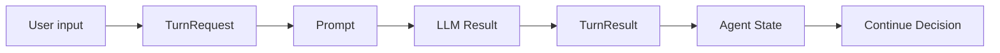
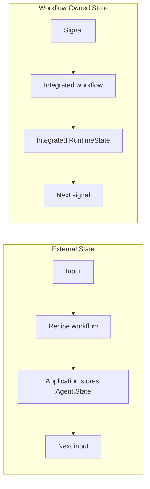
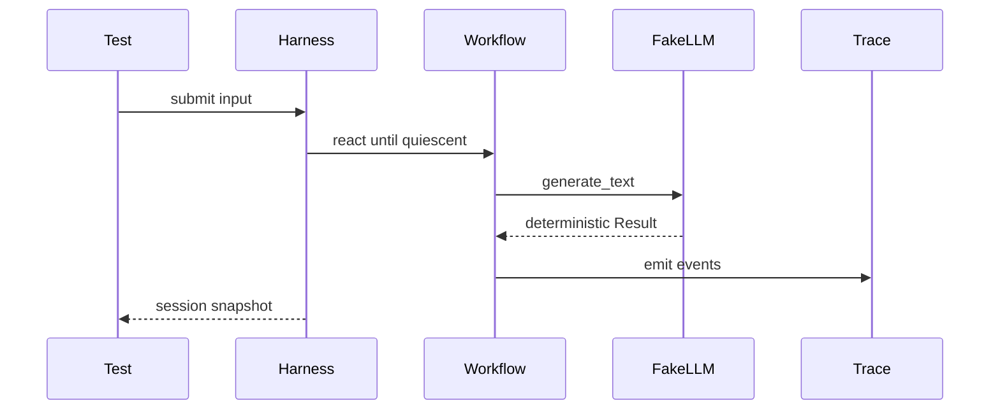

# RunicAI

RunicAI is a workflow-native toolbox for building AI and agent systems in
Elixir.

It provides typed contracts, Runic components, reference recipes, testing
helpers, tracing, evaluation harnesses, and runtime adapters on top of
[Runic](https://hex.pm/packages/runic) workflows and
[ReqLLM](https://hex.pm/packages/req_llm).

The short version: RunicAI helps you build agents as explicit workflow graphs
instead of hidden loops. Prompts, messages, model results, tool calls, context
state, guard decisions, waits, reviews, traces, and evaluations are all ordinary
values that can be inspected, tested, replayed, persisted, and recomposed.



## Why RunicAI

Most agent code starts as a loop around a model call. That works for the first
demo, then becomes harder to reason about as soon as you add tools, context
windows, reviews, timeouts, retries, memory, evaluation, and production
runtime concerns.

RunicAI keeps those concerns visible:

- **Workflow-native composition** - Components are ordinary Runic steps, rules,
  reducers, accumulators, and workflows.
- **Typed contracts** - The values moving through the graph have names and
  validation: `RunicAI.Agent.TurnRequest`, `RunicAI.Tool.ExecutionPlan`,
  `RunicAI.Context.Bundle`, `RunicAI.Trace.Event`, and so on.
- **Provider-neutral LLM access** - `RunicAI.LLM` delegates to ReqLLM by
  default, while every call can inject a plain module or function client.
- **Process-agnostic core** - Workflows describe state transitions. Your
  application chooses whether to run them in a request, a job, a GenServer, a
  supervised runtime session, or a `Runic.Runner`.
- **Operable by design** - Tracing, replay, scripted doubles, harnesses,
  evaluation cases, runtime sessions, schedulers, and adapters are part of the
  library surface.

## Installation

Add `runic_ai` to your dependencies:

```elixir
def deps do
  [
    {:runic_ai, "~> 0.1.0"}
  ]
end
```

Then run:

```bash
mix deps.get
```

## Quick Start

Every model call can receive a fake client. That makes examples and tests
deterministic and keeps your first run free of API keys.

```elixir
client = fn _model, _prompt, _opts ->
  result =
    RunicAI.LLM.Result.new!(
      RunicAI.Message.new!(:assistant, "hello from a fake model"),
      finish_reason: :stop
    )

  {:ok, result}
end

{:ok, result} =
  RunicAI.LLM.generate_text(
    "test:model",
    "Say hello",
    client: client
  )

RunicAI.LLM.Result.text(result)
#=> "hello from a fake model"
```

The same injection style works inside recipes:

```elixir
require Runic

alias Runic.Workflow
alias RunicAI.Recipes.ChatAgentKernel

client = fn _model, _prompt, _opts ->
  result =
    RunicAI.LLM.Result.new!(
      RunicAI.Message.new!(:assistant, "hello from the guide"),
      finish_reason: :stop,
      usage: %{input_tokens: 3, output_tokens: 4, total_tokens: 7}
    )

  {:ok, result}
end

workflow =
  ChatAgentKernel.new(
    model: "test:model",
    system: "You are concise.",
    client: client
  )
  |> Workflow.react_until_satisfied(%{user: "Say hello."})

ChatAgentKernel.latest_reply_text(workflow)
#=> "hello from the guide"
```

For real provider calls, omit `:client` and pass a ReqLLM model string such as
`"anthropic:claude-haiku-4-5"` or `"openai:gpt-4.1-mini"`, with provider
credentials configured as ReqLLM expects.

## What To Use First

Start with the smallest recipe that matches your application.

| Goal | Start with |
| --- | --- |
| One conversational turn or a simple chat loop | `RunicAI.Recipes.ChatAgentKernel` |
| A model that can call tools | `RunicAI.Recipes.ConversationalToolAgent` |
| Tool use with budgets, guards, waits, and review | `RunicAI.Recipes.GuardedOperatorToolAgent` |
| Long conversations with summaries, memory, retrieval, and handoff | `RunicAI.Recipes.SummaryBackedChatAgent` or `RunicAI.Recipes.MemoryAwareToolAgent` |
| Delegating work to roles or subagents | `RunicAI.Recipes.PlannerExecutorWorkflow`, `RunicAI.Recipes.ParallelResearchSynthesizer`, or `RunicAI.Recipes.ReviewerEditorJury` |
| Workflow-owned state across many turns or agent lanes | `RunicAI.Recipes.IntegratedChatAgent` or `RunicAI.Recipes.IntegratedToolAgent` |
| Regression tests and behavior scoring | `RunicAI.Recipes.EvaluationHarness` |
| Long-context split/map/reduce work | `RunicAI.Recipes.RLMSummarizer` |
| Supervised operation, scheduling, and durable execution | `RunicAI.Runtime.*` |

## Core Ideas

### Workflows Are The Composition Layer

RunicAI does not ask you to adopt one agent process model. It gives you
components that compose into Runic workflow graphs.

```mermaid
flowchart TD
  step[Runic step] --> transform[Transform typed values]
  rule[Runic rule] --> route[Route decisions]
  reduce[Runic reducer] --> aggregate[Aggregate results]
  acc[Runic accumulator] --> state[Own workflow state]
  recipe[RunicAI recipe] --> graph[Reusable workflow graph]
```

### Contracts Carry Meaning

RunicAI's public structs are the system vocabulary. A tool call is not just a
map; it is a `RunicAI.Tool.CallRequest`. A pause for human approval is not just
a magic atom; it is a `RunicAI.ReviewRequest`. A context window is not hidden
prompt slicing; it is a `RunicAI.Context.Bundle` with provenance.

That contract approach gives you useful extension points:

- custom LLM clients through `RunicAI.LLM`
- custom tools through `RunicAI.Tool.Definition` and execution adapters
- custom memory and retrieval through `RunicAI.Memory.Store` and
  `RunicAI.Retrieval.Provider`
- custom tracing through `RunicAI.Trace.Sink`
- custom runtime topology through `RunicAI.Harness.*`, `RunicAI.Runtime.*`, or
  your own process layer

### State Can Be Caller-Owned Or Workflow-Owned

External-state recipes return the latest `RunicAI.Agent.State`; your
application persists it and decides when to re-enter the workflow.

Integrated recipes keep live session state inside the workflow as
`RunicAI.Integrated.RuntimeState`, which is useful for long-lived sessions,
queued signals, multiple agent lanes, waits, and scoped resumes.



## Documentation

The docs are organized around how users build with the library:

- **Start Here** - Getting started and the mental model.
- **Core Concepts** - Workflows, contracts, context engineering, controls, and
  state models.
- **Recipes** - Practical guides for each canonical workflow.
- **Extending RunicAI** - Components, tools, telemetry, authorization,
  persistence, runtime integration, and causal logging.
- **Reference** - Component catalog, testing strategy, and the release
  checklist. Option details live with the modules and recipe guides that accept
  them.
- **Livebooks** - Interactive walkthroughs with deterministic fake clients.

Useful entry points:

- [Getting Started](guides/getting-started.md)
- [Mental Model](guides/mental-model.md)
- [Workflows As Composition](guides/workflows-as-composition.md)
- [Contracts](guides/contracts.md)
- [Context Engineering](guides/context-engineering.md)
- [Controls And Limits](guides/controls-and-limits.md)
- [Stateless Versus Stateful Agents](guides/stateless-vs-stateful-agents.md)
- [Component Catalog](guides/reference/component-catalog.md)

## Testing And Evaluation

RunicAI is designed so tests can stay deterministic.

- Inject fake LLM clients with `client: fn model, prompt, opts -> ... end`.
- Use `RunicAI.Testing.ScriptedLLM` for ordered model responses.
- Use `RunicAI.Testing.ScriptedToolExecutor` for deterministic tools.
- Capture `RunicAI.Trace.Trajectory` values and replay them with
  `RunicAI.Testing.Replay`.
- Run scenario fixtures through `RunicAI.Recipes.EvaluationHarness`.



## Runtime And Production Use

The core components do not assume one process topology. For production use,
`RunicAI.Runtime.*` provides supervised session servers, handles, backends,
schedulers, and `Runic.Runner` integration while preserving the same harness
session and trace artifacts used in tests.

Use the runtime layer when you need:

- long-lived addressable sessions
- waits and scheduler wakeups
- supervised operation
- runner-backed execution
- runtime tool adapters
- candidate routing or optimization hooks

## Safety Notes

Tools can execute real capabilities. Treat tool definitions, command adapters,
external workers, trace payload capture, and review bypasses as security
boundaries in your application. Use guard points, authorization checks, review
requests, capture policies, and redaction before exposing tools to untrusted
inputs.

See [SECURITY.md](SECURITY.md) for release-oriented security guidance.

## Development

Common commands:

```bash
mix deps.get
mix compile
mix format
mix test
mix docs
```

The documentation build uses ExDoc guides, Livebooks, grouped module docs, and
Mermaid diagrams for workflow visualizations.

## Status

RunicAI is pre-1.0. Public contracts and recipes are intended to be useful and
stable enough for real application trials, but the library should still be
treated as an early release candidate until production use has exercised the
APIs.
