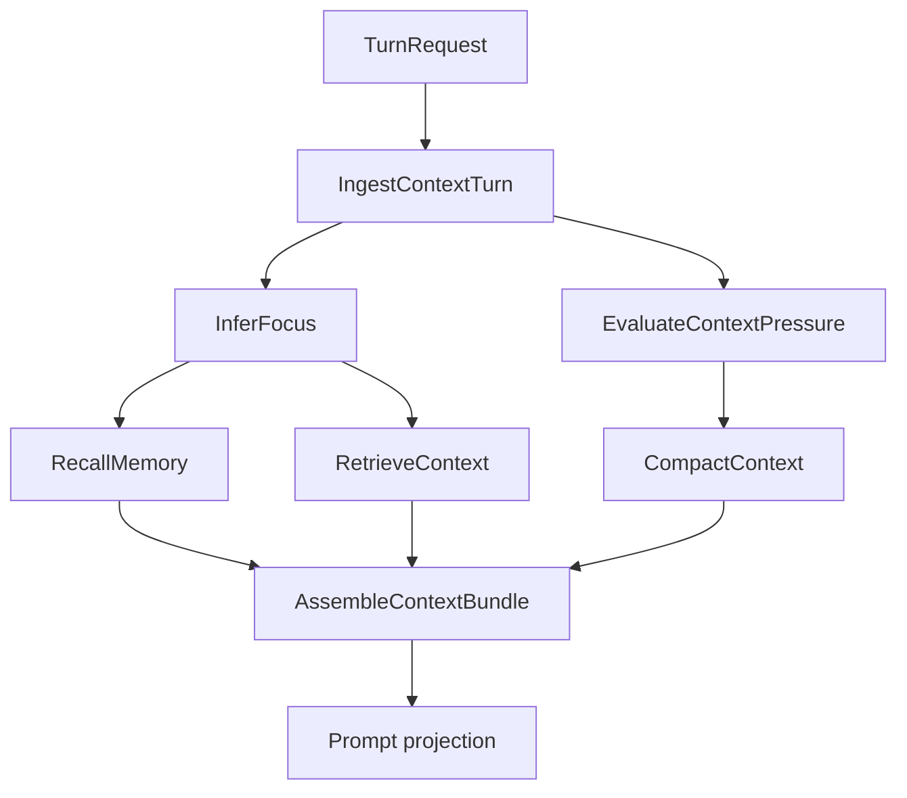
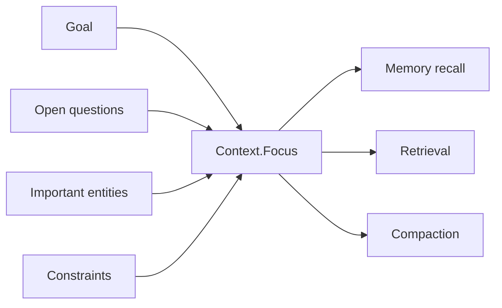
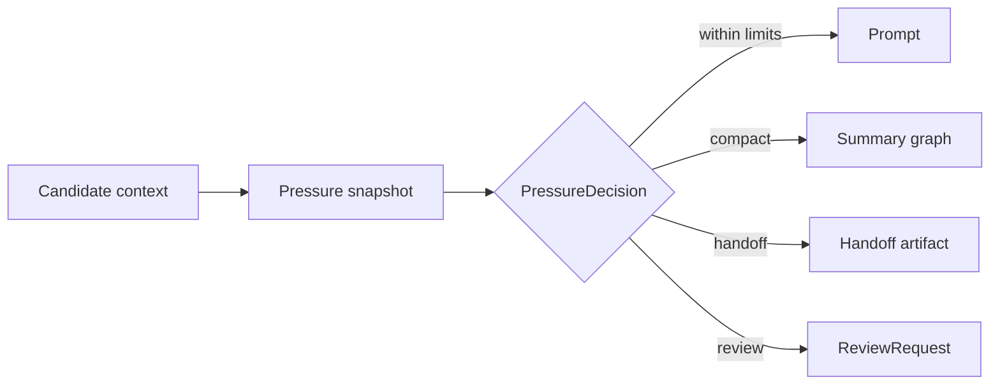

# Context Engineering

Context engineering is the practice of deciding what an AI system should know
for this turn, why it should know it, and how that knowledge can be traced back
to its source.

RunicAI treats context as workflow data, not hidden prompt trimming. The current
transcript, derived summaries, memory recall, retrieval results, focus, and
handoff artifacts can all be represented as explicit contracts.



## The Main Idea

A transcript is a record of what happened. Context is the working set selected
for the next model call.

Those are related, but they are not the same thing.

| Concern | Contract |
| --- | --- |
| Full conversation state | `RunicAI.Conversation.State` |
| Agent state plus derived context | `RunicAI.Agent.State` |
| Context graph | `RunicAI.Context.Graph` |
| Stable pointer to context | `RunicAI.Context.Ref` |
| Context graph node | `RunicAI.Context.Node` |
| Goal and salience hints | `RunicAI.Context.Focus` |
| Active model window | `RunicAI.Context.Bundle` |
| Window limits | `RunicAI.Context.WindowPolicy` |
| Compaction preferences | `RunicAI.Context.CompactionPolicy` |
| Memory storage and recall | `RunicAI.Memory.*` |
| Retrieval adapter boundary | `RunicAI.Retrieval.*` |

## Provenance With A Context Graph

The context graph lets summaries, memory entries, retrieval documents, and
handoff artifacts point back to the source material they came from.

```elixir
alias RunicAI.Context.{Graph, Node, Ref, State}
alias RunicAI.Message

message_ref = Ref.new!(:message, 1, label: "turn:user:1")
summary_ref = Ref.new!(:summary, "ci-debug", label: "summary:ci-debug")

message_node =
  Node.new_from_ref!(
    message_ref,
    Message.new!(:user, "The release fails after assets compile.")
  )

summary_node =
  Node.new_from_ref!(
    summary_ref,
    "The active issue is release packaging after asset compilation."
  )

graph =
  Graph.new()
  |> Graph.put_node!(message_node)
  |> Graph.put_node!(summary_node)
  |> Graph.add_relation!(summary_ref, message_ref, :summarizes)

context =
  State.new!(
    graph: graph,
    active_refs: [summary_ref],
    tail_refs: [message_ref]
  )

{Graph.summarized?(context.graph, message_ref), length(context.active_refs)}
```

The result is:

```elixir
{true, 1}
```

That `:summarizes` edge is small, but it is the point. A future workflow step
can inspect why a summary exists, what it covers, and whether the original
source should be restored, compacted again, handed off, or omitted.

## Focus Comes Before Selection

`RunicAI.Context.Focus` describes the active goal, questions, entities,
constraints, time scope, and optional salience prompt. It gives context
selection a target.

Without focus, context code tends to ask "what fits?" With focus, it can ask
"what matters for this turn?"



## Window Pressure Is A Decision

RunicAI models context pressure explicitly. A workflow can evaluate the current
window, decide whether pressure is soft or hard, and then choose a relief
strategy such as compaction, retrieval, handoff, or review.



The benefit is operational clarity. If an agent gives a poor answer because
critical context was omitted, you can inspect the pressure decision and context
bundle instead of guessing which helper trimmed the prompt.

## Designing Context Workflows

A practical context workflow usually follows this order:

1. Ingest the latest turn into `RunicAI.Context.State`.
2. Infer or provide a `RunicAI.Context.Focus`.
3. Recall memory and retrieve documents against that focus.
4. Evaluate pressure with `RunicAI.Context.WindowPolicy`.
5. Compact, hand off, retrieve more, or request review if needed.
6. Assemble a `RunicAI.Context.Bundle`.
7. Project the bundle into a `RunicAI.Prompt`.

Keep transcript truth separate from derived context. Summaries are useful, but
they should be traceable artifacts, not replacements for the original record.

## Options Used Here

| Option | Example | Type | Required | Default | Purpose |
| --- | --- | --- | --- | --- | --- |
| `Ref :label` | `"turn:user:1"` | string or `nil` | optional | `nil` | Human-readable label for a context reference. |
| `Ref :provenance` | `[message_ref]` | list | optional | `[]` | References or labels that explain where a context value came from. |
| `Node :token_count` | `120` | non-negative integer | optional | estimated from content | Overrides the token estimate for a context node. |
| `State :active_refs` | `[summary_ref]` | list of `RunicAI.Context.Ref` | optional | `[]` | References selected as active context. |
| `WindowPolicy :preferred_relief` | `:compact` | `:compact`, `:handoff`, `:retrieve`, or `:review` | optional | `:compact` | Preferred action when context pressure needs relief. |

