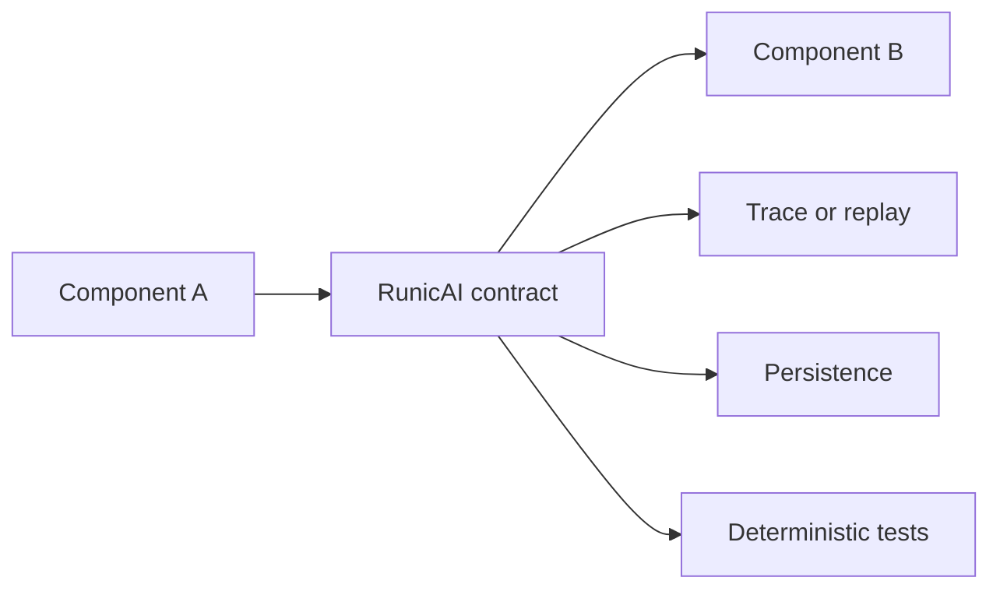
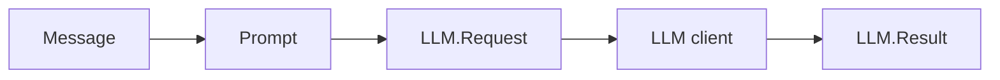

# Contracts

RunicAI contracts are the typed values that move through workflow graphs. They
are ordinary Elixir structs, but they do important design work:

1. They name the boundary between components.
2. They validate data before it reaches a provider, tool, guard, or runtime.
3. They create stable places to test, trace, replay, persist, and extend.



## Core Pattern

Most contracts follow the same pattern:

| Function shape | Purpose |
| --- | --- |
| `new/1`, `new/2`, or `new/3` | Build a value and return `{:ok, value}` or `{:error, error}`. |
| `new!/1`, `new!/2`, or `new!/3` | Build a value or raise, useful in tests and examples. |
| `validate/1` | Re-check a struct before using it at a boundary. |
| `from_input/1` or `from_input/2` | Normalize maps, keyword lists, or nearby contracts into the target contract. |
| Helper predicates or accessors | Make workflow code read clearly without reaching into internals. |

Use the non-bang versions at runtime boundaries where validation errors should
be returned. Use bang versions in tests, fixtures, and examples where invalid
setup should fail immediately.

## A Small Contract Chain

```elixir
alias RunicAI.{Message, Prompt}
alias RunicAI.LLM.{Request, Result}

prompt =
  Prompt.new!([
    Message.new!(:system, "Answer as a careful library maintainer."),
    Message.new!(:user, "What should I test first?")
  ])

request =
  Request.new!(
    "test:model",
    prompt,
    temperature: 0.2,
    metadata: %{purpose: :docs}
  )

result =
  Result.new!(
    Message.new!(:assistant, "Start with the workflow boundary.")
  )

{length(request.prompt.messages), Result.text(result), request.opts[:temperature]}
```

The result is:

```elixir
{2, "Start with the workflow boundary.", 0.2}
```

The important part is not the tuple at the end. It is that each boundary has a
specific type:



## Contract Families

| Family | What it models | Common modules |
| --- | --- | --- |
| Core text | Provider-neutral messages and prompts. | `RunicAI.Message`, `RunicAI.Prompt` |
| LLM access | Request and result values around text generation. | `RunicAI.LLM.Request`, `RunicAI.LLM.Result`, `RunicAI.LLM` |
| Conversation and turns | Durable chat state and one-turn input/output. | `RunicAI.Conversation.State`, `RunicAI.Agent.State`, `RunicAI.Agent.TurnRequest`, `RunicAI.Agent.TurnResult` |
| Tools | Model-visible tools and workflow-executable calls. | `RunicAI.Tool.Definition`, `RunicAI.Tool.Selection`, `RunicAI.Tool.ExecutionPlan`, `RunicAI.Tool.BatchResult`, `RunicAI.Tool.Observation` |
| Control | Limits, guard outcomes, review, wait, and resume. | `RunicAI.Control.BudgetPolicy`, `RunicAI.Control.BudgetDecision`, `RunicAI.Control.GuardRequest`, `RunicAI.Control.GuardDecision`, `RunicAI.Wait`, `RunicAI.ResumeSignal` |
| Context | Graph-backed context, focus, bundles, compaction, memory, and retrieval. | `RunicAI.Context.*`, `RunicAI.Memory.*`, `RunicAI.Retrieval.*` |
| Delegation | Subagent roles, tasks, assignments, child results, and joins. | `RunicAI.Decomposition.*`, `RunicAI.Candidate.*` |
| Integrated runtime | Workflow-owned multi-agent state and event envelopes. | `RunicAI.Integrated.Signal`, `RunicAI.Integrated.RuntimeState`, `RunicAI.Integrated.Emission` |
| Operability | Traces, trajectories, scripted doubles, replay, harness sessions, and evaluations. | `RunicAI.Trace.*`, `RunicAI.Testing.*`, `RunicAI.Harness.*`, `RunicAI.Evaluation.*` |

## What Contracts Enable

### Provider Independence

`RunicAI.LLM.Request` and `RunicAI.LLM.Result` keep provider responses behind a
stable API. ReqLLM remains the default adapter, but workflow code can be tested
with a function client or replaced with a module client.

### Tool Safety

Tool contracts separate what the model can see from what the workflow can
execute. A `RunicAI.Tool.Definition` contains the schema and executor. A
`RunicAI.Tool.ExecutionPlan` says which calls are planned. A
`RunicAI.Tool.BatchResult` records what happened.

### Context Provenance

Context contracts keep transcript truth, summaries, memory recall, retrieval,
and handoff artifacts visible as typed values. A summary can point back to the
messages it summarizes instead of silently replacing them.

### Runtime Flexibility

External-state and integrated-state recipes reuse the same turn contracts. That
means you can start with explicit state passing and later move to workflow-owned
runtime state without rewriting prompt, tool, budget, or guard code.

## Extending Contracts

When adding your own component, prefer accepting existing RunicAI contracts and
returning existing contracts where possible. If you need a new value:

1. Make it a struct.
2. Provide `new` and `new!`.
3. Provide `validate`.
4. Normalize nearby inputs with `from_input` if the boundary is user-facing.
5. Store policy and provenance in explicit fields or `metadata`, not hidden
   process state.

That keeps your extension aligned with the rest of the library and makes it
straightforward to document, test, and trace.

## Options Used Here

| Option | Example | Type | Required | Default | Purpose |
| --- | --- | --- | --- | --- | --- |
| `Message :metadata` | `%{source: :user}` | map | optional | `%{}` | Attaches provenance or adapter-specific data to a message. |
| `Request :metadata` | `%{purpose: :docs}` | map | optional | `%{}` | Carries request-level provenance through the workflow. |
| Request provider options | `temperature: 0.2` | keyword entries | optional | `[]` | Passed through to the LLM client as request options. |

