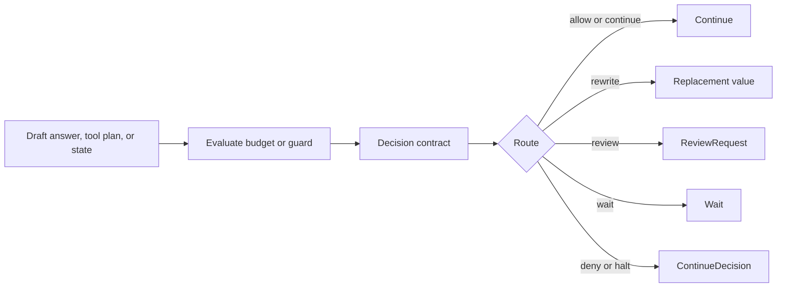
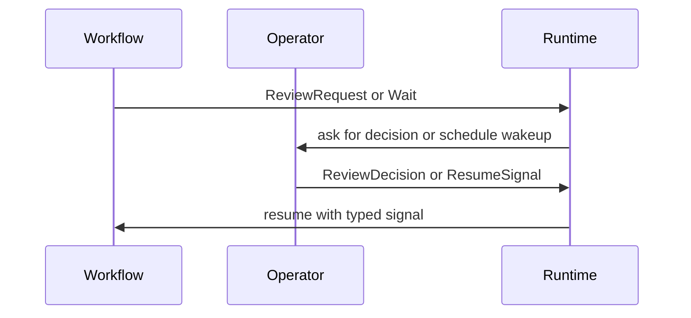
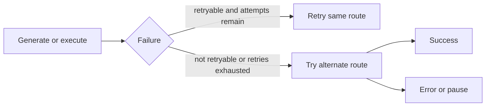

# Controls And Limits

AI workflows need explicit limits. RunicAI models those limits as workflow
contracts so they can be composed, tested, traced, reviewed, and resumed.

Controls are not only for safety incidents. They are also how you keep normal
agent behavior predictable: maximum turns, maximum tool calls, retry policy,
fallback routes, guard decisions, operator review, waits, and resume signals.



## Budgets

A budget compares observed or projected usage against a declarative policy.
Usage is represented by `RunicAI.Control.BudgetSnapshot`; the outcome is a
`RunicAI.Control.BudgetDecision`.

```elixir
alias RunicAI.Agent.State
alias RunicAI.Conversation.State, as: ConversationState
alias RunicAI.Steps.EvaluateBudget

state =
  State.new!(
    conversation: ConversationState.new!([], turns: 3),
    metadata: %{usage: %{model_calls: 3, tool_calls: 1}}
  )

{:ok, decision} =
  EvaluateBudget.evaluate(
    %{state: state, runtime: %{elapsed_ms: 1_200, estimated_cost: 0.08}},
    budget_policy: [max_turns: 2, on_exhaustion: :review]
  )

{decision.status, decision.action, List.first(decision.reasons).metric}
```

The result is:

```elixir
{:exhausted, :review, :turns}
```

A decision does not need to immediately stop the workflow. It can ask for
review, emit a wait, or continue with a soft-limit reason.

## Guards

Guards evaluate a subject at a named control point. The subject might be a
draft answer, a tool execution plan, a batch of tool results, a candidate
message, or another workflow value.

`RunicAI.Steps.EvaluateGuard` accepts an evaluator as:

| Evaluator shape | Example |
| --- | --- |
| Function | `fn guard_request -> :allow end` |
| Module | `MyGuard` implementing `evaluate/1` |
| MFA tuple | `{MyGuard, :evaluate}` or `{MyGuard, :evaluate, extra_args}` |

Evaluator return values are normalized into `RunicAI.Control.GuardDecision`.
Supported actions are `:allow`, `:deny`, `:review`, `:wait`, and `:rewrite`.

## Review, Wait, And Resume

Controls can pause progress without losing the typed shape of the workflow.



Use:

| Contract | Purpose |
| --- | --- |
| `RunicAI.ReviewRequest` | Ask an operator or external policy system for approval, rejection, edit, or cancellation. |
| `RunicAI.ReviewDecision` | Resume a review checkpoint with the operator's decision. |
| `RunicAI.Wait` | Pause until a time, external signal, budget condition, or other resumable event. |
| `RunicAI.ResumeSignal` | Resume a wait with a matching resume key and payload. |

## Retry And Fallback

Retry and fallback are separate concerns.

Retry is for trying the same operation again, usually after a retryable
provider or transport failure. Fallback is for changing route, such as trying a
different model client or alternate tool execution path.



`RunicAI.Steps.GenerateTurnControlled` and
`RunicAI.Steps.ExecuteToolCallsControlled` are the controlled variants for
model generation and tool execution.

## Design Guidelines

1. Put a budget before expensive or recursive work.
2. Put a guard before irreversible or externally visible actions.
3. Use review when a human or external policy owns the decision.
4. Use wait when progress depends on time or another system.
5. Use retry for transient failures and fallback for alternate strategies.
6. Preserve the decision contract in traces so behavior can be audited later.

## Options Used Here

| Option | Example | Type | Required | Default | Purpose |
| --- | --- | --- | --- | --- | --- |
| `BudgetPolicy :max_turns` | `2` | non-negative integer or `nil` | optional | `nil` | Maximum allowed conversation turns before exhaustion. |
| `BudgetPolicy :max_model_calls` | `10` | non-negative integer or `nil` | optional | `nil` | Maximum allowed model calls. |
| `BudgetPolicy :max_tool_calls` | `5` | non-negative integer or `nil` | optional | `nil` | Maximum allowed executed or projected tool calls. |
| `BudgetPolicy :max_elapsed_ms` | `5_000` | non-negative integer or `nil` | optional | `nil` | Maximum elapsed time in milliseconds. |
| `BudgetPolicy :max_estimated_cost` | `0.25` | number or `nil` | optional | `nil` | Maximum estimated cost. |
| `BudgetPolicy :max_recursion_depth` | `3` | non-negative integer or `nil` | optional | `nil` | Maximum recursive or delegated depth. |
| `BudgetPolicy :on_exhaustion` | `:review` | `:halt`, `:review`, or `:wait` | optional | `:halt` | Action emitted when a hard limit is exceeded. |
| `EvaluateGuard :evaluator` | `fn request -> :allow end` | function, module, or MFA tuple | optional | allow | Evaluates a guard request. |

