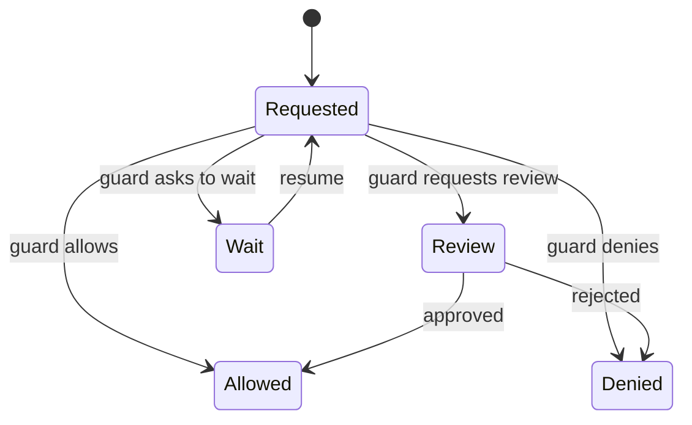

# Authorization And Guards

Model output is not authorization. Put authorization checks at tool and answer
boundaries where the workflow can make an explicit decision.



## Guard Points

`RunicAI.Recipes.GuardedOperatorToolAgent` supports guard decisions before tool
execution and before answer emission. A guard can return:

- `:allow`
- `:deny`
- `:review`
- `:wait`
- a `RunicAI.Control.GuardDecision`

## Example

```elixir
pre_tool_guard = fn request ->
  requested_tools = Enum.map(request.execution_plan.calls, & &1.tool_name)

  if "send_invoice" in requested_tools do
    :review
  else
    :allow
  end
end
```

Use application authorization data inside the guard. For example, inspect the
current user, tenant, account permissions, tool arguments, environment, and
requested action before allowing execution.

## Design Rules

- Deny by default when authorization context is missing.
- Keep high-risk actions behind review.
- Record guard decisions in traces.
- Keep guard functions deterministic where possible.
- Treat rewrites and fallbacks as policy decisions, not hidden prompt edits.
