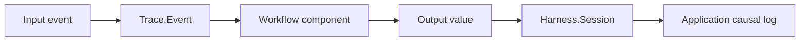

# Causal Logging

Causal logging records why an output happened: which input arrived, which
workflow components ran, which model/tool boundaries were crossed, which guards
decided, and which state snapshot resulted.

RunicAI gives you the pieces; your application chooses the storage backend and
retention policy.

## What To Store

Useful causal records usually include:

- external request id or job id
- runtime session id
- workflow name and component names
- trace id and event ids
- input summary
- output summary
- pending wait or review keys
- state snapshot reference
- redaction/capture policy

## Mapping RunicAI Artifacts

| RunicAI artifact | Logging role |
| --- | --- |
| `RunicAI.Trace.Event` | Semantic event in the causal chain. |
| `RunicAI.Trace.Trajectory` | Replayable or inspectable trace artifact. |
| `RunicAI.Harness.Session` | Canonical session snapshot. |
| `RunicAI.Runtime.Handle` | Addressable runtime identity. |
| `RunicAI.ReviewRequest` / `RunicAI.ReviewDecision` | Operator decision boundary. |
| `RunicAI.Wait` / `RunicAI.ResumeSignal` | Deferred-progress boundary. |

For durable workflow execution, connect this application log to the Runic
runner/store layer rather than hiding persistence inside prompt text.
