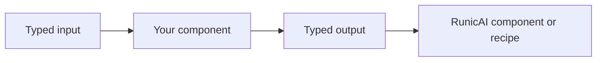

# Writing Components

RunicAI components are ordinary Runic components that speak RunicAI contracts.
When the built-in steps or rules do not fit, write your own component at the
same boundary: accept a typed value, return a typed value, and give the
component a stable name.

## Choose The Right Shape

| Shape | Use when |
| --- | --- |
| `Runic.step/2` | You transform inputs into a new value, call a model, call a tool, or normalize data. |
| `Runic.rule/2` | You route by condition: continue, halt, wait, review, deny, retry, or fallback. |
| `Runic.reduce/3` | You combine a collection into one result. |
| `Runic.accumulator/3` | The workflow should own evolving state across inputs. |



## Component Guidelines

- `require Runic` before using Runic macros.
- Always name components.
- Prefer existing contracts such as `RunicAI.Agent.TurnRequest`,
  `RunicAI.Tool.ExecutionPlan`, or `RunicAI.Context.Bundle`.
- Return `{:ok, value}` or `{:error, %RunicAI.Error{}}` when a boundary can
  fail.
- Keep provider-specific details behind adapters or opts.
- Add a focused test for the pure helper and a workflow test for routing.

## Example

```elixir
defmodule MyApp.Steps.ClassifyUrgency do
  require Runic

  def new(opts \\ []) do
    name = Keyword.get(opts, :name, :classify_urgency)

    Runic.step(
      fn %{user: user} ->
        if String.contains?(String.downcase(user), "urgent") do
          {:ok, :urgent}
        else
          {:ok, :normal}
        end
      end,
      name: name
    )
  end
end
```

Use this style when the component is application-specific but should still be
visible in workflow results and traces.
