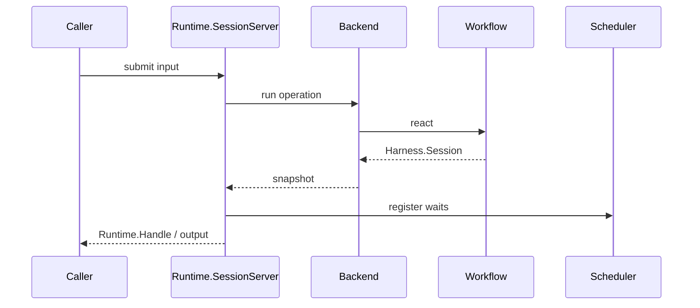

# Persistence And Runtime

RunicAI separates workflow semantics from process ownership. A recipe describes
how values move. Your runtime decides where state is stored, how inputs arrive,
and how waits wake up.

## External-State Persistence

With external-state recipes, persist `RunicAI.Agent.State` after each turn and
pass it back on the next input. This is straightforward for HTTP flows, jobs,
and applications that already own persistence.

## Integrated Runtime State

With integrated recipes, state lives in `RunicAI.Integrated.RuntimeState`
inside the workflow. This is useful for long-lived sessions, many agent lanes,
queued signals, waits, and scoped resumes.

## Runtime Sessions

Use `RunicAI.Runtime.SessionSpec` and `RunicAI.Runtime.SessionServer` when you
want a supervised, addressable session. The canonical snapshot remains
`RunicAI.Harness.Session`, so tests and runtime operation speak the same state
language.

## Runner Backends

Runner-backed backends adapt the same session operations to `Runic.Runner`.
Use them when your application wants durable workflow execution through a Runic
store.
