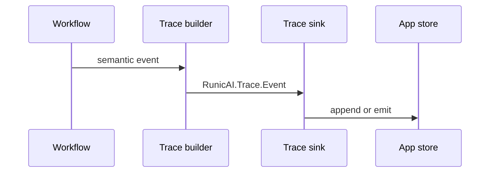

# Telemetry And Tracing

RunicAI tracing records semantic events around turns, tools, waits, reviews,
runtime emissions, and workflow quiescence. Traces are meant to answer what
happened without requiring one specific runtime topology.



## Built-In Sinks

- `RunicAI.Trace.Sinks.InMemory` keeps events in process memory for tests.
- `RunicAI.Trace.Sinks.Logger` writes trace events to the logger.
- `RunicAI.Trace.Sinks.Telemetry` emits telemetry events.

## Custom Sink

Implement `RunicAI.Trace.Sink` when traces should go to your own event bus,
database, observability platform, or audit log.

```elixir
defmodule MyApp.TraceSink do
  @behaviour RunicAI.Trace.Sink

  @impl true
  def emit(event, state) do
    MyApp.AuditLog.append(event)
    {:ok, state}
  end

  @impl true
  def flush(state), do: {:ok, state}
end
```

## Capture Policy

Use `RunicAI.Trace.CapturePolicy` to decide how much payload data a trace keeps.
Prefer summary capture by default. Use replay-grade capture only when the trace
will stay inside a trusted boundary.
