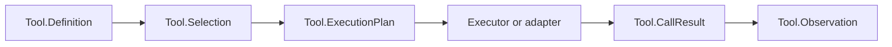

# Tools And Execution Adapters

Tools expose application capabilities to a model through
`RunicAI.Tool.Definition`. A definition describes the tool, its parameter
schema, and the executor that actually runs.



## Basic Tool

```elixir
alias RunicAI.Tool.Definition

weather_tool =
  Definition.new!(
    name: "get_weather",
    description: "Get weather for a city.",
    parameter_schema: [location: [type: :string, required: true]],
    executor: fn %{location: location} ->
      {:ok, %{location: location, forecast: "sunny"}}
    end
  )
```

## Adapter Boundary

Use `RunicAI.Tool.ExecutionAdapter` when the executor should delegate to a
module that represents an external runtime.

```elixir
defmodule MyApp.ToolAdapters.Search do
  @behaviour RunicAI.Tool.ExecutionAdapter

  @impl true
  def execute(%{query: query}, opts) do
    search_client = Keyword.fetch!(opts, :search_client)
    search_client.search(query)
  end
end

executor =
  RunicAI.Tool.ExecutionAdapter.to_executor(
    MyApp.ToolAdapters.Search,
    search_client: MyApp.Search
  )
```

## Safety

Automatic tools should be low risk and deterministic. For tools that mutate
state, spend money, disclose sensitive data, send messages, run commands, or
touch production infrastructure, put a guard or review step before execution.

Use:

- `RunicAI.Control.BudgetPolicy` for limits
- `RunicAI.Control.GuardDecision` for allow, deny, review, wait, or rewrite
- `RunicAI.ReviewRequest` and `RunicAI.ReviewDecision` for operator approval
- `RunicAI.Trace.CapturePolicy` for payload capture and redaction choices
