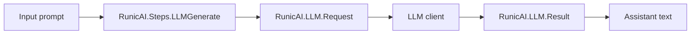

# Getting Started

RunicAI helps you build AI workflows as ordinary Runic graphs. A graph can be
as small as one LLM call or as large as a tool-using, context-aware, multi-agent
system. The important idea is that every piece is still a component with typed
inputs and outputs.

RunicAI is useful when you want AI behavior that is easy to compose, test,
inspect, and run in the process topology your application already uses.

## Install

Add RunicAI to your dependencies:

```elixir
def deps do
  [
    {:runic_ai, "~> 0.1.0"}
  ]
end
```

Then fetch dependencies:

```bash
mix deps.get
```

## First Workflow

The smallest useful RunicAI workflow is an LLM generation step. In production,
the default client delegates to ReqLLM. In examples and tests, pass a fake
client through the request options so the workflow is deterministic.

```elixir
require Runic

alias Runic.Workflow
alias RunicAI.{Message, Prompt}
alias RunicAI.LLM.Result

fake_client = fn _model, prompt, _opts ->
  text =
    case prompt do
      %Prompt{messages: messages} ->
        messages
        |> Enum.filter(&(&1.role == :user))
        |> List.last()
        |> Map.fetch!(:content)

      text when is_binary(text) ->
        text
    end

  {:ok, Result.new!(Message.new!(:assistant, "Echo: #{text}"))}
end

step =
  RunicAI.Steps.LLMGenerate.new(
    name: :draft_reply,
    model: "test:model",
    client: fake_client
  )

workflow = Runic.workflow(name: :hello_runic_ai, steps: [step])

workflow =
  Workflow.react_until_satisfied(
    workflow,
    "Explain RunicAI in one sentence."
  )

[{:ok, result}] = Workflow.raw_productions(workflow, :draft_reply)
Result.text(result)
```

That returns:

```elixir
"Echo: Explain RunicAI in one sentence."
```

## What Happened



`RunicAI.Steps.LLMGenerate` accepts a string, a `RunicAI.Prompt`, a
`RunicAI.LLM.Request`, or a map with request fields. It normalizes the input
into `RunicAI.LLM.Request`, calls `RunicAI.LLM.generate_text/1`, and emits an
`{:ok, %RunicAI.LLM.Result{}}`, `{:retry, %RunicAI.Error{}}`, or
`{:error, %RunicAI.Error{}}`.

The fake client is just a function. That same dependency-injection approach is
used throughout RunicAI, so tests can exercise workflow behavior without Mox,
global application config, or real provider credentials.

## Common Starting Points

Use these modules first:

| Goal | Start with |
| --- | --- |
| Call a model from a workflow | `RunicAI.Steps.LLMGenerate` |
| Build provider-neutral prompts | `RunicAI.Prompt`, `RunicAI.Steps.PromptBuilder` |
| Track a conversation | `RunicAI.Conversation`, `RunicAI.Agent.State` |
| Run one chat turn | `RunicAI.Recipes.ChatAgentKernel` |
| Add tool calling | `RunicAI.Recipes.ConversationalToolAgent` |
| Add budgets, guards, review, waits, retries, or fallbacks | `RunicAI.Control.*`, `RunicAI.Steps.*Controlled`, `RunicAI.Rules.*` |
| Add context, memory, retrieval, compaction, or handoff | `RunicAI.Context.*`, `RunicAI.Memory.*`, `RunicAI.Retrieval.*` |
| Keep agent state inside the workflow | `RunicAI.Recipes.IntegratedChatAgent` |

## Options Used Here

| Option | Example | Type | Required | Default | Purpose |
| --- | --- | --- | --- | --- | --- |
| `:name` | `:draft_reply` | atom | optional | component-specific | Names the Runic component for debugging and result lookup. |
| `:model` | `"test:model"` | string, `{provider, model}` tuple, or map | required for `LLMGenerate` unless the input already contains a model | none | Selects the model passed to the LLM client. |
| `:client` | `fake_client` | module or function | optional | `RunicAI.LLM.ReqLLMClient` | Replaces the provider client, usually for tests or adapters. |

## Next

Read the mental model guide before jumping into recipes. It explains why
RunicAI treats prompts, messages, tool calls, context bundles, and control
decisions as explicit workflow values.

