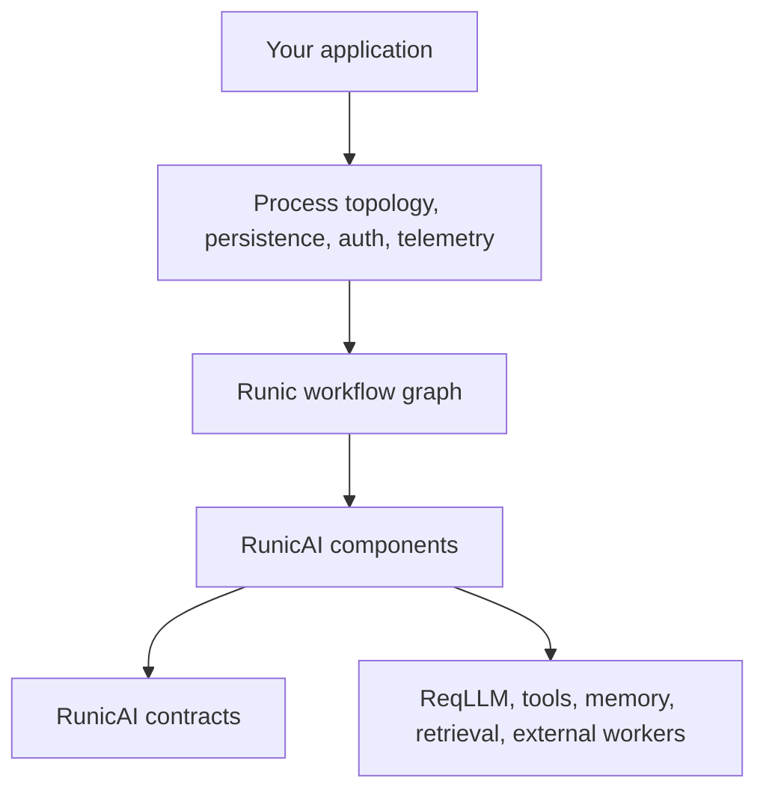
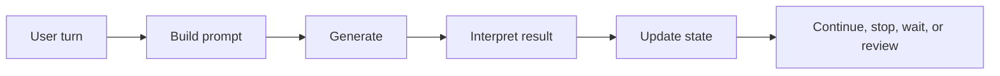
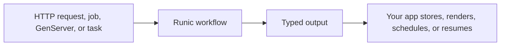

# Mental Model

RunicAI is three things layered together:

1. Runic provides the graph runtime and component model.
2. RunicAI provides AI-specific contracts, steps, rules, accumulators, and recipes.
3. Your application provides process ownership, persistence, credentials,
   authorization, telemetry policy, and user experience.



This split is intentional. RunicAI does not need to own your supervision tree
or dictate whether a workflow runs in a GenServer, a Task, a job system, or a
request process. It gives you composable workflow parts and normalized values.

## Graphs Are The Shape

A Runic workflow is a directed graph of components. Each component receives
values, emits values, and can be named. Names matter because they let you route
data, inspect outputs, and reason about the workflow.



In a conventional agent loop, the control flow is often hidden inside one
large function. In RunicAI, each boundary can be a separate value:

| Boundary | Example contract |
| --- | --- |
| Message text | `RunicAI.Message` |
| Prompt bundle | `RunicAI.Prompt` |
| Model call | `RunicAI.LLM.Request` |
| Model result | `RunicAI.LLM.Result` |
| Agent input | `RunicAI.Agent.TurnRequest` |
| Agent output | `RunicAI.Agent.TurnResult` |
| Tool execution | `RunicAI.Tool.ExecutionPlan`, `RunicAI.Tool.BatchResult` |
| Context window | `RunicAI.Context.Bundle` |
| Budget outcome | `RunicAI.Control.BudgetDecision` |
| Human approval | `RunicAI.ReviewRequest`, `RunicAI.ReviewDecision` |
| Deferred progress | `RunicAI.Wait`, `RunicAI.ResumeSignal` |

## Contracts Are The Language

RunicAI contracts are plain Elixir structs with constructors and validation.
They make dataflow explicit, which gives you useful places to test, trace,
store, redact, replay, or replace behavior.

```elixir
alias RunicAI.{Message, Prompt}
alias RunicAI.LLM.{Request, Result}

prompt =
  Prompt.new!([
    Message.new!(:system, "Answer as a careful library maintainer."),
    Message.new!(:user, "What should I test first?")
  ])

request =
  Request.new!(
    "test:model",
    prompt,
    temperature: 0.2,
    metadata: %{purpose: :docs}
  )

result =
  Result.new!(
    Message.new!(:assistant, "Start with the workflow boundary.")
  )

{length(request.prompt.messages), Result.text(result), request.opts[:temperature]}
```

The result is:

```elixir
{2, "Start with the workflow boundary.", 0.2}
```

## Components Are Ordinary Runic Parts

RunicAI components are built from Runic `Step`, `Rule`, and `Accumulator`
constructs. That means they can be placed next to your own components.

| Component kind | Use it for |
| --- | --- |
| Step | Transform one or more inputs into the next workflow value, such as building a prompt or calling an LLM. |
| Rule | Route a value by condition, such as continuing, halting, waiting, or requesting review. |
| Accumulator | Keep running state inside the workflow, such as conversation state or integrated runtime state. |
| Recipe | Assemble a common graph from smaller components, while still returning a normal `Runic.Workflow`. |

Recipes are not a separate runtime. They are prebuilt graph shapes. You can use
one directly, inspect its outputs, or build your own graph from the same lower
level contracts.

## The Runtime Stays Yours

RunicAI distinguishes agent logic from runtime ownership.



This is why the library has both external-state recipes and integrated
workflow-owned recipes:

| Model | State lives in | Best for |
| --- | --- | --- |
| External-state turn processing | The caller passes `RunicAI.Agent.State` into each turn and stores the returned state. | Request/response flows, simple jobs, explicit persistence. |
| Integrated stateful agents | `RunicAI.Integrated.RuntimeState` is reduced inside the workflow. | Long-lived sessions, multiple agent lanes, waits, wakeups, resumes. |

## A Good Way To Think About It

Build from the stable center outward:

1. Start with the contract you want to produce.
2. Choose or write steps that produce that contract.
3. Add rules for control decisions.
4. Add accumulators only when state should live in the graph.
5. Wrap the graph in your application runtime when you know how you want to
   persist, supervise, authorize, observe, and resume it.

