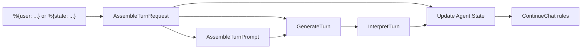

# Chat Agent

Use `RunicAI.Recipes.ChatAgentKernel` when you want the smallest useful conversational agent: take a user turn, assemble a prompt from durable state, call an LLM, interpret the result, update state, and decide whether the conversation should continue.

This is the right starting point for help desks, command-line assistants, tutoring loops, review bots, and any workflow where the agent does not need tools yet.



## What The Recipe Gives You

- A `Runic.Workflow` you can run once or repeatedly.
- Durable `RunicAI.Agent.State` with system text, messages, assigns, metadata, and turn count.
- Typed `RunicAI.Agent.TurnResult` values for ordinary replies, final answers, and errors.
- Explicit continuation decisions instead of a hidden agent loop.
- Simple dependency injection through the `:client` option.

## Working Example

This example uses a deterministic function client. In production you can omit `:client` and let `RunicAI.LLM` delegate to ReqLLM.

```elixir
alias Runic.Workflow
alias RunicAI.LLM.Result
alias RunicAI.Message
alias RunicAI.Prompt
alias RunicAI.Recipes.ChatAgentKernel

reply = fn text ->
  Result.new!(Message.new!(:assistant, text), finish_reason: :stop)
end

client = fn _model, %Prompt{messages: messages}, _opts ->
  last_user =
    messages
    |> Enum.filter(&(&1.role == :user))
    |> List.last()
    |> Map.get(:content)

  response =
    cond do
      String.contains?(last_user, "favorite color") -> reply.("noted")
      String.contains?(last_user, "What color") -> reply.("vermilion")
      true -> reply.("unknown")
    end

  {:ok, response}
end

first =
  ChatAgentKernel.new(
    model: "test:model",
    system: "Remember user preferences.",
    client: client
  )
  |> Workflow.react_until_satisfied(%{user: "My favorite color is vermilion."})

state = ChatAgentKernel.latest_state(first)

second =
  ChatAgentKernel.new(model: "test:model", client: client)
  |> Workflow.react_until_satisfied(%{
    state: state,
    user: "What color did I say was my favorite?"
  })

ChatAgentKernel.latest_reply_text(second)
#=> "vermilion"
```

## Important Options

| Option | Required | Default | Type | Purpose |
| --- | --- | --- | --- | --- |
| `:model` | yes | none | string or ReqLLM-compatible model value | Model passed to `RunicAI.LLM`. |
| `:client` | no | `RunicAI.LLM.ReqLLMClient` | module or `fn model, prompt, opts -> ... end` | Inject a deterministic client, test double, or alternate LLM adapter. |
| `:system` | no | `nil` | string | System instruction used when creating a new agent state. |
| `:state` | no | built from opts/input | `RunicAI.Agent.State` | Continue from a prior durable state. |
| `:messages` | no | `[]` | message inputs | Seed state with existing transcript messages. |
| `:assigns` | no | `%{}` | map | Store structured values alongside the conversation. |
| `:state_metadata` | no | `%{}` | map | Metadata to attach to newly assembled state. |
| `:history_window` | no | `:all` | `:all` or window input | Restrict the messages included in the prompt. |
| `:pinned_messages` | no | `[]` | message inputs | Always include important messages in prompt assembly. |
| `:observations` | no | `[]` | message inputs | Include external observations for the turn. |
| `:llm_opts` | no | `[]` | keyword | Extra options passed to the LLM client. |
| `:metadata` | no | `%{}` | map | Per-turn metadata carried into the request. |
| `:final_pattern` | no | `nil` | string, regex, or list | Classify matching replies as final results. |
| `:final_when` | no | `nil` | unary function | Custom final-result classifier. |
| `:max_turns` | no | `nil` | non-negative integer | Stop after a number of conversation turns. |
| `:stop_pattern` | no | `nil` | string, regex, or list | Stop continuation when the reply matches. |
| `:continue_when` | no | `nil` | function | Custom continuation decision logic. |
| `:name` | no | `:chat_agent_kernel` | atom | Workflow name. |

## Result Helpers

- `ChatAgentKernel.initial_state/1` builds a reusable `RunicAI.Agent.State`.
- `ChatAgentKernel.latest_state/1` returns the newest state produced by the workflow.
- `ChatAgentKernel.latest_turn_result/1` returns the newest typed turn result.
- `ChatAgentKernel.latest_continue_decision/1` exposes why the recipe will continue, stop, or halt.
- `ChatAgentKernel.latest_reply_text/1` is a convenience for UI and tests.

## When To Move On

Stay with this recipe until the agent needs external capabilities. Move to `ConversationalToolAgent` when the model should request tools, `SummaryBackedChatAgent` when context pressure matters, or `IntegratedChatAgent` when you want state to live inside a long-running workflow instead of being passed between turns.
