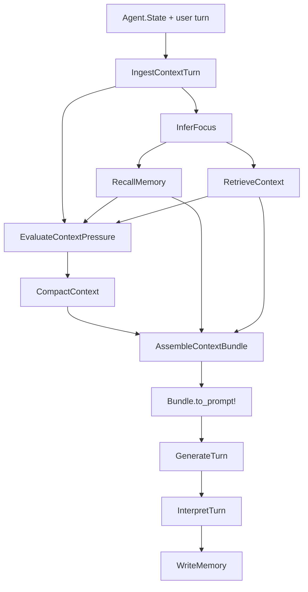
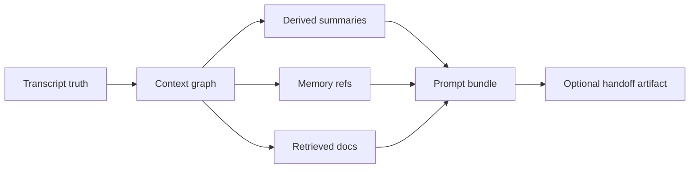

# Context-Aware Agent

Use `RunicAI.Recipes.SummaryBackedChatAgent` when a chat workflow needs explicit context engineering instead of relying on raw transcript history. The recipe ingests the current turn into a context graph, infers focus, recalls memory, retrieves supporting context, evaluates context-window pressure, compacts when needed, assembles a prompt bundle, and writes memory after the turn.

Use `RunicAI.Recipes.MemoryAwareToolAgent` when you need the same context path plus tool calling. Use `RunicAI.Recipes.HandoffContextBuilder` when you need a focused handoff artifact for another thread, agent, or human.



## What The Recipe Gives You

- A durable context graph tied back to source messages and derived summaries.
- Focus inference so memory and retrieval can follow the current task.
- Context pressure decisions before the prompt is assembled.
- Summary compaction that preserves transcript truth while shrinking prompt inputs.
- Bundle inspection with `latest_bundle/1` so you can see what the model saw.

## Working Example

This example forces context pressure low enough that compaction happens, then checks that the model saw the context summary.

```elixir
alias Runic.Workflow
alias RunicAI.Agent.State
alias RunicAI.LLM.Result
alias RunicAI.Message
alias RunicAI.Prompt
alias RunicAI.Recipes.SummaryBackedChatAgent

reply = fn text ->
  Result.new!(Message.new!(:assistant, text), finish_reason: :stop)
end

state =
  State.new!(system: "You are concise.")
  |> State.append_messages!([
    {:user, "We are debugging a flaky deployment pipeline in production."},
    {:assistant, "The build passes until artifact packaging."},
    {:user, "The failure only happens after release assets are uploaded."}
  ])

client = fn _model, %Prompt{messages: messages}, _opts ->
  text =
    if Enum.any?(messages, &String.contains?(&1.content, "[CONTEXT SUMMARY]")) do
      "Focus on packaging and upload state."
    else
      "Use the recent transcript."
    end

  {:ok, reply.(text)}
end

workflow =
  SummaryBackedChatAgent.new(
    model: "test:model",
    state: state,
    client: client,
    window_policy: [
      max_input_tokens: 120,
      reserve_output_tokens: 20,
      soft_pressure_tokens: 40,
      hard_pressure_tokens: 55,
      fresh_tail_messages: 2,
      fresh_tail_tokens: 35
    ],
    compaction_policy: [leaf_target_tokens: 16, condensed_target_tokens: 12]
  )
  |> Workflow.react_until_satisfied(%{user: "What matters most right now?"})

{
  SummaryBackedChatAgent.latest_reply_text(workflow),
  SummaryBackedChatAgent.latest_pressure_decision(workflow).action
}
#=> {"Focus on packaging and upload state.", :compact}
```

## Important Options

| Option | Required | Default | Type | Purpose |
| --- | --- | --- | --- | --- |
| `:model` | yes | none | string or ReqLLM-compatible model value | Model passed to `RunicAI.LLM`. |
| `:client` | no | `RunicAI.LLM.ReqLLMClient` | module or function client | Inject model behavior. |
| `:state`, `:system`, `:messages`, `:assigns`, `:state_metadata` | no | chat defaults | state inputs | Establish transcript truth and durable metadata. |
| `:salience_prompt` | no | step default | string or prompt input | Customize focus inference. |
| `:memory_store` | no | in-memory/no-op behavior | store module or value accepted by steps | Recall and write durable memories. |
| `:memory_store_opts` | no | `[]` | keyword | Options passed to the memory store. |
| `:memory_limit` | no | `6` | non-negative integer | Maximum recalled memories. |
| `:retrieval_provider` | no | `nil` | provider module/function/input | Retrieve external context for the current focus. |
| `:retrieval_provider_opts` | no | `[]` | keyword | Options passed to the retrieval provider. |
| `:retrieval_top_k` | no | `5` | non-negative integer | Maximum retrieved documents. |
| `:window_policy` | no | `[]` | keyword, map, or policy input | Token budget and fresh-tail controls for pressure and bundle assembly. |
| `:compaction_policy` | no | `[]` | keyword, map, or policy input | Summary target sizes and compaction behavior. |
| `:summarizer` | no | default summarizer | function | Override context summary generation. |
| `:history_window`, `:pinned_messages`, `:observations`, `:llm_opts`, `:metadata` | no | chat defaults | prompt/request inputs | Same prompt controls as `ChatAgentKernel`. |
| `:final_pattern`, `:final_when`, `:max_turns`, `:stop_pattern`, `:continue_when` | no | `nil` | classifier/control inputs | Same final-result and continuation controls as `ChatAgentKernel`. |
| `:name` | no | `:summary_backed_chat_agent` | atom | Workflow name. |

## Related Context Recipes

- `SummaryBackedChatAgent` is the most direct context-engineered chat loop.
- `MemoryAwareToolAgent` adds tool selection, tool execution, observations, and post-tool memory writes to the same context path.
- `HandoffContextBuilder` produces a `RunicAI.Context.HandoffArtifact` from current state and a goal, useful when a workflow should delegate without dumping an entire transcript.



## Result Helpers

- `latest_focus/1` returns the inferred or explicit focus.
- `latest_pressure_decision/1` explains whether the recipe kept, compacted, or otherwise adjusted context.
- `latest_bundle/1` returns the context bundle converted into the model prompt.
- `latest_state/1` exposes updated agent state, including context and memory effects.
