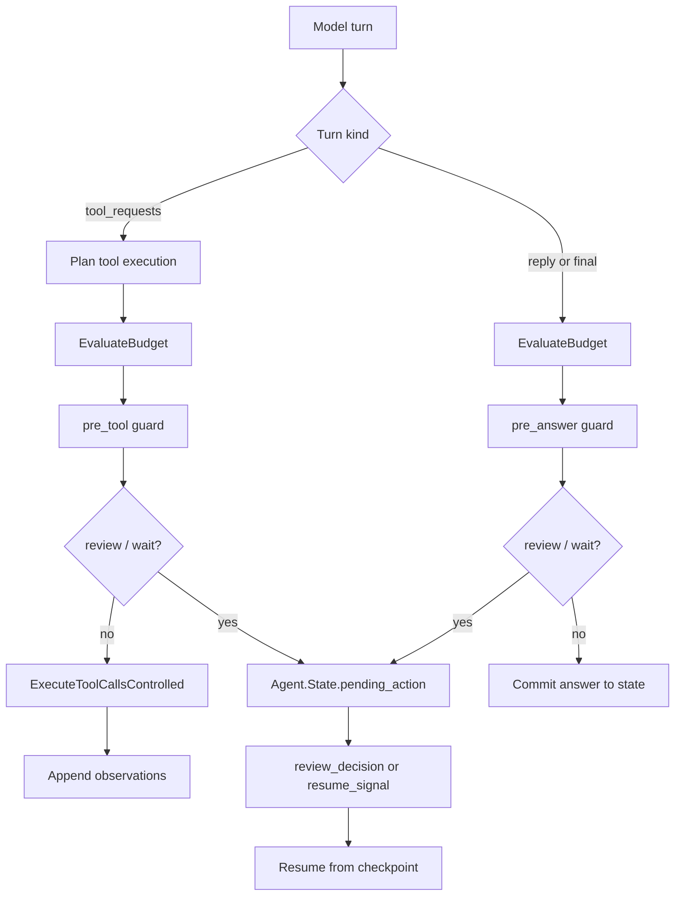

# Controlled Tool Agent

Use `RunicAI.Recipes.GuardedOperatorToolAgent` when a tool-capable agent needs budgets, guard points, reviews, waits, retries, or fallbacks. It keeps the same conversational tool shape, then adds explicit control gates before tool execution and before answer commitment.

This is the recipe for operator-facing workflows: payment actions, account changes, outbound messages, infrastructure operations, privileged retrieval, and anything where "the model requested it" is not enough permission.



## What The Recipe Gives You

- Budget checks around tool and answer lanes.
- Guard callbacks at `:pre_tool` and `:pre_answer`.
- `RunicAI.ReviewRequest` values for human approval or edits.
- `RunicAI.Wait` values for scheduled or external release.
- Retry and fallback policy hooks around LLM generation and tool execution.
- Resume workflows that continue from the pending checkpoint without re-running the whole turn.

## Working Example

This example pauses before executing a tool, then resumes with an approved review decision.

```elixir
alias RunicAI.LLM.Result
alias RunicAI.Message
alias RunicAI.Prompt
alias RunicAI.Recipes.GuardedOperatorToolAgent
alias RunicAI.Tool.Definition

reply = fn text ->
  Result.new!(Message.new!(:assistant, text), finish_reason: :stop)
end

tool_response = fn tool_calls, text ->
  message = ReqLLM.Context.assistant(text, tool_calls: tool_calls)

  %ReqLLM.Response{
    id: "example-response",
    model: "test:model",
    context: ReqLLM.Context.new([message]),
    message: message,
    usage: %{},
    finish_reason: :tool_calls
  }
end

weather_tool =
  Definition.new!(
    name: "get_weather",
    description: "Get weather for a city",
    parameter_schema: [location: [type: :string, required: true]],
    executor: fn %{location: location} ->
      {:ok, %{location: location, forecast: "sunny"}}
    end
  )

client = fn _model, %Prompt{messages: messages}, _opts ->
  if Enum.any?(messages, &(&1.role == :tool)) do
    {:ok, reply.("Paris is sunny.")}
  else
    call =
      ReqLLM.ToolCall.new(
        "call_1",
        "get_weather",
        Jason.encode!(%{location: "Paris"})
      )

    {:ok, tool_response.([call], "Let me check.")}
  end
end

opts = [
  model: "test:model",
  registry: [weather_tool],
  client: client,
  budget_policy: [max_tool_calls: 1, on_exhaustion: :review],
  pre_tool_guard: fn request ->
    if length(request.execution_plan.calls) == 1, do: :review, else: :allow
  end
]

paused =
  GuardedOperatorToolAgent.react_until_resolution(opts, %{
    user: "What's the weather in Paris?"
  })

review = GuardedOperatorToolAgent.latest_review_request(paused)
state = GuardedOperatorToolAgent.latest_state(paused)

resumed =
  GuardedOperatorToolAgent.react_until_resolution(opts, %{
    state: state,
    review_decision: %{resume_key: review.resume_key, status: :approved}
  })

{
  review.checkpoint,
  GuardedOperatorToolAgent.latest_reply_text(resumed),
  GuardedOperatorToolAgent.latest_state(resumed).pending_action
}
#=> {:pre_tool, "Paris is sunny.", nil}
```

## Important Options

| Option | Required | Default | Type | Purpose |
| --- | --- | --- | --- | --- |
| `:model` | yes | none | string or ReqLLM-compatible model value | Model passed to `RunicAI.LLM`. |
| `:registry` | no | `[]` | tool registry input | Available tools. |
| `:client` | no | `RunicAI.LLM.ReqLLMClient` | module or function client | Inject model behavior. |
| `:budget_policy` | no | `nil` | keyword, map, or `RunicAI.Control.BudgetPolicy` | Limits turns, model calls, tool calls, elapsed time, estimated cost, or recursion depth. |
| `:pre_tool_guard` | no | allow | function | Evaluates a `RunicAI.Control.GuardRequest` before executing a tool plan. |
| `:pre_answer_guard` | no | allow | function | Evaluates a guard request before committing an answer. |
| `:pre_tool_guard_policy`, `:pre_answer_guard_policy` | no | `nil` | term | Policy payload passed into guard requests. |
| `:generation_retry_policy`, `:tool_retry_policy` | no | `nil` | keyword, map, or `RunicAI.Control.RetryPolicy` | Retry failed model or tool calls. |
| `:generation_fallback_policy`, `:tool_fallback_policy` | no | `nil` | keyword, map, or `RunicAI.Control.FallbackPolicy` | Provide alternate models, tools, or degraded outputs. |
| `:execution_policy`, `:tool_planner`, `:tool_selector`, `:visible_tools`, `:tool_requirement` | no | tool defaults | tool policy inputs | Same tool controls as `ConversationalToolAgent`. |
| `:max_tool_rounds` | no | `8` | positive integer | Maximum recursive rounds for `react_until_resolution/3`. |
| `:system`, `:state`, `:messages`, `:assigns`, `:history_window`, `:pinned_messages`, `:observations` | no | chat defaults | chat state inputs | Same state and prompt controls as `ChatAgentKernel`. |
| `:final_pattern`, `:final_when`, `:max_turns`, `:stop_pattern`, `:continue_when` | no | `nil` | classifier/control inputs | Same final-result and continuation controls as `ChatAgentKernel`. |
| `:name` | no | `:guarded_operator_tool_agent` | atom | Workflow name. |

## Guard Outcomes

A guard may return plain atoms such as `:allow`, `:review`, or `:wait`, or a `RunicAI.Control.GuardDecision`. Use `GuardDecision.rewrite!/3` to replace a candidate answer or execution plan, `GuardDecision.deny!/2` to halt, and `GuardDecision.wait!/2` when progress should resume later.

## Resume Inputs

- `%{state: paused_state, review_decision: %{resume_key: key, status: :approved}}` approves the original subject.
- `status: :edited` with `:edited_value` commits a replacement answer or plan.
- `status: :rejected` turns the pending action into a halt decision.
- `%{state: paused_state, resume_signal: %{kind: wait.kind, resume_key: wait.resume_key, payload: payload}}` releases a wait.

## Result Helpers

- `latest_review_request/1` and `latest_wait/1` expose pending operator work.
- `latest_execution_plan/1`, `latest_tool_results/1`, and `latest_observations/1` expose the tool lane.
- `latest_continue_decision/1` explains a stop, halt, continue, or control outcome.
