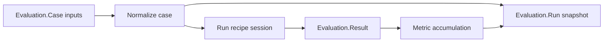

# Evaluation Harness

Use `RunicAI.Recipes.EvaluationHarness` to run recipe behavior against repeatable cases and aggregate the results. It gives you a workflow-native way to exercise agents before release: feed cases through a recipe, capture the resulting session, evaluate expectations, and accumulate metrics.

This is useful for regression suites, prompt changes, tool policy changes, context-window tuning, guard behavior checks, and release qualification.



## What The Recipe Gives You

- `RunicAI.Evaluation.Case` fixtures with expected outcomes.
- Turn-processor or integrated drivers selected from the target recipe.
- Harness policies for reaction limits, stop conditions, capture, sinks, and run context.
- Built-in expectations for text, tools, review, wait, and custom scoring.
- Aggregated metrics for pass/fail counts, LLM calls, tool calls, and overall score.

## Working Example

This example evaluates `ChatAgentKernel` with a deterministic client.

```elixir
alias RunicAI.Evaluation.Case
alias RunicAI.Harness.Policy
alias RunicAI.LLM.Result
alias RunicAI.Message
alias RunicAI.Prompt
alias RunicAI.Recipes.ChatAgentKernel
alias RunicAI.Recipes.EvaluationHarness

reply = fn text ->
  Result.new!(Message.new!(:assistant, text), finish_reason: :stop)
end

client = fn _model, %Prompt{messages: messages}, _opts ->
  last_user =
    messages
    |> Enum.filter(&(&1.role == :user))
    |> List.last()
    |> Map.get(:content, "")

  response =
    if String.contains?(last_user, "hello") do
      "hello there"
    else
      "goodbye now"
    end

  {:ok, reply.(response)}
end

run =
  EvaluationHarness.run(
    [
      Case.new!(
        id: "hello-case",
        input: %{user: "say hello"},
        expected: [{:contains_text, "hello"}]
      ),
      Case.new!(
        id: "goodbye-case",
        input: %{user: "say goodbye"},
        expected: [{:contains_text, "goodbye"}]
      )
    ],
    recipe: ChatAgentKernel,
    recipe_opts: [model: "test:model", client: client],
    policy: Policy.new!(capture_policy: [mode: :summary])
  )

{
  length(run.results),
  run.aggregate.cases_passed,
  run.aggregate.overall_score
}
#=> {2, 2, 1.0}
```

## Important Options

| Option | Required | Default | Type | Purpose |
| --- | --- | --- | --- | --- |
| `:recipe` | yes | none | recipe module | Module evaluated by the harness. |
| `:recipe_opts` | no | `[]` | keyword or `fn case -> keyword end` | Options passed to the recipe per case. |
| `:policy` | no | `RunicAI.Harness.Policy.new!()` | policy input or `fn case -> policy end` | Execution limits, stop behavior, capture, sinks, and run context. |
| `:driver` | no | inferred | `:turn_processor`, `:integrated`, or driver module | Overrides the automatic driver choice. |
| `:metrics` | no | `RunicAI.Evaluation.Metric.defaults()` | list of metrics | Aggregate metric set. |
| `:started_at` | no | `DateTime.utc_now()` | `DateTime` | Timestamp for run snapshots. |
| `:name` | no | `:evaluation_harness` | atom | Workflow name. |

## Case Inputs And Expectations

`Evaluation.Case.new!/1` accepts:

- `:id` for stable reporting.
- `:input`, either one input map or a list of inputs submitted in order.
- `:expected`, a list of expectation inputs.
- optional metadata for your own reporting.

Common expectation tuples:

- `{:contains_text, "needle"}`
- `{:exact_text, "full answer"}`
- `{:tool_called, "get_weather"}`
- `{:tool_not_called, "dangerous_tool"}`
- `{:review_required, true}`
- `{:wait_required, true}`
- `{:custom, fn result -> %{passed?: true, score: 1.0} end}`

## Harness Policy Summary

| Policy option | Default | Purpose |
| --- | --- | --- |
| `:max_reactions` | `16` | Maximum workflow reactions per drain. |
| `:max_turns` | `nil` | Optional turn limit. |
| `:max_wall_time_ms` | `nil` | Optional wall-clock guard. |
| `:stop_on` | `[:review, :wait, :error]` | Signals that stop harness draining. |
| `:capture_policy` | default capture policy | Controls trace payload detail. |
| `:sinks` | `[]` | Trace sinks for telemetry, logging, or memory capture. |
| `:run_context` | `%{}` | Runtime context passed into Runic workflow evaluation. |
| `:async` | `false` | Run compatible workflow work asynchronously. |
| `:metadata` | `%{}` | Policy metadata. |

## Result Helpers

- `run/2` returns a completed `RunicAI.Evaluation.Run`.
- `run_workflow/2` returns the harness workflow after all cases.
- `run_case!/2` runs one case and returns an `Evaluation.Result`.
- `latest_cases/1`, `latest_results/1`, `latest_aggregate_state/1`, `latest_aggregate/2`, and `latest_run/1` inspect a harness workflow.
