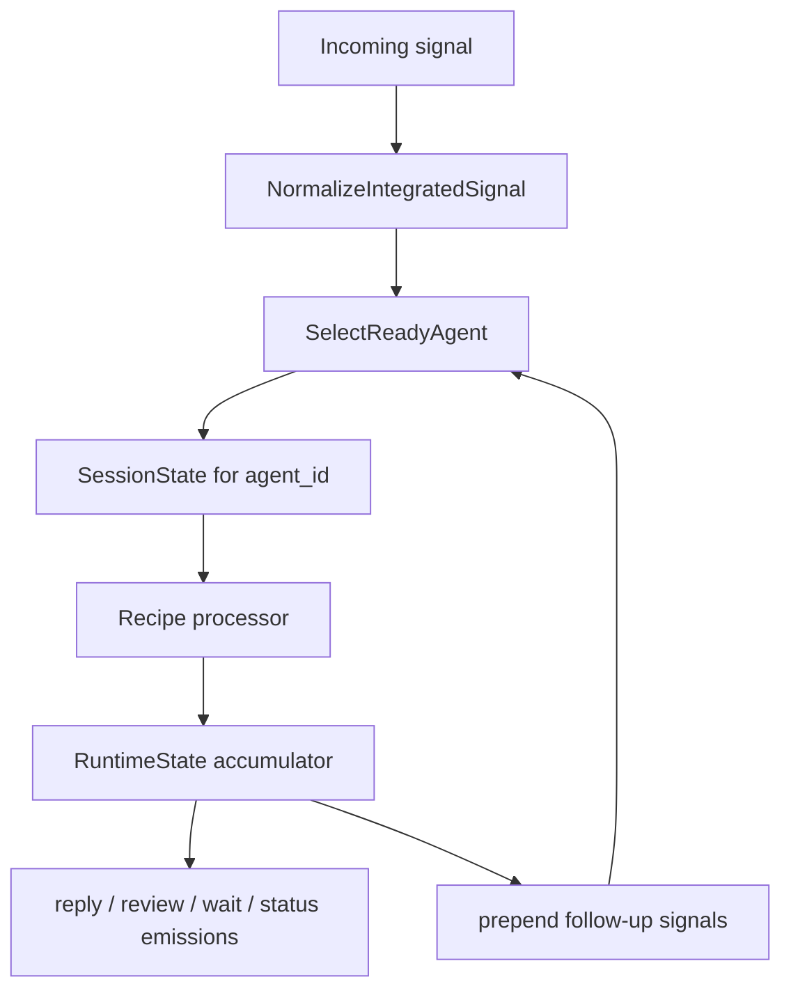

# Integrated Stateful Agent

Use the integrated recipes when the workflow should own agent state instead of asking the caller to pass `Agent.State` back in for every turn. Integrated recipes keep one or many agent lanes inside a shared `RunicAI.Integrated.RuntimeState`, route incoming signals to the right lane, and emit typed outputs for replies, reviews, waits, and status changes.

Use `RunicAI.Recipes.IntegratedChatAgent` for stateful chat lanes. Use `RunicAI.Recipes.IntegratedToolAgent` when those lanes also need scoped tools, budgets, guards, waits, and review resumes.



## What The Recipe Gives You

- Workflow-owned state for one or many named agents.
- Agent isolation inside one workflow: each lane has its own conversation, pending work, and controls.
- Signals for normal turns, review decisions, wakes, and resumes.
- Emissions that can drive a UI, runtime, scheduler, or trace sink.
- The same chat, tool, budget, and guard contracts used by the non-integrated recipes.

## Working Example

This example runs two independent chat lanes through one workflow.

```elixir
alias Runic.Workflow
alias RunicAI.LLM.Result
alias RunicAI.Message
alias RunicAI.Prompt
alias RunicAI.Recipes.IntegratedChatAgent

reply = fn text ->
  Result.new!(Message.new!(:assistant, text), finish_reason: :stop)
end

client = fn _model, %Prompt{messages: messages}, _opts ->
  last_user =
    messages
    |> Enum.filter(&(&1.role == :user))
    |> List.last()
    |> Map.get(:content)

  {:ok, reply.("echo: #{last_user}")}
end

workflow =
  IntegratedChatAgent.new(
    model: "test:model",
    client: client,
    agents: [[id: "alpha"], [id: "beta"]]
  )
  |> Workflow.react_until_satisfied(%{agent_id: "alpha", user: "hello alpha"})
  |> Workflow.react_until_satisfied(%{agent_id: "beta", user: "hello beta"})

alpha = IntegratedChatAgent.session(workflow, "alpha")
beta = IntegratedChatAgent.session(workflow, "beta")

{
  IntegratedChatAgent.latest_reply_text(workflow, "alpha"),
  IntegratedChatAgent.latest_reply_text(workflow, "beta"),
  alpha.agent_state.conversation.turns,
  beta.agent_state.conversation.turns
}
#=> {"echo: hello alpha", "echo: hello beta", 1, 1}
```

## Important Options

### Shared Integrated Options

| Option | Required | Default | Type | Purpose |
| --- | --- | --- | --- | --- |
| `:model` | yes | none | string or ReqLLM-compatible model value | Default model for each lane. |
| `:client` | no | `RunicAI.LLM.ReqLLMClient` | module or function client | Inject model behavior. |
| `:default_agent_id` | no | first profile id or `"agent"` | string or atom | Lane used when input does not include `:agent_id`. |
| `:agents` | no | one default agent | list of keyword profiles | Configure named lanes with per-agent overrides. |
| `:initial_runtime` | no | built from agents | `RunicAI.Integrated.RuntimeState` | Start from an existing integrated runtime. |
| `:role`, `:conversation_id` | no | `nil` | string/term | Metadata attached to each session profile. |
| `:system`, `:messages`, `:assigns`, `:state_metadata` | no | chat defaults | state inputs | Initial state for each lane. |
| `:history_window`, `:pinned_messages`, `:observations`, `:llm_opts`, `:metadata` | no | chat defaults | prompt/request inputs | Per-lane turn defaults. |
| `:final_pattern`, `:final_when`, `:max_turns`, `:stop_pattern`, `:continue_when` | no | `nil` | classifier/control inputs | Final-result and continuation controls. |
| `:name` | no | recipe default | atom | Workflow name. |

Each entry in `:agents` may override the same profile options. This is the usual way to run lanes with different systems, tools, budgets, or visible capabilities.

### IntegratedToolAgent Additions

| Option | Required | Default | Type | Purpose |
| --- | --- | --- | --- | --- |
| `:registry` | no | `[]` | tool registry input | Available tools for a lane. |
| `:tool_selector` / `:selector`, `:visible_tools`, `:tool_requirement`, `:tool_metadata` | no | tool defaults | tool inputs | Same tool-selection controls as `ConversationalToolAgent`. |
| `:execution_policy`, `:tool_planner` | no | defaults | policy/function inputs | Tool planning and execution behavior. |
| `:budget_policy` | no | `nil` | budget policy input | Scoped budget checks per lane. |
| `:pre_tool_guard`, `:pre_answer_guard` | no | allow | functions | Lane-scoped guard callbacks. |
| `:pre_tool_guard_policy`, `:pre_answer_guard_policy` | no | `nil` | term | Guard policy payloads. |
| `:generation_retry_policy`, `:generation_fallback_policy`, `:tool_retry_policy`, `:tool_fallback_policy` | no | `nil` | control policy inputs | Retry and fallback behavior. |

## Signal Inputs

- `%{user: "..."}` submits a user turn to the default lane.
- `%{agent_id: "alpha", user: "..."}` submits a turn to a specific lane.
- `%{review_decision: %{resume_key: key, status: :approved}}` resumes a review checkpoint.
- `%{wake: %{resume_key: key}}` releases scheduled wait work.
- `%{resume_signal: %{resume_key: key, payload: payload}}` releases an external wait with payload.

## Result Helpers

- `runtime_state/1` returns the full integrated runtime.
- `session/2` returns a lane's `RunicAI.Integrated.SessionState`.
- `emissions/1` returns emitted replies, waits, reviews, and status events.
- `latest_turn_result/2`, `latest_reply_text/2`, `latest_review_request/2`, and `latest_wait/2` query recent lane-specific outputs.

## When To Use Integrated State

Use integrated state when a runtime, scheduler, or UI wants to keep a workflow alive and submit signals over time. Use the non-integrated recipes when your caller already owns state persistence and wants each workflow run to be a simple pure turn processor.
