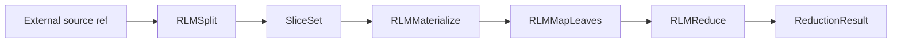

# RLM Summarizer

Use `RunicAI.Recipes.RLMSummarizer` when the input is too large or too awkward to treat as one prompt. The recipe stores long content in an RLM environment, splits it into bounded slices, materializes each slice late, maps leaf artifacts into summaries or facts, and reduces those leaf results into one output.

This is a practical starting point for long-document summarization, source-map preserving extraction, codebase note generation, transcript condensation, and any task where you want the workflow to reason over references instead of copying the whole source into every step.



## What The Recipe Gives You

- Externalized source content through `RunicAI.RLM.EnvironmentRef`.
- Deterministic character chunking in the in-memory environment.
- Late materialization so leaf work receives only bounded artifacts.
- Pluggable `:mapper` and `:reducer` functions.
- A `RunicAI.RLM.ReductionResult` with final output and typed leaf results.

## Working Example

This example uses the in-memory RLM environment and deterministic mapper/reducer functions.

```elixir
alias RunicAI.RLM
alias RunicAI.Recipes.RLMSummarizer

{:ok, environment} = RLM.init_environment()

{:ok, source_ref, environment} =
  RLM.put_source(environment, "alpha beta gamma delta epsilon zeta", id: "doc")

workflow =
  RLMSummarizer.react_until_resolution(
    [
      chunk_size: 12,
      mapper: fn artifact ->
        "summary(" <> String.trim(artifact.content) <> ")"
      end,
      reducer: fn results ->
        Enum.map_join(results, " | ", & &1.output)
      end
    ],
    %{environment: environment, source_ref: source_ref}
  )

RLMSummarizer.latest_output(workflow)
#=> "summary(alpha beta g) | summary(amma delta e) | summary(psilon zeta)"
```

## Important Options

| Option | Required | Default | Type | Purpose |
| --- | --- | --- | --- | --- |
| `:chunk_size` | no | `4_000` | positive integer | Maximum slice size for `RLMSplit`. |
| `:overlap` | no | `0` | non-negative integer smaller than `:chunk_size` | Character overlap between adjacent slices. |
| `:mapper` | no | returns artifact content | unary function | Maps each materialized artifact to a leaf output or `RunicAI.RLM.LeafResult`. |
| `:reducer` | no | joins leaf outputs with blank lines | unary function | Reduces leaf results into the final output. |
| `:name` | no | `:rlm_summarizer` | atom | Workflow name. |

## Input Shape

The workflow input should include:

| Input key | Required | Type | Purpose |
| --- | --- | --- | --- |
| `:environment` | yes | RLM environment | Environment that can materialize the source. |
| `:source_ref` | yes | `RunicAI.RLM.EnvironmentRef` | Reference to the long source. |
| `:split_opts` | no | keyword | Per-run overrides for split options such as `:chunk_size` and `:overlap`. |

## When To Customize

- Replace `:mapper` with an LLM-backed leaf summarizer when each chunk needs model reasoning.
- Replace `:reducer` with a structured reducer when the final output should be JSON-like data, sections, citations, or a merged artifact map.
- Use a custom RLM environment when sources live in files, object storage, databases, or retrieval systems.
- Preserve `artifact.refs` in mapper output when you need source traceability.

## Result Helpers

- `react_until_resolution/3` runs the whole summarizer workflow.
- `latest_result/1` returns the latest `RunicAI.RLM.ReductionResult`.
- `latest_output/1` returns the reduced output directly.
