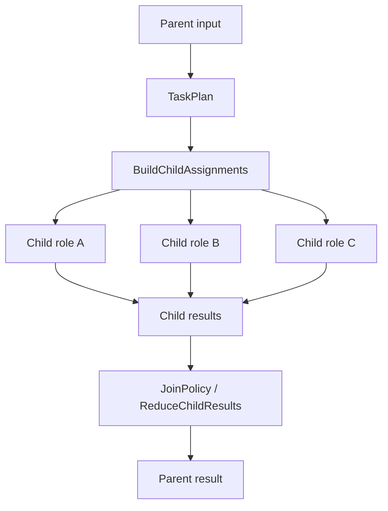

# Subagent Decomposition

Use the decomposition recipes when one model turn is the wrong shape for the work. RunicAI models decomposition as typed parent-child workflow data: a parent plans tasks, creates assignments, executes child roles, and reduces results through an explicit join policy.

This is useful for research fan-out, reviewer/editor workflows, rubric-based judging, parallel extraction, and tasks where each subtask should have its own role, input, budget, tools, or context window.



## Recipe Choices

- `RunicAI.Recipes.PlannerExecutorWorkflow` is the generic plan, assign, execute, reduce kernel.
- `RunicAI.Recipes.ParallelResearchSynthesizer` is a practical fan-out recipe that turns topics into research tasks and synthesizes findings.
- `RunicAI.Recipes.ReviewerEditorJury` generates candidate outputs, judges them, and selects or escalates the result.

## Working Example

This example uses deterministic workflow roles, so no external model calls are needed.

```elixir
alias RunicAI.Decomposition.Role
alias RunicAI.Recipes.ParallelResearchSynthesizer

researcher =
  Role.new!(
    name: "researcher",
    kind: :workflow,
    description: "Gather one topic worth of evidence",
    builder: fn assignment ->
      topic = assignment.input.input[:topic]
      %{topic: topic, notes: "Notes about #{topic}"}
    end,
    defaults: %{}
  )

workflow =
  ParallelResearchSynthesizer.react_until_resolution(
    [registry: [researcher], researcher_role: "researcher"],
    %{topics: ["atoms", "processes"], query: "Elixir runtime primitives"}
  )

result = ParallelResearchSynthesizer.latest_result(workflow)

{
  result.status,
  result.output.topics,
  result.output.synthesis_mode
}
#=> {:completed, ["atoms", "processes"], :deterministic}
```

## Important Options

### PlannerExecutorWorkflow

| Option | Required | Default | Type | Purpose |
| --- | --- | --- | --- | --- |
| `:registry` | usually | `nil` | role registry input | Roles available to child assignments. |
| `:planner` | no | input-driven | function | Build a task plan from parent input. |
| `:tasks` | no | input tasks | list of task inputs | Static child tasks. |
| `:groups` | no | `nil` | list | Optional grouping for planned tasks. |
| `:join_policy` | no | step default | keyword, map, or `RunicAI.Decomposition.JoinPolicy` | How child results are reduced. |
| `:state` | no | `nil` | `RunicAI.Agent.State` | Parent state inherited by child assignments. |
| `:inheritance_policy` | no | default policy | policy input | Controls inherited messages, context, tools, and budgets. |
| `:tool_registry`, `:selection`, `:visible_tools` | no | `nil` | tool inputs | Tool availability inherited by children. |
| `:budget_policy`, `:window_policy` | no | `nil` | policy inputs | Budget and context-window constraints for child work. |
| `:metadata` | no | `%{}` | map | Metadata attached to task planning. |
| `:name` | no | `:planner_executor_workflow` | atom | Workflow name. |

### ParallelResearchSynthesizer

| Option | Required | Default | Type | Purpose |
| --- | --- | --- | --- | --- |
| `:registry` | yes for role execution | `nil` | role registry input | Must include the researcher role and any optional synthesizer role. |
| `:researcher_role` | no | `"researcher"` | role name or role input | Role used for each topic. |
| `:join_policy` | no | deterministic synthesis policy | join policy input | Override synthesis behavior. |
| `:synthesizer_role` | no | `nil` | role name or role input | Run a final child role over completed findings. |
| `:synthesizer_goal`, `:synthesizer_instructions` | no | built-in text | strings | Customize optional synthesis child work. |
| `:synthesizer_inheritance_policy` | no | role/default policy | policy input | Controls what the synthesis role inherits. |
| Planner options | no | inherited | same as above | Passed through to `PlannerExecutorWorkflow`. |

### ReviewerEditorJury

| Option | Required | Default | Type | Purpose |
| --- | --- | --- | --- | --- |
| `:registry` | yes | `nil` | role registry input | Must include candidate and judge roles. |
| `:planner` / `:candidate_planner` | no | input task plan | function | Build candidate tasks. |
| `:tasks`, `:groups`, `:candidate_join_policy` | no | input/defaults | task and policy inputs | Configure candidate generation. |
| `:judge_role` / `:judge_roles` | yes for judging | `[]` | role name or list | Judge roles used for each completed candidate. |
| `:judge_instructions` | no | `nil` | string | Instructions passed to judge tasks. |
| `:judge_join_policy` | no | all-settled ignore partial failure | join policy input | How judge tasks settle. |
| `:evaluation_extractor` | no | default extractor | function | Convert judge outputs into evaluations. |
| `:required_judges` | no | number of judge roles | positive integer | Minimum evaluations needed before a candidate is eligible. |
| `:judge_inheritance_policy`, `:inheritance_policy`, `:tool_registry`, `:budget_policy`, `:window_policy` | no | defaults | policy inputs | Inheritance and resource controls for child work. |

## Extension Points

- Define roles with `RunicAI.Decomposition.Role.new!/1`.
- Use `kind: :workflow` when a role can be represented as a local deterministic function or workflow builder.
- Use `JoinPolicy` to decide whether partial failures halt, are ignored, or are surfaced for review.
- Return `RunicAI.Decomposition.Result.review!/3`, `wait!/3`, or `handoff!/3` from child roles when the parent should not silently collapse uncertainty.

## Result Helpers

- `PlannerExecutorWorkflow.latest_task_plan/1`, `latest_assignments/1`, `latest_child_results/1`, `latest_result/1`, and `latest_output/1`.
- `ParallelResearchSynthesizer` delegates the same helpers and adds deterministic research synthesis behavior.
- `ReviewerEditorJury.latest_candidate_results/1`, `latest_evaluations/1`, and `latest_result/1`.
