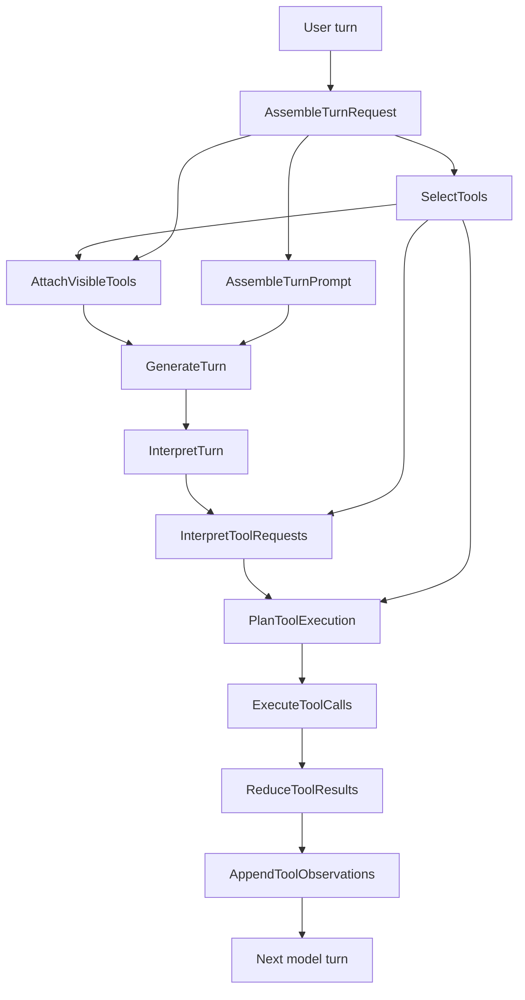

# Tool Agent

Use `RunicAI.Recipes.ConversationalToolAgent` when the model should be able to ask for tools, receive tool observations, and then answer from those observations. The recipe keeps the tool lane explicit: tool selection, provider-visible tool definitions, tool request normalization, planning, execution, result reduction, and observation messages are all normal Runic components.

This is a good fit for weather/status lookups, internal data fetches, calculations, search calls, and other low-risk capabilities where the tool can run automatically.



## What The Recipe Gives You

- Typed tool definitions through `RunicAI.Tool.Definition`.
- A `RunicAI.Tool.Selection` per turn so visible tools are scoped and inspectable.
- Normalized `RunicAI.Tool.CallRequest` and `RunicAI.Tool.ExecutionPlan` values before anything executes.
- Tool observations appended to conversation state as model-readable messages.
- `react_until_resolution/3` for the common "tool call, observe, answer" loop.

## Working Example

The fake client first asks for `get_weather`, then answers after the tool observation appears in the prompt.

```elixir
alias RunicAI.LLM.Result
alias RunicAI.Message
alias RunicAI.Prompt
alias RunicAI.Recipes.ConversationalToolAgent
alias RunicAI.Tool.Definition

reply = fn text ->
  Result.new!(Message.new!(:assistant, text), finish_reason: :stop)
end

tool_response = fn tool_calls, text ->
  message = ReqLLM.Context.assistant(text, tool_calls: tool_calls)

  %ReqLLM.Response{
    id: "example-response",
    model: "test:model",
    context: ReqLLM.Context.new([message]),
    message: message,
    usage: %{},
    finish_reason: :tool_calls
  }
end

weather_tool =
  Definition.new!(
    name: "get_weather",
    description: "Get weather for a city",
    parameter_schema: [location: [type: :string, required: true]],
    executor: fn %{location: location} ->
      {:ok, %{location: location, forecast: "sunny"}}
    end
  )

client = fn _model, %Prompt{messages: messages}, _opts ->
  if Enum.any?(messages, &(&1.role == :tool)) do
    {:ok, reply.("Paris is sunny.")}
  else
    call =
      ReqLLM.ToolCall.new(
        "call_1",
        "get_weather",
        Jason.encode!(%{location: "Paris"})
      )

    {:ok, tool_response.([call], "Let me check.")}
  end
end

workflow =
  ConversationalToolAgent.react_until_resolution(
    [model: "test:model", registry: [weather_tool], client: client],
    %{user: "What's the weather in Paris?"}
  )

state = ConversationalToolAgent.latest_state(workflow)

{
  ConversationalToolAgent.latest_reply_text(workflow),
  Enum.map(state.conversation.messages, & &1.role)
}
#=> {"Paris is sunny.", [:user, :assistant, :tool, :assistant]}
```

## Important Options

| Option | Required | Default | Type | Purpose |
| --- | --- | --- | --- | --- |
| `:model` | yes | none | string or ReqLLM-compatible model value | Model passed to `RunicAI.LLM`. |
| `:registry` | no | `[]` | list, registry input | Available `RunicAI.Tool.Definition` values. |
| `:client` | no | `RunicAI.LLM.ReqLLMClient` | module or function client | Inject model behavior. |
| `:tool_selector` / `:selector` | no | `nil` | function or selector input | Pick visible tools for the current turn. |
| `:visible_tools` | no | all registry tools | list of tool names | Restrict the visible tool set. |
| `:tool_requirement` | no | `:optional` | `:optional`, `:required`, `:per_turn`, or policy input | Controls provider tool-choice semantics. `:required` relaxes after the first tool batch. |
| `:tool_metadata` | no | `%{}` | map | Metadata attached to the tool selection. |
| `:execution_policy` | no | default execution policy | keyword, map, or `RunicAI.Tool.ExecutionPolicy` | Controls serial/parallel/staged execution, timeout, concurrency, and error behavior. |
| `:tool_planner` | no | default planner | function | Customize how normalized tool calls become an execution plan. |
| `:max_tool_rounds` | no | `8` | positive integer | Maximum recursive rounds for `react_until_resolution/3`. |
| `:system`, `:state`, `:messages`, `:assigns`, `:history_window`, `:pinned_messages`, `:observations` | no | chat defaults | chat state inputs | Same state and prompt controls as `ChatAgentKernel`. |
| `:llm_opts`, `:metadata` | no | `[]`, `%{}` | keyword, map | Passed into the turn request. |
| `:final_pattern`, `:final_when`, `:max_turns`, `:stop_pattern`, `:continue_when` | no | `nil` | classifier/control inputs | Same final-result and continuation controls as `ChatAgentKernel`. |
| `:name` | no | `:conversational_tool_agent` | atom | Workflow name. |

## Result Helpers

- `latest_selection/1` returns the visible tool selection.
- `latest_execution_plan/1` returns the normalized plan for the current tool batch.
- `latest_tool_results/1` returns call results for the workflow cycle that executed tools.
- `latest_observations/1` returns model-ready tool observations.
- `latest_state/1`, `latest_turn_result/1`, `latest_continue_decision/1`, and `latest_reply_text/1` mirror the chat recipe helpers.

## Design Notes

Prefer `:tool_requirement` over provider-specific `tool_choice` options. It expresses what the recipe means, then RunicAI translates it at the LLM boundary. Keep automatic tools low risk and deterministic where possible. Move to the controlled recipe when a tool can mutate state, spend money, expose sensitive data, or require operator approval.
