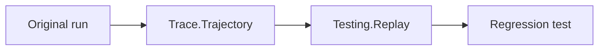

# Testing Strategy

RunicAI is easiest to test when each boundary stays explicit.

## Layers To Test

| Layer | Test style |
| --- | --- |
| Pure contract constructors | Unit tests for valid and invalid inputs. |
| Steps and rules | Call helper functions directly, then run a tiny workflow. |
| Recipes | Use fake clients and scripted tools. |
| Harnesses | Submit inputs and drain until quiescent. |
| Runtime sessions | Use in-memory backend first, runner backend when persistence matters. |
| Evaluation | Convert important scenarios into `RunicAI.Evaluation.Case` fixtures. |

## Fake Model Clients

Every `RunicAI.LLM` call accepts `:client`.

```elixir
client = fn _model, _prompt, _opts ->
  result =
    RunicAI.LLM.Result.new!(
      RunicAI.Message.new!(:assistant, "deterministic reply")
    )

  {:ok, result}
end
```

## Replay

Use trace trajectories when a failure should become a regression fixture.



## Release Expectation

Public examples should be backed by one of:

- doctest
- `test/runic_ai/doc_examples_test.exs`
- Tidewave eval during authoring
- a script under `scripts/`
- a Livebook with deterministic fake clients
