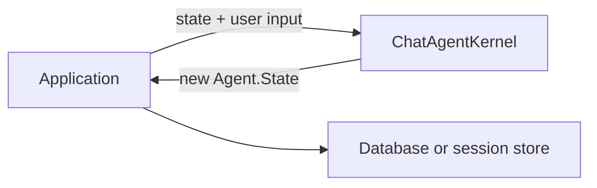
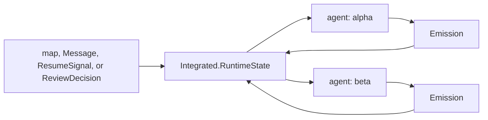
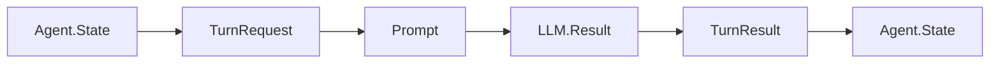
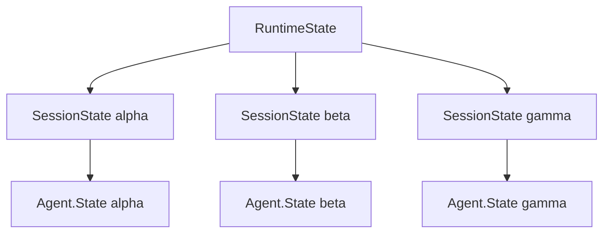

# Stateless Vs Stateful Agents

RunicAI supports two practical ways to run agent workflows:

1. External-state turn processing, where your application passes state into
   each turn and stores the returned state.
2. Integrated stateful agents, where the workflow owns runtime state in an
   accumulator and reduces incoming signals over time.

Both approaches use the same core contracts for messages, prompts, turn
requests, turn results, tools, context, budgets, waits, and review. The
difference is where state lives.

## External-State Turn Processing

Use external state when each run is naturally one turn or one job, and your
application already has a clear persistence boundary.



```elixir
alias Runic.Workflow
alias RunicAI.{Message, Prompt}
alias RunicAI.LLM.Result
alias RunicAI.Recipes.ChatAgentKernel

client = fn _model, %Prompt{messages: messages}, _opts ->
  user_text =
    messages
    |> Enum.filter(&(&1.role == :user))
    |> List.last()
    |> Map.fetch!(:content)

  {:ok, Result.new!(Message.new!(:assistant, "echo: #{user_text}"))}
end

first =
  ChatAgentKernel.new(
    model: "test:model",
    system: "Be brief.",
    client: client
  )
  |> Workflow.react_until_satisfied(%{user: "hello"})

first_state = ChatAgentKernel.latest_state(first)

second =
  ChatAgentKernel.new(model: "test:model", client: client)
  |> Workflow.react_until_satisfied(%{state: first_state, user: "again"})

{
  ChatAgentKernel.latest_reply_text(first),
  ChatAgentKernel.latest_state(second).conversation.turns
}
```

The result is:

```elixir
{"echo: hello", 2}
```

The caller chooses where to store `first_state`. The workflow does not assume a
database, process, queue, or session server.

## Integrated Stateful Agents

Use integrated state when the workflow should own one or more live agent lanes,
handle signals over time, and keep pending waits or review checkpoints indexed.



```elixir
alias Runic.Workflow
alias RunicAI.{Message, Prompt}
alias RunicAI.LLM.Result
alias RunicAI.Recipes.IntegratedChatAgent

client = fn _model, %Prompt{messages: messages}, _opts ->
  user_text =
    messages
    |> Enum.filter(&(&1.role == :user))
    |> List.last()
    |> Map.fetch!(:content)

  {:ok, Result.new!(Message.new!(:assistant, "echo: #{user_text}"))}
end

workflow =
  IntegratedChatAgent.new(
    default_agent_id: "chat",
    model: "test:model",
    client: client
  )
  |> Workflow.react_until_satisfied(%{user: "first"})
  |> Workflow.react_until_satisfied(%{user: "second"})

session = IntegratedChatAgent.session(workflow, "chat")

{
  IntegratedChatAgent.latest_reply_text(workflow, "chat"),
  session.agent_state.conversation.turns
}
```

The result is:

```elixir
{"echo: second", 2}
```

Here the workflow keeps `RunicAI.Integrated.RuntimeState` internally. New inputs
are normalized into `RunicAI.Integrated.Signal` values and reduced into the
runtime state. Outputs are emitted as `RunicAI.Integrated.Emission` values with
an `agent_id`.

## How To Choose

| Choose this | When |
| --- | --- |
| External-state turn processing | You want simple request/response turns, explicit state persistence, and easy integration with an existing web or job boundary. |
| Integrated stateful agents | You want the workflow to own multiple agent lanes, pending work, waits, scheduled wakeups, review resumes, or long-lived session behavior. |

## What Stays The Same

The inner turn still uses the same conceptual path:



The state ownership changes, but the contracts do not. That is why you can
start with `RunicAI.Recipes.ChatAgentKernel` and later move to
`RunicAI.Recipes.IntegratedChatAgent` when your runtime needs become clearer.

## Multi-Agent Lanes

Integrated recipes can isolate more than one agent lane in the same workflow.
Each lane has its own `RunicAI.Integrated.SessionState`, and emissions carry the
agent id that produced them.



This is a good fit for delegated assistants, parallel reviewers, or long-lived
sessions where user messages, tool results, waits, and review decisions may
arrive out of order.

## Options Used Here

| Option | Example | Type | Required | Default | Purpose |
| --- | --- | --- | --- | --- | --- |
| `ChatAgentKernel :state` | `first_state` | `RunicAI.Agent.State` | optional | built from input/defaults | Provides prior external state for the next turn. |
| `ChatAgentKernel :model` | `"test:model"` | string, tuple, or map | required | none | Model used by the turn request. |
| `ChatAgentKernel :client` | `client` | module or function | optional | `RunicAI.LLM.ReqLLMClient` | LLM client used for generation. |
| `IntegratedChatAgent :default_agent_id` | `"chat"` | string or atom | optional | `"agent"` | Agent lane used when an input does not name an agent. |
| `IntegratedChatAgent :agents` | `[[id: "alpha"], [id: "beta"]]` | list of keyword profiles | optional | one default profile | Initial integrated agent lanes. |
| `IntegratedChatAgent :initial_runtime` | `runtime_state` | `RunicAI.Integrated.RuntimeState` | optional | built from profiles | Existing workflow-owned runtime state. |

