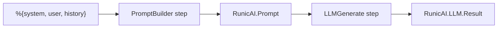
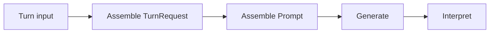
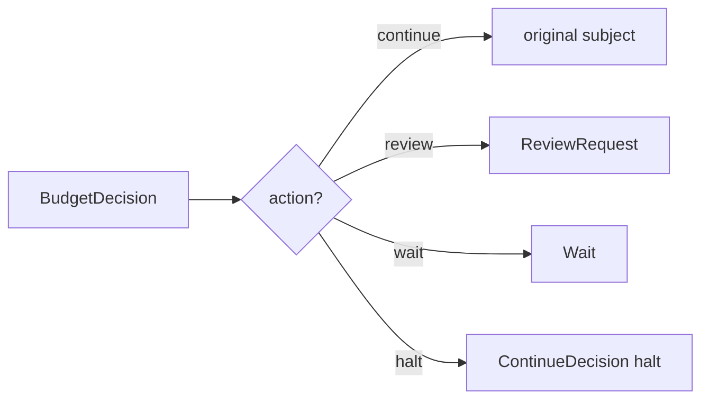
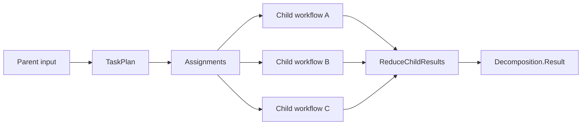
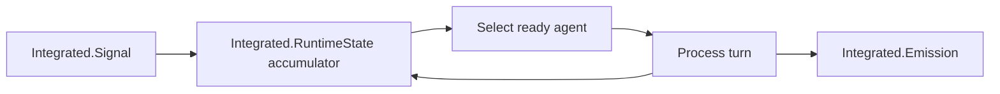

# Workflows As Composition

RunicAI works best when you treat agent behavior as a graph of small,
named transformations. Instead of asking "which agent loop should I use?",
ask "which values should move through the workflow, and which component owns
each transformation?"

## From One Step To A Pipeline

Start with one useful boundary, then compose more boundaries around it.



```elixir
require Runic

alias Runic.Workflow
alias RunicAI.{Message, Prompt}
alias RunicAI.LLM.Result

fake_client = fn _model, %Prompt{messages: messages}, _opts ->
  user_text =
    messages
    |> Enum.filter(&(&1.role == :user))
    |> List.last()
    |> Map.fetch!(:content)

  {:ok, Result.new!(Message.new!(:assistant, "Plan: #{user_text}"))}
end

workflow =
  Runic.workflow(
    name: :prompt_then_generate,
    steps: [
      {RunicAI.Steps.PromptBuilder.new(name: :build_prompt),
       [
         RunicAI.Steps.LLMGenerate.new(
           name: :call_llm,
           model: "test:model",
           client: fake_client
         )
       ]}
    ]
  )

workflow =
  Workflow.react_until_satisfied(workflow, %{
    system: "You produce concise change plans.",
    user: "Add tracing to tool calls."
  })

[{:ok, result}] = Workflow.raw_productions(workflow, :call_llm)
Result.text(result)
```

The result is:

```elixir
"Plan: Add tracing to tool calls."
```

That example has two RunicAI steps, but the shape scales. You can add
selection, guards, tool execution, context assembly, review pauses, or
subagent execution as additional graph nodes.

## Why This Matters

Workflows let complexity grow by adding explicit edges instead of adding hidden
branches inside one function.

| Hidden loop concern | Workflow-shaped concern |
| --- | --- |
| "The prompt builder also decides what tools are allowed." | Prompt building and tool selection are separate steps. |
| "The model might call tools, or maybe answer directly." | Interpretation emits `RunicAI.Agent.TurnResult` with `:reply`, `:final`, `:tool_requests`, `:wait`, or `:error`. |
| "The loop stops somewhere in the recursive code." | A rule emits `RunicAI.Agent.ContinueDecision`. |
| "Context was truncated by a helper." | Context pressure, compaction, and bundle assembly are separate contracts. |
| "A child agent was called from inside the parent." | Child assignments and child results are workflow values. |

## Common Composition Shapes

### Linear Pipeline

Use a linear pipeline when each step naturally transforms the previous value.



`RunicAI.Recipes.ChatAgentKernel` is the canonical chat version of this shape.

### Branching Control

Use rules when one value can route to different outcomes.



`RunicAI.Rules.BudgetGate` uses this shape.

### Fan-Out And Fan-In

Use fan-out when a parent task can be decomposed into independent child work,
then fan the results back into a join.



`RunicAI.Recipes.PlannerExecutorWorkflow` uses this shape for delegated work.
The child executors can be simple functions, workflows, or recipe-backed agent
lanes.

### Workflow-Owned State

Use an accumulator when the workflow itself should own long-lived state.



`RunicAI.Recipes.IntegratedChatAgent` and
`RunicAI.Recipes.IntegratedToolAgent` use this shape.

## Choosing Component Boundaries

Good component boundaries usually satisfy at least one of these:

1. The value should be tested independently.
2. The value should be traced, redacted, persisted, or replayed.
3. The value may be replaced by another implementation later.
4. The value is a policy decision, not just data formatting.
5. The value crosses a trust boundary, such as tools, authorization, review, or
   external workers.

If a piece of logic is just local formatting, keep it local. If it explains the
agent's behavior or affects safety, make it a named component and a typed value.

## Options Used Here

| Option | Example | Type | Required | Default | Purpose |
| --- | --- | --- | --- | --- | --- |
| `PromptBuilder :name` | `:build_prompt` | atom | optional | `:prompt_builder` | Names the prompt-building step. |
| `LLMGenerate :model` | `"test:model"` | string, tuple, or map | required unless input has a model | none | Default model used when the input is a prompt or string. |
| `LLMGenerate :client` | `fake_client` | module or function | optional | `RunicAI.LLM.ReqLLMClient` | Client used by the generated request. |
